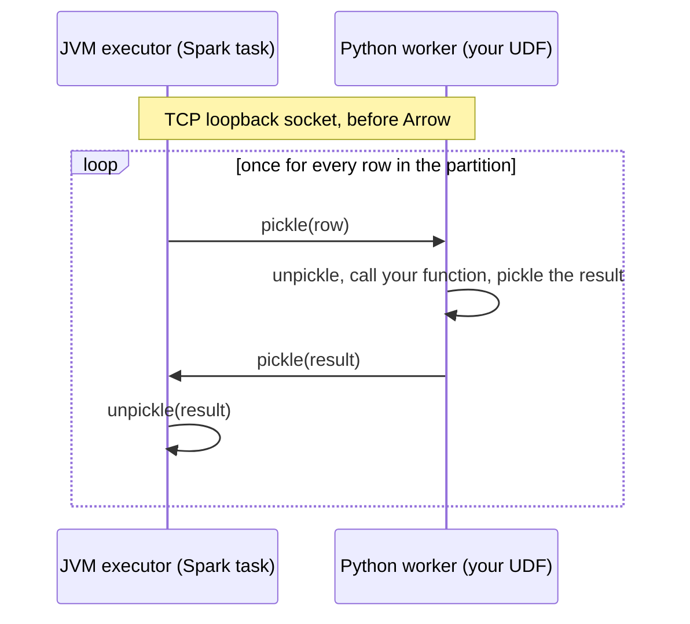
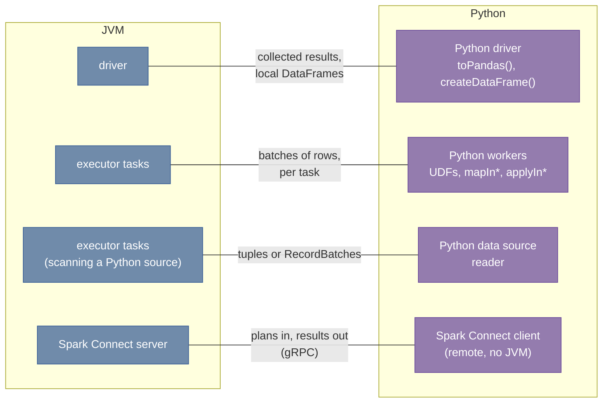
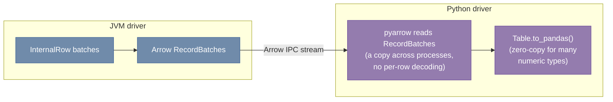
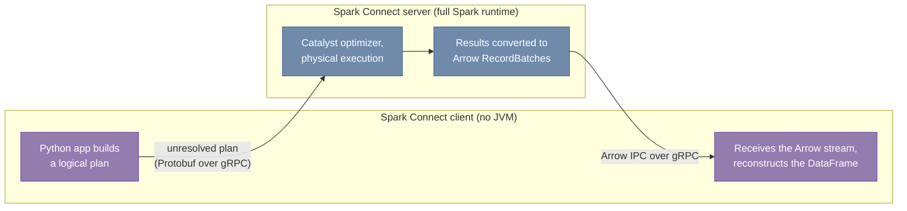
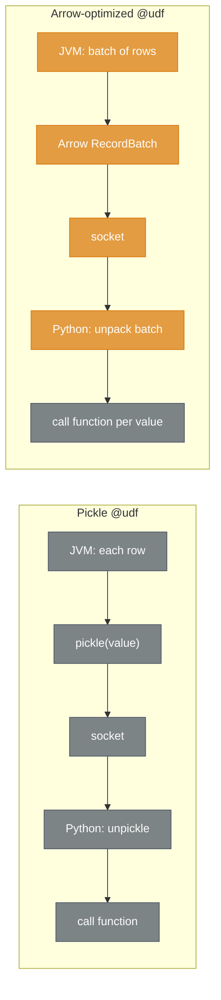
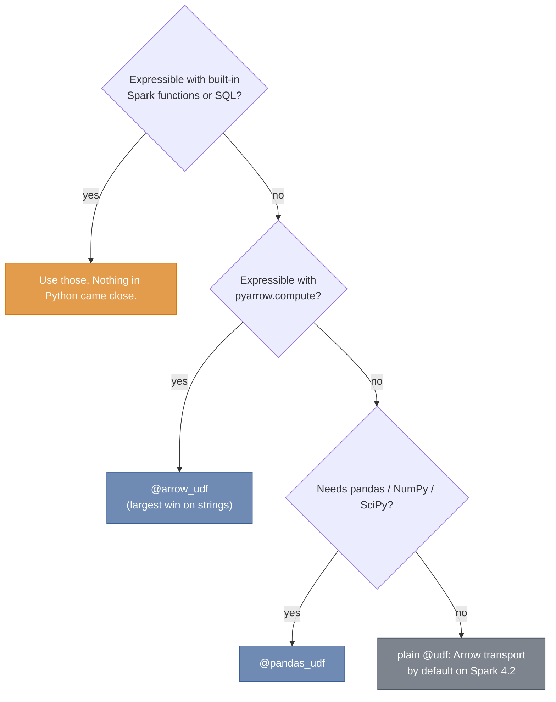
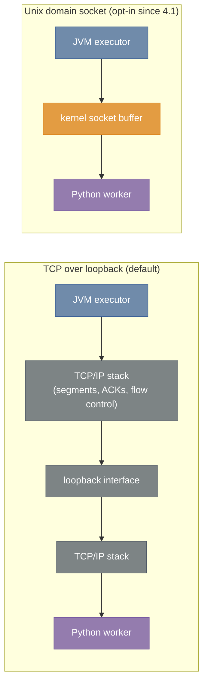
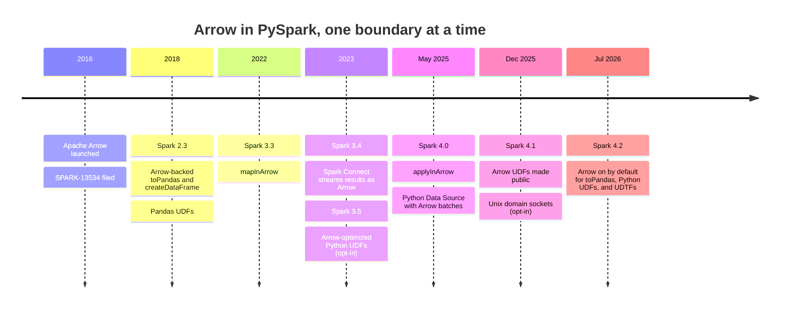
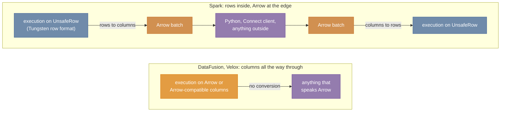

*Originally published on [systems/null](https://systemsnull.net/posts/data-engineering-ai/arrow-and-spark).*

**Arrow's real contribution to PySpark isn't speed at any one API but a shared memory format at every boundary between the JVM and Python; each release removed one conversion at one boundary, what each one left behind explains the next, and the conversion that remains now lives inside Spark's own engine rather than at the Python edge.** 

That crossing is the oldest problem in PySpark, and the most persistent attempt to fix it started in February 2016, when Wes McKinney (the creator of pandas) filed a Spark ticket with a modest title: [SPARK-13534](https://issues.apache.org/jira/browse/SPARK-13534), "Implement Apache Arrow serializer for Spark DataFrame for use in DataFrame.toPandas." It asked for one method to stop using pickle.

It took two years to ship. And over the decade that followed, the same idea went through every other door between Spark's JVM and Python: UDFs, partition-level APIs, the network protocol of Spark Connect, custom data sources, until in Spark 4.1 a Python function could receive Spark's data as an Arrow array and never touch pandas at all, and in Spark 4.2 the Arrow paths [finally became the defaults](https://spark.apache.org/docs/latest/api/python/tutorial/sql/arrow_pandas.html).

---

## The wall

PySpark is not a Python reimplementation of Spark. It's a Python client for a JVM engine. When you write `df.filter(col("x") > 5).groupBy("y").count()`, Python builds a query plan and hands it to the JVM, which optimizes, distributes, and executes it; **Python never touches the data**, which is why DataFrame code runs at the same speed in PySpark and Scala.

The trouble starts the moment your own code needs the data: a UDF, `toPandas()`, `createDataFrame(pandas_df)`, a custom data source. Then data has to physically cross from the JVM into a Python process, and for most of Spark's history the only way across was pickle, one row at a time:



Every row pays four serialization steps and a function call. For a UDF like `return x * 1.1`, the arithmetic is nanoseconds and the machinery around it is microseconds, **three orders of magnitude of overhead wrapped around almost no work.**

That was PySpark from 2015 to 2018, and the same crossing existed at every door between the two runtimes, on both the driver and the executors:



## Why the fix was a memory format, not a faster pickle

Arrow was conceived in late 2015 by people who had hit the same wall from different directions. McKinney had spent years fighting pandas' memory model; his 2017 essay [*"Apache Arrow and the 10 Things I Hate About pandas"*](https://wesmckinney.com/blog/apache-arrow-pandas-internals/) lists the grievances, including a rule of thumb that pandas users needed "5 to 10 times as much RAM as the size of your dataset."

Jacques Nadeau, building a query engine at Dremio, saw every data system inventing its own internal format and paying to translate between them at every boundary. Marcel Kornacker, who created Impala at Cloudera, saw the same copying across the Hadoop ecosystem. [They met at Strata NYC](https://www.dremio.com/blog/origin-and-history-of-apache-arrow/) in September 2015, and Arrow was announced as an Apache top-level project in February 2016, skipping the incubator entirely, which is unusual and reflected how many companies wanted the same thing.

The idea was not a faster serializer. **It was to agree on the bytes themselves:** [a language-independent, columnar, in-memory layout](https://arrow.apache.org/docs/format/Columnar.html) specified down to byte alignment, null bitmaps, and buffer order, so that two Arrow-aware systems can hand each other data without converting it.

Within a process, or with shared memory, that's genuinely *zero-copy*; across a socket it's still a copy, but with no per-row decoding on either side, because the bytes on the wire are already the bytes in memory.

Columnar mattered as much as standard. In a row layout, values from one column are interleaved with everything else in the row:

```
row layout:     [id=1, name="Alice", age=30] [id=2, name="Bob", age=25] [id=3, name="Carol", age=35]
columnar:       id:   [1, 2, 3]
                name: ["Alice", "Bob", "Carol"]
                age:  [30, 25, 35]
```

With columns stored contiguously, a 64-byte cache line holds eight useful `int64` values instead of one row's mixed fields, and SIMD instructions can process a run of values at once.

The database literature had already shown what this buys: the [MonetDB/X100 work](https://www.cidrdb.org/cidr2005/papers/P19.pdf) (CIDR 2005) argued that pushing batches of around a thousand column values through each operator, instead of one row at a time, is an order of magnitude or two faster. Arrow's batch-oriented design was built around exactly that model.

---

## Boundary one: the driver (2018)

The first door was the smallest. `DataFrame.toPandas()` collected results to the driver by pickling every row and rebuilding each one as Python objects before pandas could wrap them, and it was notoriously slow. [McKinney's ticket](https://issues.apache.org/jira/browse/SPARK-13534), filed on February 28, 2016, three weeks after the first commit to the Arrow repository, asked to replace that path. It stayed open for over a year. Bryan Cutler, at IBM's Spark Technology Center, resolved it on June 23, 2017, and it reached users in Spark 2.3.0 in February 2018.

Two years, for one method.



```python
# Spark 2.3 name, later renamed; on by default since Spark 4.2
spark.conf.set("spark.sql.execution.arrow.pyspark.enabled", "true")
```

The reverse direction, `createDataFrame(pandas_df)`, got the same treatment ([SPARK-20791](https://issues.apache.org/jira/browse/SPARK-20791)). What made this matter wasn't the one method; it was [the plumbing Cutler built](https://arrow.apache.org/blog/2017/07/26/spark-arrow/) to do it (Arrow converters on the JVM side, pyarrow integration on the Python side), **which every later boundary reused**.

**What it removed:** pickle for collecting data to the driver. **What it left:** everything that happens on executors. UDFs still crossed row by row.

## Boundary two: UDFs, in batches (2018)

The second door was the one that mattered for performance, and it came from outside Databricks. The proposal, [SPARK-21190](https://issues.apache.org/jira/browse/SPARK-21190) ("SPIP: Vectorized UDFs in Python"), was filed by Reynold Xin, but most of the implementation was done by Li Jin, an engineer at the quantitative investment firm Two Sigma and an Arrow committer, on top of Cutler's serializer. It shipped in the same Spark 2.3.0 release. Instead of calling your function once per row, Spark would send a batch of rows (10,000 by default, `spark.sql.execution.arrow.maxRecordsPerBatch`) as an Arrow RecordBatch and call your function once per batch, with a pandas Series:

```python
# Before: once per row, pickle both ways
@udf(returnType="double")
def add_tax(price):
    return price * 1.1 if price else None

# After: once per batch, a pandas Series in and out
@pandas_udf("double")
def add_tax(price: pd.Series) -> pd.Series:
    return price * 1.1
```

[Li Jin's post introducing the feature](https://www.databricks.com/blog/2017/10/30/introducing-vectorized-udfs-for-pyspark.html) in October 2017 reported speedups from around 3x on simple arithmetic to around 100x on a cumulative-probability function, and the spread is the point: **the simpler the function, the more of its cost was the crossing**, and the more complex the function, the more it also benefits from running as vectorized NumPy instead of Python bytecode.

My own measurements, eight years and many releases later, land in the same shape. At 50 million rows, a pandas UDF did the arithmetic workload in 0.79 seconds against 5.20 for a pickled UDF, and a normal CDF in 0.82 against 6.18; on a string transform the gap was narrower, 2.51 against 6.22, for a reason that turns out to matter later.

**What it removed:** per-row serialization and per-row function calls. **What it left:** a rewrite (your function had to speak pandas), and a conversion. Every batch arrived as Arrow and was turned into pandas before your code saw it, and the result was turned back:

```mermaid
flowchart LR
  classDef jvm fill:#3a5f96,fill-opacity:0.72,stroke:#3a5f96,color:#ffffff
  classDef py fill:#6b4a9b,fill-opacity:0.72,stroke:#6b4a9b,color:#ffffff
  classDef conv fill:#c0661a,fill-opacity:0.72,stroke:#c0661a,color:#ffffff
  A["JVM: batch of<br/>10,000 rows"]:::jvm -->|"Arrow IPC"| B["pyarrow<br/>RecordBatch"]:::py
  B -->|"Arrow to pandas,<br/>per batch"| C["pandas.Series"]:::conv
  C --> D["your function,<br/>once per batch"]:::py
  D --> E["pandas.Series"]:::conv
  E -->|"pandas to Arrow,<br/>per batch"| F["pyarrow<br/>RecordBatch"]:::py
  F -->|"Arrow IPC"| G["JVM: rows"]:::jvm
```



## What actually crosses the socket

Every boundary from here on sends the same thing over the socket: [Arrow's IPC stream format](https://arrow.apache.org/docs/python/ipc.html), a schema message followed by record-batch messages, each framed like this:

```
┌─────────────────────────────────────────────────────────────┐
│ Continuation indicator: 0xFFFFFFFF (4 bytes)                │
│ Metadata length (4 bytes, little-endian int32)              │
│ Flatbuffer metadata (Message type, schema or batch header)  │
│ Padding to 8-byte boundary                                  │
│ Message body (data buffers, padded to 8-byte multiple)      │
└─────────────────────────────────────────────────────────────┘
```

Inside the body, each column is a set of plain buffers: a validity bitmap with one bit per value, the values themselves as a contiguous typed array, and, for variable-length types like strings, an offsets array into one contiguous UTF-8 buffer. For four rows of `(name: string, age: int32)`:

```
Validity bitmap (age):  [1, 1, 0, 1]      → 0b1011 (bit-packed)
Data buffer (age):      [30, 25, 0, 35]   → 16 bytes (4 × int32)
Offsets (name):         [0, 5, 8, 13, 18] → 5 × int32
Data buffer (name):     "AliceBobCarolDavid" (contiguous UTF-8)
```

No per-value type tags, no escaping, no framing between values.

Strings are where Arrow and pandas differ most: **in Arrow, a million strings are one buffer and an array of offsets**, while in traditional pandas they're a million separate Python objects.

---

## Boundary three: letting code see Arrow (2022 to 2025)

For four years, every batch API in PySpark handed you pandas, whether you wanted pandas or not.

The first API that let user code see Arrow directly was `mapInArrow`, added by Hyukjin Kwon, a long-time PySpark maintainer at Databricks ([SPARK-37227](https://issues.apache.org/jira/browse/SPARK-37227), with the Python side in [SPARK-37228](https://issues.apache.org/jira/browse/SPARK-37228)), in Spark 3.3.0 in June 2022. It passes whole partitions as an iterator of `pyarrow.RecordBatch` objects, and your function yields RecordBatches back:

```python
import pyarrow as pa
import pyarrow.compute as pc

def add_tax_arrow(batches):
    for batch in batches:
        taxed = pc.multiply(batch.column("price"), pa.scalar(1.1))
        yield pa.RecordBatch.from_arrays([batch.column("id"), taxed],
                                         names=["id", "price_with_tax"])

df.mapInArrow(add_tax_arrow, schema="id long, price_with_tax double")
```

Grouped operations were the obvious remaining gap, and Enrico Minack closed it with `applyInArrow` ([SPARK-40559](https://issues.apache.org/jira/browse/SPARK-40559)), which shipped in Spark 4.0.0 in May 2025. Where `applyInPandas` turns each group into a pandas DataFrame, `applyInArrow` hands you the group as a `pyarrow.Table`:

```python
def normalize(table: pa.Table) -> pa.Table:
    totals = table.column("total")
    mean, std = pc.mean(totals).as_py(), pc.stddev(totals).as_py()
    normalized = (pa.array([0.0] * len(totals)) if not std
                  else pc.divide(pc.subtract(totals, pa.scalar(mean)), pa.scalar(std)))
    return pa.Table.from_arrays([table.column("order_id"), totals, normalized],
                                names=["order_id", "total", "normalized"])

orders.groupBy("location_id").applyInArrow(
    normalize, schema="order_id long, total double, normalized double")
```

The same idea reached the other direction in 4.0 too: the new Python Data Source API ([SPARK-44076](https://issues.apache.org/jira/browse/SPARK-44076)) lets a custom source written in Python yield `pyarrow.RecordBatch` objects instead of tuples ([SPARK-48493](https://issues.apache.org/jira/browse/SPARK-48493)), so data read by Python code can enter Spark as Arrow instead of being built up one Python tuple at a time.

I haven't benchmarked the grouped or data-source paths myself, so there are no numbers for them here; the mechanism is the same as everywhere else, and the benefit should be largest where the pandas conversion is most expensive, which is strings.

**What it removed:** the forced detour through pandas, for anyone willing to write Arrow code. **What it left:** that condition. Most PySpark code is plain `@udf` functions that nobody is going to rewrite.

## Boundary four: the network (2023)

Spark Connect started as a proposal from Martin Grund at Databricks in June 2022 ([SPARK-39375](https://issues.apache.org/jira/browse/SPARK-39375)): separate the client from the server, so an application talks to Spark over gRPC instead of living inside the driver's JVM. Once there's a network between you and the engine, **the format results travel in stops being an optimization and becomes the protocol**.

The answer was Arrow.



The client sends unresolved logical plans as Protocol Buffers; the server optimizes and runs them and streams the results back as Arrow record batches over the same channel. That's what makes a JVM-free Python client possible at all: the `pyspark-client` package is a 1.6 MB wheel of pure Python. The same columnar format that moves data between executors and Python workers now moves data between a remote cluster and a laptop.

## Boundary five: the UDFs nobody rewrote (2023 to 2026)

Every boundary so far helped people who changed their code. Arrow-optimized Python UDFs ([SPARK-40307](https://issues.apache.org/jira/browse/SPARK-40307), Spark 3.5.0, September 2023) took the opposite approach: keep your plain `@udf` exactly as written, and swap the transport underneath it. Batches cross as Arrow; Python unpacks each batch and still calls your function once per value.



[Xinrong Meng's 2023 Databricks post](https://www.databricks.com/blog/arrow-optimized-python-udfs-apache-sparktm-35) measured about 1.6x over pickle for a single UDF and 1.9x for three chained ones on a 32 GB dataset, and my benchmark agrees in spirit: `useArrow=True` took the arithmetic workload from 5.20 to 2.23 seconds and the CDF from 6.18 to 2.94. Real, and cheap to get, but nothing like the pandas UDF numbers, because the per-row function call is still there.

That call is my benchmark's ceiling.

Turning this on by default took two tries. It was merged for Spark 4.0 ([SPARK-48516](https://issues.apache.org/jira/browse/SPARK-48516)) and reverted in March 2025 before the release; it finally shipped as the default in Spark 4.2, along with Arrow for `toPandas()` and for Python UDTFs, and [a minimum PyArrow of 18.0](https://github.com/apache/spark/blob/branch-4.3/python/docs/source/migration_guide/pyspark_upgrade.rst). On 4.2, then, every existing `@udf` gets Arrow transport without anyone touching it.

It's also where I made the mistake that best illustrates how confusing this boundary is. My benchmark's "Arrow" variant of the plain UDF flipped `spark.sql.execution.arrow.pyspark.enabled`, which governs `toPandas()` and `createDataFrame()` and has nothing to do with UDFs. The setting that actually moves a UDF onto Arrow is `spark.sql.execution.pythonUDF.arrow.enabled`, or `useArrow=True` on the decorator. So my "Arrow" row was the pickled UDF measured twice, and its near-identical result was an accidental A/A test.

**Three settings are named for Arrow, and they control three different boundaries.**

**What it removed:** pickle, for everyone, with no code changes. **What it left:** the function call per row, which is the part no transport format can fix.

## Boundary six: Arrow as the execution format (2025)

The last step turned Arrow from the way data travels into the way your code computes. Ruifeng Zheng's [SPARK-53014](https://issues.apache.org/jira/browse/SPARK-53014), "Make Arrow UDF public," shipped in Spark 4.1.0 on December 16, 2025, almost ten years after McKinney's ticket. An Arrow UDF receives `pyarrow.Array` values and returns one, and it's meant to be written with `pyarrow.compute`, whose functions are [C++ kernels operating directly on Arrow buffers](https://arrow.apache.org/docs/python/compute.html):

```python
import pyarrow as pa
import pyarrow.compute as pc
from pyspark.sql.functions import arrow_udf

@arrow_udf("double")
def add_tax(price: pa.Array) -> pa.Array:
    return pc.multiply(price, pa.scalar(1.1))

@arrow_udf("string")
def clean_email(email: pa.Array) -> pa.Array:
    return pc.utf8_trim(pc.utf8_lower(email))
```

The four UDF types differ only in where the data changes format:

| UDF type | Data path | Format conversions |
|---|---|---|
| Pickle `@udf` | JVM → pickle → Python value → pickle → JVM | pickle both ways, per row |
| Arrow-optimized `@udf` | JVM → Arrow → Python value → Arrow → JVM | Arrow ↔ Python objects, per row |
| `@pandas_udf` | JVM → Arrow → pandas → Arrow → JVM | Arrow ↔ pandas, per batch |
| `@arrow_udf` | JVM → Arrow → your function → Arrow → JVM | none on the Python side |

In my benchmark, `@arrow_udf` was the fastest Python option everywhere, but **the margin over pandas UDFs depended almost entirely on the data type**. On arithmetic and the CDF it was only 5 to 9% faster; on the string transform it was 1.6x faster at both 50M and 100M rows (1.55 seconds against 2.51 at 50M).

The split comes down to strings. A numeric pandas Series is a NumPy array underneath, so converting from Arrow is cheap; a string column in traditional pandas is an array of Python objects, so converting means building millions of them. `pyarrow.compute` skips all of that and works on the one contiguous buffer.

**What it removed:** the last conversion on the Python side. **What it left:** Spark's side.

Taken together, the choice today comes down to what your function can receive:



## The pipe itself

Everything above changes what goes through the socket. Hyukjin Kwon's [SPARK-51688](https://issues.apache.org/jira/browse/SPARK-51688), shipped in Spark 4.1.0, changes the socket: instead of TCP over loopback, which runs every byte through the full TCP/IP stack even though it never leaves the machine, the JVM and Python workers can talk over a *Unix domain socket*, which goes straight through a kernel buffer.

It's opt-in (`spark.python.unix.domain.socket.enabled`, whose default comes from the `PYSPARK_UDS_MODE` environment variable) in 4.1 and 4.2, and that's unchanged on the 4.3 branch, which instead adds another transport option: [pipelined, asynchronous transfer of UDF batches](https://issues.apache.org/jira/browse/SPARK-56642) between the JVM and Python (`spark.python.udf.pipelined.enabled`, off by default).



```
Spark 1.x:  pickle format  + TCP loopback        slow format over a slow pipe
Spark 2.3:  Arrow format   + TCP loopback        fast format over a slow pipe
Spark 4.1:  Arrow format   + Unix domain socket  fast format over a faster pipe (opt-in)
```

---

## One boundary at a time



As of Spark 4.2, Arrow is the format at every place data crosses between the JVM and Python:

| Boundary | Arrow's role | Default |
|---|---|---|
| `toPandas()` / `createDataFrame()` | replaces pickle for driver data collection | yes, since 4.2 |
| `@udf` (plain Python UDFs) | replaces pickle transport | yes, since 4.2 |
| `@pandas_udf`, `mapInPandas`, `applyInPandas` | batch transport, converted to pandas | always |
| `@arrow_udf`, `mapInArrow`, `applyInArrow` | transport and execution format | always |
| Spark Connect results | the result protocol | always |
| Python Data Source API | source data format | when the source yields RecordBatches |

## The last boundary

What's left is on Spark's side of the wall. Inside the JVM, Spark still executes on its own row format (UnsafeRow, from the Tungsten project), and Arrow exists at the edges, so **every crossing still begins and ends with a conversion** between Spark's rows and Arrow's columns. Engines like Velox and DataFusion show that a query engine can execute on Arrow-format data directly; Spark doesn't, and closing that gap is a much bigger change than any of the boundaries above.



The 4.3 branch, which hasn't been released yet (its first release candidate [failed its vote on September 6](https://lists.apache.org/thread/6bhgq2w84zrv3sl4wr2zl8p23fvbsfrg), and a second, [put to a vote on October 13](https://lists.apache.org/thread/y7h0v7km0814xb5fg57ght5wtfptn9lt), drew -1 votes over critical fixes that still need backporting, so there's no date), has two small signs of movement at exactly this edge. One is an Arrow format for Spark's in-memory cache (`ArrowCachedBatchSerializer`, [SPARK-57268](https://issues.apache.org/jira/browse/SPARK-57268)), part of a proposal to make Spark better on a single machine: the first time Arrow shows up as a storage format inside Spark itself rather than at a door.

The other goes around the boundary instead of through it: experimental transpilation of Python UDFs into Spark expressions (SPIP [SPARK-54783](https://issues.apache.org/jira/browse/SPARK-54783)), so a simple enough Python function never has to cross into Python at all. It's off by default, classic-mode only, and requires ANSI mode, but it's the one approach that could get under my benchmark's ceiling, because **it removes the per-row Python call rather than making the trip to it cheaper**.

The pandas side is moving too, more slowly than you'd expect. [pandas 3.0, released in January 2026](https://pandas.pydata.org/docs/whatsnew/v3.0.0.html), made a PyArrow-backed string type the default, which should shrink exactly the string-conversion cost that separates pandas UDFs from Arrow UDFs. But PySpark doesn't support pandas 3 yet, not even on the 4.3 branch: it still pins pandas below 3.0, and the umbrella ticket for supporting it ([SPARK-55139](https://issues.apache.org/jira/browse/SPARK-55139)) is open.

When Wes McKinney filed SPARK-13534 in 2016, he was asking for one method to stop pickling. Ten years later, every door he could have named uses Arrow, the defaults finally say so, and the conversion that remains is the one Spark performs on itself, between its own rows and everything outside it.

That's the last boundary, and **it was never a Python problem.**
