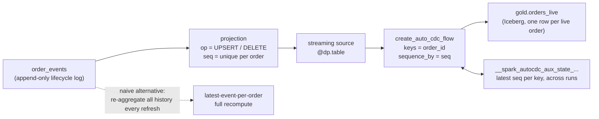

*Originally published on [systems/null](https://systemsnull.net/posts/data-engineering-ai/auto-cdc-declarative-pipelines).*

## The question an event log can't answer cheaply

The dataset I use for most of my pipeline demos is a simulated ghost kitchen (a delivery-only restaurant operation), and like most operational data it arrives as an append-only log. Every order produces a lifecycle of events, each stamped with a time and a per-order sequence number, and a day of it is about a million events. The generator deliberately injects a few percent of late and duplicated events, because real streams do that.

Logs like this are excellent at answering what happened and awkward at answering what operations people actually ask: which orders are live right now, and where is each one?

The usual answer is to recompute it. Group the whole history by order, take the latest event for each, drop the cancelled ones, and repeat on every refresh, paying for the entire history every time and getting it subtly wrong whenever "latest" means latest to arrive rather than latest to happen.

The better answer depends on noticing something that sounds obvious once it's said: **an append-only lifecycle log is already a change data capture feed.** Each event is a change to the current state of one entity (the order), keyed by order id, sequenced by when it happened, and a cancellation is simply a delete.

Here is an illustrative order (simplified; the real sequence is described below), first as the lifecycle log records it, then as the change feed it implies:

| seq | event_type | as a change to `orders_live` |
|---|---|---|
| 1 | `order_created` | UPSERT order 1042, status = `order_created` |
| 2 | `kitchen_started` | UPSERT order 1042, status = `kitchen_started` |
| 3 | `order_ready` | UPSERT order 1042, status = `order_ready` |
| 4 | `driver_picked_up` | UPSERT order 1042, status = `driver_picked_up` |
| 5 | `driver_ping` | UPSERT order 1042, status = `driver_ping` |
| 6 | `delivered` | UPSERT order 1042, status = `delivered` |

An order that ends in `order_cancelled` produces a DELETE as its last change instead, and disappears from the table. Once the log is seen this way, "current status of every order" stops being an aggregation problem and becomes the problem of applying a change feed to a table, which is exactly what AUTO CDC was built to do.

My argument is that AUTO CDC is worth adopting less because it saves code (though it does, a lot) than because it moves the hard parts of change application into the engine, and leaves you with a small, explicit contract: **a sequence column that is unique and never null, a target that genuinely supports row-level operations, and deletes expressed as events.** Most of what goes wrong with hand-rolled CDC is the engine's side of that contract done badly; most of what can still go wrong with AUTO CDC is your side of it.

## What AUTO CDC is, and where it stands

AUTO CDC began as `APPLY CHANGES` in Databricks' Delta Live Tables and was contributed to Apache Spark under its own SPIP ([SPARK-56249](https://issues.apache.org/jira/browse/SPARK-56249)), as part of [Spark Declarative Pipelines](https://issues.apache.org/jira/browse/SPARK-51727). In Python it's `create_auto_cdc_flow`.

| Release | AUTO CDC status |
|---|---|
| Spark 4.2.0 (July 2026) | Shipped. SCD Type 1 via the Python / Spark Connect API |
| Spark 4.3.0 (release candidate) | Adds SCD Type 2 (history with validity ranges) |
| main branch (5.0.0-SNAPSHOT) | Ongoing work under SPARK-56249 |

Everything I tested was *SCD Type 1* (the target holds only the current state per key, and updates overwrite in place), on a build of the main branch from late May 2026, before [4.2 was released](https://spark.apache.org/news/).

Applying a change feed correctly means doing several things at once:

- matching each change to its row by key
- keeping the version with the highest sequence per key, not the last to arrive
- honouring deletes, but only when the delete is the latest thing that happened to that key
- staying idempotent when a streaming source redelivers after a failure

The hand-rolled version is usually a `foreachBatch` with windowed deduplication feeding a `MERGE`, and **it tends to get the cross-batch cases wrong without throwing errors**. A late update that lands in the micro-batch after a newer one quietly overwrites it, and nobody notices until the numbers disagree with something else.



## The code

The projection from lifecycle log to change feed is ordinary Spark. This is the core of what my test harness does: every event becomes an UPSERT of the order's current status, a cancellation becomes a DELETE, and the sequence is made unique per order.

```python
feed = events.select(
    F.col("order_id"),
    F.col("event_type").alias("status"),
    F.col("location_id").cast("int").alias("location_id"),
    F.col("ts_seconds").alias("event_ts"),
    F.when(F.col("event_type") == "order_cancelled", F.lit("DELETE"))
     .otherwise(F.lit("UPSERT")).alias("op"),
    # unique per-key ordering: event time, broken by per-order sequence
    (F.col("ts_seconds") * F.lit(100) + F.col("sequence")).alias("seq"),
)
```

Then the pipeline itself is three declarations: a streaming source, a target streaming table, and the flow.

```python
from pyspark import pipelines as dp

@dp.table(name="order_cdc_source")
def order_cdc_source():
    return spark.readStream.schema(ORDER_SCHEMA).json("file:///data/order_cdc/*.json")

dp.create_streaming_table("ice.gold.orders_live")

dp.create_auto_cdc_flow(
    target="ice.gold.orders_live",
    source="order_cdc_source",
    keys=["order_id"],                  # how a change finds its row
    sequence_by="seq",                  # highest sequence per key wins, whatever the arrival order
    apply_as_deletes="op = 'DELETE'",   # which events delete the row
    except_column_list=["op", "seq"],   # bookkeeping columns to leave out of the target
    stored_as_scd_type=1,
)
```

The engine handles what the hand-rolled version gets wrong: deduplication across micro-batches by `sequence_by`, the generated upsert and delete, exactly-once checkpointing, and the auxiliary state table that remembers the latest sequence per key across runs.

That table is what lets a late event arriving in a later batch resolve correctly.

| | Recompute from the log | AUTO CDC |
|---|---|---|
| Cost per refresh | re-aggregates the entire history | processes only new events |
| Out-of-order events | "latest" by arrival is wrong | resolved by `sequence_by` |
| Cancellations | a row every query must remember to filter | the row is deleted |
| Code | bespoke `foreachBatch` + dedup + `MERGE` | three declarations |

## Running it on messy data

I ran the order-status projection on a sample of the ghost-kitchen stream: a little under five thousand orders and roughly 125,000 of their lifecycle events, including the injected late and duplicate ones. AUTO CDC collapsed them into one row per live order:

| `gold.orders_live` | rows |
|---|---|
| `delivered` | 4,601 |
| `driver_ping` (mid-delivery) | 84 |
| `order_ready` | 3 |
| `order_created` | 1 |
| `kitchen_started` | 1 |
| `driver_picked_up` | 1 |
| **total live orders** | **4,691** |
| cancelled orders removed by `apply_as_deletes` | 308 |

To check it, I recomputed the same table from scratch the naive way and compared the two in both directions:

```python
w = Window.partitionBy("order_id").orderBy(F.desc("seq"))
naive = (feed.withColumn("rn", F.row_number().over(w)).filter("rn = 1")
             .filter("op != 'DELETE'").select("order_id", "status"))
pairs = spark.table("ice.gold.orders_live").select("order_id", "status")
match = naive.subtract(pairs).count() == 0 and pairs.subtract(naive).count() == 0
# match = True
```

They matched exactly.

It's worth being precise about what that proves: it compares the two columns the table exists to answer, as sets, rather than every column byte for byte.

Two details of the run also deserve honesty, because they're the kind of thing that makes a demo look cleaner than it was. The sample was drawn by sorting order ids and taking the first five thousand, and because the raw data contains events with a null order id (which Spark sorts first), the sample was really 4,999 orders.

And the projection joined each event to its order's creation event, so orders with duplicated creation events fanned out into duplicate rows in the feed. AUTO CDC handled both without complaint, since duplicate copies of an event carry the same sequence value and resolve to the same row, but a pipeline that quietly processes inputs it wasn't meant to receive is a reminder to **look at your inputs before trusting your outputs**.

The second scenario was the textbook one: keeping a dimension current as kitchens relocate, rename, and close. These are the exact changes streamed into `silver.dim_locations_current`, on top of an initial load of four locations at sequence 1:

```python
changes = [
    {"id": 2, "city": "Los Angeles - Arts District", "op": "UPSERT", "seq": 5},
    {"id": 1, "city": "San Francisco - SoMa",        "op": "UPSERT", "seq": 4},
    {"id": 3, "city": "Chicago",                      "op": "DELETE", "seq": 6},   # kitchen closed
    {"id": 2, "city": "Los Angeles (STALE)",          "op": "UPSERT", "seq": 3},   # arrives late, older
]
```

| id | after AUTO CDC | why |
|---|---|---|
| 1 | San Francisco - SoMa | rename at seq 4 applied |
| 2 | Los Angeles - Arts District | rename at seq 5 kept; the stale seq 3 edit ignored |
| 3 | (no row) | closure at seq 6 deleted it |
| 4 | Austin | unchanged |

A nightly full reload would eventually reach the same names, but it copies every unchanged row to get there and has no way at all to express that a location no longer exists.

That's the more general lesson: an append-only or aggregate pipeline can only add facts, so "this was cancelled" becomes another row every downstream query has to remember to filter. **In a CDC pipeline a terminal business event can be the delete itself**, and the same mechanism propagates hard deletes for compliance.

## Edge cases, and how Type 1 resolves them

I put SCD Type 1 through a battery of adversarial cases, and it behaved correctly in every one. The behaviours are worth knowing precisely, because this is where intuition tends to be wrong. These are the cases from my stress harness, with the events in arrival order; `|` separates micro-batches.

| Case | Events for one key | Result |
|---|---|---|
| Upsert to a key that never existed | UPSERT@1 | row inserted |
| Delete of a key that never existed | DELETE@1 | no-op |
| Several updates in one batch | UPSERT@1, UPSERT@2, UPSERT@3 | row has the @3 values |
| Stale delete | UPSERT@1 \| UPSERT@3 \| DELETE@2 | row stays, with the @3 values; the update is newer |
| Stale insert after a delete | UPSERT@3 \| DELETE@5 \| UPSERT@2 | row stays deleted |
| Delete arrives before an older insert | DELETE@5 \| UPSERT@2 | row stays deleted |
| Resurrection | UPSERT@1 \| DELETE@2 \| UPSERT@3 | row present, with the @3 values |
| Volume, out of order | 500 keys, each UPSERT@1, @3, @2 shuffled across 5 batches, plus DELETE@5 for 100 of them | exactly 400 rows, all with the @3 values |
| Tie (probe, not pass/fail) | UPSERT@5 "Boston", UPSERT@5 "Denver" in one batch | one of them, chosen arbitrarily |

## Your side of the contract

**The sequence.** A null in the `sequence_by` column fails the micro-batch with `AUTOCDC_MICROBATCH_VALIDATION.NULL_SEQUENCE` rather than guessing, which is the right behaviour, and means the column has to be non-null by construction.

Ties are worse, because they don't fail: two changes to the same key with the same sequence in one micro-batch are resolved arbitrarily, as [the programming guide](https://github.com/apache/spark/blob/master/docs/declarative-pipelines-programming-guide.md) itself warns. A coarse timestamp is the classic way to produce ties, so **sequence on something strictly increasing per key**, like a log offset or commit LSN. My composite of timestamp times 100 plus the per-order sequence works only because no order in this data has more than 99 events; it's a local trick, not a general recipe. The ties that did occur in my data were all injected exact duplicates, the one case where an arbitrary choice is harmless.

**The target.** AUTO CDC needs a connector that implements Spark's DataSource V2 row-level operation interface (`SupportsRowLevelOperations`), and *"supports MERGE"* is not the same thing:

| Target | Result in my testing |
|---|---|
| Plain Parquet | rejected immediately: `AUTOCDC_TARGET_DOES_NOT_SUPPORT_MERGE` |
| Delta | did not work: Delta's table implementation doesn't expose `SupportsRowLevelOperations`, despite supporting MERGE elsewhere |
| Iceberg, Hadoop catalog | worked |
| Iceberg, JDBC (Postgres) catalog | worked |
| Iceberg, Hive Metastore catalog | worked |
| Iceberg, Gravitino REST catalog | worked |
| Iceberg, Glue catalog (emulated) | worked |
| Iceberg, Unity Catalog OSS REST | failed: the catalog is read-only |
| Any ephemeral / in-memory catalog | unsuitable: the aux state table must persist across restarts |

Two smaller surprises: the target carries a hidden `__spark_autocdc_metadata` column that shows up in `SELECT *`, and Iceberg's own changelog is batch-only in open-source Spark for now, so you can't stream one Iceberg table's changes straight into AUTO CDC as a source.

**A correction.** I originally reported that running an AUTO CDC pipeline through the `spark-pipelines` CLI failed at registration with `InvalidPlanInput: RELTYPE_NOT_SET`, and called it a bug. It wasn't.

The CLI connects to the default Spark Connect endpoint, and an old Spark 4.1 Connect server was still listening there, so my pipeline was being sent to a server that had never heard of AUTO CDC. Against a server of the right version the CLI works correctly. If you see that error, **check what's actually listening on `sc://localhost:15002` before anything else.**

## What changes

With a hand-rolled pipeline, the question you're left with is whether you've correctly implemented cross-batch deduplication, sequenced deletes, and idempotent merges, and the honest answer is usually that you won't know until something disagrees. With AUTO CDC that part belongs to the engine, which is tested against exactly the cases people get wrong.

The question becomes whether you've given it a sequence that is unique and never null, a target that really supports row-level operations, and a delete for everything that should be allowed to disappear. That's a much better question to be left with, and the first step is often not a new data source at all; it's noticing that **the event log you already have has been a change feed all along**.

## Further reading

- Test harnesses and results: `lakehouse-stack/scripts/pipelines/autocdc-scd1` (Spark main branch, 5.0.0-SNAPSHOT at 06ffa273, with an Iceberg runtime ported to Spark 5.0).
