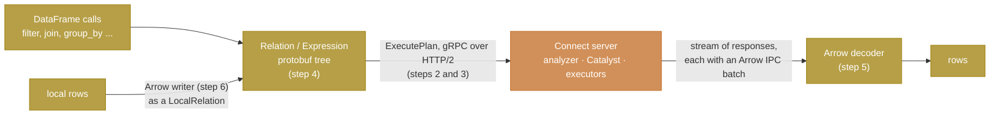
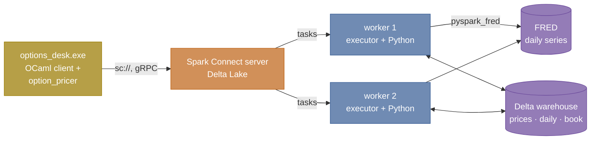
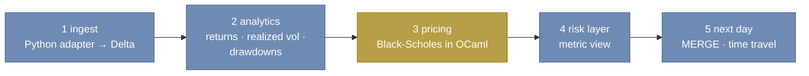

*Originally published on [systems/null](https://systemsnull.net/posts/data-engineering-ai/build-a-spark-connect-client).*

## But Lisa, surely you must have a good reason for using OCaml?

No, not really. Well, yes. Sort of. 

In a previous blog post I wrote a cheeky little guide to Spark Connect Clients, which I enjoyed writing thoroughly and was pretty well received. But it ended on a warning: not all Connect Clients are built equally, and it highly depends on the language you're using and the love and care of the maintainers. Current gold standards include the Rust Client, for instance, which gives you full interoperability with Rust native engines like Polars or DuckDB. More on that in a follow up post, but it's pretty cool. 

The follow-up question is what it takes to build one then and how to test it. And to be honest, I've always defaulted to OCaml as sort of a joke language- partially from it's niche quality and mostly from my secret love for the finance industry and beasts like Jane Street.

OCaml is a useful language for the demonstration because it lacks all of the built in capabilities that would otherwise make life easy: there is no Arrow library, no concept of the gRPC protocol at all, and a protobuf compiler is its own project with its own parser rather than a plugin for Google's `protoc`. Every piece of the Connect client has to be manually built; making you realize how good the Go or Rust clients have it in comparison because of their respectively rich ecosystems. Naturally, I vibe coded most of this with my good friend Claude Code, and if you want to skip the entire droll on the implementation journey you can skip ahead to [the repo here](https://github.com/lisancao/spark-connect-ocaml). 

**Every Spark Connect client essentially has the same four basic requirements: compile the published protos, make a streaming gRPC call, build relation trees, and decode Arrow batches. The Connect server itself does so much of the work for you in this architecture that the only parts costing real effort are the two the protocol leaves to the client implementation: its protobuf toolchain and its Arrow codec.**

## The Roles and Responsibilities of a Connect Client

The client sits between the DataFrame calls and the server, and it never processes data itself. It turns method calls into a protobuf tree, sends the tree, and turns the Arrow that comes back into values:



The analyzer, Catalyst and the executors are the server's. The rest is the client's.

## Step 1: Getting the protos to compile

The protocol *is* its protobuf definitions, published in the Spark repository under [`sql/connect/common/src/main/protobuf/spark/connect/`](https://github.com/apache/spark/tree/master/sql/connect/common/src/main/protobuf/spark/connect). A client starts by copying them out of the tag it targets (I used v4.2.0) and compiling them with whatever protobuf toolchain its language has. They import `google/protobuf/any.proto` and `timestamp.proto`, and Spark's error details also need `google/rpc/status.proto` and `error_details.proto`. None of these are in the Spark repo. If the language's toolchain does not ship them, each is a few lines to write by hand, and wire-compatible as long as the field numbers match.

This step is "mechanical" in Go, Rust, Swift and Java, where `protoc` and a maintained plugin do it. In OCaml the compiler is [`ocaml-protoc`](https://github.com/mransan/ocaml-protoc), a from-scratch parser and generator, and Spark's protos hit several things it disagrees with. Each fix is one line in a post-generation fix-up script:

| Problem                                                                            | Where                                                     | Fix                                      |
| ---------------------------------------------------------------------------------- | --------------------------------------------------------- | ---------------------------------------- |
| Single-quoted strings (`syntax = 'proto3';`), legal but rare                       | every Spark proto                                         | rewrite to double quotes when vendoring  |
| `reserved "userId", "sessionId";` (field *name* reservations)                      | `relations.proto`                                         | drop the lines; they have no wire effect |
| A one-line default emitted before the function it calls exists                     | the mutually recursive ML relation messages               | move the line below its dependency       |
| Key and payload emitted in the wrong order for a oneof case whose message is empty | `Catalog.CurrentDatabase`, `CurrentCatalog`, `ClearCache` | swap the two generated lines             |

The oneof bug surfaced the way every protobuf mistake surfaces. Three catalog calls, and only those three, came back from the server as `UNKNOWN: Application error processing RPC`, with `Invalid protobuf byte sequence` in the server log. That message means the server could not parse the request at all, and the diagnostic is to dump the bytes:

```text
Catalog{current_database}  generated:  00 0a    length 0, then the key for field 1
Catalog{current_database}  correct:    0a 00    key for field 1, then length 0
AnalyzePlan{spark_version} generated:  52 00    same shape, inlined elsewhere, comes out right
```

`ocaml-protoc` encodes back to front (payload first, then its key, so a nested message's length is known before the key is written), and the standalone encoder for an empty message had the two lines in the wrong order. Nothing else in the API was affected: the bug lives in the encoder generated for a message that is nothing but a oneof, and `Catalog` is the only such message on the request path with empty cases. A client in Go never meets this, because `protoc` has been exercised by every Google service for a decade; a client in OCaml meets it immediately. **The protobuf compiler is the first dependency the protocol pushes onto the host language, and the Spark protos are a stress test for it.**

## Step 2: Speak gRPC

gRPC is small once HTTP/2 is available, and OCaml does have HTTP/2 ([`h2`](https://github.com/anmonteiro/ocaml-h2), with TLS through `ocaml-tls` and the system trust store). A call is a `POST` to `/spark.connect.SparkConnectService/<Method>` with two headers that matter, `content-type: application/grpc` and `te: trailers`, plus `authorization: Bearer <token>` when a token is set. The body in each direction is a sequence of messages, each framed as a compression flag byte, a big-endian length, and the protobuf bytes:

```ocaml
let frame payload =
  let n = String.length payload in
  let b = Bytes.create (5 + n) in
  Bytes.set b 0 '\000';                      (* not compressed *)
  Bytes.set_int32_be b 1 (Int32.of_int n);   (* length *)
  Bytes.blit_string payload 0 b 5 n;
  Bytes.unsafe_to_string b
```

The status comes back in HTTP/2 *trailers*, not in the response status line (which is always 200), as `grpc-status` and a percent-encoded `grpc-message`. Spark adds `grpc-status-details-bin`, base64 of a `google.rpc.Status`, which is where the useful error information lives. The reader side is the mirror of `frame`: buffer the body, peel off messages as their lengths complete, and finish when the trailers arrive.

```ocaml
let status_of_headers (h : H2.Headers.t) =
  match H2.Headers.get h "grpc-status" with
  | None -> None
  | Some code ->
      let code = try int_of_string code with _ -> 2 in
      let message = Option.value ~default:"" (Option.map percent_decode (H2.Headers.get h "grpc-message")) in
      let details = Option.map base64_decode (H2.Headers.get h "grpc-status-details-bin") in
      Some { code; message; details }
```

Spark Connect only uses two call shapes: unary (`AnalyzePlan`, `Config`, `Interrupt`, `ReleaseSession`, `FetchErrorDetails`, and friends) and server-streaming (`ExecutePlan`, `ReattachExecute`). A unary call is a streaming call where the client reads one message. There are no client-streaming or bidirectional methods except `AddArtifacts`, which is only needed to upload files to the server. That is the whole transport. It worked on the first query, and almost none of the effort in this project went into it.

## Step 3: A session, and the first RPC

Every request carries the same identity block: a `session_id` the client mints (a UUID), a `user_context` with a `user_id`, and a `client_type` string that is effectively a user agent. After the first reply the client also records the `server_side_session_id` the server sent and echoes it back as `client_observed_server_side_session_id` on every later request, which is how the server notices if it has restarted underneath the client.

The hello world of Connect is `AnalyzePlan` with the `spark_version` option, because it needs no plan:

```ocaml
let analyze t analyze =
  let req =
    P.Base.make_analyze_plan_request ~session_id:t.session_id
      ?client_observed_server_side_session_id:t.server_side_session_id
      ~user_context:(user_context t) ~client_type:t.client_type ~analyze ()
  in
  unary t ~method_:"AnalyzePlan" ~encode:P.Base.encode_pb_analyze_plan_request
    ~decode:P.Base.decode_pb_analyze_plan_response req
  >|= fun r -> observe t r.server_side_session_id; r

let version t =
  Client.analyze t.client B.Spark_version >|= fun r ->
  match r.result with Some (B.Spark_version v) -> v.version | _ -> failwith "unexpected response"
```

```text
server version: 4.2.0
```

Once that prints, the protobuf toolchain, the HTTP/2 stack, the gRPC framing and the session plumbing are all known good, and everything after it is vocabulary.

## Step 4: Build plans instead of running them

Plan building is the most clerical step of the seven. A `Relation` is a `common` block holding a `plan_id` plus a oneof of every operator the server understands: `Read`, `Project`, `Filter`, `Join`, `Aggregate`, `Sort`, `Limit`, `SetOp`, `Sample`, `Deduplicate`, `Range`, `Sql`, `LocalRelation`, and a long tail. A DataFrame method is a function that wraps the current relation in a new one, and that is the entire DataFrame API:

```ocaml
let of_rel_type client rel_type =
  { client;
    rel = R.make_relation ~common:(R.make_relation_common ~plan_id:(Client.fresh_plan_id client) ()) ~rel_type () }

let filter t cond = of_rel_type t.client (R.Filter (R.make_filter ~input:t.rel ~condition:cond ()))

let join ?(how = `Inner) t other ~on =
  of_rel_type t.client
    (R.Join (R.make_join ~left:t.rel ~right:other.rel ~join_condition:on ~join_type:(join_type_pb how) ()))
```

Expressions are the same idea one level down. A column reference is an `UnresolvedAttribute` holding a string; a literal is a `Literal` with a typed oneof; and every function *and every operator* is an `UnresolvedFunction` called by name, so `a + b` is the function `+` applied to two arguments and `a == b` is `==`. The client never resolves anything:

```ocaml
let fn ?(distinct = false) name args =
  of_expr_type (E.Unresolved_function
    (E.make_expression_unresolved_function ~function_name:name ~arguments:args ~is_distinct:distinct ()))

let add a b = fn "+" [ a; b ]
let eq a b = fn "==" [ a; b ]
let gt a b = fn ">" [ a; b ]
```

There is no analyzer in the client: `Column.col "nope"` is a string in a message until the server sees the plan, which is why a typo fails late under Connect. The client cannot check the name; it has no catalog to check it against.

The size of this layer depends on how much the server does, and the server does nearly everything. Each of the following is a server message rather than client code:

| What you'd expect to implement client-side           | What Connect actually does                                                                                                                                                                       |
| ---------------------------------------------------- | ------------------------------------------------------------------------------------------------------------------------------------------------------------------------------------------------ |
| Rendering the table for `show()`                     | `ShowString` is a *relation*; the server formats the ASCII table and returns it as one string cell                                                                                               |
| `count()`                                            | an `Aggregate` with `count(1)`; the client reads back one row                                                                                                                                    |
| Schema, `printSchema()`, `explain()`                 | `AnalyzePlan` with `Schema`, `TreeString` or `Explain`; the server returns the type tree, the formatted text, or the plan string (the only way to see one, since Catalyst isn't on your machine) |
| `listTables()`, `currentDatabase()`, `tableExists()` | relations under the `Catalog` message; they execute like a query and return rows                                                                                                                 |
| `sql()` for DDL vs for a query                       | a `SqlCommand`; the server runs it eagerly and, for a query, hands back a relation to keep building on                                                                                           |
| Named and positional SQL parameters                  | literals attached to the `SqlCommand`; the server binds `:name` and `?`                                                                                                                          |
| Telling `a.id` from `b.id` in a self-join            | every relation carries a client-assigned `plan_id`, and an attribute can name the plan it belongs to                                                                                             |

The `plan_id` is the one piece of real design in this step. Because the client assigns `plan_id`s, it can mint a column reference bound to a particular DataFrame, and the server resolves it against that side of the join even when both sides have the same column names:

```ocaml
let col t name = Column.col_of_plan ~plan_id:(plan_id t) name

let a = Dataframe.alias people "a" and b = Dataframe.alias people "b" in
Dataframe.join a b ~on:Column.O.(Dataframe.col a "id" = Dataframe.col b "id" + Column.int 1)
```

## Step 5: Execute, and decode the Arrow that comes back

`ExecutePlan` takes a `Plan` (either a `Relation` to query or a `Command` to run) and returns a stream of `ExecutePlanResponse` messages. Each one has a `response_type` oneof: `arrow_batch` carries data, `sql_command_result` carries the relation a `SqlCommand` produced, `result_complete` is the end marker, and progress and metrics messages can be ignored at first. The collect loop is a fold over the stream:

```ocaml
let collect_arrow t =
  Client.execute t.client (root t) >>= fun stream ->
  let schema = ref None and batches = ref [] in
  Lwt_stream.iter
    (fun (r : B.execute_plan_response) ->
      match r.response_type with
      | Some (B.Arrow_batch ab) ->
          let sc, bs = Arrow_ipc.read_stream (Bytes.unsafe_to_string ab.data) in
          (match sc with Some s when !schema = None -> schema := Some s | _ -> ());
          batches := List.rev_append bs !batches
      | _ -> ())
    stream
  >|= fun () -> (!schema, List.rev !batches)
```

**Each `arrow_batch` in `ab.data` is a complete Arrow IPC stream**, a schema message followed by one record batch, not a bare batch sharing a schema across the response. So the decoder is a full IPC stream reader. In a language with an Arrow library this step is one function call. OCaml does not have one (the package on opam binds the C++ library, which defeats the point of a thin client), so this is where the project stopped being clerical.

An IPC stream is a sequence of messages, each framed as a continuation marker, a metadata length, a [FlatBuffers](https://flatbuffers.dev/) `Message`, and a body of raw buffers:

```text
FF FF FF FF  <int32 metadata length>  <FlatBuffer: Message{version, header type, header, bodyLength}>  <body>
```

The `Message` header is a `Schema` (a vector of `Field`s, each with a name, a nullability flag, a type union and child fields) or a `RecordBatch` (a row count, a vector of field *nodes* giving each column's length and null count, and a vector of *buffers* giving offsets into the body). Decoding a batch is a depth-first walk: for each field, take the next node, take its validity bitmap buffer, take its data buffer(s), and recurse into children for lists, structs and maps. FlatBuffers itself is a vtable-indirected binary format and reading it is a page or so of offset arithmetic. Then there is one decoder per type. The decoder is the largest file in the project not because Arrow is complicated but because Spark produces many Arrow types:

| Spark type                     | What arrives in the Arrow batch                                                                                   |
| ------------------------------ | ----------------------------------------------------------------------------------------------------------------- |
| tinyint, smallint, int, bigint | `Int` with bit width and signedness; a fixed-width buffer                                                         |
| float, double                  | `FloatingPoint` with precision                                                                                    |
| string, binary                 | `Utf8` / `Binary`: an offsets buffer plus a data buffer (and `Large` variants with 64-bit offsets)                |
| decimal(p, s)                  | `Decimal`: 128-bit (or 256-bit) little-endian two's complement, which needs a bignum-to-decimal-string conversion |
| date                           | `Date32`, days since the epoch                                                                                    |
| timestamp                      | `Timestamp` in microseconds, with the session time zone as a string                                               |
| timestamp_ntz                  | the same with no time zone                                                                                        |
| interval year to month         | `Interval(YEAR_MONTH)`                                                                                            |
| interval day to second         | `Duration(MICROSECOND)`                                                                                           |
| array, struct, map             | `List`, `Struct`, `Map`: child columns with their own nodes and validity bitmaps                                  |

Decimal decoding was the only algorithmic piece, and only because the natural answer (the `zarith` bignum library) is a C dependency I did not want in a client whose point is having none. Performance without tuning was acceptable: a two-column projection over three million rows (a bigint and a SHA-1 string) came back and decoded in 1.63 seconds on localhost, with the client building a boxed value per cell, the least efficient representation available. The server's time dominates.

## Step 6: Sending data to the server

`createDataFrame` has to send rows *to* the server, and Connect's `LocalRelation` message carries them as, again, an Arrow IPC stream. A client that builds a DataFrame from local values therefore needs an Arrow *writer*, including a FlatBuffers *builder* for the schema and record batch metadata:

```ocaml
let create_dataframe ?schema t ~columns rows =
  let data = Arrow_writer.encode ?schema ~columns rows in
  of_rel_type t (R.Local_relation (R.make_local_relation ~data:(Bytes.unsafe_of_string data) ()))
```

The builder is the fiddly half. FlatBuffers are written back to front with vtables, alignment padding and forward offsets, and a byte out of place produces a Java stack trace on the server rather than anything that points at the byte. So the acceptance test for the writer was not the Spark server, which is forgiving, but `pyarrow`'s `validate(full=True)`, which is not. The stream passed with every Spark type the decoder reads, including nested lists, structs and decimals. The server infers the Spark schema from the Arrow schema, so a local table of `Value.Int`, `Value.String` and `Value.Float` cells comes up as `bigint`, `string` and `double` with no DDL string needed (a DDL string can be passed for narrower types).

Every official client carries both halves of this codec; they borrow them from an Arrow library the language already had.

## Step 7: Errors, the way Spark sends them

The `grpc-status-details-bin` trailer is base64 of a `google.rpc.Status`, whose `details` is a list of `Any`. Spark puts a `google.rpc.ErrorInfo` in it, and the `metadata` map on that is where everything useful lives: `classes` (the JVM exception class chain as a JSON array), `sqlState`, `errorId`, and `messageParameters`. The error id goes to `FetchErrorDetails` for the server-side stack trace and query context.

```ocaml
let status = P.Status.decode_pb_status (Pbrt.Decoder.of_string raw) in
let info =
  List.find_map
    (fun (a : P.Any.any) ->
      if ends_with ~suffix:"google.rpc.ErrorInfo" a.type_url then
        Some (P.Error_details.decode_pb_error_info (Pbrt.Decoder.of_string (Bytes.to_string a.value)))
      else None)
    status.details
in
(* info.metadata: ("classes", "[...]"), ("sqlState", "42P01"), ("errorId", "..."), ... *)
```

The Spark error condition itself is not a separate field; it is the bracketed prefix of the message, so a client lifts it with a trivial parse. The OCaml client's output for a query on a table that does not exist, with no string matching beyond that bracket:

```text
Spark error INTERNAL (org.apache.spark.sql.catalyst.ExtendedAnalysisException):
[TABLE_OR_VIEW_NOT_FOUND] The table or view `nope` cannot be found. ...
SQLSTATE: 42P01; line 1 pos 14;
'Project [*]
+- 'UnresolvedRelation [nope], [], false
```

`error_class = TABLE_OR_VIEW_NOT_FOUND`, `sql_state = 42P01`, and the exception classes as a list. The server supplies all of it; the client's job is to keep it.

## Putting it together

With those seven pieces the client reads like every other Connect client, because they all converge on the proto's shape:

```ocaml
open Lwt.Infix
open Spark_connect

let () =
  Lwt_main.run begin
    Session.connect "sc://localhost:15002" >>= fun spark ->
    let people = Session.create_dataframe spark ~columns:[ "id"; "name" ]
      [ [ Value.Int 1; Value.String "ann" ]; [ Value.Int 2; Value.String "bob" ] ] in
    let orders = Session.create_dataframe spark ~columns:[ "pid"; "amount" ]
      [ [ Value.Int 1; Value.Float 10.0 ]; [ Value.Int 1; Value.Float 5.5 ] ] in
    let per_person =
      Dataframe.join people orders ~on:Column.O.(Column.col "id" = Column.col "pid")
      |> fun df -> Dataframe.group_by df [ Column.col "name" ]
      |> fun g -> Dataframe.Grouped.agg g [ Column.alias (F.sum (Column.col "amount")) "total" ] in
    Dataframe.show per_person >>= fun () ->
    Session.close spark
  end
```

```text
+----+-----+
|name|total|
+----+-----+
| ann| 15.5|
+----+-----+
```

The two local tables went up inside the plan as `LocalRelation`s, the join and aggregate went up as relation nodes around them, the server formatted the table and returned it as a one-cell Arrow batch, and the whole exchange was a single `ExecutePlan` call, since nothing before `show` touches the server. Pointed at a Databricks endpoint with `sc://host:443/;token=...`, the same client turns TLS on because the token is present, which is what the connection string spec asks for and what every client reimplements.

The SQL path is the only one with a wrinkle: `sql()` sends a `SqlCommand` and executes eagerly, so `CREATE TABLE` runs right away, and for a query the reply carries a `sql_command_result` relation that the client wraps as the DataFrame to keep building on. Config is a unary call with get/set/unset operations, the catalog is relations, writers are `WriteOperation` (v1, with save modes) and `WriteOperationV2` (create/replace/append) commands, and `persist` is an `AnalyzePlan` option.

## Testing its Production Readiness

So, here begets the real question: is this actually usable? Well, maybe. As much as I'd love Jane Street to plug this in and hire me to maintain it (though, I'm pretty happy at Databricks right now), there's still some coverage issues, particularly around UDFs which are highly variable anyways.
 
 For my own due diligence, I tested the client two ways: every message it can build, exercised against more than one Spark release, and execution on a real cluster of the kind of work I naively imagine someone at Jane Street would reach for OCaml to do.

### Every message, tested against three Spark releases

Coverage is precisely measurable for a Connect client, because the protocol is a finite list of protobuf messages. The repo has a script that reads the generated bindings, finds which relations, expressions, commands, catalog calls and analyze requests the client builds, follows each one back to the public function that builds it, and checks whether a test calls that function. Its output is [docs/protocol-coverage.md](https://github.com/lisancao/spark-connect-ocaml/blob/main/docs/protocol-coverage.md), regenerated rather than maintained by hand:

| Protocol area                    | Implemented | Of those, tested |
| -------------------------------- | ----------- | ---------------- |
| Relations (DataFrame operations) | 33 of 61    | all              |
| Expressions                      | 14 of 22    | all              |
| Literal types                    | 18 of 22    | all              |
| Catalog                          | 21 of 36    | all              |
| AnalyzePlan requests             | 11 of 14    | all              |
| Config operations                | 7 of 7      | all              |
| Commands                         | 4 of 20     | all              |

The same suite passes against Spark 4.1.3, 4.2.0 and 4.3.0-rc1. The unimplemented messages are mostly the runtime half of the protocol (streaming, UDFs, ML, pipelines), plus a tail of statistics relations like `crosstab` and `approx_quantile` that I have not needed yet.

The tests found bugs that a demo doesn't make obvious. `na_fill` sent whole numbers as 32-bit integer literals, which the server's fill rejects outright (PySpark always sends longs, so it never meets this). Sort orders without an explicit null ordering went up as "unspecified", so an ascending sort put nulls last where Spark and PySpark put them first. And `show()` did not end with a newline, so two tables printed in a row ran together. The suite also had a bug of its own: it compared a `TIMESTAMP` literal without pinning the session time zone, so it passed on every server running in UTC (all of my Docker ones) and failed on the one running natively on my machine.

### Case Study: A small options desk

OCaml's best-known home outside academia is finance, where trading firms write their pricing and risk code in it, wirh the same firms keep their market history in data lakes that Spark reads. OCaml and Spark here have historically met through Python or a SQL string.

So my E2E is a small options desk with one question: **should 30-day index options be priced off realized volatility, measured from recent prices, or off the VIX, the market's implied volatility?**

The pricing code is borrowed. It is the closed-form Black-Scholes module from Case Ollila's [option-pricing-model-comparison](https://github.com/crollila/option-pricing-model-comparison) (MIT), typed OCaml with Greeks in trader units and every numeric routine written from scratch, vendored unchanged into the example. The market data is public: daily S&P 500, Nasdaq Composite and Dow Jones closes, the VIX, and the 3-month Treasury yield, all from [FRED](https://fred.stlouisfed.org/). The whole thing runs as one OCaml program, [`spark-demos/demos/08_spark_connect_ocaml`](https://github.com/lisancao/spark-demos/tree/main/demos/08_spark_connect_ocaml), against a standalone Spark 4.2 cluster with Delta Lake:



The program is a pipeline, and each step that can check itself does so against an independent calculation:



**1. Market data through a Python adapter.** The adapter is a short [Python data source](https://github.com/lisancao/spark-demos/blob/main/demos/08_spark_connect_ocaml/pyspark_fred/__init__.py) that downloads FRED series, one partition per series, installed on every node as a `pyspark_fred` package so Spark discovers it with no per-session registration. From OCaml the adapter is a format name:

```ocaml
let fred spark series =
  Session.read spark |> fun r ->
  Session.Reader.format r "fred" |> fun r ->
  Session.Reader.option r "series" (String.concat "," series) |> fun r -> Session.Reader.load r
```

The client never learns that Python is involved: it sends a `Read` relation naming a format, the executors run the adapter, and the same Arrow batches come back that the decoder reads for any query. The ingest lands ten years of closes in a Delta table (ten years because that is what FRED's agreement with S&P Dow Jones Indices lets it publish for their series, and the job trims the Nasdaq to the same window):

```text
+---------+--------+----------+----------+
|   series|count(1)| min(date)| max(date)|
+---------+--------+----------+----------+
|     DJIA|    2514|2016-10-10|2026-10-09|
|NASDAQCOM|    2515|2016-10-10|2026-10-09|
|    SP500|    2514|2016-10-10|2026-10-09|
+---------+--------+----------+----------+
```

**2. The heavy part, in Spark.** Daily log returns come from a `lag` over each series, realized volatility is the standard deviation of the last 21 returns annualized by the square root of 252 trading days, and drawdown is each close against the running maximum, all window functions built in OCaml and evaluated on the cluster:

```ocaml
let by_day = Column.Window.partition_by [ col "series" ] |> fun w -> Column.Window.with_order_by w [ col "date" ] in
let last_21 = Column.Window.rows_between by_day (Column.Window.Value (Column.int (-20))) Column.Window.current_row in
let daily =
  Dataframe.with_columns prices [ ("ret", F.log Column.O.(col "value" / Column.over (F.lag (col "value")) by_day)) ]
  |> fun d -> Dataframe.with_column d "rv21" Column.O.(Column.over (F.stddev (col "ret")) last_21 * F.sqrt (Column.int 252))
```

```text
+---------+----------+--------+--------+------------+----------------+-------------+
|   series|      date|    spot|rv21_pct|avg_rv21_pct|max_drawdown_pct|worst_day_pct|
+---------+----------+--------+--------+------------+----------------+-------------+
|     DJIA|2026-10-09|51654.95|    10.2|        14.3|           -37.1|        -13.8|
|NASDAQCOM|2026-10-09|27366.17|    14.2|        19.4|           -36.4|        -13.1|
|    SP500|2026-10-09| 7811.54|    10.0|        15.0|           -33.9|        -12.8|
+---------+----------+--------+--------+------------+----------------+-------------+
```

The worst single day for all three is 16 March 2020. The deepest drawdown is March 2020 for the S&P 500 and the Dow, but December 2022 for the Nasdaq, whose 2022 bear market went further than the Covid crash. Joining the S&P 500's trailing realized volatility to the VIX day by day answers half the desk's question: over the decade the VIX sat above realized volatility on 86.1% of trading days, by 3.7 volatility points on average. That gap is a rough measure of the volatility risk premium, the price the market charges for insurance.

**3. Pricing, in OCaml.** The program pulls the latest close and realized volatility for each index, plus the current VIX and T-bill yield, and hands them to the pricer as its author intended (I set the dividend yield to zero to keep the example small):

```ocaml
let m = { T.spot; strike = spot; ttm = 30. /. 365.; rate; div_yield = 0.0; vol = rv series } in
let g = BS.greeks kind m in
(BS.price kind m, g.delta, BS.vega_per_point g.vega, BS.theta_per_day g.theta)
```

```text
  risk-free (3m T-bill) 4.23%, VIX 15.4
  index      kind contracts     strike    vol  premium   delta   vega/pt theta/day
  SP500      call        20    7811.54  10.0%   103.40   0.554      8.85     -1.96
  SP500      put        -10    7811.54  10.0%    76.28  -0.446      8.85     -1.06
  NASDAQCOM  call         5   27366.17  14.2%   492.76   0.542     31.13     -9.03
  DJIA       put          8   51654.95  10.2%   516.15  -0.447     58.56     -7.22
  SP500 30-day ATM call: 103.40 at realized vol (10.0%), 151.41 at VIX (15.4%)
```

The same at-the-money S&P call is worth 103.40 at realized volatility and 151.41 at the VIX, 46% more, which is the volatility risk premium expressed in dollars. Put-call parity, the pricer's own check that its calls and puts are consistent with each other, holds for every index to within 5e-13. The priced book then goes back to Spark the other way, as a `LocalRelation` built from OCaml values and written as a Delta table.

**4. The risk layer, as a metric view.** Spark 4.2 added metric views ([SPARK-54403](https://issues.apache.org/jira/browse/SPARK-54403), [SPARK-54405](https://issues.apache.org/jira/browse/SPARK-54405)): a view defined in YAML as a source, dimensions, and measures, where each measure is an aggregate defined once and queried with `measure()` under whatever grouping the query asks for. A risk layer has the same shape, so the desk's exposures are defined once:

```yaml
version: "0.1"
source: desk_book
dimensions:
  - name: index_name
    expr: index_name
  - name: kind
    expr: kind
measures:
  - name: premium_usd
    expr: cast(round(sum(premium * contracts * 100)) as bigint)
  - name: dollar_delta
    expr: cast(round(sum(delta * contracts * 100 * spot)) as bigint)
  - name: vega_usd_per_pt
    expr: cast(round(sum(vega_pt * contracts * 100)) as bigint)
  - name: theta_usd_per_day
    expr: cast(round(sum(theta_day * contracts * 100)) as bigint)
```

The client has no code for metric views at all. Defining one is a SQL statement, and querying one from the DataFrame API is a function call, because `measure` is a function the server resolves:

```ocaml
Dataframe.group_by (Session.table spark "desk_risk") [ col "index_name" ] |> fun g ->
Dataframe.Grouped.agg g (List.map (fun m -> Column.alias (Column.fn "measure" [ col m ]) m)
                           [ "premium_usd"; "dollar_delta"; "vega_usd_per_pt"; "theta_usd_per_day" ])
```

```text
+----------+-----------+------------+---------------+-----------------+
|index_name|premium_usd|dollar_delta|vega_usd_per_pt|theta_usd_per_day|
+----------+-----------+------------+---------------+-----------------+
|      DJIA|     412920|   -18467411|          46844|            -5775|
| NASDAQCOM|     246379|     7417769|          15563|            -4514|
|     SP500|     130507|    12138611|           8853|            -2867|
+----------+-----------+------------+---------------+-----------------+
```

The check computes the same four sums directly from the book table and compares them row by row. They match.

**5. The next day.** The desk adds to its S&P calls and closes the Nasdaq position, as a `MERGE` from a DataFrame of fills built in OCaml. Delta keeps the previous book, and `VERSION AS OF` reads it back:

```text
  yesterday: [DJIA, put, 8] [NASDAQCOM, call, 5] [SP500, call, 20] [SP500, put, -10]
  today:     [DJIA, put, 8] [SP500, call, 25] [SP500, put, -10]
```

| Check | Compared against | Result |
|---|---|---|
| Put-call parity, each index | the pricer's own arbitrage identity | pass |
| Priced book written to Delta | the number of positions sent | pass |
| Risk measures from the metric view | the same aggregation on the book table | pass |
| Time travel to yesterday's book | the book before the `MERGE` | pass |

On the cluster, every Spark job succeeded, with the tasks split close to evenly between the two workers' executors.

## What's left on my to do list, and where the official clients spend their time

What this client does not do is also a map of where Connect stops being a plan-and-Arrow protocol and starts being a runtime:

- **Reattachable execution.** The official clients use `ReattachExecute` and `ReleaseExecute` so a dropped connection can resume a long query from the last response it saw. This one uses plain `ExecutePlan`, which Spark 4 servers fully support, but a flaky network on an hour-long query loses the query. It is the first thing to add.
- **User-defined functions.** A UDF in Connect is serialized *code* shipped to the server: pickled Python, or a Scala closure with its JARs uploaded through `AddArtifacts`. It only works when the server can run the client's language, and there is no OCaml runtime on a Spark executor. **This client will never have UDFs**; it has the whole SQL function library and higher-order functions with lambdas. Code that already lives on the server is a different matter: the desk's market-data adapter is Python installed on the executors, and any client can call it by name.
- **Streaming, MLlib and pipeline commands.** The messages are generated and reachable, but each is a stateful API rather than a plan.
- **Dictionary-encoded or compressed Arrow batches.** Spark does not send them by default; the decoder raises if it ever meets one.

Each item is either resilience or a place where the client has to be a runtime instead of a plan builder. The line between those halves is the line Connect draws. The first half is small enough to build in a language the Spark project will never target. The second half is where the Go, Swift and Rust clients are spending their effort, and it is the half to check before building on any of them.

## Further reading

- [Spark Connect overview](https://spark.apache.org/docs/latest/spark-connect-overview.html) and the [protobuf definitions](https://github.com/apache/spark/tree/master/sql/connect/common/src/main/protobuf/spark/connect) that are the real spec
- [gRPC over HTTP/2](https://github.com/grpc/grpc/blob/master/doc/PROTOCOL-HTTP2.md), the framing and trailer rules from step 2
- [Arrow IPC streaming format](https://arrow.apache.org/docs/format/Columnar.html#serialization-and-interprocess-communication-ipc) and the [FlatBuffers schema](https://github.com/apache/arrow/tree/main/format) it's described in
- [spark-connect-ocaml](https://github.com/lisancao/spark-connect-ocaml), the client this post walks through, and the official [Go](https://github.com/apache/spark-connect-go), [Rust](https://github.com/apache/spark-connect-rust) and [Swift](https://github.com/apache/spark-connect-swift) clients to compare it against
