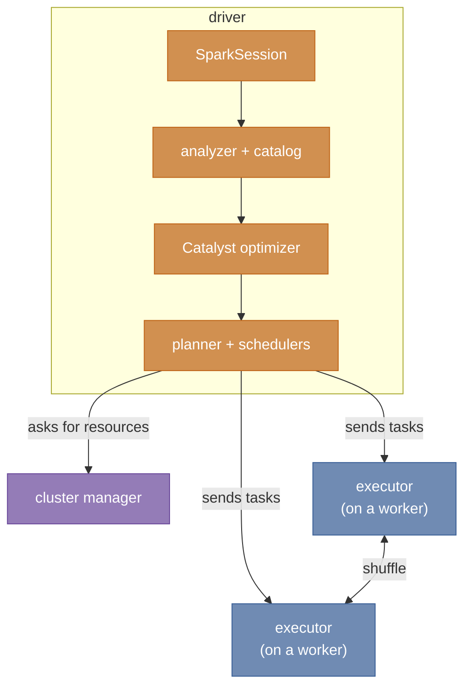
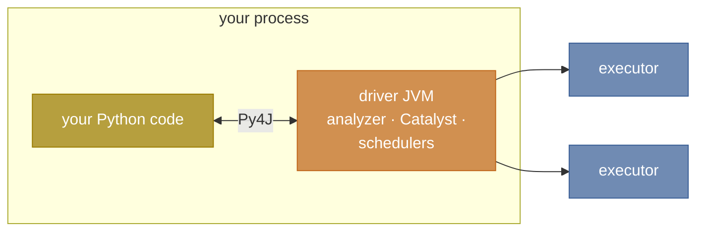
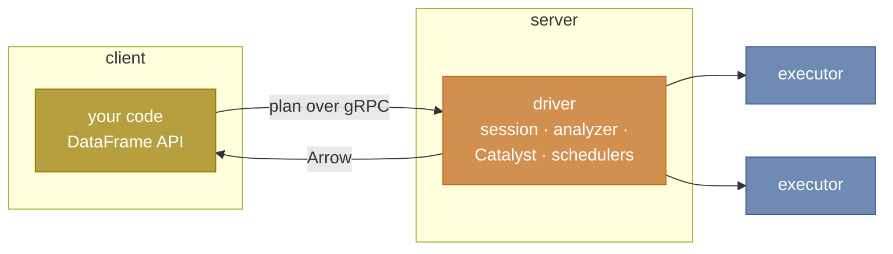

*Originally published on [systems/null](https://systemsnull.net/posts/data-engineering-ai/idiots-guide-spark-connect-clients).*

[Spark Connect](https://spark.apache.org/docs/latest/spark-connect-overview.html) is a new concept for many of us, especially given the long history of how managing Spark clusters has traditionally worked. Spark Connect in a nutshell separates your application from Spark: your code becomes a small client, Spark runs as a server somewhere else, and the two talk over the network. The primary benefit of Connect for most users is getting rid of the headaches around `SparkContext`, installing a package from your notebook, your Python version not mattering, or a typo failing on the line you typed it, which Connect very kindly obfuscates for us. Honestly, it's a pretty overdue upgrade for Spark as an engine and a pretty intuitive direction: decouple client sessions from the server, and make the server and its configuration as dead easy as possible for your customers.

The mindset shift away from having your PySpark setup share the same process as your Spark driver is not a super hard jump, but it does mean there are some adjustments to make in how you set things like configurations or write jobs. This becomes even more intense once you get into the meat of Spark Connect, which is the language agnosticism and running multiple clients and servers, particularly for those of us dabbling in Rust or Go.

So this guide, written for idiots by an idiot, starts with a tour of how Spark itself works and how that changes with a Connect setup. From there it's practical: how to run a server, how to connect to it from Python and other languages, what changes in your code, and how to do some basic debugging. Note that after the inclusion of session tracing in 4.3, and hopefully an eventual Spark Connect Gateway, the latter will be much, much easier.

Every example comes from [spark-demos](https://github.com/lisancao/spark-demos/tree/main/demos/02_spark_connect), where each one is a runnable script, and I ran every snippet here against Spark 4.2.0, the current release.

## How Spark works

Spark lets you write code as if you were working with one table on one machine, and then runs it across however many machines you have; Connect's whole trick is moving part of the machinery that makes that possible somewhere else, so it's worth having a picture of that machinery first. A running Spark application has a [few kinds of pieces](https://spark.apache.org/docs/latest/cluster-overview.html):

- **The driver** is the brain. It holds your `SparkSession`, works out what your code actually means, decides how to run it, and coordinates everything else. Inside it:
  - the **analyzer**, which resolves the tables and columns you named, using the **catalog** (the registry of what tables exist and what's in them);
  - the **[Catalyst optimizer](https://www.databricks.com/glossary/catalyst-optimizer)**, which rewrites your query into a cheaper equivalent (skipping columns you never use, filtering before joining, and so on);
  - the **planner**, which turns the optimized query into physical operations;
  - the **schedulers**, which cut that physical plan into **stages** (at every point where data has to be reshuffled between machines) and each stage into **tasks**, one per slice (**partition**) of the data.
- **The cluster manager** hands out machines: Spark's own standalone master, YARN, or Kubernetes.
- **Workers** are the machines (or containers) the cluster manager gives you.
- **Executors** are the processes on those workers that actually run tasks, read and write data, hold cached data, and exchange data with each other during a shuffle.



Following one line of code through all of that:

```python
orders.filter(orders.total > 20).groupBy("region").count().show()
```

| Step | What happens | Where |
|---|---|---|
| 1 | Your code describes the query: filter, group, count | your program |
| 2 | That becomes an *unresolved logical plan*: a tree of operations naming tables and columns that haven't been checked yet | the driver |
| 3 | The analyzer checks `orders`, `total` and `region` against the catalog and fills in types | the driver |
| 4 | Catalyst optimizes the plan (here it reads only the two columns it needs) | the driver |
| 5 | The planner picks physical operators and generates code for them | the driver |
| 6 | The schedulers split the work into stages (before and after the shuffle `groupBy` needs) and tasks | the driver |
| 7 | Executors run the tasks against their slices of the data | the executors |
| 8 | The counts come back to the driver, and on to you | the driver, then your program |

Nothing actually runs until step 8 is needed; until you call something that wants a result (`show()`, `count()`, writing a table), Spark is only building the plan, which is what people mean by lazy evaluation. Classic Spark does run step 3 straight away (it checks your names the moment you define a DataFrame), and that small difference ends up mattering a lot once Connect is involved, so keep it in your back pocket for the debugging section.

**The detail that matters most for this guide is where the driver runs.** In classic PySpark (in the default "client" mode) the driver runs inside your program: your Python process starts a Java virtual machine next to it and talks to it through a bridge called [Py4J](https://www.py4j.org/), and that JVM *is* the driver, with the analyzer, the catalog connection, Catalyst and the schedulers all living in it.



Your code and Spark's brain share a process, a machine, a set of installed libraries, and a fate, such that if one of them crashes it takes the other down with it.

## What the shared driver costs you

Sharing a process is fine when it's one person on one laptop, and it causes a surprising number of problems as soon as more than one person (or more than one program) uses the same Spark:

- **You need Java and all of Spark on every machine that runs your code**, including your laptop, a CI runner, or a web service that just wants to run one query.
- **Your application and Spark are upgraded together.** Upgrading Spark means changing the environment every job runs in, whether the job was ready or not.
- **Everyone's code shares the driver.** One badly behaved notebook can take the driver down for everyone attached to it.
- **Only JVM languages and Python can talk to Spark**, because they're the ones that can live inside or next to the JVM.
- **Credentials go everywhere the driver goes**, so catalog passwords and storage keys end up on every machine that runs a job.

Spark Connect fixes all of these with one change, which is that **it splits the driver in two.** The part you write against, the DataFrame API, stays in your program; everything that thinks (the session, the analyzer, the catalog, Catalyst, the schedulers) moves into a long-running **Spark Connect server**, with a network connection in between. Your program builds step 2, the unresolved plan, as a small [protobuf](https://protobuf.dev/) message, sends it over [gRPC](https://grpc.io/) and gets results back as [Arrow](https://arrow.apache.org/), and steps 3 to 8 all happen on the server.



Piece by piece, this is what moves and what stays put:

| Piece | Classic PySpark | Spark Connect |
|---|---|---|
| Your code and the DataFrame API | your process | your process (the client) |
| Building the unresolved plan | the driver JVM, via Py4J | the client, as a protobuf message |
| `SparkSession` and its state (temp views, settings, artifacts) | the driver, in your process | the server |
| Analyzer and catalog connection | the driver, in your process | the server |
| Catalyst, physical planning, code generation | the driver, in your process | the server |
| Stage and task scheduling | the driver, in your process | the server |
| Cluster manager, workers, executors | the cluster | the cluster, **unchanged** |
| Results | Py4J and a local socket into your process | Arrow batches over gRPC |
| Catalog and storage credentials | wherever the driver runs | the server only |

The cluster itself doesn't change at all, and executors run tasks exactly as they did before. What changes is that your program no longer contains a driver, so it doesn't need Java, it can be written in any language that speaks gRPC and Arrow, and it can be upgraded on its own schedule rather than the server's. Connect first appeared in Spark 3.4, and since 4.0 the server has shipped in the standard Spark download.

**Pretty much every confusing thing about Connect is this split showing up somewhere you didn't expect it.** `explain()` shows you a plan your laptop didn't make, because Catalyst is on the server; a typo in a column name fails late, because the analyzer is on the server and only sees your plan once you ask for a result; `sparkContext` is gone, because it belonged to the driver. Anything that used to live in your program (the JVM, your files, your Python version, your credentials) now lives on the other side of a network connection, and most of the rest of this guide is working through the consequences of that.

## Connecting from Python

From Python it's two steps: install the thin client ([`pyspark-client`](https://pypi.org/project/pyspark-client/)),

```bash
pip install pyspark-client
```

and create your session with `.remote(...)` instead of `.master(...)`:

```python
from pyspark.sql import SparkSession
from pyspark.sql import functions as F

spark = SparkSession.builder.remote("sc://localhost:15002").getOrCreate()
print(spark.version)            # the *server's* Spark version

orders = spark.createDataFrame(
    [("metro", "pizza", 24.0), ("metro", "sushi", 40.0), ("urban", "pizza", 18.0)],
    "region string, item string, total double",
)
orders.groupBy("region").agg(F.round(F.avg("total"), 2).alias("avg_ticket")).show()
```

Everything after the session line is ordinary PySpark, the same code you'd run in classic mode. Your program builds the plan and the server optimizes and runs it, so if you call `.explain()` you're reading the server's plan (your laptop doesn't have an optimizer anymore).

### Before and after: setting up a session

A real classic session usually does a lot more than pick a master; it pulls in packages, sets SQL extensions, turns on Hive support and quiets the logs. A typical one looks something like this:

```python
# Before: Spark Classic. Everything is configured by the program that runs the driver.
spark = (
    SparkSession.builder
    .master("spark://my-cluster:7077")
    .config("spark.jars.packages", "org.apache.spark:spark-sql-kafka-0-10_2.13:4.2.0")
    .config("spark.sql.shuffle.partitions", "64")
    .enableHiveSupport()
    .getOrCreate()
)
spark.sparkContext.setLogLevel("WARN")
```

Under Connect that one block splits in two, because some of those settings describe the *driver*, and the driver isn't yours anymore. Anything the server reads once when it starts (packages and JARs, `spark.sql.extensions`, catalog implementations, Hive support) moves to the command that starts the server:

```bash
# After, part 1: the server owns its JVM, so it gets the packages and static settings.
./sbin/start-connect-server.sh \
  --master spark://my-cluster:7077 \
  --packages org.apache.spark:spark-sql-kafka-0-10_2.13:4.2.0
```

and the client keeps only what can change per session:

```python
# After, part 2: the client names the server and sets runtime options.
spark = (
    SparkSession.builder
    .remote("sc://localhost:15002")
    .config("spark.sql.shuffle.partitions", "64")   # runtime settings still work from the client
    .getOrCreate()
)
```

The log level moves to the server as well (its `conf/log4j2.properties`), since the logs are the server's now. The sneaky part is that Connect doesn't stop you from setting a startup-only setting from the client; it warns and carries on without it. Asking for a package from the client gets you this, and no package:

```text
UserWarning: Failed to set spark.jars.packages to Some(org.apache.spark:spark-sql-kafka-0-10_2.13:4.2.0)
due to [CANNOT_MODIFY_CONFIG] Cannot modify the value of the Spark config ...
```

`enableHiveSupport()` does the same thing (with `CANNOT_MODIFY_STATIC_CONFIG`) and hands you a session without Hive, which you might not notice until a table you expected isn't there. The rule of thumb I've landed on is that if a setting describes how the server starts, it belongs wherever the server starts.

You can also leave the URL out of your code entirely by setting `SPARK_REMOTE`, and a plain `SparkSession.builder.getOrCreate()` will connect to it:

```bash
export SPARK_REMOTE="sc://localhost:15002"
```

### Before and after: the rest of your code

Most DataFrame code doesn't change at all. What does change is anything that reached into the driver, and accumulators are a good example:

```python
# Before: an accumulator, counted on the executors and read on the driver
bad_rows = spark.sparkContext.accumulator(0)
orders.foreach(lambda row: bad_rows.add(1) if row.total is None else None)
print(bad_rows.value)
```

```python
# After: an Observation, collected alongside a query you were running anyway
from pyspark.sql import Observation

obs = Observation("quality")
checked = orders.observe(obs, F.count(F.when(F.col("total").isNull(), 1)).alias("bad_rows"))
checked.write.mode("overwrite").saveAsTable("orders_checked")
print(obs.get["bad_rows"])
```

I'd argue the [Observation](https://spark.apache.org/docs/latest/api/python/reference/pyspark.sql/api/pyspark.sql.Observation.html) is the better pattern anyway, since the metric rides along with a write you were already doing instead of needing its own pass over the data. The rest of the common swaps, side by side:

| Before (Classic) | After (Connect) |
|---|---|
| `spark.sparkContext.setLogLevel("WARN")` | set the level in the server's `conf/log4j2.properties` |
| `df.rdd.zipWithIndex()` | `df.zipWithIndex()` (4.2+) |
| `spark.read.json(rdd_of_strings)` | `spark.read.json(df)` on a string column (4.2+) |
| `sc.accumulator(0)` | `df.observe(Observation(...), ...)` |
| `sc.addPyFile("lib/geo.py")` | `spark.addArtifact("lib/geo.py", pyfile=True)` |
| `sc.broadcast(lookup)` | a broadcast join, `F.broadcast(lookup_df)`, or a literal column |
| `spark.newSession()` | `SparkSession.builder.remote(url).create()` |
| `spark-submit job.py` | `python job.py` with `SPARK_REMOTE` set |

All of that assumes there's a server sitting at `localhost:15002`, which brings us to running one.

## Running a Connect server

There are three ways to get one, roughly in order of effort.

**1. Inside your own Python process, for trying things out.** Full PySpark can start a Connect server in-process:

```python
spark = SparkSession.builder.remote("local[*]").getOrCreate()
```

This needs full `pyspark` (not `pyspark-client`) and Java installed, because the server still has to run somewhere; it's the Connect code path without a separate server, which makes it great for tests and for learning.

**2. From a Spark download, on your machine or a server.** Download Spark from [spark.apache.org](https://spark.apache.org/downloads.html) (you'll need Java 17 or newer) and start the server that ships with it:

```bash
./sbin/start-connect-server.sh        # listens on port 15002
./sbin/stop-connect-server.sh         # when you're done
```

By default it runs Spark locally on that one machine; to have it run jobs on a cluster instead, point it at the cluster's master:

```bash
./sbin/start-connect-server.sh --master spark://my-cluster:7077
```

One thing that surprised me is that **by default the server listens on every network interface**, so anything that can reach your machine can reach the server the moment it starts. On a laptop on shared Wi-Fi, restrict it with `--conf spark.connect.grpc.binding.address=127.0.0.1`. (You'll see `spark.connect.grpc.binding.host` in plenty of examples, including some of mine; it isn't a real setting, and Spark silently ignores it.)

**3. In Docker.** The official [`apache/spark`](https://hub.docker.com/r/apache/spark) image includes Spark, Java and Python; add PyArrow and pandas on top, since Python UDFs use Arrow by default as of Spark 4.2:

```dockerfile
FROM apache/spark:4.2.0-scala2.13-java21-python3-ubuntu
USER root
RUN python3 -m pip install --no-cache-dir pyarrow pandas
USER spark
```

Then start the server with `--wait`, which keeps it in the foreground (what a container needs):

```yaml
services:
  spark-connect:
    build: .
    entrypoint:
      - /opt/spark/sbin/start-connect-server.sh
      - --wait
    ports:
      - "127.0.0.1:15002:15002"   # Spark Connect
      - "127.0.0.1:4040:4040"     # Spark UI
```

The image's Python is 3.10, which matters for your client (more on that below).

For production, Connect servers also run on Kubernetes (the [Apache Spark Kubernetes Operator](https://github.com/apache/spark-kubernetes-operator) deploys one as an ordinary Spark application) and, since Spark 4.2, inside YARN. The repo's [topology guide](https://github.com/lisancao/spark-demos/blob/main/demos/02_spark_connect/setup/TOPOLOGIES.md) walks through six ways to deploy one and when each makes sense.

Before you share a server with other people, know that **a single server holds many sessions**, each isolated from the others but all sharing the server's memory and executors; if people need stronger isolation than that, they need separate servers.

## Running a job

There's no separate "submit" step for a Connect job, because **your program is the job**, and running it sends the work:

```bash
export SPARK_REMOTE="sc://localhost:15002"
python my_pipeline.py
```

(`SparkSession.builder.getOrCreate()` picks up `SPARK_REMOTE` from the environment, so the same script runs against whichever server the variable names.) A few other routes are worth knowing about.

**An existing job, almost unchanged.** `spark.api.mode` switches a classic job to Connect: Spark starts a Connect server for the job and runs your code as its client. Set it in the session builder and keep your existing `master`:

```python
spark = (SparkSession.builder
         .master("spark://my-cluster:7077")
         .config("spark.api.mode", "connect")
         .getOrCreate())
```

This is the gentlest way to try Connect on real work, since you can move one job, watch it, and move it back if something breaks. The documentation also shows passing it to `spark-submit` as `--conf spark.api.mode=connect`; on 4.2.0 that failed for me with `TypeError: 'JavaPackage' object is not callable` while the builder setting worked, so for now, set it in code.

**A [declarative pipeline](https://spark.apache.org/docs/latest/declarative-pipelines-programming-guide.html).** Tell the `spark-pipelines` CLI which server to use with `--remote`:

```bash
spark-pipelines run --spec spark-pipeline.yml --remote sc://localhost:15002
```

Don't rely on `SPARK_REMOTE` here; the CLI ignores it and quietly starts a local server of its own. The `spark-pipelines` command comes with full PySpark, and with only the thin client it's the other way round: run `python -m pyspark.pipelines.cli run --spec spark-pipeline.yml`, which has no `--remote` option and connects to whatever `SPARK_REMOTE` names.

**Code your job depends on.** If your functions import your own modules, the server doesn't have them, so ship them with the session using [`addArtifact`](https://spark.apache.org/docs/latest/api/python/reference/pyspark.sql/api/pyspark.sql.SparkSession.addArtifact.html):

```python
spark.addArtifact("lib/geo.py", pyfile=True)        # importable by your UDFs
spark.addArtifact("model.tar.gz", archive=True)     # unpacked on the executors
spark.addArtifact("lookup.csv", file=True)          # copied as is
```

JARs for catalogs and extensions are the exception; those have to be installed on the server.

## What you need locally

Much less than before, which is kind of the point:

| You need | Why |
|---|---|
| Python, **the same minor version as the server's** | Python functions you send run in the server's Python. The 4.2 client needs Python 3.10 or newer |
| `pyspark-client` | The thin client |
| Its dependencies: pyarrow, pandas, numpy, grpcio | They come with it; this is most of the install |
| **No** Java, no Spark download, no `SPARK_HOME` | That all lives on the server |

The thing actually worth getting right is which package you install, because there are four with nearly identical names:

| Package | What you actually get | Java needed locally? |
|---|---|---|
| `pyspark` | Full PySpark: about 470 MB, most of it some 280 JAR files | yes |
| `pyspark[connect]` | Full PySpark plus the Connect extras | yes |
| `pyspark-connect` | **A tiny package that installs full `pyspark`** (and makes Connect its default) | yes |
| `pyspark-client` | The thin client: about 15 MB, no JARs | no |

`pyspark-connect` sounds like the Connect client and isn't; the thin client is `pyspark-client`. Don't judge by the size of your environment either: with its dependencies a `pyspark-client` environment is about 330 MB against about 780 MB for `pyspark[connect]`, because pyarrow, pandas and numpy are most of it, so **what the thin client really saves you is Java, not disk space.** To check which one you actually have:

```python
import importlib.util, pathlib, pyspark

print((pathlib.Path(pyspark.__file__).parent / "jars").exists())  # thin client: False
print(importlib.util.find_spec("py4j") is not None)               # thin client: False
```

If either prints `True`, you're on full PySpark. And if you have a full Spark installed elsewhere on the machine, clear `SPARK_HOME` and `PYTHONPATH` before you start, or they can quietly shadow the thin client.

## Clients in other languages

Because the client only has to build a plan and read Arrow, it doesn't have to be Python, or even a JVM language, and the same server takes all of these:

| Language | Client | Latest release |
|---|---|---|
| Python | `pyspark-client` (in `apache/spark`) | 4.2.0 |
| Scala and Java | `spark-connect-client-jvm` (in `apache/spark`) | 4.2.0 |
| Go | [`apache/spark-connect-go`](https://github.com/apache/spark-connect-go) | v0.1.0 |
| Swift | [`apache/spark-connect-swift`](https://github.com/apache/spark-connect-swift) | 0.7.0 |
| Rust | [`apache/spark-connect-rust`](https://github.com/apache/spark-connect-rust) | 4.2.0 |
| Anything with JDBC | `spark-connect-client-jdbc`, URL `jdbc:sc://host:15002` | since 4.1 |

They all start the same way, with a connection string. In Scala:

```scala
val spark = SparkSession.builder().remote("sc://localhost:15002").getOrCreate()
spark.range(10).filter("id % 2 = 0").show()
```

In Go:

```go
spark, err := sql.NewSessionBuilder().Remote("sc://localhost:15002").Build(ctx)
df, err := spark.Sql(ctx, "SELECT 'apple' AS word, 123 AS count")
df.Show(ctx, 100, false)
```

(At the time of writing, the Go client's only release, v0.1.0, can't be fetched with `go get` because of a module-path mismatch; `go get github.com/apache/spark-connect-go@master` works.)

Rust is where it gets fun for me, because results arrive as Arrow and can go straight into a native Rust tool. This program from the repo has Spark aggregate five million rows down to seven and then hands them to [Polars](https://pola.rs/) for local work:

```rust
let spark = SparkSession::builder().remote("sc://localhost:15002").get_or_create()?;
let e = |c: Column| c.expression().clone();   // aggregate expressions, unwrapped

let summary = spark
    .range(5_000_000)?
    .with_column("bucket", col("id") % lit(7))
    .group_by([col("bucket")])
    .agg(vec![e(f::count(col("id")).alias("n"))]);

let batches = summary.collect_record_batches()?;   // Arrow RecordBatches, ready for Polars
```

That division of labour, with Spark doing the part that needs a cluster and your language of choice doing the rest, is the part of Connect I find most interesting. The clients aren't equally complete yet, though (the Python and JVM ones cover the most, the newer ones less), so check that the one you pick supports what you need before you build on it.

## Debugging

Most Connect problems come from forgetting that there are now two sides, so when something goes wrong I work through these in roughly this order.

**1. Am I talking to the server I think I am?** Print `spark.version` first, every time, since nothing in `sc://localhost:15002` says which Spark is supposed to answer. I learned this one the hard way: an old Spark 4.1 server was still sitting on port 15002 on my machine when I pointed newer tools at it, and it answered, misunderstood a request it had never heard of, and gave me an error convincing enough that I wrote it up as a Spark bug. (The full story is in Hosting an Entire Open Lakehouse on Port 8080.) Two related traps:

```python
a = SparkSession.builder.remote("sc://server-a:15002").getOrCreate()
b = SparkSession.builder.remote("sc://server-b:15002").getOrCreate()
assert b is a    # getOrCreate() returned the existing session; use .create() for a new one
```

and connection strings that look fine but aren't; the part after the port has to be empty, and parameter values can't contain `/`:

```text
sc://localhost:15002/;user_agent=myapp/setup
PySparkValueError: [INVALID_CONNECT_URL] ... The path component '/;user_agent=myapp/setup' must be empty.
```

**2. Read the error's name.** Connect errors carry an [error class](https://spark.apache.org/docs/latest/sql-error-conditions.html) in square brackets, and a handful of them cover most of what you'll hit early on:

| Error | What it means | What to do |
|---|---|---|
| `JVM_ATTRIBUTE_NOT_SUPPORTED` | You used something that lived in the local JVM: `spark.sparkContext` (and so everything reached through it, like `sparkContext.setLogLevel`), `_jvm`, `df.rdd` | Use the DataFrame replacement: `df.zipWithIndex()`, `spark.read.json(df)`, `df.observe(...)` for counters, `addArtifact` for files |
| `PYTHON_VERSION_MISMATCH` | Your Python and the server's differ (e.g. 3.12 vs 3.10) | Match your Python minor version to the server's |
| `ModuleNotFoundError` inside a UDF | The server's Python is missing a package your function needs | Ship it with `addArtifact`, or install it on the server |
| `UNSUPPORTED_LOCAL_CONNECTION_STRING` | You called `.create()` with `local[*]` | Use `.getOrCreate()` for local |
| `INVALID_CONNECT_URL` | The connection string is malformed | Empty path, no `/` in parameter values |

One that doesn't raise at all is `enableHiveSupport()`, which prints a warning and gives you a session without Hive, so read your warnings.

**3. Errors arrive late.** Classic Spark checks your DataFrame the moment you define it (that step 3 from earlier); Connect doesn't send anything to the server until it needs an answer, so a typo in a column name fails at the `show()` or `write` rather than on the line with the typo, and a `try`/`except` around the definition catches nothing. The same thing has two quieter consequences:

```python
a.createOrReplaceTempView("brands")
first = spark.table("brands")
b.createOrReplaceTempView("brands")
first.count()     # Classic: rows of a    Connect: rows of b
```

A DataFrame built on a temp view reads whatever the view points to *when it runs*, and a Python function that reads a variable sees that variable's value *when it runs*, so give temp views unique names and pass values into functions explicitly.

**4. Look at the server's side.** The server has the [Spark UI](https://spark.apache.org/docs/latest/web-ui.html) (port 4040 by default), where you can see the jobs your client triggered along with a **Connect** tab listing every client session and request, and it has its logs (in `logs/` under the Spark directory, or `docker logs` for a container). `df.explain()` shows you the plan the server actually built.

**5. Check your client isn't newer than your server.** The supported direction is an older client talking to a newer server, and the other way round can fail in odd ways: a 4.2 client can't even build a DataFrame from a three-row Python list on a 4.1 server, because the 4.1 server reports a size limit as `3221225472b` and the 4.2 client chokes on the `b`.

**6. Let a script check for you.** The repo includes a [doctor](https://github.com/lisancao/spark-demos/blob/main/demos/02_spark_connect/tools/doctor.py) that checks the client you installed, whether the server is reachable, its version, and whether Python functions actually run on it:

```bash
python tools/doctor.py --remote sc://localhost:15002 --expect-version 4.2
```

## The whole guide, on one page

- **Spark** splits big data work across many machines.
- **Spark Connect** moves the driver out of your program; your code becomes a client that sends plans to a server.
- **Use it** with `pip install pyspark-client` and `SparkSession.builder.remote("sc://host:15002")`.
- **Get a server** in-process with `local[*]`, from a Spark download with `start-connect-server.sh`, or from the `apache/spark` Docker image (plus PyArrow).
- **Send a job** by running your program; ship your own modules with `addArtifact`.
- **Locally** you need Python matching the server's version and `pyspark-client`, and nothing else.
- **Other languages** (Scala, Go, Rust, Swift, JDBC) use the same server and the same connection string.
- **When it breaks,** check which server answered, read the error's name, remember errors arrive late, and look at the server's side.

Nearly all of it comes back to the one change at the start, which is that the driver moved out of your program; once you know which side of the network a thing lives on, most of Connect stops being surprising.
