import img0 from "./lakehouse-at-home-architecture.svg";

*Originally published on [systems/null](https://systemsnull.net/posts/data-engineering-ai/lakehouse-at-home-demos).*

Most of my job, at least the part people see, is running Spark code in front of other people and promising it'll work. The catch is that I almost never demo the stable stuff. Nobody wants a talk about the version of Spark they're already running; they want the release that came out last month, or the feature that's still a JIRA ticket, so the thing I'm showing is usually newer than its documentation and occasionally newer than any release. Iceberg ships on its own schedule, both of them depend on an exact Hadoop and an exact AWS SDK, and the whole arrangement can quietly stop working between the week I build a demo and the week I give it without a single line of my code changing.

So in December 2025 I started [lakehouse-at-home](https://github.com/lisancao/lakehouse-at-home): somewhere real to install new versions of Spark and Iceberg and find out what broke before an audience did. This is how it got built, one service and one problem at a time. Each section adds to the architecture diagram; **new pieces are highlighted**, and everything built before them fades into the background.

## Why on my own machine

Honestly, part of it was curiosity about the hardware. My desktop is a Ryzen 7 7800X3D with 64GB of RAM and an RTX 5070 Ti, which is a ridiculous amount of machine to spend mostly on a browser, and I wanted to know whether it could carry a *real* lakehouse: not single-node Spark reading a Parquet file, but the actual set of services a data platform runs on, all at once, talking to each other the way they would in production.

The rest was control. Managed platforms give you the versions they support, not the one that shipped last week, and certainly not a build from Spark's master branch, which is where I ended up more than once. A demo also has to behave the same way every single time; while preparing a recording in March I wrote the requirement down more bluntly than any design doc would: "keep in mind with demos theres a certain amount of cleanup and restarting needed for each session and predictable behaviour". Tearing everything down and bringing it back identical is trivial when the whole lakehouse lives on a box I own, and it costs nothing, which matters when you do it several times a day.

And I had a longer game in mind. If I was going to run a lakehouse at home anyway, it could eventually hold data that actually lives at home: readings from my IoT devices, my own documents, the kind of personal data I'd rather not ship to someone else's cloud to query. **Local wasn't only the cheap option; it was the only one where the data could eventually be mine.**

---

## Starting from the data

I started from the tables rather than the compute, because the tables were the point. I wanted **Iceberg and Delta side by side**, reading and writing the same kinds of data, so that when a new release changed how one of them behaved I'd see the difference rather than read about it. (That paid off. Delta 4.0.1, for example, turned out not to load on Spark 4.1 at all, which I only found out because I tried.)

An open table format is really three things pretending to be one: an engine that reads and writes, a **catalog** that records which tables exist and which snapshot of each is current, and **storage** for the data files themselves. Each needs somewhere to live.

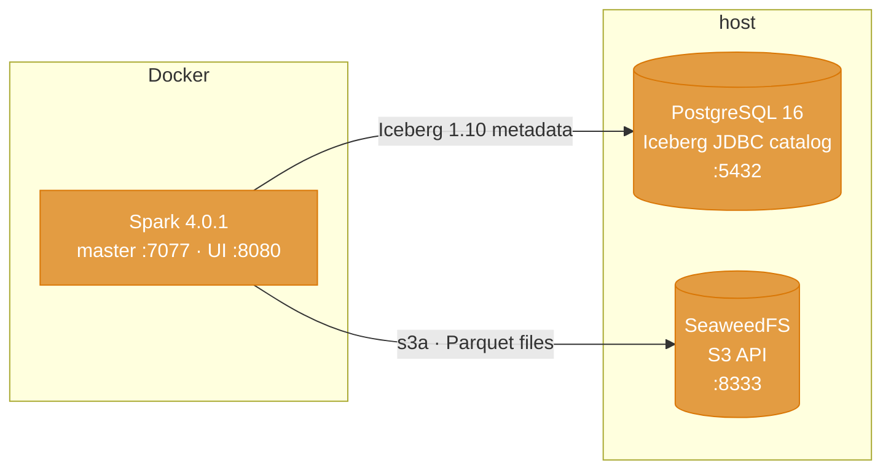

The simplest catalog that behaves like a real one is Iceberg's JDBC catalog, which keeps table metadata in an ordinary relational database, so I used Postgres, running natively on the host. For storage I wanted S3 semantics rather than a local directory, because every real lakehouse sits on object storage, so I picked **SeaweedFS**, which speaks the S3 API, and ran it natively too. On the Spark side, wiring that up is a handful of lines:

```properties
spark.sql.extensions              org.apache.iceberg.spark.extensions.IcebergSparkSessionExtensions
spark.sql.catalog.iceberg         org.apache.iceberg.spark.SparkCatalog
spark.sql.catalog.iceberg.type    jdbc
spark.sql.catalog.iceberg.uri     jdbc:postgresql://localhost:5432/iceberg_catalog
spark.sql.catalog.iceberg.warehouse  s3a://lakehouse/warehouse
```

And that's where it got hard, because Spark doesn't talk to S3 by itself. It goes through Hadoop's `s3a` connector, which is compiled against one specific version of the AWS SDK, and Iceberg's runtime has to agree with both. Get any of them slightly wrong and nothing tells you which one; you get a `ClassNotFoundException`, or a `NoSuchMethodError` from somewhere deep in the SDK, or a credentials failure that looks exactly like a credentials failure and isn't. Getting Spark to authenticate against SeaweedFS at all took a lot of trial and error with the `s3a` settings:

```properties
spark.hadoop.fs.s3a.endpoint                http://localhost:8333
spark.hadoop.fs.s3a.path.style.access       true    # SeaweedFS isn't AWS: no virtual-host bucket URLs
spark.hadoop.fs.s3a.connection.ssl.enabled  false   # plain HTTP on localhost
spark.hadoop.fs.s3a.impl                    org.apache.hadoop.fs.s3a.S3AFileSystem
```

and then a lot more trial and error with the JARs, until the combination that worked was pinned so hard that the first README warns about it in the troubleshooting section, parenthetical and all: *Hadoop 3.4.1 → AWS SDK v2.24.6 (not newer!)*. The download script from that week still pulls **both** AWS SDK bundles, the v1 bundle and the v2 one, because by that point I wasn't going to argue with anything that worked. All told it came to "~860MB of dependencies (exact versions required for compatibility)":

| Component | Pinned to | Why |
|---|---|---|
| Spark | 4.0.1 (Scala 2.13, Java 17) | the thing under test |
| Iceberg runtime | `iceberg-spark-runtime-4.0_2.13-1.10.0` | must match Spark's minor version and Scala version |
| Hadoop | `hadoop-aws-3.4.1` | provides `s3a` |
| AWS SDK v2 | `bundle-2.24.6` | the exact version Hadoop 3.4.1 was built against |
| AWS SDK v1 | `aws-java-sdk-bundle-1.12.780` | belt and braces |
| Postgres JDBC | `42.7.4` | for the Iceberg catalog |

**Most of what goes wrong when you upgrade a lakehouse isn't the engine; it's the dependency graph around it**, and the only way to learn that graph is to break it somewhere safe. The project's agent guide still has a section called *Critical Versions: Do not change without testing*, which is the same lesson written for machines.

Once it worked, it was an ordinary lakehouse, and the first thing any test of it does is the ordinary thing:

```sql
CREATE NAMESPACE IF NOT EXISTS iceberg.bronze;

CREATE TABLE iceberg.bronze.orders (
    order_id    STRING,
    customer_id STRING,
    amount      DOUBLE,
    created_at  TIMESTAMP
) USING iceberg;
```

The last decision in that first week was where everything should run, and it shaped the next nine months more than anything else. Spark went in Docker, because I'd want to swap its versions constantly. Postgres and SeaweedFS stayed native on the host, because they were storage, and storage should outlive the experiments. The first compose file still shows the argument I had with myself about how the two sides would reach each other: a bridge network, published ports and a `host.docker.internal` gateway, all commented out, and above them the line that won:

```yaml
spark-master:
  image: apache/spark:4.0.1-scala2.13-java17-python3-r-ubuntu
  network_mode: "host"
#    ports:
#      - "8090:8080"  # Spark Master Web UI
#      - "7077:7077"  # Spark Master
#    networks:
#      - lakehouse
#    extra_hosts:
#      - "host.docker.internal:host-gateway"
```

**Host networking made everything simple on my machine, and it's also the reason the title of this post is a port number.** Every container shared the host's ports with every native service, so from then on each new component had to find a port nobody else was using. Keep an eye on the port numbers in the diagrams; they're the plot.

## A catalog I had to build

Once I had tables, I wanted the kind of catalog people actually run in production: one that governs access, vends credentials, and lets more than one engine find the same tables. That meant **Unity Catalog OSS**, running alongside the Postgres catalog rather than replacing it, so both paths stayed testable.

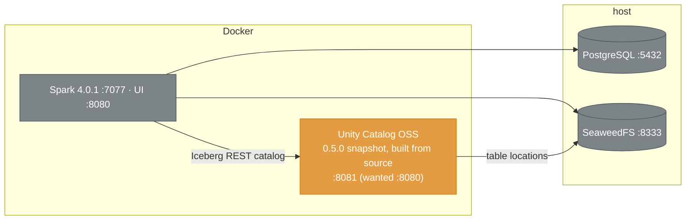

The problem was that the features I wanted were ahead of the published images. When I was preparing an episode of *OverArchitected* in March, the release I needed didn't have a Docker image yet, so I cloned the repository, built the image myself, and ran a 0.5.0 snapshot from source. It was the first time the stack ran something that hadn't been released, and it wasn't the last. It also needed a port: its default was 8080, which Spark's UI already had, so it moved to 8081. From Spark's side it's just a second catalog, talking Iceberg's REST protocol:

```properties
spark.sql.catalog.unity               org.apache.iceberg.spark.SparkCatalog
spark.sql.catalog.unity.catalog-impl  org.apache.iceberg.rest.RESTCatalog
spark.sql.catalog.unity.uri           http://localhost:8081/api/2.1/unity-catalog/iceberg
```

## Streams: Kafka and Zookeeper

Batch tables only tell half the story, so the next piece was streaming: Kafka for the events, with Zookeeper to coordinate it.

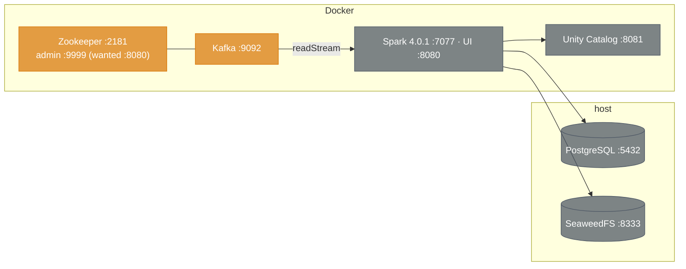

This part was harder than it had any right to be. When I finally sat down with it in January, the prompt was the whole mood of the week: "debug my kafka setup, why can't spark read it?" The answer was about eight small things at once. The streaming job never ran `from_json()` on Kafka's `value` column, so it was trying to aggregate raw bytes; a column was referenced as `total.revenue` instead of `total_revenue`; one alias was the wrong case; a debug query was blocking the stream. Kafka itself wasn't on host networking, so Spark couldn't reach it, and once it was, its connection string to Zookeeper was wrong. And Zookeeper's admin server, which listens on 8080 by default, was fighting Spark's web UI for the same port. Zookeeper lost, and moved to 9999.

The fix for the first of those is the part every Kafka tutorial skips: Kafka hands Spark bytes, and you have to tell it what they mean.

```python
kafka_df = (
    spark.readStream
    .format("kafka")
    .option("kafka.bootstrap.servers", "localhost:9092")
    .option("subscribe", "orders")
    .option("startingOffsets", "latest")
    .load()
)

parsed = kafka_df.select(
    f.from_json(f.col("value").cast("string"), event_schema).alias("event"),
    f.col("timestamp").alias("kafka_timestamp"),
)
```

Weeks later I was still citing Kafka as the cautionary tale; when I worried I was adding things too fast, the reason I gave was "how much trouble even setting up and testing kafka was".

## Data that misbehaves

A lakehouse with no data in it proves nothing, and a lakehouse full of clean data proves less than you'd think: every pipeline looks correct when nothing is ever late, duplicated or missing. I needed data that behaved like the real thing, which is to say *badly*, and at a volume that would actually exercise the stack.

Rather than invent a domain, I borrowed one. Databricks' [Casper's Kitchens](https://github.com/databricks-solutions/caspers-kitchens) simulates a ghost-kitchen delivery business, and I asked the agent to study how its generators worked and rebuild the idea for this stack ("please consult me first", I added, because I wanted to understand the shape of the data before it existed). What came out is a small Python package that simulates the full life of a food order:

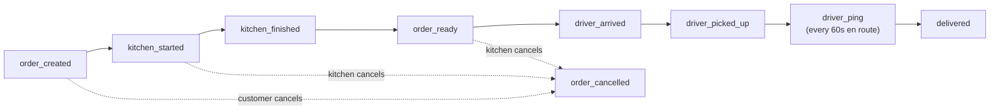

Each step takes a Gaussian amount of time, demand follows the day, and some brands are growing while others decline, so there are real trends for a pipeline to find:

```python
@dataclass
class ServiceTimes:
    """Gaussian distribution parameters for order lifecycle phases (in minutes)."""
    order_to_kitchen_start: tuple[float, float] = (2.0, 0.5)
    kitchen_prep: tuple[float, float] = (15.0, 5.0)
    kitchen_to_driver: tuple[float, float] = (5.0, 2.0)
    pickup_to_delivery: tuple[float, float] = (20.0, 8.0)
    driver_ping_interval_sec: int = 60
```

Demand peaks at noon and again from six to eight in the evening, and Fridays and Saturdays run 25 to 35 percent busier than a weekday. And then, on purpose, it breaks things:

```python
@dataclass
class ChaosConfig:
    """Data quality issue injection settings."""
    enabled: bool = True
    null_rate: float = 0.05            # 5% of fields nullified
    late_event_rate: float = 0.03      # 3% out-of-order events
    duplicate_rate: float = 0.02       # 2% duplicate events
    malformed_json_rate: float = 0.01  # 1% malformed body
```

| Chaos | What it tests |
|---|---|
| Null fields | schema enforcement, defaults, data quality checks |
| Late (out-of-order) events | watermarks, event time vs processing time |
| Duplicate events | idempotency, deduplication |
| Malformed JSON | parsing, dead-letter handling |

The same generator feeds both halves of the stack:

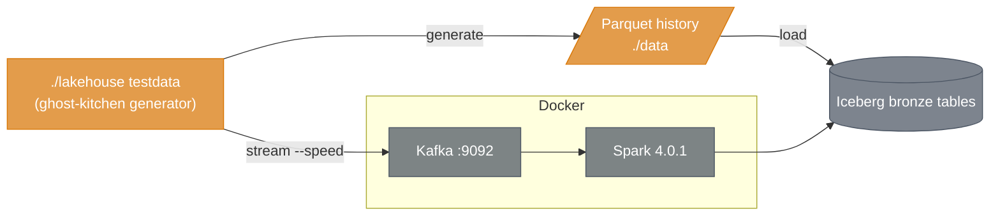

```bash
./lakehouse testdata generate --days 7     # history as Parquet
./lakehouse testdata load                  # into Iceberg bronze tables
./lakehouse testdata stream --speed 60     # replay into Kafka, an hour per minute
./lakehouse testdata stats
```

**The duplicates and late events are there because the interesting failures only show up when the data misbehaves**, and months later, when I tested AUTO CDC, cancellations and duplicate creation events were exactly the cases the feature existed for.

## Spark, twice

The point of all of this was testing Spark versions, and that's the part I designed most deliberately. Instead of upgrading 4.0 to 4.1 in place, the stack runs them **side by side**: each version gets its own compose file, its own container names, its own image (with the Java version the official image ships), and its own block of ports, so both clusters can be up at once and the same job can be submitted to either.

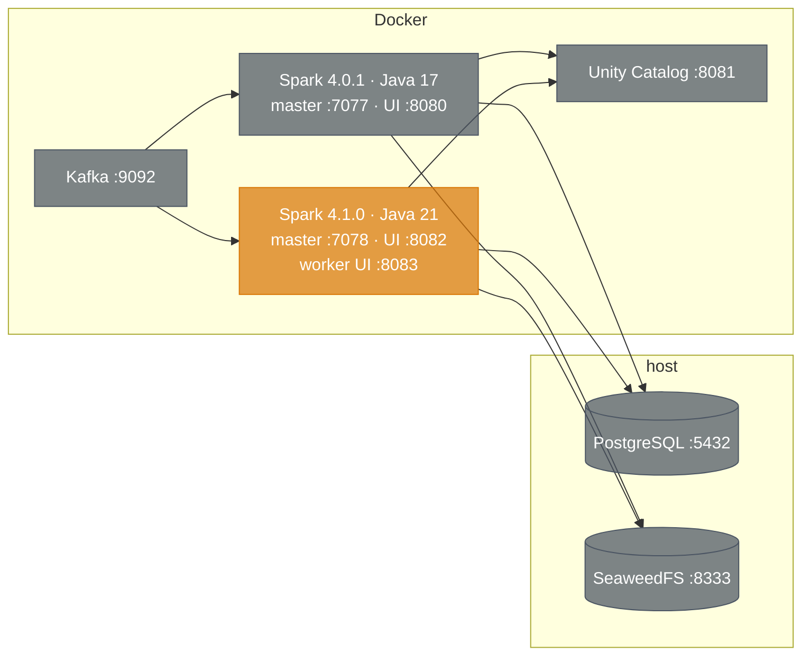

| | Spark 4.0.1 | Spark 4.1.0 |
|---|---|---|
| Compose file | `docker-compose.yml` | `docker-compose-spark41.yml` |
| Image | `apache/spark:4.0.1-scala2.13-java17-…` | `apache/spark:4.1.0-scala2.13-java21-…` |
| Master | 7077 | 7078 |
| Master UI | 8080 | 8082 |

```bash
./lakehouse start spark                  # Spark 4.0.1
./lakehouse start spark --version 4.1    # Spark 4.1.0, alongside it
```

That turned out to be the organising idea for a lot of what followed. Spark Declarative Pipelines arrived in 4.1, so the workshop I built on the stack became a pair of notebooks: the same medallion pipeline written imperatively on 4.0 and declaratively on 4.1, running against the same Iceberg tables at the same time.

## Orchestration: Airflow

Pipelines that only run when I type `spark-submit` aren't really pipelines, so in January the stack got **Apache Airflow**. The first version was Airflow 2.8, and within a week I upgraded it to 3.1, which was educational in the way major versions are: the webserver became an `api-server`, `schedule_interval` became `schedule`, `BashOperator` moved into a providers package, and the health endpoint moved.

In the middle of that upgrade, the Java version in one image flipped from 17 to 21 and back again, and my reaction at the time was correct, if not patient: "why do we keep switching java versions? this is a fundamental change we can't keep expecting users to keep up with". The rule that came out of it is that **Java versions are whatever the official images ship, and nobody changes them**.

The more useful correction was conceptual. The first architecture diagrams drew Airflow talking to Iceberg, and I asked the question that should have been asked earlier: "does airflow being linked to the iceberg api really make sense in the architecture diagrams? what is airflow really orchestrating in ths stack? just spark pipelines right?" It was. **Airflow doesn't touch the data; it tells Spark when to**, and the diagram got simpler once it said so:

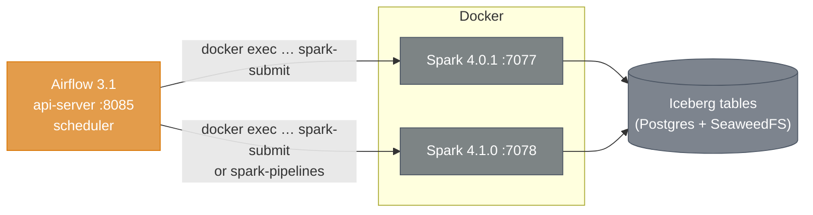

The stack ships three DAGs:

| DAG | What it does |
|---|---|
| `lakehouse_medallion_pipeline` | checks Kafka is reachable, *branches on which Spark version to use*, runs the medallion job on 4.0 or 4.1, then verifies the tables |
| `sdp_pipeline` | preflight, runs a declarative pipeline from its `spark-pipeline.yml` spec, verifies, then maintains |
| `iceberg_maintenance` | the chores nobody remembers: `rewrite_data_files` to compact small files, `expire_snapshots`, `remove_orphan_files` |

The branch in the first DAG is my favourite detail in the repo, because the version-testing idea reaches all the way into orchestration:

```python
choose_spark = BranchPythonOperator(
    task_id="choose_spark_version",
    python_callable=choose_spark_version,
)

run_pipeline_spark41 = BashOperator(
    task_id="run_pipeline_spark41",
    bash_command="""
        docker exec spark-master-41 /opt/spark/bin/spark-submit \
            /scripts/pipelines/pipeline_spark41.py
    """,
)

check_kafka >> choose_spark >> [run_pipeline_spark41, run_pipeline_spark40]
[run_pipeline_spark41, run_pipeline_spark40] >> verify_tables
```

Running declarative pipelines from Airflow was clumsier at first, because there was no operator for them; that changed in March, and I'll come back to it once SDP itself has been introduced.

## One CLI, built for agents

By now there were two Spark clusters, a streaming stack, two catalogs, an orchestrator and a pile of native services, and remembering which compose file, which ports and which container names went with which version had become a job in itself. So everything went behind a single entry point, `./lakehouse`, a bash CLI that wraps Docker Compose and hides the bookkeeping:

```bash
./lakehouse setup                        # prerequisites, Postgres catalog, JARs
./lakehouse preflight                    # do .env, Spark config and the catalog agree?
./lakehouse start all --version 4.1      # Spark + Kafka, then wait until they answer
./lakehouse start airflow                # optional services, one at a time
./lakehouse status --json                # machine-readable, for scripts and agents
./lakehouse logs spark-master
./lakehouse stop all
```

Run it with no arguments and it explains itself, including one line that would matter later:

```text
$ ./lakehouse help
Lakehouse Management CLI

Usage: lakehouse <command> [options] [--version 4.0|4.1]

Commands:
  setup               Validate environment and install dependencies
  check-config        Validate credentials between .env and spark-defaults.conf
  preflight           Run preflight checks before starting services
  migrate [--dry-run] Run database schema migrations
  status              Show all services status
  start [service]     Start service (spark|kafka|airflow|unity-catalog|all)
  ...
  testdata <cmd>      Test data generation (generate|stream|load|stats|clean)
  browsedata [table]  Browse Iceberg table rows (default: iceberg.bronze.orders)

Services:
  ...
  all            Spark + Kafka (not Unity Catalog or Airflow)
```

`all` means the core services, which I discovered the hard way on the morning of a recording, after a reboot, when `./lakehouse start all` brought back Spark and Kafka and not the catalog or MLflow I was about to demo.

The deeper reason for one CLI was that I wanted the stack to be **agent-first**. Early on I wrote down the goal: "I want people to feed an agent the repo, and be able to get up and running locally or on a cloud provider like AWS with minimal hitches." At the time, coding agents were far more reliable driving a well-behaved command line than reconstructing a sequence of `docker compose` invocations from a README, so the CLI was designed for them as much as for people. Commands fail with real exit codes and say what to do next, and `status --json` exists so an agent can read the state of the stack instead of scraping coloured terminal output.

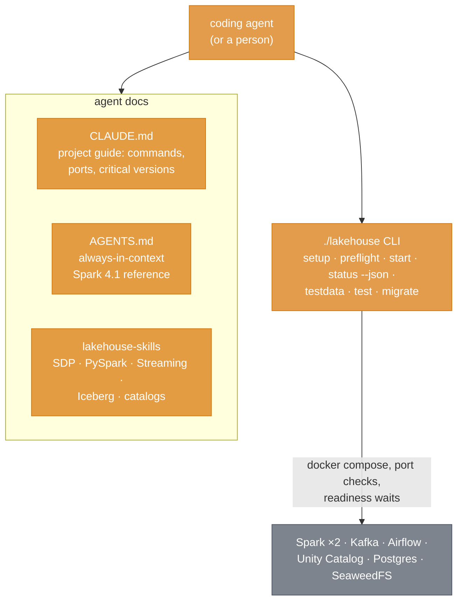

Some features came straight from me asking the obvious question, like "is there a cli test process in setup that checks if ports are available for the services?"; there wasn't, so now `start` checks every port it's about to need and refuses to run if something else is holding one:

```bash
check_port_available() {
    local port=$1
    local expected_container=$2

    if ! nc -z localhost "$port" 2>/dev/null; then
        return 0                      # port is free
    fi
    # port is in use: fine only if it's the container we expect
    if [ -n "$expected_container" ] && \
       docker ps --format '{{.Names}}' | grep -q "^${expected_container}$"; then
        return 0
    fi
    return 1                          # blocked by something else
}
```

The documentation is split the same way. `CLAUDE.md` works as an agent's guide to the project. `AGENTS.md` describes itself as a "compressed reference for AI agents. Always in context - no skill invocation required": Spark 4.1's breaking changes, standard imports, API quick references, the things an agent gets wrong when it's working from older training data. Deeper, task-specific knowledge went into **skills**, which grew into their own repo, [lakehouse-skills](https://github.com/lisancao/lakehouse-skills). That started because the agent kept stumbling over SDP's API, and I asked it, fairly pointedly, to write down what it had learned ("you had some struggles using the official API. can you create an SDP.md skills file"). Then I tested the skill the only way that means anything: a fresh agent session authored pipelines against the stack using nothing but that file, and wherever its output was wrong, the skill got fixed.

There's one design choice in the CLI I'd make differently now. Its definition of a healthy service is the one almost every homelab script settles on:

```bash
is_service_healthy() {
    local port=$1
    nc -z localhost "$port" 2>/dev/null
}
```

A service is up if *something* answers on its port. Here's what `status` says on my machine as I write this, with only some of the stack running:

```text
$ ./lakehouse status
================================
LAKEHOUSE STATUS
================================

System Services:
✓ PostgreSQL (port 5432)
✓ SeaweedFS (port 8333)

Unity Catalog (optional):
✓ unity-catalog
✓ Unity Catalog REST API (port 8081)

Spark 4.1 Containers:
✗ spark-master-41
✗ spark-worker-41

Airflow Containers:
✓ airflow-webserver
✗ Airflow UI (port 8085)
✓ airflow-scheduler

Ports:
  Unity Catalog:    8081 (REST API + Iceberg endpoint)
  Spark 4.0:        7077, 8080 (UI), 8081 (Worker UI)
  Spark 4.1:        7078, 8082 (UI), 8083 (Worker UI)
```

Two things in there are the whole post in miniature. The port table lists **8081 twice**: Unity Catalog moved there to get out of the Spark UI's way, and Spark 4.0's worker UI has been sitting on 8081 by default the entire time. And Airflow's container is up while its UI isn't answering, which the human-readable status reports honestly and the JSON version doesn't:

```json
"airflow": {
  "webserver": true,
  "scheduler": true
},
"all_healthy": false
```

**A port check tells you something is listening, not that it's the thing you think it is, at the version you think it is**, and a container check tells you something is running, not that it's serving. On a machine where every service shares one set of ports, that distinction eventually matters. It mattered in June, when a Spark "bug" I'd had written up with a minimal reproduction turned out to be an old Spark Connect server that had been answering on the port the whole time. That one gets its own post.

## Credentials, everywhere

A lakehouse at home has fewer secrets than a real one, but it has the same *shape* of secrets, and they multiply faster than you'd expect. The Iceberg catalog needs a Postgres username and password. Spark needs S3 keys for SeaweedFS. Unity Catalog needs its own copy of the storage credentials so it can hand them out. Airflow has an admin login, MLflow has a database, and every one of those values lives in more than one place.

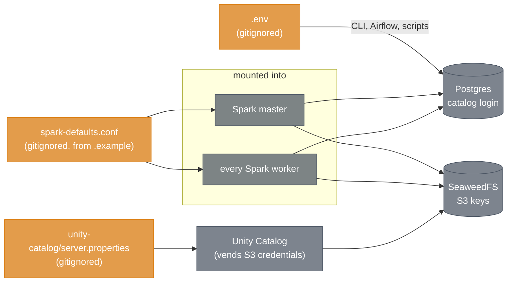

The pattern the repo settled on is boring on purpose. Real values live in files that are never committed (`.env`, `spark-defaults.conf`, the Unity Catalog `server.properties`), each with a checked-in `.example` template full of obvious placeholders like `your_access_key`, and `.gitignore` opens with a section literally titled *Credentials and Secrets*. The part that took longer to learn was that **the same secret stored in two files will eventually disagree**, and the error you get when it does never says so; Spark reports an S3 failure, or Iceberg reports a missing catalog. So the CLI grew a command that checks the copies against each other, and against the placeholders nobody replaced:

```text
$ ./lakehouse check-config
================================
CONFIGURATION CHECK
================================

1. Checking .env file...
   ✓ .env configuration valid

2. Checking spark-defaults.conf...
   ✓ Credentials consistent

3. Testing database connection...
   ✓ PostgreSQL connection successful

4. Testing S3 endpoint...
   ✓ S3 endpoint responding
```

It's also where I found my own worst habit in the codebase. An early version of the CLI connected to the catalog as a hardcoded Postgres user, and the user was *me*: my own username, baked into a script I was about to tell strangers to run. Reading credentials from `.env` instead of hardcoding them was one of the first fixes anyone would need to run the stack at all, and `detect-secrets` now sits in the pre-commit chain so the next version of that mistake doesn't make it into a commit.

The catalogs raise the stakes, because a catalog's job is partly to *hold* credentials so that engines don't have to. Unity Catalog can vend short-lived storage credentials to whoever asks for a table, which is the whole point of running it, but it needs a complete set of storage credentials to vend; in one setup it quietly skipped configuring a bucket until every S3 field was filled in, including a placeholder session token that a local SeaweedFS has no use for. And the classic Spark layout has the opposite problem: because every node that runs a driver needs the catalog, **the catalog password and the S3 keys end up mounted into the master and every worker.** That, more than anything, is why Spark Connect ended up in the stack.

## Testing it, and CI

A stack whose whole purpose is catching breakage needs to catch its own. The repo's tests come in two layers: fast unit tests (project structure, DAG definitions, pipeline transformations, the CLI's security guarantees) and integration tests that run against real services, one file per component: Iceberg CRUD, SeaweedFS, Kafka streaming, Unity Catalog, Airflow, the declarative pipelines across file and table formats, and a `test_fresh_install` that checks the thing I kept promising people, that it works from a clean clone. The integration tests read like a lakehouse tutorial, which is roughly the point:

```python
@pytest.mark.integration
class TestIcebergCRUD:
    def test_create_table(self, spark_with_postgres):
        spark = spark_with_postgres
        spark.sql("CREATE NAMESPACE IF NOT EXISTS iceberg.test_crud")
        spark.sql("""
            CREATE TABLE IF NOT EXISTS iceberg.test_crud.orders (
                order_id STRING, customer_id STRING,
                amount DOUBLE, created_at TIMESTAMP
            ) USING iceberg
        """)
        tables = spark.sql("SHOW TABLES IN iceberg.test_crud").collect()
        assert "orders" in [row.tableName for row in tables]
```

CI runs on **GitHub Actions**, as three workflows that hand off to each other (with a copy of the CI workflow on a self-hosted Gitea, so the same checks can run on my own hardware):

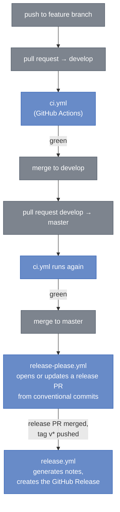

Inside `ci.yml`, the jobs run in stages that each gate the next:

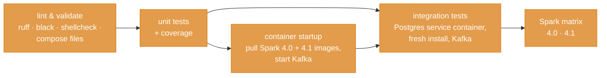

The last stage is the version-testing idea again, this time for the stack itself: the same checks run against both Spark images.

```yaml
spark-matrix:
  name: Spark ${{ matrix.spark-version }} Tests
  strategy:
    matrix:
      spark-version: ['4.0', '4.1']
      include:
        - spark-version: '4.0'
          image: apache/spark:4.0.1-scala2.13-java17-python3-r-ubuntu
        - spark-version: '4.1'
          image: apache/spark:4.1.0-scala2.13-java21-python3-r-ubuntu
          compose-file: docker-compose-spark41.yml
```

Around the tests sits the less glamorous machinery that makes a repo safe to hand to strangers (and their agents). Work flows from feature branches into `develop`, where CI runs on every pull request, and only then into `master`; releases are cut by release-please from conventional commit messages. The CI workflow pins its actions to commit SHAs rather than tags (going back through it for this post, I noticed two exceptions I should fix: the Codecov upload in CI, and the release workflows, which still use tags like `@v4`), the workflow's default permissions are read-only, and a pre-commit hook chain runs `detect-secrets`, `bandit`, `shellcheck`, `hadolint`, `ruff` and `black` before anything reaches a branch. That hardening came out of the same January week where I admitted I was scared I was going too fast; the test suite's own `test_security.py` still guards the fixes it produced, like removing an `eval` from the CLI and closing a SQL-injection path in `lakehouse migrate`.

CI also taught me one thing about the outside world. The Airflow image downloads a Spark release tarball, and once Spark 4.1.1 superseded 4.1.0, the old tarball moved from Apache's fast mirrors to the slow archive server, and the build started timing out. Nothing in my repo had changed; the internet had.

## Declarative pipelines and real time

The last layer is the reason I needed all the others: the new Spark features I actually demo.

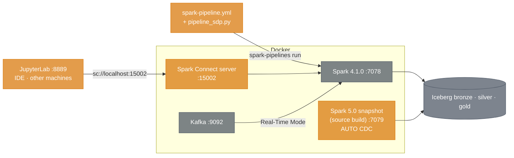

**Spark Declarative Pipelines** arrived in 4.1, which is exactly why two Sparks mattered. Instead of writing the order of operations yourself, you declare the tables you want and how each is derived, and SDP works out the graph. In this stack a small spec points at a Python file:

```yaml
name: lakehouse_pipeline
libraries:
  - glob:
      include: pipeline_sdp.py
catalog: iceberg
database: bronze
```

and the Python file is a set of decorated functions, from a streaming bronze table fed by Kafka up to gold aggregates:

```python
from pyspark import pipelines as dp
from pyspark.sql import functions as f

@dp.table(name="bronze.orders_streaming")
def orders_streaming():
    ...  # the Kafka readStream + from_json from earlier

@dp.materialized_view(name="gold.hourly_metrics")
def hourly_metrics():
    orders = spark.table("iceberg.silver.orders_enriched")
    return (
        orders.filter(f.col("event_type") == "order_created")
        .groupBy("event_date", "event_hour", "location_id", "city_name")
        .agg(
            f.count("order_id").alias("order_count"),
            f.sum("order_total").alias("total_revenue"),
            f.avg("order_total").alias("avg_order_value"),
        )
    )
```

It also turned into a benchmark: on the stack's own Iceberg, Postgres, SeaweedFS and Kafka, a million-row pipeline took 11.73s through `spark-pipelines` against 7.75s as a raw `spark-submit`, a fixed four seconds or so of orchestration that's noticeable on small jobs and irrelevant on large ones. **SDP is a pipeline abstraction, not a performance tool**, and I'd rather know that than guess at it on stage.

### Scheduling SDP: `SparkPipelinesOperator`

Running a pipeline by hand is a demo; running it every night is a platform, which brings Airflow back in. My first SDP DAG did what everyone did in early 2026: it wrapped the `spark-pipelines` CLI in a `SparkSubmitOperator`, pretending the CLI was a Spark application:

```python
# Before: SDP smuggled through spark-submit
SparkSubmitOperator(
    task_id="run_pipeline",
    application="/usr/local/bin/spark-pipelines",
    application_args=["run", "--spec", "/scripts/pipelines/spark-pipeline.yml"],
    conn_id="spark_default",
)
```

It mostly worked, and when it didn't, it failed in confusing ways, because SDP pipelines don't really run through `spark-submit`. The `spark-pipelines` CLI dispatches through Spark Connect when `SPARK_REMOTE` is set and through `spark-submit` otherwise, and in Spark 4.1 its shell wrapper took the JVM path even in Connect mode: it tried to start a *second* Spark Connect server on port 15002, next to the one already there, and rejected the `--master` and `--deploy-mode` flags the operator was passing. (Yes, 15002 again.)

In late March a dedicated [`SparkPipelinesOperator`](https://github.com/apache/airflow/pull/61681) landed in Airflow's Spark provider, and it's genuinely much easier. You hand it the pipeline spec and a command, and it works out the rest:

```python
# After: an operator that knows what a pipeline is
SparkPipelinesOperator(
    task_id="run_pipeline",
    pipeline_spec="/scripts/pipelines/spark-pipeline.yml",
    pipeline_command="run",          # or "dry-run" to validate the graph first
    conn_id="spark_default",
)
```

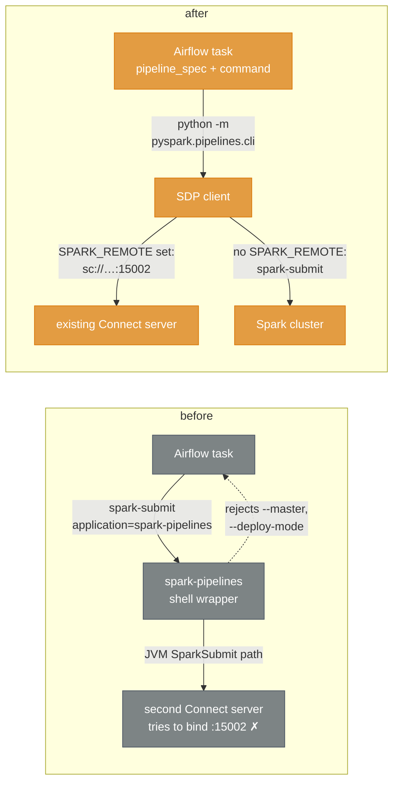

Under the hood it skips the shell wrapper and calls SDP's Python entry point directly, so it takes the right path in both modes. On top of that it adds the things you'd want from any Airflow operator. The spec, command, Spark conf and environment variables are all templated, so one DAG can run a pipeline per date partition. `pipeline_command` is validated, so a typo fails at parse time instead of at 2 a.m. And its logs say which Spark it actually talked to, which, given everything else in this post, I appreciate more than I can say.

That also made patterns cheap that used to be fiddly. The stack's demo DAGs include a `dry-run` → `run` chain, so a broken dependency graph is caught before any cluster time is spent:

```python
validate = SparkPipelinesOperator(task_id="validate", pipeline_spec=SPEC, pipeline_command="dry-run")
run      = SparkPipelinesOperator(task_id="run",      pipeline_spec=SPEC, pipeline_command="run")
validate >> run
```

alongside multi-pipeline chains, sensor-triggered runs that wait for data to land in Kafka, and per-pipeline resource tuning. The repo vendors a copy of the operator so its DAGs work regardless of which provider version is installed, with an import that prefers the upstream one when it's there.

### Converging streaming and batch

The usual answer to "we need real time" is a second engine. Spark does the batch work, Flink does the low-latency streaming, and now there are two runtimes, two codebases, two sets of semantics for the same business logic, and two things to keep upgraded. For a stack on one desktop, whose whole purpose is testing *Spark*, I wanted exactly one engine, and I wanted batch and streaming to be the same code wherever possible.

Spark gets surprisingly close. In the declarative pipeline above, the Kafka-fed bronze table is a streaming table and the silver and gold layers are materialized views, in the same file, over the same Iceberg catalog, run by the same `spark-pipelines run`. Outside of SDP, the same DataFrame logic can sit anywhere on the latency spectrum by changing one line, the trigger:

```python
query = (
    parsed_orders.writeStream
    .format("kafka")
    .option("topic", "orders_out")
    .outputMode("update")
    .trigger(availableNow=True)           # incremental batch: process what's there, then stop
  # .trigger(processingTime="1 second")   # micro-batch: latency measured in seconds
  # Real-Time Mode:                       # continuous: latency measured in milliseconds
)
```

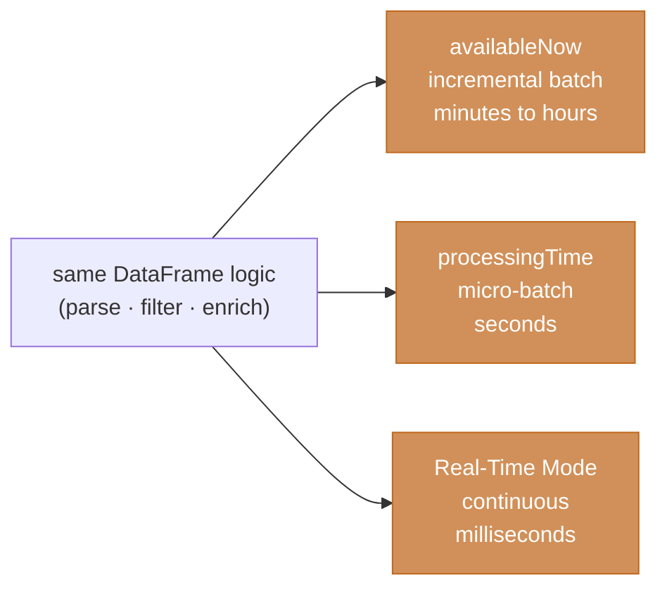

**Real-Time Mode** is what makes the one-engine argument hold at the low-latency end. Instead of scheduling a new micro-batch every interval, it keeps long-running tasks processing records as they arrive and only checkpoints periodically. With the stack's Kafka producing 500 events a second across 50 keys, a stateless Kafka-to-Kafka pipeline on Spark 4.1, on this desktop, measured a median latency of 17 milliseconds, steady across six runs:

| Percentile | Latency (6 runs) |
|---|---|
| p50 | 16 to 18 ms |
| p95 | 20 to 24 ms |
| p99 | 21 to 26 ms |

That's the latency range people usually reach for a second engine to get. But in 4.1 there were real limits, and the stack found all of them:

| 4.1 limitation | What it meant |
|---|---|
| **Stateless only** | the RTM operator allowlist permits projections, filters and broadcast joins, but not aggregations, shuffles or state stores; no running counts, no deduplication |
| **No Python UDFs** | Python UDF execution isn't on the allowlist |
| **No PySpark keyword** | `trigger(realTime=...)` didn't exist in PySpark 4.1 |
| **Console sink doesn't flush** | use a Kafka sink to see output |
| **`current_timestamp()` is per checkpoint, not per row** | latency has to be measured outside Spark, by a consumer comparing wall clocks |
| **Every stage runs at once** | a 16-partition Kafka source needs 16 task slots just to read; stateful plans need far more |

The PySpark gap was the most awkward for me, since everything else in the stack is Python. The quickstart got around it by reaching through Py4J into the JVM and setting Scala's trigger directly:

```python
def with_real_time_trigger(dsw, checkpoint_interval="5 minutes"):
    """Apply RealTimeTrigger to a DataStreamWriter via the JVM gateway."""
    jvm = dsw._spark._jvm
    jTrigger = jvm.org.apache.spark.sql.execution.streaming.RealTimeTrigger.apply(
        checkpoint_interval
    )
    dsw._jwrite = dsw._jwrite.trigger(jTrigger)
    return dsw
```

which works on a classic Spark session and is impossible over Spark Connect, where the client has no JVM to reach into; one more reason the Connect migration needed care.

Spark 4.2 added the native PySpark trigger, and 4.3 adds stateful operators to Real-Time Mode. That upgrade gets a post of its own.

## Building Iceberg for a Spark that doesn't exist

In May, the contributor who wrote AUTO CDC (SDP's new change-data-capture flow) asked me to put it through its paces before it went public. The feature had landed on Spark's `master` branch, and that meant it existed in exactly one place. `master` is where development for Spark's *next major version* happens, so it builds as `5.0.0-SNAPSHOT`: not a release, not even a preview, just whatever is on the branch that day. Before any Apache Spark release, the project cuts a **release candidate** (an "RC"), a build the community downloads, tests and votes on; only a passing vote turns it into a release. AUTO CDC hadn't made it onto a release branch yet, so there wasn't even a release candidate to try. The stack grew a third Spark, and it had to be built from source first:

```bash
cd ~/spark-src
./dev/make-distribution.sh --pip --tgz --connect -Phive -Phive-thriftserver   # 30 to 45 minutes
./build/mvn install -DskipTests -Phive -Phive-thriftserver                    # publish to ~/.m2
```

That was the easy half. AUTO CDC writes by merging changes into its target row by row, so the target needs a table format that supports row-level operations; point it at plain Parquet and it refuses with `AUTOCDC_TARGET_DOES_NOT_SUPPORT_MERGE`. I needed Iceberg. But Iceberg's Spark integration is built separately for each Spark minor version, and the newest one in Iceberg's repository was `spark/v4.1`. The released 4.1 runtime didn't just lack support for Spark 5.0; **it failed to load at all**, because Spark 5.0 had deleted an interface Iceberg compiles against. There was nothing to download, so I built one.

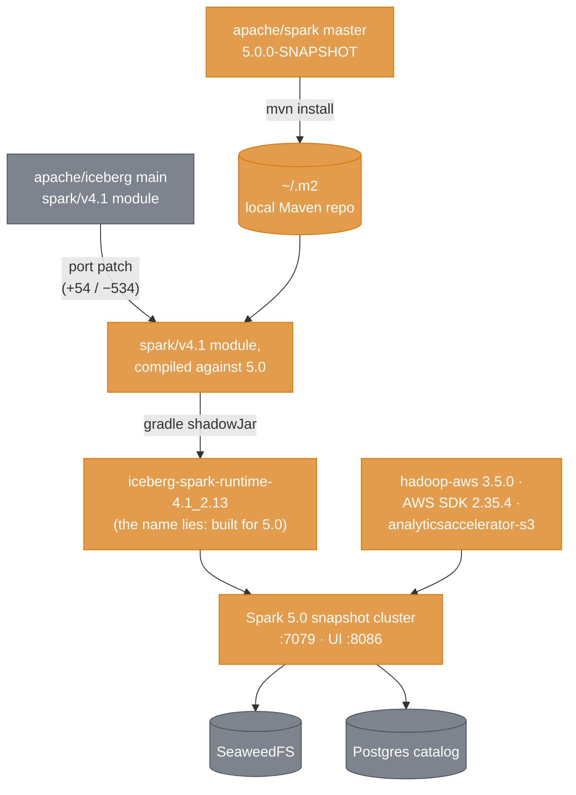

The port started by pointing Iceberg's build at the snapshot instead of the last release:

```diff
 # gradle/libs.versions.toml
 spark40 = "4.0.2"
-spark41 = "4.1.1"
+spark41 = "5.0.0-SNAPSHOT"
```

and then compiling, reading the errors, and fixing what Spark had changed underneath it. Most of the work fell into three kinds of API drift:

| What changed on `master` (the 5.0 snapshot) | What broke in Iceberg | What the port did |
|---|---|---|
| The DSv2 `View` connector interface was removed (replaced by `ViewInfo` and `TableViewCatalog`) | Iceberg's view support, its catalogs' view methods, and its SQL extensions, which are built on views | removed view support entirely: a **tables-only** port, which is most of the 534 deleted lines |
| New abstract methods: `Reducer.resultType()`, and nanosecond timestamp getters on `SpecializedGetters` | Iceberg's partition functions and row readers no longer compiled | implemented them (integer result types; nanosecond timestamps throw) |
| `StagedTable` and `TruncatableTable` both gained a *default* `reportDriverMetrics()` | Java refuses a class that inherits two unrelated defaults | overrode it explicitly in Iceberg's staged tables |

The last one is my favourite, because nothing was wrong with either interface on its own; Iceberg's staged tables implement both, and the moment both grew a default method with the same name, Java couldn't choose between them:

```java
@Override
public CustomTaskMetric[] reportDriverMetrics() {
  return new CustomTaskMetric[0];
}
```

Then the storage layer did to me exactly what it had done in December. Spark 5.0 moved to Hadoop 3.5.0, so the carefully pinned `s3a` stack from the first week was wrong again, and the new combination needed `hadoop-aws-3.5.0`, AWS SDK bundle 2.35.4, and a dependency that hadn't existed before, `analyticsaccelerator-s3`. Even Kafka needed its JARs copied into the distribution's own `jars/` directory before the new server would register it as a data source. **Every new Spark reopens the dependency graph from the first week**, and the only question is whether you find out on your own machine or on stage.

The runtime I ended up with kept the name `iceberg-spark-runtime-4.1_2.13` (the module wiring was reused), which is the most misleading filename I own. It can't do Iceberg views or SQL procedures. It could do exactly one thing well, native row-level `MERGE` into Iceberg tables, which is the one thing AUTO CDC needed, and with it I ran the feature against Kafka streams, Debezium change feeds and the ghost-kitchen orders, cancellations and all, weeks before it shipped. (I also asked whether I should port Delta the same way. The answer was no: AUTO CDC needs a table that implements Spark's row-level operations interface, and Delta does its merges through its own command instead, so a ported Delta still couldn't have been a target.) The findings are in AUTO CDC in Spark Declarative Pipelines.

The coda is that this wasn't a one-off. When Spark 4.2 shipped for real in July, Maven Central's Iceberg runtimes still stopped at 4.1, and I built Iceberg locally again to run the stack on it. Testing a new Spark release, it turns out, very often means building a little of the ecosystem that hasn't caught up to it yet.

## Why run Spark Connect at home at all

Spark Connect splits Spark in two: a thin client that builds query plans and sends them over gRPC, and a server that owns the driver and actually runs them. On a single desktop that sounds like complexity for its own sake, since the client and the server are the same machine. I ran it anyway, because the classic layout had three problems that got worse the bigger the stack got:

- **Code had to live beside the driver.** A pipeline couldn't be submitted from my laptop or from CI; it had to be copied into the Spark master container first, which is why the CLI grew copy, run and delete wrappers around `spark-submit`.
- **Credentials lived everywhere a driver could.** The catalog password and S3 keys were mounted into the master and every worker.
- **The application and the platform shared one environment.** Upgrading Spark changed the Python environment and JARs every job ran in, which is exactly backwards for a stack whose purpose is upgrading Spark.

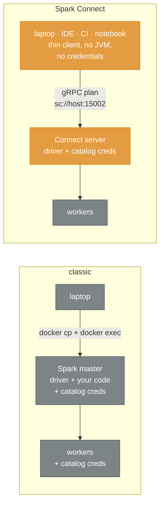

```python
from pyspark.sql import SparkSession

spark = SparkSession.builder.remote("sc://localhost:15002").getOrCreate()
spark.table("iceberg.gold.hourly_metrics").show()
```

There was also a practical reason: SDP leans on Connect's machinery even when you never type `sc://` yourself, so Spark's newest pipeline features were going to pull me toward it regardless.

Running it locally was not free. Things that had quietly worked stopped working, and the failures were instructive:

| Problem | What happened | What fixed it |
|---|---|---|
| Driver-only APIs | `spark.sparkContext.setLogLevel("WARN")` fails with `JVM_ATTRIBUTE_NOT_SUPPORTED`; the client has no `sparkContext`, `_jvm` or `_jsc`. An audit of one pipeline found 21 blocking calls, every one of them `setLogLevel` | log levels belong to the server; set them there |
| Config the client can't set | `spark.jars` and `spark.sql.extensions` are fixed when the server starts, so a client can't add Iceberg's extensions (and without them there's no `MERGE INTO` or `CALL iceberg.system.*`) | put the JARs and extensions on the server; check capabilities at client startup |
| A scary, harmless warning | the server logs `ClassNotFoundException: …IcebergSparkSessionExtensions` at startup, for its bootstrap session, before the JARs are loaded | verify by *using* `MERGE INTO` and `CALL`, not by reading the log |
| Connectors not registering | Kafka's JARs on `extraClassPath` weren't enough for a standalone Connect server to find the data source | copy them into the server's own `jars/` directory |
| Checkpoints | streaming checkpoints over S3A against SeaweedFS failed | keep checkpoints on `file://` paths on the server |
| One port, many servers | Connect's default port is 15002, and more than one Spark on the same machine wants it; Spark 4.1's shell wrapper could even start a second Connect server that fought the first | one server per port, explicitly; and check *which* server answered |

When I finally moved the stack's own medallion pipeline to Connect, on Spark 4.2 with a locally built Iceberg runtime, every one of its ten Iceberg tables came out identical to the classic run, down to the content hashes (1,027,129 rows in `bronze.orders` alone). The last row of that table is the one that bit hardest, and it's the story of the next post.

## Experimental agents

The *OverArchitected* episode had a premise I took more seriously than it deserved: *we're lazy; can AI manage the lakehouse for us?* So the stack grew three experimental agents, each a small service built on MLflow, with every model call routed through MLflow's AI Gateway and every step recorded by MLflow Tracing.

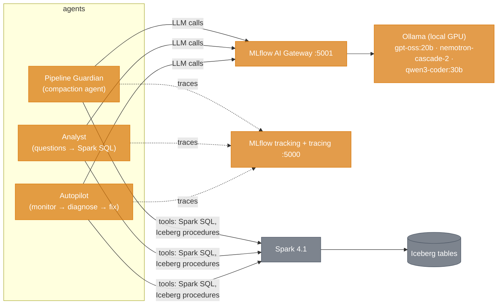

| Agent | Job | Tools it gets |
|---|---|---|
| **Pipeline Guardian** | the compaction agent: inspects Iceberg table health and decides when maintenance is due | `inspect_table` (row counts, snapshots, file counts), `check_quality` (null rates, freshness, duplicates), `run_maintenance`, `query_table` |
| **Analyst** | answers business questions over the gold layer ("what's the delivery performance in San Francisco this week?") | natural language to Spark SQL, then back to prose |
| **Autopilot** | watches the streaming pipeline and tries to fix it: throughput, latency, null spikes, schema drift, compaction when file counts climb | all of the above, in a monitoring loop |

The Guardian is the one I find most interesting, because table maintenance is exactly the kind of chore people forget. Iceberg tables fed by streams accumulate small files and old snapshots until reads slow down, and deciding *when* to compact is a judgement call about file counts, table size and query patterns. The agent makes the judgement; the tool it calls is deliberately boring:

```python
def run_maintenance(table_name: str, action: str) -> dict:
    """Run Iceberg maintenance: compact, expire_snapshots, remove_orphans."""
    spark = get_spark()
    if action == "compact":
        spark.sql(f"CALL iceberg.system.rewrite_data_files(table => '{table_name}')")
    elif action == "expire_snapshots":
        cutoff = (datetime.now() - timedelta(days=7)).strftime("%Y-%m-%d %H:%M:%S")
        spark.sql(
            f"CALL iceberg.system.expire_snapshots("
            f"table => '{table_name}', "
            f"older_than => TIMESTAMP '{cutoff}', retain_last => 5)"
        )
    ...
```

Handing that judgement to a model, with a narrow set of tools and a full trace of what it looked at and why, is a reasonable experiment. It is also, and I want to be clear about this, an experiment: an agent with `run_maintenance` and an arbitrary-SQL tool can do real damage to real tables, which is why these live under `scripts/demos` and nowhere near anything I care about.

They were also the part of the stack where I pushed hardest on keeping everything open. The first version routed calls to a hosted model, and before the recording I asked for the opposite: "Can you hook up a local model into our lakehouse-stack instead of anthropic api? we go full oss if we can it will be a fun story. A US model is.. preferred". The gateway now points at models served locally through Ollama on the same desktop's GPU, and a hosted model is a one-line route change if you want one:

```yaml
endpoints:
  - name: chat
    endpoint_type: llm/v1/chat
    model:
      provider: openai          # Ollama speaks the OpenAI API
      name: gpt-oss:20b
      config:
        openai_api_base: http://localhost:11434/v1
```

**An open lakehouse whose agents phone a closed API for every decision isn't really an open lakehouse**, and on a desktop with a decent GPU, it doesn't have to be.

---

## Someone else's machine

In April the repo got its first outside contributor, and he immediately found everything that only worked because it was *my* machine. Denis Arnaud opened [four](https://github.com/lisancao/lakehouse-at-home/pull/37) [pull](https://github.com/lisancao/lakehouse-at-home/pull/38) [requests](https://github.com/lisancao/lakehouse-at-home/pull/39) [in two days](https://github.com/lisancao/lakehouse-at-home/pull/40): the Unity Catalog image tag had vanished from Docker Hub; the CLI assumed GNU `df`, which macOS doesn't have; and the host networking and the `/data/spark` volume path (which exists because of how I partitioned my own drives) didn't translate to a Mac at all. He replaced them with named volumes and the very `host.docker.internal` gateway I'd commented out in December, and fixed a timestamp parse that Spark 4's ANSI mode rejects along the way:

```python
# Before: under ANSI mode a failed parse raises instead of returning null,
# so the coalesce never reaches its second format.
f.coalesce(
    f.to_timestamp("ts", "yyyy-MM-dd'T'HH:mm:ss.SSSSSS"),
    f.to_timestamp("ts", "yyyy-MM-dd'T'HH:mm:ss")
)

# After: try_to_timestamp returns null on a mismatch.
f.coalesce(
    f.try_to_timestamp(events_df.ts, f.lit("yyyy-MM-dd'T'HH:mm:ss.SSSSSS")),
    f.try_to_timestamp(events_df.ts, f.lit("yyyy-MM-dd'T'HH:mm:ss"))
)
```

While I was reviewing them, the coding agent helpfully opened its own versions of the same fixes. My message to it was not diplomatic ("why are you creating all these new PRs without my consent either. its getting kind of messy"), and then, more to the point, "in the OSS community we give credit and encourage people's PRs, not.. just take them and implement it ourselves. lol". I closed its copies and merged his.

## Where it is now

Put together, it looks like this:


The `./lakehouse` CLI starts, checks and stops every box above, and GitHub Actions runs the test suite against Spark 4.0 and 4.1 on every pull request.

And for anyone who wants to find their way around the repo:

```text
lakehouse-at-home/
├── lakehouse                     the CLI: setup · check-config · start/stop/status · testdata · test · migrate
├── docker-compose*.yml           one compose file per service: Spark 4.0, Spark 4.1, Kafka,
│                                   Unity Catalog, Airflow, MLflow, notebooks
├── config/                       Spark, Unity Catalog, Airflow, MLflow configs (.example only; live ones are gitignored)
├── dags/                         Airflow DAGs: medallion pipeline, SDP pipeline, Iceberg maintenance
├── scripts/
│   ├── pipelines/                the medallion pipeline, imperative (4.0) and declarative (4.1)
│   ├── testdata/                 the ghost-kitchen generator, with chaos
│   ├── demos/                    showcase demos and the experimental MLflow agents
│   ├── quickstarts/              Iceberg, Kafka streaming, and friends
│   ├── connectivity/             smoke tests for each service
│   └── tools/                    Kafka producer, helpers
├── notebooks/                    the 4.0 vs 4.1 workshop pair
├── benchmarks/                   pipeline, source and UDF benchmarks
├── tests/                        pytest: unit + integration (one file per service)
├── docs/                         getting started, guides, deployment, troubleshooting
├── terraform/                    AWS deployment (VPC, S3, RDS, EMR)
├── terraform-databricks/         Databricks as a managed destination
├── .github/ · .gitea/            CI and release workflows
├── CLAUDE.md                     agent guide to the project
├── AGENTS.md                     always-in-context Spark 4.1 reference for agents
└── .claude/skills/               agent skills, loaded on demand (SDP first; the rest grew into lakehouse-skills)
```

In April I reframed it from a hobby into a composable reference architecture, the pieces you'd need for a Databricks-equivalent lakehouse with each one swappable, and in May a stripped-down, Spark Connect-first copy became [open-lakehouse](https://github.com/open-lakehouse/open-lakehouse) for team demos on AWS. The original stays the messier workbench, and it's still where new versions land first.

Some of it is unfinished, and I'd rather say so. The Terraform for AWS and Databricks has never been applied end to end, and the IoT and personal-data half of the plan is still a plan. But the thing I built it for, it does. AUTO CDC shipped in Spark 4.2 in July; by then I'd already run it on a Spark that didn't officially exist yet, against data designed to misbehave, on my own desktop, and I knew where its edges were.
