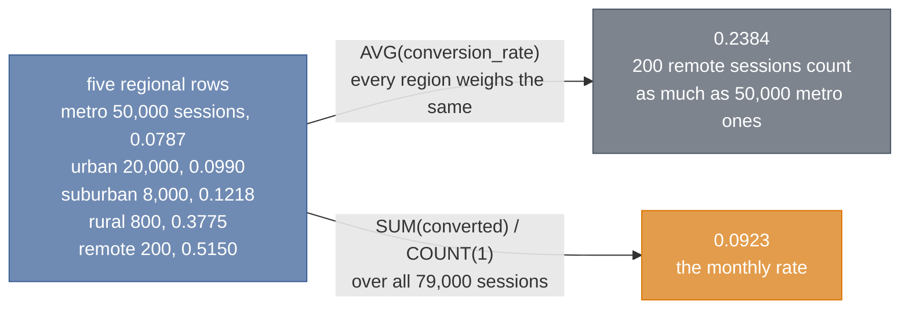
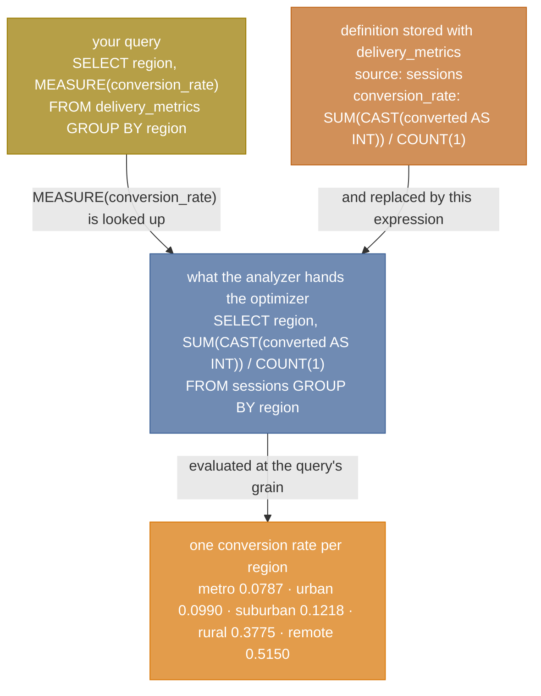

import img0 from "./metric-views-spark-42-file.gif";
import img1 from "./metric-views-spark-42-query.gif";
import img2 from "./metric-views-spark-42-define.gif";
import img3 from "./metric-views-spark-42-register.gif";
import img4 from "./metric-views-spark-42-jdbc.gif";
import img5 from "./metric-views-spark-42-dashboard.gif";
import img6 from "./metric-views-spark-42-agent.gif";

*Originally published on [systems/null](https://systemsnull.net/posts/data-engineering-ai/metric-views-spark-42).*

[Metric views](https://issues.apache.org/jira/browse/SPARK-54119) landed in Spark 4.2 this past summer, and they address a common, hard-to-catch issue in many organizations: incongruent statistics. For instance, a dashboard's revenue figure may differ depending on 1) who owns it and is in charge of the query and 2) the data they are using to calculate it. Agents issuing ad hoc queries indefinitely compound this by creating inconsistent definitions and then circulating them, and a figure itself is hard to judge correctness from without domain knowledge.

An analyst-built dashboard and a vibe-coded dashboard can both look correct when viewed individually. For example, 43% and 57% look equally plausible as a growth percentage, and the hilarious part is that they can *both* be wrong. Then, on top of that, there's the even worse issue of these figures propagating into other computations and not being updated easily. In an ideal world, the analyst writes it once, updates it when they need to update the query itself, and then everyone's agents/applications/dashboards pull from that and get updated automatically.

Lucky for us, Apache Spark 4.2's release has come to save us from this special type of data engineering hell before it gets any more out of hand.

**I defined one metric view, `delivery_metrics`, and then asked Spark SQL, a JDBC client, a dashboard, and a Claude agent for the same conversion rate. All four used the definition stored in Spark's catalog and returned 0.0923 for the month, with the same regional breakdown. Without that definition, valid SQL produced 0.2384, and the raw-table agent began with the wrong year before spending six statements reconstructing the answer.**

A metric view in Spark is a view stored in YAML instead of a script or traditional query. It names a source table, dimensions that queries can group by, and measures, each of which is an aggregate formula with no grouping attached. A query asks for a measure with `MEASURE()` and brings its own `GROUP BY`, and Spark evaluates the formula at the defined level. The formula is written once, queried at any breakdown, and gives the same answer a hand-written query would provide. It sounds complicated, but once you look at the YAML file itself you'll go "Oh, is that it?"

## A metric view in one screen

The definition is one file accessible to Spark, in this case `metrics/delivery_metrics.yaml`:

```yaml
version: 0.1
source: default.sessions
dimensions:
  - name: region
    expr: region
  - name: session_date
    expr: session_date
measures:
  - name: total_sessions
    expr: COUNT(1)
  - name: converted_sessions
    expr: SUM(CAST(converted AS INT))
  - name: conversion_rate
    expr: SUM(CAST(converted AS INT)) / COUNT(1)
  - name: active_users
    expr: COUNT(DISTINCT user_id)
```


Registering it is one statement with the file's contents between the dollar-sign markers:

```sql
CREATE VIEW default.delivery_metrics WITH METRICS LANGUAGE YAML AS $$
  ...the file...
$$
```

A query names measures with `MEASURE()` and supplies its own grouping:

```sql
SELECT region,
       MEASURE(total_sessions) AS sessions,
       ROUND(MEASURE(conversion_rate), 4) AS conversion_rate,
       MEASURE(active_users) AS active_users
FROM delivery_metrics
GROUP BY region
ORDER BY sessions DESC
```

```
+--------+--------+---------------+------------+
|  region|sessions|conversion_rate|active_users|
+--------+--------+---------------+------------+
|   metro|   50000|         0.0787|        6370|
|   urban|   20000|          0.099|        2519|
|suburban|    8000|         0.1218|         974|
|   rural|     800|         0.3775|          99|
|  remote|     200|          0.515|          32|
+--------+--------+---------------+------------+
```


Without the `GROUP BY`, the same measures come back for the month: 79,000 sessions, a conversion rate of 0.0923, 9,994 active users. The formula appears in one place and each query evaluates it at its own grain.

That matters because a conversion rate is a ratio and an active-user count is a distinct count; neither can be assembled from smaller pieces. The unweighted average of the five regional rates above is 0.2384, against a monthly rate of 0.0923. The sum of thirty daily active-user counts is 69,420, against 9,994 distinct users in the month. Both wrong answers come from valid SQL that runs without error.



## Defining one

A definition is five fields:

| Field | What it holds |
|---|---|
| `version` | The format version; `0.1` in Spark 4.2 |
| `source` | What the measures are computed over: a table, a view, or a SQL query |
| `filter` | Optional. A boolean expression applied to every query of the view |
| `dimensions` | Scalar expressions queries can group and filter by, each with a `name` and an `expr` |
| `measures` | Aggregate expressions with no grouping, each with a `name` and an `expr` |

A measure is any aggregate expression Spark SQL accepts, and a dimension is any scalar expression. `source` can be a query; `metrics/order_metrics.yaml` uses one to join sessions to orders, bake in a filter, derive two dimensions that exist as columns in neither table, and define measures over the join:

```yaml
version: 0.1
source: >
  SELECT s.session_id, s.user_id, s.region, s.session_date, s.converted,
  o.order_id, o.order_total
  FROM default.sessions s LEFT JOIN default.orders o ON s.session_id = o.session_id
filter: region <> 'remote'
dimensions:
  - name: region
    expr: region
  - name: session_date
    expr: session_date
  - name: day_type
    expr: CASE WHEN dayofweek(to_date(session_date)) IN (1, 7) THEN 'weekend' ELSE 'weekday' END
  - name: region_tier
    expr: CASE WHEN region IN ('metro', 'urban') THEN 'core' ELSE 'long_tail' END
measures:
  - name: sessions
    expr: COUNT(1)
  - name: conversion_rate
    expr: SUM(CAST(converted AS INT)) / COUNT(1)
  - name: paying_users
    expr: COUNT(DISTINCT CASE WHEN order_id IS NOT NULL THEN user_id END)
  - name: orders
    expr: COUNT(order_id)
  - name: revenue
    expr: SUM(order_total)
  - name: aov
    expr: SUM(order_total) / NULLIF(COUNT(order_id), 0)
  - name: arppu
    expr: SUM(order_total)
      / NULLIF(COUNT(DISTINCT CASE WHEN order_id IS NOT NULL THEN user_id END), 0)
```


The left join keeps sessions that never ordered, so the conversion rate counts them. The filter excludes the remote region from every query of the view. `day_type` and `region_tier` are defined once, in the view. The measures fix the definitions: a paying user is a distinct user with an order, and ARPPU divides revenue by that count. Qualified names (`default.sessions`, not `sessions`) keep the definition meaning the same thing from any current database.

## Registering it in the catalog

Spark reads the catalog object, not the file. `make register` runs `apps/register.py`, which sends the `CREATE VIEW` statement for each file in `metrics/` (dropping any existing view first, since `OR REPLACE` doesn't replace a metric view in 4.2.0) and describes the result. Spark plans the aggregation at create time to infer each column's type. A measure with no aggregate, or a reference to a column the source lacks, fails at registration rather than at the first query:

```
default.delivery_metrics  <-  metrics/delivery_metrics.yaml
    region               string
    session_date         string
    total_sessions       bigint
    converted_sessions   bigint
    conversion_rate      double
    active_users         bigint
```


From then on the definition has the catalog-backed lifetime and discovery of a view. It appears in `SHOW VIEWS`, `DESCRIBE TABLE` lists dimensions and measures as typed columns, and `DESCRIBE TABLE EXTENDED` shows `Type: METRIC_VIEW` with the YAML itself under `View Text`. The dashboard and the agent in the demo both read the definition from there.

The demo's server keeps its catalog in a Hive metastore on a Docker volume, so a view registered from one session is visible to every session and survives a restart. On another deployment it is an entry in whatever catalog Spark already uses.

## Querying at any grain

`measure` is registered as an aggregate function, but it never runs. The analyzer finds an aggregate sitting on a metric view, looks each `MEASURE(name)` up in the definition, substitutes the formula, projects the source through the dimension expressions, and hands the optimizer an ordinary aggregation. The query's `GROUP BY` sets the grain because it is the only `GROUP BY` in the plan.



`EXPLAIN` confirms it. The optimized plan contains no metric view, only an aggregate over the two columns the measure needs:

```
== Optimized Logical Plan ==
Aggregate [region], [region, round((cast(sum(cast(converted as int)) as double) / cast(count(1) as double)), 4) AS conversion_rate]
+- Project [converted, region]
   +- Relation spark_catalog.default.sessions[...] parquet
```

That is the plan a hand-written aggregate query produces, with the same column pruning and partial aggregation. The optimized plan has no metric-view operator; execution receives the same aggregate plan as the hand-written query.

Filters on dimensions and on source columns, `GROUP BY ALL`, `MEASURE()` inside expressions, aliases in `HAVING` and `ORDER BY`, and `F.expr("measure(active_users)")` from the DataFrame API all work.

One rule follows from the rewrite: a measure is evaluated at the grain of the query that calls `MEASURE()`, and its result is an ordinary column after that. Rolling a `MEASURE()` result up in an outer query aggregates that column, not the measure. Ask for each number at the grain it will be shown.

## Using it from everywhere

The view is in the catalog, so anything that can send SQL to the server can use it, and none of them needs to know how a measure is computed. I used the same `default.delivery_metrics` definition in four contexts; this was not four implementations of conversion rate, but four clients asking Spark for the same catalog measure:

| Client | What it asked for | Result |
|---|---|---|
| Spark SQL | Monthly and regional `MEASURE(conversion_rate)` | 0.0923 overall; metro 0.0787, urban 0.0990, suburban 0.1218, rural 0.3775, remote 0.5150 |
| Command-line JDBC client | Regional `MEASURE(conversion_rate)` | The same five regional rates |
| Streamlit dashboard | The measures and `region` dimension discovered from the catalog | The same five regional rates, rendered as a table and chart |
| Claude agent | June conversion rate overall and by region | 0.0923 overall and the same five regional rates, in two statements |

The agreement is the point. The SQL client, dashboard and agent do not carry separate copies of the formula `SUM(CAST(converted AS INT)) / COUNT(1)`; they carry a request for `conversion_rate`, and Spark resolves that request from the one definition above.

| Client | What it is | What it needs |
|---|---|---|
| `make jdbc` | A command-line client using Spark Connect's JDBC driver | The driver jar; any BI tool with a JDBC connection is in the same position |
| `make dashboard` | A Streamlit page that discovers metric views in the catalog and renders them | The dimension and measure names from `DESCRIBE` |
| `make agent` | A Claude agent with one `run_sql` tool | The views' YAML in its context, and a rule to ask at the right grain |

**JDBC, with no Python at all.** `apps/jdbc.sh` fetches `spark-connect-client-jdbc` from Maven Central and runs a command-line JDBC client (Beeline) from the Spark image:

```bash
make jdbc SQL="SELECT region, MEASURE(total_sessions) AS sessions,
  ROUND(MEASURE(conversion_rate), 4) AS conversion_rate, MEASURE(active_users) AS active_users
  FROM delivery_metrics GROUP BY region ORDER BY sessions DESC"
```

```
+-----------+-----------+------------------+---------------+
|  region   | sessions  | conversion_rate  | active_users  |
+-----------+-----------+------------------+---------------+
| metro     | 50000     | 0.0787           | 6370          |
| urban     | 20000     | 0.099            | 2519          |
| suburban  | 8000      | 0.1218           | 974           |
| rural     | 800       | 0.3775           | 99            |
| remote    | 200       | 0.515            | 32            |
+-----------+-----------+------------------+---------------+
```


**A dashboard with no formula in it.** `apps/dashboard.py` asks the catalog which views are metric views, reads each one's YAML, offers the dimensions and measures as controls, and runs the `MEASURE()` query for whatever is picked. A measure added to the file and registered with `make register` appears in the dropdown with no change to the dashboard.

```python
for view in spark.sql("SHOW VIEWS").collect():
    name = f"{view.namespace}.{view.viewName}"
    info = {r.col_name: r.data_type for r in spark.sql(f"DESCRIBE TABLE EXTENDED {name}").collect()}
    if info.get("Type") == "METRIC_VIEW":
        definition = yaml.safe_load(info["View Text"])
```

With `default.delivery_metrics` selected, `region` as the group-by and three measures ticked, the page runs this and draws the result as a table and a bar chart, with the definition it read from the catalog in a collapsed section underneath:

```sql
SELECT region,
       MEASURE(total_sessions)     AS total_sessions,
       MEASURE(converted_sessions) AS converted_sessions,
       MEASURE(conversion_rate)    AS conversion_rate
FROM default.delivery_metrics
GROUP BY region ORDER BY total_sessions DESC
```

```
+--------+--------------+------------------+---------------+
|  region|total_sessions|converted_sessions|conversion_rate|
+--------+--------------+------------------+---------------+
|   metro|         50000|              3937|         0.0787|
|   urban|         20000|              1979|          0.099|
|suburban|          8000|               974|         0.1218|
|   rural|           800|               302|         0.3775|
|  remote|           200|               103|          0.515|
+--------+--------------+------------------+---------------+
```


**An agent using the same view.** `apps/agent.py` gives Claude one tool, `run_sql`, the metric views' definitions read from the catalog, and one rule: ask for a measure at the grain the answer needs. When I asked for June's conversion rate overall and by region, it used `default.delivery_metrics` twice: once at the regional grain and once for the month.

```sql
SELECT region,
       MEASURE(conversion_rate) AS conversion_rate,
       MEASURE(total_sessions) AS sessions
FROM default.delivery_metrics
GROUP BY region
ORDER BY region;

SELECT MEASURE(conversion_rate) AS conversion_rate,
       MEASURE(total_sessions) AS sessions
FROM default.delivery_metrics;
```

The answer was 0.0923 overall across 79,000 sessions, followed by the same regional rates returned by Spark SQL, JDBC and the dashboard. With only the raw tables, the same model's first statement filtered for June **2024**, returned no rows because the data was from 2026, and then needed five more statements to inspect the date range, calculate the rates and verify the `converted` flag against the orders table. It eventually got the right answer, but only after reconstructing context and business logic that the metric view supplied immediately.

**A harder agent question.** The second definition, `default.order_metrics`, tests semantics that cannot be inferred from column names alone. I asked:

```text
$ make agent Q="What's the average order value and revenue per paying user
                for core regions on weekends?"

[sql]
SELECT MEASURE(aov) AS aov, MEASURE(arppu) AS arppu, MEASURE(revenue) AS revenue,
       MEASURE(orders) AS orders, MEASURE(paying_users) AS paying_users
FROM default.order_metrics WHERE region_tier = 'core' AND day_type = 'weekend'

[answer]
For weekend sessions in core regions (metro and urban):
- Average order value: about $31.52. That's $49,020.84 in revenue across 1,555 orders.
- Revenue per paying user: about $34.35. That's the same revenue across 1,427 paying users.
```


One statement at the right grain, checkable without re-deriving it. The agent was not told what "core" means or what a paying user is; both definitions came from the catalog. With only the tables, it needed eight statements, including five attempts to find and read the metric view definition so it could discover that `core` meant metro and urban.

## The agent with and without the metric view

The script has a second mode, `--context tables`, that shows the model only the raw tables. Same model, same tool, same questions:

| Question | With the metric view | With only the tables |
|---|---|---|
| Conversion rate, overall and by region | 2 statements, both `MEASURE()` | 6, including a wrong-year filter, a date-range check, and a join to verify the flag |
| Users active in June | 2 | 2, plus the sum of the daily counts, computed to show why not to use it |
| AOV and ARPPU for core regions on weekends | 1 | 8, five of them finding and reading the metric view's definition in the catalog to learn what "core" means |

The model eventually got every number right both ways, but that final correctness hides the experiment. With the metric views, it issued short queries against named measures whose definitions were already fixed. With only the tables, it guessed the wrong year, explored the schema, verified flags and searched the catalog for the meaning of a business term. The metric view changed the shape of the work: one definition reused by every client, SQL that is checkable without re-deriving its business logic, and an agent that can ask for a metric instead of inventing one. Full transcripts are in [`apps/RUNS.md`](https://github.com/lisancao/spark-demos/blob/main/demos/01_metrics_views/apps/RUNS.md).

## Get started

The demo needs Docker, [uv](https://docs.astral.sh/uv/), Make, and an Anthropic API key for the agent:

```bash
make setup           # client venv, plus streamlit and the anthropic SDK
make data            # generate the dataset
make up              # Spark Connect on apache/spark:4.2.0, Hive metastore on a volume
make register        # metrics/*.yaml into the catalog
make jdbc SQL="..."  # beeline over jdbc:sc://
make dashboard       # http://localhost:8501
make agent Q="..."   # add CONTEXT=tables to hide the metric views from it
```

- [spark-demos/01_metrics_views](https://github.com/lisancao/spark-demos/tree/main/demos/01_metrics_views): the definitions, the register script, the JDBC wrapper, the dashboard, the agent and its transcripts, and the tests that pin every number quoted from the demo
- [SPARK-54119](https://issues.apache.org/jira/browse/SPARK-54119), the epic, with the [SPIP](https://docs.google.com/document/d/1xVTLijvDTJ90lZ_ujwzf9HvBJgWg0mY6cYM44Fcghl0/edit) by Linhong Liu, Can Efeoglu, Justin Talbot, Gengliang Wang, Liang-Chi Hsieh and Daniel Tenedorio
- [Databricks metric views](https://docs.databricks.com/aws/en/metric-views/), where the format is heading: declared joins, window measures, composed measures

The useful part is still the simple one: I defined conversion rate once, then Spark SQL, JDBC, a dashboard and an agent all asked for it at the grain where they needed to show it. That is a much better boundary for an agent-native data system than hoping every client independently writes the same correct SQL.
