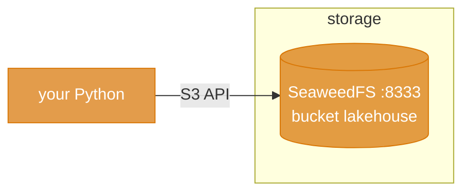
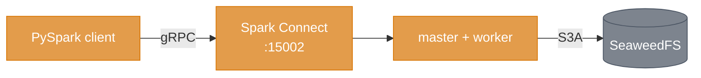
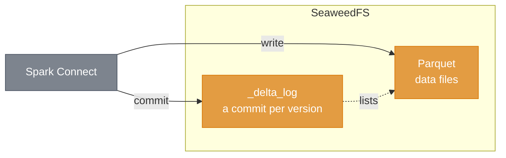
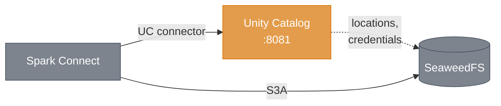
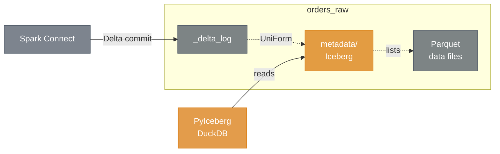
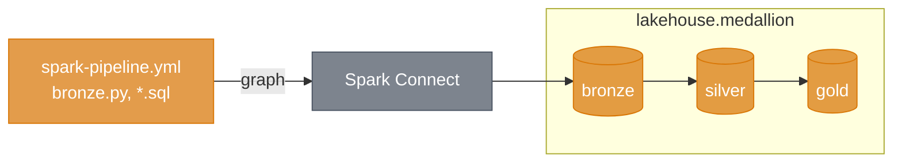
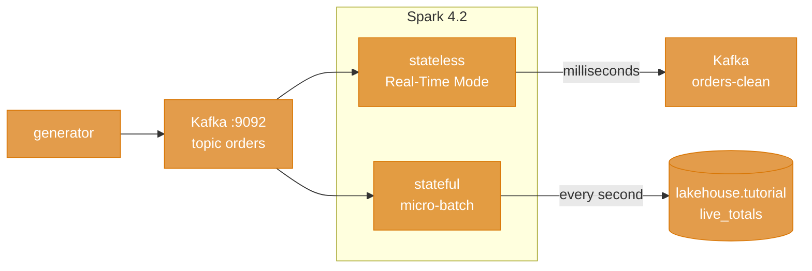
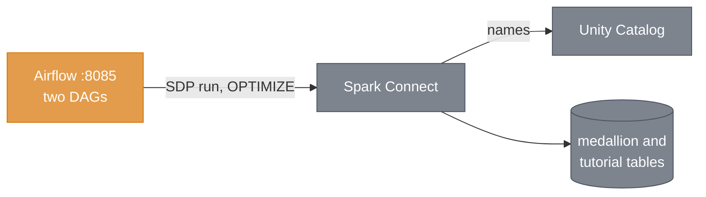
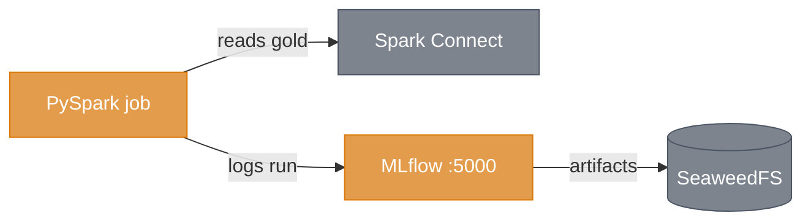

import img0 from "./open-lakehouse-architecture.svg";

*Originally published on [systems/null](https://systemsnull.net/posts/data-engineering-ai/open-lakehouse-on-your-laptop).*

An *open* lakehouse is one where every layer (storage, table format, engine, catalog, and the ML and AI tools on top) is built on open standards, so no layer is locked to a single vendor. I wrote about what that means and why it matters in [What is an open lakehouse? Open data standards, explained](https://www.databricks.com/blog/what-open-lakehouse-open-data-standards-explained). **The practical payoff is that a team can change processing engines, add a query engine, adopt a second table format or swap a model framework without re-platforming the layers above or below. ** 

In practice, each of these open source technologies runs as its own service and does one job: object storage holds the files, a table format turns files into tables, a catalog names the tables, Spark reads and writes them, a stream brings in what's happening now, a pipeline framework derives the tables people actually query, an orchestrator runs it all on a schedule, and experiment tracking records what you compute from it. This post builds all of it on your laptop, starting from an empty folder, with nothing but Docker and Python. Every file you need is in the post, in full: a `compose.yaml` that grows by a few services per section, a handful of config files, and short Python scripts. You run plain `docker compose` and `python` commands, and nothing else.

This post builds this stack manually layer by layer. If you want to just have a full packaged lakehouse, check out the project [open-lakehouse](https://github.com/open-lakehouse/open-lakehouse). It comes with several agent skills, a cli, and a reference in case you get stuck on one of the steps.

## What this tutorial covers


| Layer | What runs | Image or package | Port |
|---|---|---|---|
| Storage | SeaweedFS, an S3-compatible object store | `chrislusf/seaweedfs:3.80` | 8333 |
| Compute | a Spark master, a worker and a Spark Connect server | `apache/spark:4.2.0` | 15002 (UI 8080) |
| Table format | Delta Lake, with UniForm for Iceberg readers | Delta 4.4.0, loaded by Spark | |
| Catalog | Unity Catalog OSS | `unitycatalog/unitycatalog:v0.6.0` | 8081 |
| Iceberg readers | PyIceberg and DuckDB | on your machine | |
| Pipelines | Spark Declarative Pipelines | part of Spark 4.2 | |
| Event log | Kafka, single node, KRaft mode | `apache/kafka:4.2.0` | 9092 |
| Streaming | Structured Streaming, including Real-Time Mode | part of Spark 4.2 | |
| Orchestration | Airflow, in standalone mode | `apache/airflow:3.3.2-python3.12` | 8085 |
| ML | MLflow tracking server | `ghcr.io/mlflow/mlflow:v3.16.1` | 5000 |

Everything runs on one Spark version, 4.2.0, and the pieces that plug into Spark are pinned to match it. There's no separate database: Airflow and MLflow keep their metadata in SQLite and Unity Catalog in its embedded H2 database, which is plenty for one laptop.

### Basic Requirements

- **Docker with the Compose plugin**, Compose v2.17 or newer. On Linux that's Docker Engine plus the `docker-compose-plugin` package; on macOS, [Docker Desktop](https://docs.docker.com/desktop/setup/install/mac-install/); on Windows, Docker Desktop with WSL2, and you follow the Linux steps inside your WSL distribution (keep the project folder in your WSL home directory, not under `/mnt/c`).
- **Python 3.10 or newer**, with `venv` (on Ubuntu and WSL, `sudo apt install python3-venv` if `python3 -m venv` complains).
- **Memory and disk.** The whole stack uses about 9 GB of RAM once everything is up, so a 16 GB machine is comfortable; in Docker Desktop, raise the memory limit under Settings > Resources to at least 10 GB. Plan for about 12 GB of disk for images and downloads.

I ran every step below on Ubuntu 24.04 with Docker Engine, copying each file and command out of this post into an empty folder.

Every port the stack publishes is written in `compose.yaml` as `${NAME:-default}`, for example `"${S3_PORT:-8333}:8333"`. If one of the defaults is already taken on your machine, pick another in a `.env` file next to `compose.yaml` (a line like `S3_PORT=18333`; Compose reads that file on every command), and point the scripts at it with the matching variable from `common.py` below (`export S3_ENDPOINT=http://localhost:18333`).

## A folder and a Python environment

Make an empty folder and give it a virtual environment with the clients this post uses:

```bash
mkdir open-lakehouse && cd open-lakehouse
python3 -m venv .venv
source .venv/bin/activate
pip install pyspark-client==4.2.0 pandas==2.3.3 boto3==1.43.93 kafka-python==2.3.0 pyiceberg==0.12.0 duckdb==1.5.6 mlflow-skinny==3.16.1
```

`pyspark-client` is PySpark without the JVM: a thin client that sends query plans to a Spark Connect server and gets results back, so your machine never runs Spark itself. The others are the S3 client (`boto3`), a Kafka producer for the test data, the two Iceberg readers, and the MLflow client. (`pandas` is pinned below 3.0, which PySpark 4.2 doesn't fully support yet.) Open a new terminal later and you'll need `source .venv/bin/activate` again in that folder.

### Where everything goes

Everything in this post lives in that one `open-lakehouse` folder. By the end it looks like this:

```text
open-lakehouse/
├── .venv/                      the Python environment you just made
├── compose.yaml                every service, added layer by layer
├── s3.json                     SeaweedFS access keys
├── server.properties           Unity Catalog settings
├── spark-conf/
│   └── spark-defaults.conf     Spark settings, mounted into the Spark containers
├── pipeline/
│   ├── spark-pipeline.yml      the declarative pipeline's spec
│   └── transformations/
│       ├── bronze.py
│       ├── silver.sql
│       └── gold.sql
├── dags/
│   ├── medallion.py            the Airflow DAG that runs the pipeline
│   └── maintenance.py          the Airflow DAG that compacts and vacuums
├── common.py                   shared endpoints, imported by every script below
├── create_bucket.py
├── hello_spark.py
├── generate_orders.py
├── load_orders.py
├── register_orders.py
├── enable_uniform.py
├── read_iceberg.py
├── prepare_medallion.py
├── read_gold.py
├── stream_clean.py
├── stream_totals.py
├── check_stream.py
└── log_run.py
```

The label above each code block is the file's path, so `File: open-lakehouse/spark-conf/spark-defaults.conf` means create that file in that subfolder. The Python scripts all sit at the top of the folder, next to `common.py`, so they can import it. **Run every command from inside `open-lakehouse`, with the virtual environment active** (`source .venv/bin/activate`); `docker compose` finds `compose.yaml` there, and `python generate_orders.py` finds the script there.

Every script imports its endpoints and clients from one small module, so the addresses live in one place:

**File: `open-lakehouse/common.py`**

```python
"""Endpoints and clients that every script in this tutorial shares."""

import json
import os
import urllib.request

import boto3
from pyspark.sql import SparkSession

SPARK_REMOTE = os.environ.get("SPARK_REMOTE", "sc://localhost:15002")
S3_ENDPOINT = os.environ.get("S3_ENDPOINT", "http://localhost:8333")
UC_URL = os.environ.get("UC_URL", "http://localhost:8081")
KAFKA_BOOTSTRAP = os.environ.get("KAFKA_BOOTSTRAP", "localhost:9092")
MLFLOW_TRACKING_URI = os.environ.get("MLFLOW_TRACKING_URI", "http://localhost:5000")
S3_KEY, S3_SECRET = "lakehouse", "lakehouse-secret"

def spark():
    """A Spark Connect session: a thin client, the work runs in the cluster."""
    return SparkSession.builder.remote(SPARK_REMOTE).getOrCreate()

def s3():
    """An S3 client for SeaweedFS."""
    return boto3.client(
        "s3",
        endpoint_url=S3_ENDPOINT,
        aws_access_key_id=S3_KEY,
        aws_secret_access_key=S3_SECRET,
        region_name="us-east-1",
    )

def uc(method, path, body=None):
    """Call the Unity Catalog REST API and return the JSON reply."""
    request = urllib.request.Request(
        f"{UC_URL}/api/2.1/unity-catalog{path}",
        data=json.dumps(body).encode() if body else None,
        headers={"Content-Type": "application/json"},
        method=method,
    )
    with urllib.request.urlopen(request) as reply:
        return json.load(reply)
```

The defaults are the ports the stack publishes on your machine. `s3()` talks to the object store, `uc()` to the catalog's REST API, and `spark()` opens a Spark Connect session, which is all the scripts need to run on the cluster.

## Storage: SeaweedFS

A lakehouse keeps its tables as ordinary files in object storage: Parquet data files plus the table format's own log next to them. [SeaweedFS](https://github.com/seaweedfs/seaweedfs) is a small open-source object store that speaks the S3 API, so Spark writes to it the same way it would write to Amazon S3, and every tool in this post that reads S3 can read it too.

SeaweedFS needs to know who may use its S3 API. This identities file creates one user with a local key pair and full rights:

**File: `open-lakehouse/s3.json`**

```json
{
  "identities": [
    {
      "name": "lakehouse",
      "credentials": [{ "accessKey": "lakehouse", "secretKey": "lakehouse-secret" }],
      "actions": ["Admin", "Read", "Write", "List", "Tagging"]
    }
  ]
}
```

Then the first version of `compose.yaml`, with one service:

**File: `open-lakehouse/compose.yaml`**

```yaml
services:
  seaweedfs:
    image: chrislusf/seaweedfs:3.80
    entrypoint: weed
    command: server -dir=/data -s3 -s3.config=/etc/seaweedfs/s3.json -volume.max=0 -master.volumeSizeLimitMB=1024
    ports:
      - "${S3_PORT:-8333}:8333"
    volumes:
      - ./s3.json:/etc/seaweedfs/s3.json:ro
      - seaweedfs-data:/data
    healthcheck:
      test: wget -qO /dev/null http://127.0.0.1:8333/status
      interval: 5s
      retries: 30

volumes:
  seaweedfs-data:
```

`weed server -s3` runs the whole object store in one process (the master, a volume server, the filer and the S3 gateway); `-volume.max=0` and `-master.volumeSizeLimitMB=1024` let it add 1 GB storage volumes as the data grows. The named volume `seaweedfs-data` keeps the files across restarts. The healthcheck asks the S3 gateway for its status, and `--wait` makes `docker compose up` return only once every service with a healthcheck reports healthy:

```bash
docker compose up -d --wait
```

To check it, create the bucket the rest of the stack uses, write an object, and list it back:

**File: `open-lakehouse/create_bucket.py`**

```python
"""Create the `lakehouse` bucket, write one object and list it back."""

from common import s3

client = s3()
existing = [b["Name"] for b in client.list_buckets()["Buckets"]]
if "lakehouse" not in existing:
    client.create_bucket(Bucket="lakehouse")

client.put_object(Bucket="lakehouse", Key="hello.txt", Body=b"hello, lakehouse\n")
for obj in client.list_objects_v2(Bucket="lakehouse")["Contents"]:
    print(obj["Key"], obj["Size"], "bytes")
```

```bash
python create_bucket.py
```

```text
hello.txt 17 bytes
```



## Compute: Spark 4.2 and Spark Connect

Spark is the engine: it reads and writes every table, and everything above this layer either feeds it or tells it what to run. The stack runs a small standalone cluster (a master and one worker) plus a **Spark Connect server**. Connect splits the classic Spark application in two: the server owns the driver, the catalog settings and the storage credentials, and clients send it query plans over gRPC as thin Python processes. Every client in this post, from your terminal to Airflow, talks to the same server.

Spark reads its settings from `spark-defaults.conf`. Make a folder for it:

```bash
mkdir spark-conf
```

**File: `open-lakehouse/spark-conf/spark-defaults.conf`**

```properties
# Delta Lake
spark.sql.extensions                             io.delta.sql.DeltaSparkSessionExtension
spark.sql.catalog.spark_catalog                  org.apache.spark.sql.delta.catalog.DeltaCatalog

# SeaweedFS, through Hadoop's S3A connector, for both s3:// and s3a:// paths
spark.hadoop.fs.s3a.endpoint                     http://seaweedfs:8333
spark.hadoop.fs.s3a.access.key                   lakehouse
spark.hadoop.fs.s3a.secret.key                   lakehouse-secret
spark.hadoop.fs.s3a.path.style.access            true
spark.hadoop.fs.s3a.connection.ssl.enabled       false
spark.hadoop.fs.s3.impl                          org.apache.hadoop.fs.s3a.S3AFileSystem
spark.hadoop.fs.AbstractFileSystem.s3.impl       org.apache.hadoop.fs.s3a.S3A

# Resources: a cap, so other applications still get cores, and idle executors go back
spark.driver.memory                              2g
spark.executor.memory                            1g
spark.executor.cores                             2
spark.cores.max                                  4
spark.dynamicAllocation.enabled                  true
spark.dynamicAllocation.shuffleTracking.enabled  true
spark.dynamicAllocation.executorIdleTimeout      60s
spark.dynamicAllocation.shuffleTracking.timeout  120s
spark.dynamicAllocation.cachedExecutorIdleTimeout 300s

# Where --packages keeps the JARs it downloads (a volume, so it happens once)
spark.jars.ivy                                   /opt/spark/work-dir/ivy
```

The first block turns on Delta Lake. The second points Hadoop's S3A connector at SeaweedFS for both `s3a://` and `s3://` paths, so you can write `s3://lakehouse/...` everywhere. The third keeps the Connect server, a single long-running application, from holding the whole worker forever: it caps the server at four cores, so a job you submit to the cluster later still gets some, and hands idle executors back to the worker after a minute or two (shuffle tracking alone keeps an executor as long as it holds shuffle files, which in a long-lived Connect session can mean forever). The last line tells Spark where to cache the JARs it downloads.

Now add the three Spark services to `compose.yaml`, under `services:`:

**File: `open-lakehouse/compose.yaml`**, add under `services:`

```yaml
  spark-master:
    image: apache/spark:4.2.0
    hostname: spark-master
    command: /opt/spark/bin/spark-class org.apache.spark.deploy.master.Master --host spark-master
    ports:
      - "${SPARK_UI_PORT:-8080}:8080"
    healthcheck:
      test: curl -sf http://localhost:8080 > /dev/null
      interval: 5s
      retries: 30

  spark-worker:
    image: apache/spark:4.2.0
    hostname: spark-worker
    command: /opt/spark/bin/spark-class org.apache.spark.deploy.worker.Worker --host spark-worker spark://spark-master:7077
    environment:
      SPARK_WORKER_CORES: "6"
      SPARK_WORKER_MEMORY: 4g
    volumes:
      - spark-work:/opt/spark/work-dir
    depends_on:
      spark-master:
        condition: service_healthy

  spark-connect:
    image: apache/spark:4.2.0
    hostname: spark-connect
    command: >
      /opt/spark/sbin/start-connect-server.sh
      --master spark://spark-master:7077
      --packages io.delta:delta-spark_4.2_2.13:4.4.0,io.delta:delta-iceberg_2.13:4.4.0,io.unitycatalog:unitycatalog-spark_4.2_2.13:0.6.0,org.apache.hadoop:hadoop-aws:3.5.0,org.apache.spark:spark-sql-kafka-0-10_2.13:4.2.0
      --exclude-packages io.delta:delta-spark_4.1_2.13
    environment:
      SPARK_NO_DAEMONIZE: "1"
    ports:
      - "${SPARK_CONNECT_PORT:-15002}:15002"
    volumes:
      - ./spark-conf:/opt/spark/conf
      - spark-work:/opt/spark/work-dir
    depends_on:
      spark-master:
        condition: service_healthy
    healthcheck:
      test: ["CMD", "bash", "-c", "echo > /dev/tcp/localhost/15002"]
      interval: 5s
      start_period: 15m
```

and their shared volume, under `volumes:` at the bottom:

**File: `open-lakehouse/compose.yaml`**, add under `volumes:`

```yaml
  spark-work:
```

All three run the official `apache/spark:4.2.0` image, with no custom build. The master and worker are Spark's standalone cluster; the worker offers six cores and 4 GB to applications. The Connect server is started with `--packages`, which resolves Spark's plugins from Maven Central when it starts and puts them on the classpath of the driver and every executor:

| Package | Version | What it adds |
|---|---|---|
| `io.delta:delta-spark_4.2_2.13` | 4.4.0 | Delta Lake, built for Spark 4.2 |
| `io.delta:delta-iceberg_2.13` | 4.4.0 | UniForm: Delta tables that also write Iceberg metadata |
| `io.unitycatalog:unitycatalog-spark_4.2_2.13` | 0.6.0 | Spark's connector to Unity Catalog, matching the server |
| `org.apache.hadoop:hadoop-aws` | 3.5.0 | the S3A filesystem; it must match the Hadoop inside the Spark image, and it brings the AWS SDK with it |
| `org.apache.spark:spark-sql-kafka-0-10_2.13` | 4.2.0 | the Kafka source and sink for Structured Streaming |

`--exclude-packages` drops one dependency: `delta-iceberg` asks for the Spark 4.1 build of Delta, and the Spark 4.2 build is already on the list. The first start downloads about 800 MB (most of it the AWS SDK), so it takes longer than the later ones, which reuse the downloads the `spark-work` volume keeps (`docker compose logs -f spark-connect` in another terminal shows the progress). The worker mounts the same volume, which the streaming section uses for its checkpoints.

Here's the whole file at this point:

**File: `open-lakehouse/compose.yaml`**

```yaml
services:
  seaweedfs:
    image: chrislusf/seaweedfs:3.80
    entrypoint: weed
    command: server -dir=/data -s3 -s3.config=/etc/seaweedfs/s3.json -volume.max=0 -master.volumeSizeLimitMB=1024
    ports:
      - "${S3_PORT:-8333}:8333"
    volumes:
      - ./s3.json:/etc/seaweedfs/s3.json:ro
      - seaweedfs-data:/data
    healthcheck:
      test: wget -qO /dev/null http://127.0.0.1:8333/status
      interval: 5s
      retries: 30

  spark-master:
    image: apache/spark:4.2.0
    hostname: spark-master
    command: /opt/spark/bin/spark-class org.apache.spark.deploy.master.Master --host spark-master
    ports:
      - "${SPARK_UI_PORT:-8080}:8080"
    healthcheck:
      test: curl -sf http://localhost:8080 > /dev/null
      interval: 5s
      retries: 30

  spark-worker:
    image: apache/spark:4.2.0
    hostname: spark-worker
    command: /opt/spark/bin/spark-class org.apache.spark.deploy.worker.Worker --host spark-worker spark://spark-master:7077
    environment:
      SPARK_WORKER_CORES: "6"
      SPARK_WORKER_MEMORY: 4g
    volumes:
      - spark-work:/opt/spark/work-dir
    depends_on:
      spark-master:
        condition: service_healthy

  spark-connect:
    image: apache/spark:4.2.0
    hostname: spark-connect
    command: >
      /opt/spark/sbin/start-connect-server.sh
      --master spark://spark-master:7077
      --packages io.delta:delta-spark_4.2_2.13:4.4.0,io.delta:delta-iceberg_2.13:4.4.0,io.unitycatalog:unitycatalog-spark_4.2_2.13:0.6.0,org.apache.hadoop:hadoop-aws:3.5.0,org.apache.spark:spark-sql-kafka-0-10_2.13:4.2.0
      --exclude-packages io.delta:delta-spark_4.1_2.13
    environment:
      SPARK_NO_DAEMONIZE: "1"
    ports:
      - "${SPARK_CONNECT_PORT:-15002}:15002"
    volumes:
      - ./spark-conf:/opt/spark/conf
      - spark-work:/opt/spark/work-dir
    depends_on:
      spark-master:
        condition: service_healthy
    healthcheck:
      test: ["CMD", "bash", "-c", "echo > /dev/tcp/localhost/15002"]
      interval: 5s
      start_period: 15m

volumes:
  seaweedfs-data:
  spark-work:
```

Start the cluster. The Connect server's healthcheck passes once its gRPC port accepts connections, so `--wait` returns when the server is ready for queries:

```bash
docker compose up -d --wait
```

Then send it a query:

**File: `open-lakehouse/hello_spark.py`**

```python
"""Send one query to the cluster through Spark Connect."""

from common import SPARK_REMOTE, spark

session = spark()
print(f"Connected to Spark {session.version} at {SPARK_REMOTE}")
session.range(1_000_000).selectExpr("sum(id) AS total").show()
```

```bash
python hello_spark.py
```

```text
Connected to Spark 4.2.0 at sc://localhost:15002
+------------+
|       total|
+------------+
|499999500000|
+------------+
```

The sum ran on the worker; your terminal only sent the plan and printed the result. The Spark UI at [http://localhost:8080](http://localhost:8080) lists the worker and the running "Spark Connect server" application.



## Some data: a ghost-kitchen generator

A lakehouse needs something to hold. This generator makes up orders for a ghost kitchen, a delivery-only restaurant cooking for several brands in four cities. Each order produces three events (`order_created`, `order_ready`, `delivered`), with the brand, item count and total as a JSON string in `body`. It misbehaves on purpose, the way real feeds do: some events arrive twice and a few lose their location, so the later layers have something to clean up. It writes a week of history to the bucket as Parquet, or streams live events into Kafka for the streaming section:

**File: `open-lakehouse/generate_orders.py`**

```python
"""Ghost-kitchen orders: a week of history for the bucket, or a live stream for Kafka.

    python generate_orders.py files    # 7 days of events -> s3://lakehouse/landing/
    python generate_orders.py stream   # one day of events, live -> Kafka topic `orders`
"""

import io
import json
import random
import sys
import time
from datetime import datetime, timedelta, timezone

import pandas as pd
from common import KAFKA_BOOTSTRAP, s3

LOCATIONS = {1: "Oakland", 2: "Berkeley", 3: "San Francisco", 4: "San Jose"}
BRANDS = {"Pizza Planet": 16.0, "Wok This Way": 21.0, "Taco Loco": 12.5,
          "Curry House": 23.0, "Sushi Express": 29.0}
rng = random.Random(7)

def order(ts):
    """One order's events: created, ready in the kitchen, delivered."""
    order_id = f"{rng.getrandbits(40):010x}"
    location = rng.choice(list(LOCATIONS))
    brand, items = rng.choice(list(BRANDS)), rng.randint(1, 4)
    total = round(BRANDS[brand] * items * rng.uniform(0.9, 1.2), 2)
    steps = [("order_created", 0), ("order_ready", rng.randint(8, 20)),
             ("delivered", rng.randint(25, 50))]
    return [{
        "event_id": f"{order_id}-{n}",
        "event_type": kind,
        "ts": (ts + timedelta(minutes=minutes)).isoformat(timespec="seconds"),
        "location_id": location,
        "order_id": order_id,
        "body": json.dumps({"brand": brand, "items": items, "total": total}),
    } for n, (kind, minutes) in enumerate(steps)]

def messy(events):
    """Real feeds misbehave: a few events lose their location, some arrive twice."""
    out = []
    for event in events:
        if rng.random() < 0.01:
            event["location_id"] = None
        out.append(event)
        if rng.random() < 0.03:
            out.append(dict(event))
    return out

def week():
    start = datetime(2026, 9, 1)
    for day in range(7):
        events = []
        for _ in range(rng.randint(1200, 1800)):
            events += order(start + timedelta(days=day, seconds=rng.randint(36000, 79200)))
        yield (start + timedelta(days=day)).date(), messy(events)

def put_parquet(client, key, frame):
    buffer = io.BytesIO()
    frame.to_parquet(buffer, index=False)
    client.put_object(Bucket="lakehouse", Key=key, Body=buffer.getvalue())
    print(f"{key}  {len(frame):,} rows")

def write_files():
    client = s3()
    for day, events in week():
        frame = pd.DataFrame(events).astype({"location_id": "Int64"})  # keep the gaps as nulls
        put_parquet(client, f"landing/orders/{day}.parquet", frame)
    cities = pd.DataFrame({"location_id": list(LOCATIONS), "city": list(LOCATIONS.values())})
    put_parquet(client, "landing/locations/locations.parquet", cities)

def stream(per_second=50):
    from kafka import KafkaProducer

    producer = KafkaProducer(bootstrap_servers=KAFKA_BOOTSTRAP, key_serializer=str.encode,
                             value_serializer=lambda v: json.dumps(v).encode())
    rng.seed()  # new order ids on every run
    _, events = next(week())
    events.sort(key=lambda e: e["ts"])
    stamps = {}
    for n, event in enumerate(events, 1):
        if event["event_id"] not in stamps:  # a resent event keeps its first timestamp
            late = rng.random() < 0.02  # and a few arrive three minutes late
            now = datetime.now(timezone.utc) - timedelta(minutes=3 if late else 0)
            stamps[event["event_id"]] = now.isoformat(timespec="milliseconds")
        producer.send("orders", key=event["order_id"],
                      value={**event, "ts": stamps[event["event_id"]]})
        if n % 1000 == 0:
            print(f"sent {n:,} events")
        time.sleep(1 / per_second)
    producer.flush()
    print(f"sent {len(events):,} events to the topic orders")

if __name__ == "__main__":
    {"files": write_files, "stream": stream}[sys.argv[1]]()
```

```bash
python generate_orders.py files
```

```text
landing/orders/2026-09-01.parquet  4,720 rows
landing/orders/2026-09-02.parquet  4,382 rows
landing/orders/2026-09-03.parquet  5,479 rows
landing/orders/2026-09-04.parquet  4,508 rows
landing/orders/2026-09-05.parquet  5,194 rows
landing/orders/2026-09-06.parquet  4,962 rows
landing/orders/2026-09-07.parquet  4,776 rows
landing/locations/locations.parquet  4 rows
```

It's seeded, so you get the same week I did. The files land in a `landing/` prefix in the bucket, the usual first stop for raw data before it becomes a table.

## Table format: Delta Lake

Parquet files in a bucket aren't a table yet. A **table format** adds a transaction log next to the data files, where each write is a new, atomic commit that says which files make up the table now. That log is what gives you ACID writes on object storage, readers that never see half a write, and time travel. This stack uses [Delta Lake](https://delta.io/), the format Unity Catalog OSS writes.

This script writes the week's events as a Delta table in two commits, the first day and then the other six, then reads the table as it is now and as it was at version 0:

**File: `open-lakehouse/load_orders.py`**

```python
"""Write the week's events as a Delta table in two commits, then time-travel."""

from common import s3, spark
from pyspark.sql import functions as f

TABLE_PATH = "s3://lakehouse/tables/orders_raw"

session = spark()
events = session.read.parquet("s3://lakehouse/landing/orders/").withColumn(
    "event_date", f.to_date("ts")
)

# Commit 0: the first day. Commit 1: the other six.
events.where("event_date = '2026-09-01'").write.format("delta").save(TABLE_PATH)
events.where("event_date > '2026-09-01'").write.format("delta").mode("append").save(TABLE_PATH)

session.sql(f"DESCRIBE HISTORY delta.`{TABLE_PATH}`").select(
    "version", "operation", "operationMetrics.numOutputRows"
).show()

now = session.read.format("delta").load(TABLE_PATH).count()
then = session.read.format("delta").option("versionAsOf", 0).load(TABLE_PATH).count()
print(f"rows now: {now:,}   rows at version 0: {then:,}\n")

# Underneath, it's files in the bucket: Parquet data plus the _delta_log.
for obj in s3().list_objects_v2(Bucket="lakehouse", Prefix="tables/orders_raw/")["Contents"]:
    print(obj["Key"])
```

```bash
python load_orders.py
```

```text
+-------+---------+-------------+
|version|operation|numOutputRows|
+-------+---------+-------------+
|      1|    WRITE|        29301|
|      0|    WRITE|         4720|
+-------+---------+-------------+

rows now: 34,021   rows at version 0: 4,720

tables/orders_raw/_delta_log/00000000000000000000.crc
tables/orders_raw/_delta_log/00000000000000000000.json
tables/orders_raw/_delta_log/00000000000000000001.crc
tables/orders_raw/_delta_log/00000000000000000001.json
tables/orders_raw/_delta_log/_staged_commits/
tables/orders_raw/part-00000-7f3f327f-b1e1-4f75-99de-ccfbc82c1b65-c000.snappy.parquet
tables/orders_raw/part-00000-92a94a61-efd3-4a85-924d-e3481bde0ed6-c000.snappy.parquet
tables/orders_raw/part-00001-9db8f5d3-76b4-4a7b-972b-b3b51c7f29e3-c000.snappy.parquet
tables/orders_raw/part-00001-fd4c4fe3-30ec-43f1-a3b6-3b5128241edd-c000.snappy.parquet
```

Version 0 still exists, because the append added files and a commit rather than rewriting anything. Underneath, the table is Parquet files plus a `_delta_log` folder with one JSON commit per version (the `.crc` files are checksums, and `_staged_commits/` is an empty folder Delta keeps for commits that go through a catalog). The log is the table, and this listing shows it: there are four Parquet files, but the commits list only three of them. The fourth is an empty file from a task that had no rows for the first day, and since no commit references it, no reader ever sees it.



## Catalog: Unity Catalog OSS

A path like `s3://lakehouse/tables/orders_raw` works, but nobody wants to pass paths around. A **catalog** gives tables names (`catalog.schema.table`), records where each one lives, and is the one place engines ask about tables. [Unity Catalog OSS](https://www.unitycatalog.io/) also governs access and hands engines short-lived storage credentials for the tables they ask for, which is why it needs the S3 settings too:

**File: `open-lakehouse/server.properties`**

```properties
server.env=dev
server.authorization=disable

# The bucket Unity Catalog hands out credentials for, and the key pair it uses
s3.bucketPath.0=s3://lakehouse
s3.region.0=us-east-1
s3.accessKey.0=lakehouse
s3.secretKey.0=lakehouse-secret
s3.sessionToken.0=unused
s3.endpoint.0=http://seaweedfs:8333
```

`s3.bucketPath.0` is the bucket root the credentials cover. UC 0.6.0 skips a bucket's settings unless all four credential fields are filled in, so the session token gets a placeholder; SeaweedFS ignores it.

Add the catalog server, under `services:`:

**File: `open-lakehouse/compose.yaml`**, add under `services:`

```yaml
  unity-catalog:
    image: unitycatalog/unitycatalog:v0.6.0
    ports:
      - "${UC_PORT:-8081}:8080"
    volumes:
      - ./server.properties:/home/unitycatalog/etc/conf/server.properties:ro
      - uc-data:/home/unitycatalog/etc/db
    healthcheck:
      test: wget -qO /dev/null http://127.0.0.1:8080/api/2.1/unity-catalog/catalogs
      interval: 5s
      retries: 30
```

and its volume, under `volumes:`:

**File: `open-lakehouse/compose.yaml`**, add under `volumes:`

```yaml
  uc-data:
```

Spark needs to know about the catalog too. Add these lines to the end of `spark-conf/spark-defaults.conf`:

**File: `open-lakehouse/spark-conf/spark-defaults.conf`**, add at the end

```properties
# Unity Catalog: Spark's catalog `lakehouse` is the Unity Catalog catalog `lakehouse`
spark.sql.catalog.lakehouse                      io.unitycatalog.spark.UCSingleCatalog
spark.sql.catalog.lakehouse.uri                  http://unity-catalog:8080
spark.sql.catalog.lakehouse.token                unused
```

A Unity Catalog connector serves one catalog, and the Spark catalog's name is the Unity Catalog name it serves, so `lakehouse.tutorial.orders_raw` in Spark is the table `orders_raw` in schema `tutorial` of the catalog `lakehouse`. Start Unity Catalog, then recreate the Connect server so it reads the new settings (its downloads are in the volume, so this takes seconds):

```bash
docker compose up -d --wait
docker compose up -d --wait --force-recreate spark-connect
```

This script creates the `lakehouse` catalog through the REST API (a catalog can't be created from Spark), registers the Delta table you wrote, queries it by name, and asks the catalog what it holds:

**File: `open-lakehouse/register_orders.py`**

```python
"""Create the `lakehouse` catalog, register orders_raw in it, and query it by name."""

from common import spark, uc

if "lakehouse" not in [c["name"] for c in uc("GET", "/catalogs")["catalogs"]]:
    uc("POST", "/catalogs", {"name": "lakehouse", "storage_root": "s3://lakehouse/managed"})

session = spark()
session.sql("CREATE SCHEMA IF NOT EXISTS lakehouse.tutorial")
session.sql("""
    CREATE TABLE IF NOT EXISTS lakehouse.tutorial.orders_raw
    USING delta LOCATION 's3://lakehouse/tables/orders_raw'
""")
session.sql("""
    SELECT event_date, count(*) AS events
    FROM lakehouse.tutorial.orders_raw
    GROUP BY event_date ORDER BY event_date
""").show()

# Ask the catalog itself, over its REST API.
for table in uc("GET", "/tables?catalog_name=lakehouse&schema_name=tutorial")["tables"]:
    print(table["name"], table["table_type"], table["data_source_format"], table["storage_location"])
```

```bash
python register_orders.py
```

```text
+----------+------+
|event_date|events|
+----------+------+
|2026-09-01|  4720|
|2026-09-02|  4382|
|2026-09-03|  5479|
|2026-09-04|  4508|
|2026-09-05|  5194|
|2026-09-06|  4962|
|2026-09-07|  4776|
+----------+------+

orders_raw EXTERNAL DELTA s3://lakehouse/tables/orders_raw
```

Two kinds of Delta table live in this catalog. `orders_raw` is **external**: you chose its location and registered it. The pipeline section creates **catalog-managed** tables, where the catalog picks the location under the catalog's `storage_root` (`s3://lakehouse/managed` here) and owns the table's lifecycle. The locations are `s3://` URIs because that's how Unity Catalog records them; `spark-defaults.conf` maps `s3://` to the S3A filesystem, so Spark follows them.



## Open formats: read the same table as Iceberg

Delta is one open table format; [Apache Iceberg](https://iceberg.apache.org/) is another, and plenty of engines read Iceberg. You don't have to pick one. Both keep the data in Parquet and differ in the metadata they put next to it, so one copy of the files can carry both kinds of metadata. Delta calls that **UniForm**: the table stays a Delta table that Spark writes, and with each commit Delta also writes Iceberg metadata for the same files. Delta writes, Iceberg engines read.

The conversion lives in the `delta-iceberg` package the Connect server already loaded. Three table properties turn it on: Iceberg as a universal format, the IcebergCompatV2 table feature, and column mapping by name, since Iceberg tracks columns by ID rather than by position:

**File: `open-lakehouse/enable_uniform.py`**

```python
"""Turn on UniForm: orders_raw stays a Delta table and also gets Iceberg metadata."""

from common import s3, spark

spark().sql("""
    ALTER TABLE lakehouse.tutorial.orders_raw SET TBLPROPERTIES (
        'delta.universalFormat.enabledFormats' = 'iceberg',
        'delta.enableIcebergCompatV2' = 'true',
        'delta.columnMapping.mode' = 'name'
    )
""")

for obj in s3().list_objects_v2(Bucket="lakehouse", Prefix="tables/orders_raw/metadata/")["Contents"]:
    print(obj["Key"])
```

```bash
python enable_uniform.py
```

```text
tables/orders_raw/metadata/00000-01bfacd6-e573-475c-917f-34bc3a647658.metadata.json
tables/orders_raw/metadata/ec2026c7-0ade-4f27-a333-598ff9fa2096-m0.avro
tables/orders_raw/metadata/snap-2861189516262794144-1-ec2026c7-0ade-4f27-a333-598ff9fa2096.avro
```

The `ALTER` was itself a Delta commit, and UniForm converted it: a `metadata.json`, a manifest list (`snap-...`) and a manifest (`...-m0`), all pointing at the Parquet files that were already there. Nothing was rewritten; Iceberg readers match the existing files' columns by name.

Now read the table as Iceberg, with two readers that know nothing about Delta and don't use Spark: [PyIceberg](https://py.iceberg.apache.org/), Iceberg's Python library, and [DuckDB](https://duckdb.org/) with its `iceberg` extension. Both open the newest `metadata.json` in the bucket (Iceberg calls a table opened straight from its metadata file a static table):

**File: `open-lakehouse/read_iceberg.py`**

```python
"""Read orders_raw as an Iceberg table with PyIceberg and DuckDB. No Spark involved."""

import duckdb
from common import S3_ENDPOINT, S3_KEY, S3_SECRET, s3
from pyiceberg.table import StaticTable

# The table's current Iceberg metadata is the newest metadata.json UniForm wrote.
listing = s3().list_objects_v2(Bucket="lakehouse", Prefix="tables/orders_raw/metadata/")
newest = max(
    (obj for obj in listing["Contents"] if obj["Key"].endswith(".metadata.json")),
    key=lambda obj: obj["LastModified"],
)
location = f"s3://lakehouse/{newest['Key']}"
print(f"Reading {location}\n")

table = StaticTable.from_metadata(location, properties={
    "s3.endpoint": S3_ENDPOINT,
    "s3.access-key-id": S3_KEY,
    "s3.secret-access-key": S3_SECRET,
    "s3.region": "us-east-1",
})
rows = table.scan(selected_fields=("event_id",)).to_arrow().num_rows
print(f"PyIceberg: {rows:,} rows (Iceberg v{table.format_version}, "
      f"converted from Delta version {table.properties['delta-version']})\n")

duck = duckdb.connect()
duck.sql("INSTALL iceberg; LOAD iceberg; INSTALL httpfs; LOAD httpfs;")
duck.sql(f"""
    CREATE SECRET (TYPE s3, KEY_ID '{S3_KEY}', SECRET '{S3_SECRET}', REGION 'us-east-1',
                   ENDPOINT '{S3_ENDPOINT.split("://")[1]}', URL_STYLE 'path', USE_SSL false)
""")
duck.sql(f"""
    SELECT event_date, count(*) AS events
    FROM iceberg_scan('{location}')
    GROUP BY event_date ORDER BY event_date
""").show()
```

```bash
python read_iceberg.py
```

```text
Reading s3://lakehouse/tables/orders_raw/metadata/00000-01bfacd6-e573-475c-917f-34bc3a647658.metadata.json

PyIceberg: 34,021 rows (Iceberg v2, converted from Delta version 2)

┌────────────┬────────┐
│ event_date │ events │
│    date    │ int64  │
├────────────┼────────┤
│ 2026-09-01 │   4720 │
│ 2026-09-02 │   4382 │
│ 2026-09-03 │   5479 │
│ 2026-09-04 │   4508 │
│ 2026-09-05 │   5194 │
│ 2026-09-06 │   4962 │
│ 2026-09-07 │   4776 │
└────────────┴────────┘
```

The same rows per day as the Delta query in the catalog section, through Iceberg metadata. "Converted from Delta version 2" is the `ALTER` commit, and every later commit to the table gets new Iceberg metadata, so the readers keep up with the writes. (DuckDB downloads its `iceberg` and `httpfs` extensions the first time.)

Unity Catalog speaks Iceberg too: its Iceberg REST catalog, at `/api/2.1/unity-catalog/iceberg` with the catalog name as the `warehouse`, lists the catalog-managed UniForm tables. To hand one of them to an Iceberg client, the server reads the table's metadata file with its own S3 client, which UC 0.6.0 sets up for AWS S3, so on this laptop stack the readers open the metadata from the bucket directly instead.

Spark writes Delta here, and Iceberg only through UniForm. Native Iceberg writes from Spark 4.2 arrive with Iceberg's next release, which adds a Spark 4.2 runtime.



## Pipelines: bronze, silver, gold with Spark Declarative Pipelines

So far every table was written by hand. In a real lakehouse the interesting tables are *derived*: cleaned events from raw ones, aggregates from cleaned ones. [Spark Declarative Pipelines](https://spark.apache.org/docs/latest/declarative-pipelines-programming-guide.html) (SDP) lets you declare each table as a query; SDP works out the dependency graph from the tables each query reads and materializes them in order. Here it's the classic medallion layout:

| Layer | Tables | What it does |
|---|---|---|
| bronze | `orders_bronze`, `locations` | the landing files, as they arrived |
| silver | `orders_silver` | each event once, with a known location, the JSON parsed and the city attached |
| gold | `revenue_by_brand`, `revenue_by_city_day` | the numbers people ask for |

A pipeline is a spec file plus a folder of transformations. Make the folders:

```bash
mkdir -p pipeline/transformations
```

The spec names the catalog and schema the tables go to, and where SDP keeps its own state:

**File: `open-lakehouse/pipeline/spark-pipeline.yml`**

```yaml
name: medallion
catalog: lakehouse
database: medallion
storage: s3://lakehouse/pipelines/medallion
libraries:
  - glob:
      include: transformations/**
```

Bronze reads files, so it's Python, the one place a query needs a DataFrame reader:

**File: `open-lakehouse/pipeline/transformations/bronze.py`**

```python
"""Bronze: the landing files, as they arrived."""

from pyspark import pipelines as dp
from pyspark.sql import SparkSession

spark = SparkSession.active()

# Unity Catalog manages these tables: it picks their location under the
# catalog's storage root. These properties mark a Delta table as catalog-managed.
MANAGED = {
    "delta.feature.catalogManaged": "supported",
    "delta.checkpoint.writeStatsAsJson": "true",
    "delta.checkpoint.writeStatsAsStruct": "true",
}

@dp.materialized_view(format="delta", table_properties=MANAGED)
def orders_bronze():
    return spark.read.parquet("s3://lakehouse/landing/orders/")

@dp.materialized_view(format="delta", table_properties=MANAGED)
def locations():
    return spark.read.parquet("s3://lakehouse/landing/locations/")
```

Silver and gold are SQL. Each `CREATE MATERIALIZED VIEW` names the tables it reads, and that's all SDP needs to order them:

**File: `open-lakehouse/pipeline/transformations/silver.sql`**

```sql
-- Silver: each event once, with a known location, the order details parsed
-- out of the JSON body, and the city attached.
CREATE MATERIALIZED VIEW orders_silver
USING delta
TBLPROPERTIES ('delta.feature.catalogManaged' = 'supported',
               'delta.checkpoint.writeStatsAsJson' = 'true',
               'delta.checkpoint.writeStatsAsStruct' = 'true')
AS SELECT DISTINCT
  o.event_id,
  o.event_type,
  to_timestamp(o.ts) AS event_time,
  o.order_id,
  l.city,
  get_json_object(o.body, '$.brand') AS brand,
  CAST(get_json_object(o.body, '$.total') AS DOUBLE) AS total
FROM orders_bronze o
JOIN locations l ON o.location_id = l.location_id;
```

**File: `open-lakehouse/pipeline/transformations/gold.sql`**

```sql
-- Gold: the numbers people ask for, built from silver.
CREATE MATERIALIZED VIEW revenue_by_brand
USING delta
TBLPROPERTIES ('delta.feature.catalogManaged' = 'supported',
               'delta.checkpoint.writeStatsAsJson' = 'true',
               'delta.checkpoint.writeStatsAsStruct' = 'true')
AS SELECT
  brand,
  count(*) AS orders,
  round(sum(total), 2) AS revenue,
  round(avg(total), 2) AS avg_order
FROM orders_silver
WHERE event_type = 'order_created'
GROUP BY brand;

CREATE MATERIALIZED VIEW revenue_by_city_day
USING delta
TBLPROPERTIES ('delta.feature.catalogManaged' = 'supported',
               'delta.checkpoint.writeStatsAsJson' = 'true',
               'delta.checkpoint.writeStatsAsStruct' = 'true')
AS SELECT
  city,
  to_date(event_time) AS day,
  count(*) AS orders,
  round(sum(total), 2) AS revenue
FROM orders_silver
WHERE event_type = 'order_created'
GROUP BY city, to_date(event_time);
```

These are catalog-managed tables, so each one carries the three table properties that mark a Delta table as catalog-managed (Unity Catalog requires both checkpoint-stats properties when it creates one), and none gives a location. SDP also won't replace a table that already exists in Unity Catalog, so a run starts by clearing the previous run's tables:

**File: `open-lakehouse/prepare_medallion.py`**

```python
"""Get lakehouse.medallion ready for a pipeline run: create it, or clear the last run.

SDP can't replace a table that already exists in Unity Catalog, so a rerun of the
pipeline starts by dropping the tables the previous run created.
"""

from common import spark

session = spark()
session.sql("CREATE SCHEMA IF NOT EXISTS lakehouse.medallion")
for row in session.sql("SHOW TABLES IN lakehouse.medallion").collect():
    session.sql(f"DROP TABLE lakehouse.medallion.{row.tableName}")
    print(f"dropped lakehouse.medallion.{row.tableName}")
print("lakehouse.medallion is ready")
```

Now prepare the schema, check the graph without writing anything, and run it. The pipeline CLI ships with `pyspark-client`; it runs on your machine, reads the spec and the transformations, and sends the graph to the Connect server, which does the work:

```bash
python prepare_medallion.py
SPARK_REMOTE=sc://localhost:15002 python -m pyspark.pipelines.cli dry-run --spec pipeline/spark-pipeline.yml
SPARK_REMOTE=sc://localhost:15002 python -m pyspark.pipelines.cli run --spec pipeline/spark-pipeline.yml
```

```text
2026-10-01 14:36:58: Loading definitions. Root directory: '.../open-lakehouse/pipeline'.
2026-10-01 14:36:58: Found 3 files matching glob 'transformations/**/*'
...
2026-10-01 21:37:09: Flow lakehouse.medallion.orders_bronze has COMPLETED.
2026-10-01 21:37:09: Flow lakehouse.medallion.locations has COMPLETED.
2026-10-01 21:37:15: Flow lakehouse.medallion.orders_silver has COMPLETED.
2026-10-01 21:37:19: Flow lakehouse.medallion.revenue_by_city_day has COMPLETED.
2026-10-01 21:37:19: Flow lakehouse.medallion.revenue_by_brand has COMPLETED.
2026-10-01 21:37:21: Run is COMPLETED.
```

The dry run resolves every table and dependency before any data moves, which makes it the cheap thing to run first. Bronze's two tables run side by side, silver waits for both, and the two gold tables wait for silver. To check, read a gold table by name and list what the pipeline put in the catalog:

**File: `open-lakehouse/read_gold.py`**

```python
"""Read a gold table by name, and list what the pipeline put in the catalog."""

from common import spark, uc

spark().sql("""
    SELECT * FROM lakehouse.medallion.revenue_by_brand ORDER BY revenue DESC
""").show()

for table in uc("GET", "/tables?catalog_name=lakehouse&schema_name=medallion")["tables"]:
    print(table["name"], table["table_type"], table["data_source_format"])
```

```bash
python read_gold.py
```

```text
+-------------+------+---------+---------+
|        brand|orders|  revenue|avg_order|
+-------------+------+---------+---------+
|Sushi Express|  2140|160332.61|    74.92|
|  Curry House|  2219|133432.76|    60.13|
| Wok This Way|  2152|118668.13|    55.14|
| Pizza Planet|  2233| 93402.24|    41.83|
|    Taco Loco|  2168| 71548.53|     33.0|
+-------------+------+---------+---------+

locations MANAGED DELTA
orders_bronze MANAGED DELTA
orders_silver MANAGED DELTA
revenue_by_brand MANAGED DELTA
revenue_by_city_day MANAGED DELTA
```

The order counts are the distinct orders with a known location; the duplicates and the orders that lost their location stopped at silver. A managed table's location is the catalog's business, so the listing shows them as `MANAGED`. To run the pipeline again, run `python prepare_medallion.py` first.



## Streaming: Real-Time Mode and micro-batches

The week of files is history; a stream is what's happening now. Kafka is the event log the orders flow through, and Spark's Structured Streaming reads it. By default Structured Streaming works in **micro-batches**: it collects whatever arrived since the last batch, processes it, commits, and starts over, so each record waits for the next batch. **Real-Time Mode** keeps the query's tasks running for a long batch instead and passes each record through the moment it arrives; the trigger's duration only sets how often the query writes a checkpoint. In Spark 4.2, Real-Time Mode runs stateless queries (filters, projections and the like, with no aggregation or deduplication), reads from Kafka and writes to Kafka, in the `update` output mode. Spark 4.2 is also the release that gave PySpark its `trigger(realTime=...)` keyword, so it works from Python over Spark Connect like everything else here.

This section builds two queries on the order stream: a stateless one in Real-Time Mode that writes clean orders back to Kafka, and a stateful one (deduplication and running totals) as an ordinary micro-batch query that writes into a Delta table in Unity Catalog.

### Kafka

Add Kafka, under `services:`:

**File: `open-lakehouse/compose.yaml`**, add under `services:`

```yaml
  kafka:
    image: apache/kafka:4.2.0
    ports:
      - "${KAFKA_PORT:-9092}:9094"
    environment:
      KAFKA_NODE_ID: 1
      KAFKA_PROCESS_ROLES: broker,controller
      KAFKA_CONTROLLER_QUORUM_VOTERS: 1@kafka:9093
      KAFKA_CONTROLLER_LISTENER_NAMES: CONTROLLER
      KAFKA_LISTENERS: INTERNAL://:9092,CONTROLLER://:9093,EXTERNAL://:9094
      KAFKA_ADVERTISED_LISTENERS: INTERNAL://kafka:9092,EXTERNAL://localhost:${KAFKA_PORT:-9092}
      KAFKA_LISTENER_SECURITY_PROTOCOL_MAP: INTERNAL:PLAINTEXT,CONTROLLER:PLAINTEXT,EXTERNAL:PLAINTEXT
      KAFKA_INTER_BROKER_LISTENER_NAME: INTERNAL
      KAFKA_OFFSETS_TOPIC_REPLICATION_FACTOR: 1
      KAFKA_TRANSACTION_STATE_LOG_REPLICATION_FACTOR: 1
      KAFKA_TRANSACTION_STATE_LOG_MIN_ISR: 1
    healthcheck:
      test: /opt/kafka/bin/kafka-topics.sh --bootstrap-server localhost:9092 --list
      interval: 10s
      retries: 30
```

This is the official Apache Kafka image in KRaft mode: one process is both the broker and its own controller, with no ZooKeeper. It has two listeners because its clients are in two places. Spark, in the Compose network, connects to `kafka:9092`; your machine connects to `localhost:9092`, which Docker forwards to the `EXTERNAL` listener on container port 9094, and that listener tells clients to come back to `localhost`.

```bash
docker compose up -d --wait
```

Create the input topic and the Real-Time Mode query's output topic. `orders` gets two partitions, so the Real-Time Mode query reads it with two parallel tasks:

```bash
docker compose exec kafka /opt/kafka/bin/kafka-topics.sh --bootstrap-server kafka:9092 --create --topic orders --partitions 2
docker compose exec kafka /opt/kafka/bin/kafka-topics.sh --bootstrap-server kafka:9092 --create --topic orders-clean --partitions 2
```

```text
Created topic orders.
Created topic orders-clean.
```

### A stateless query in Real-Time Mode

The first query keeps the events a downstream service would act on: new orders with a known location. It pulls the brand and total out of the JSON body and writes each one to `orders-clean`, along with the time the input reached Kafka, so you can time it later. It's an ordinary streaming query with a different trigger:

**File: `open-lakehouse/stream_clean.py`**

```python
"""Real-Time Mode: clean each order event from Kafka into another topic as it arrives."""

from common import spark
from pyspark.sql import functions as f

EVENT = "event_id STRING, event_type STRING, ts STRING, location_id INT, order_id STRING, body STRING"

session = spark()
orders = (
    session.readStream.format("kafka")
    .option("kafka.bootstrap.servers", "kafka:9092")  # Kafka as the cluster sees it
    .option("subscribe", "orders")
    .load()
    .select(f.from_json(f.col("value").cast("string"), EVENT).alias("e"), "timestamp")
)

clean = orders.where("e.event_type = 'order_created' AND e.location_id IS NOT NULL").select(
    f.col("e.order_id").alias("key"),
    f.to_json(f.struct(
        "e.event_id",
        "e.location_id",
        f.get_json_object("e.body", "$.brand").alias("brand"),
        f.get_json_object("e.body", "$.total").cast("double").alias("total"),
        f.unix_millis("timestamp").alias("received_ms"),  # when it reached Kafka
    )).alias("value"),
)

query = (
    clean.writeStream.queryName("orders_clean")
    .format("kafka")
    .option("kafka.bootstrap.servers", "kafka:9092")
    .option("topic", "orders-clean")
    .option("checkpointLocation", "/opt/spark/work-dir/checkpoints/orders_clean")
    .outputMode("update")  # the output mode Real-Time Mode supports
    .trigger(realTime="5 minutes")  # how often to checkpoint, not a latency target
    .start()
)
print("orders -> orders-clean, in Real-Time Mode. Ctrl+C to stop.")
try:
    query.awaitTermination()
except KeyboardInterrupt:
    query.stop()
```

The query runs on the Connect server, so it reaches Kafka as `kafka:9092`, its name inside the Compose network. Its checkpoint goes in the `spark-work` volume that the Connect server and the worker share. (SeaweedFS's S3 API handles everything Delta writes, but Spark's streaming checkpoints don't start on it: Spark expects a new checkpoint's `offsets` folder to list as empty, and SeaweedFS lists the folder's own marker object.)

### A stateful query into Delta

The second query keeps a running count of orders and the revenue for each kitchen location. Two stateful steps do the work: `dropDuplicates` remembers the event ids it has seen and drops repeats, because a duplicate order would otherwise count twice, and `groupBy(...).agg(...)` keeps the running totals. Real-Time Mode in Spark 4.2 doesn't run stateful queries, so this one is a micro-batch query, once a second:

**File: `open-lakehouse/stream_totals.py`**

```python
"""Micro-batch: deduplicate orders and keep running totals per location, in Delta."""

from common import spark
from pyspark.sql import functions as f

EVENT = "event_id STRING, event_type STRING, ts STRING, location_id INT, order_id STRING, body STRING"

session = spark()
session.conf.set("spark.sql.shuffle.partitions", "4")
session.sql("""
    CREATE TABLE IF NOT EXISTS lakehouse.tutorial.live_totals (
        location_id INT, orders BIGINT, revenue DOUBLE, last_order_at TIMESTAMP
    ) USING delta LOCATION 's3://lakehouse/tables/live_totals'
""")

totals = (
    session.readStream.format("kafka")
    .option("kafka.bootstrap.servers", "kafka:9092")
    .option("subscribe", "orders")
    .load()
    .select(f.from_json(f.col("value").cast("string"), EVENT).alias("e"))
    .select("e.*", f.to_timestamp("e.ts").alias("event_time"))
    .where("event_type = 'order_created' AND location_id IS NOT NULL")
    .withWatermark("event_time", "10 minutes")  # how long to remember an event id
    .dropDuplicates(["event_id", "event_time"])
    .groupBy("location_id")
    .agg(
        f.count("*").alias("orders"),
        f.round(f.sum(f.get_json_object("body", "$.total").cast("double")), 2).alias("revenue"),
        f.max("event_time").alias("last_order_at"),
    )
)

query = (
    totals.writeStream.queryName("live_totals")
    .format("delta")
    .outputMode("complete")  # each batch rewrites the four rows with the current totals
    .option("checkpointLocation", "/opt/spark/work-dir/checkpoints/live_totals")
    .trigger(processingTime="1 second")
    .toTable("lakehouse.tutorial.live_totals")
)
print("orders -> lakehouse.tutorial.live_totals, every second. Ctrl+C to stop.")
try:
    query.awaitTermination()
except KeyboardInterrupt:
    query.stop()
```

A few details matter here. The filter comes before the deduplication, so the state only holds events that count. The watermark bounds that state: without it, `dropDuplicates` would keep every event id forever, and with it, ids more than 10 minutes (in event time) behind the newest event are dropped from state, which is also why `event_time` is part of the deduplication key. The generator resends its duplicates right away and sends a few events three minutes late, so 10 minutes covers both. The `complete` output mode suits a result this small: every batch rewrites four rows, so the table always holds the current totals, and each batch is a Delta commit you can time-travel to.

### Run them

Start each query in a terminal of its own (`source .venv/bin/activate` first), and leave them running:

```bash
python stream_clean.py
```

```bash
python stream_totals.py
```

With both waiting, stream a day of orders into Kafka from a third terminal. It sends 50 events a second and stops by itself after about two minutes:

```bash
python generate_orders.py stream
```

```text
sent 1,000 events
...
sent 4,625 events to the topic orders
```

Here are a few records as the Real-Time Mode query wrote them:

```bash
docker compose exec kafka /opt/kafka/bin/kafka-console-consumer.sh --bootstrap-server kafka:9092 --topic orders-clean --from-beginning --max-messages 3
```

```text
{"event_id":"4de57cb207-0","location_id":4,"brand":"Curry House","total":23.98,"received_ms":1790890668647}
{"event_id":"904638cd9b-0","location_id":2,"brand":"Wok This Way","total":23.63,"received_ms":1790890668769}
{"event_id":"bdbede7a39-0","location_id":3,"brand":"Pizza Planet","total":33.93,"received_ms":1790890668890}
Processed a total of 3 messages
```

To check both queries, compare their output with the input. This script reads the topics once, as batches: it counts the `order_created` events with a location two ways (all records, and distinct event ids), reads the current totals from the Delta table, and measures how long each record spent inside the Real-Time Mode query, from its input's Kafka timestamp to its output's:

**File: `open-lakehouse/check_stream.py`**

```python
"""Check both streaming queries against what the generator sent."""

from common import spark
from pyspark.sql import functions as f

EVENT = "event_id STRING, event_type STRING, ts STRING, location_id INT, order_id STRING, body STRING"

session = spark()

def topic(name):
    """Everything in a Kafka topic so far, read once as a batch."""
    return (
        session.read.format("kafka")
        .option("kafka.bootstrap.servers", "kafka:9092")
        .option("subscribe", name)
        .option("startingOffsets", "earliest")
        .load()
    )

sent = (
    topic("orders")
    .select(f.from_json(f.col("value").cast("string"), EVENT).alias("e"))
    .where("e.event_type = 'order_created' AND e.location_id IS NOT NULL")
    .agg(f.count("*").alias("records"), f.count_distinct("e.event_id").alias("distinct"))
    .first()
)
totals = session.table("lakehouse.tutorial.live_totals").orderBy("location_id")
totals.show(truncate=False)

print(f"order_created records sent:        {sent['records']:,}")
print(f"distinct order_created event ids:  {sent['distinct']:,}")
print(f"orders in live_totals:             {totals.agg(f.sum('orders')).first()[0]:,}")

# How long each record spent in the Real-Time Mode query, Kafka to Kafka.
spent = topic("orders-clean").select(
    (f.unix_millis("timestamp")
     - f.get_json_object(f.col("value").cast("string"), "$.received_ms").cast("long")).alias("ms")
)
p50, p99 = spent.agg(f.percentile_approx("ms", [0.5, 0.99])).first()[0]
print(f"\norders-clean: {spent.count():,} records, p50 {p50} ms, p99 {p99} ms in Spark")
```

```bash
python check_stream.py
```

```text
+-----------+------+--------+-----------------------+
|location_id|orders|revenue |last_order_at          |
+-----------+------+--------+-----------------------+
|1          |361   |18666.46|2026-10-01 21:39:19.782|
|2          |354   |19276.01|2026-10-01 21:39:19.58 |
|3          |380   |19758.75|2026-10-01 21:39:19.802|
|4          |384   |19255.33|2026-10-01 21:39:19.883|
+-----------+------+--------+-----------------------+

order_created records sent:        1,512
distinct order_created event ids:  1,479
orders in live_totals:             1,479

orders-clean: 1,512 records, p50 1 ms, p99 3 ms in Spark
```

The totals match the distinct count, not the raw one: the duplicate orders the generator sent never made it into a total. (Check too early, while the stateful query is still catching up, and its total trails the distinct count for a second.) The Real-Time Mode query, which has no state, passed every record through, duplicates included, in a millisecond or two each. A micro-batch query with a one-second trigger holds each record until its batch runs, half a second on average, before it does anything with it. In Spark 4.3, Real-Time Mode also runs stateful queries.

Stop both queries with Ctrl+C in their terminals; each script catches it and stops its query on the server.



## Orchestration: Airflow runs the pipeline and the maintenance

Everything so far ran because you typed it. [Apache Airflow](https://airflow.apache.org/) runs it on a schedule, retries it, and keeps a record of every run. It doesn't touch the data itself: its tasks talk to the same Connect server you've been using, so Airflow needs only `pyspark-client`, not a JVM. Two DAGs, in a `dags` folder:

```bash
mkdir dags
```

The first runs the medallion pipeline every day. It does what you did by hand: clears the previous run's tables, runs the spec through `SparkPipelinesOperator` from Airflow's Spark provider, and then checks that the gold table isn't empty. With a `spark_connect` connection, the operator runs the same pipeline CLI you ran, inside the task, against the Connect server:

**File: `open-lakehouse/dags/medallion.py`**

```python
"""Run the medallion pipeline every day, on the cluster, through Spark Connect."""

from datetime import datetime

from airflow.providers.apache.spark.operators.spark_pipelines import SparkPipelinesOperator
from airflow.sdk import DAG, task

with DAG("medallion", schedule="@daily", start_date=datetime(2026, 9, 1), catchup=False):

    @task
    def prepare():
        """Create the schema, or drop the last run's tables (SDP won't replace them)."""
        from pyspark.sql import SparkSession

        spark = SparkSession.builder.remote("sc://spark-connect:15002").getOrCreate()
        spark.sql("CREATE SCHEMA IF NOT EXISTS lakehouse.medallion")
        for row in spark.sql("SHOW TABLES IN lakehouse.medallion").collect():
            spark.sql(f"DROP TABLE lakehouse.medallion.{row.tableName}")

    run_pipeline = SparkPipelinesOperator(
        task_id="run_pipeline",
        pipeline_spec="/opt/airflow/pipeline/spark-pipeline.yml",
        pipeline_command="run",
        conn_id="spark_connect_default",
    )

    @task
    def check_gold():
        from pyspark.sql import SparkSession

        spark = SparkSession.builder.remote("sc://spark-connect:15002").getOrCreate()
        brands = spark.table("lakehouse.medallion.revenue_by_brand").count()
        print(f"revenue_by_brand has {brands} rows")
        if brands == 0:
            raise ValueError("the gold table is empty")

    prepare() >> run_pipeline >> check_gold()
```

The second compacts the two external tables every night and deletes the files no version from the last week needs. Compaction matters for both: the batch table was written as a few small files, and every micro-batch rewrites the streaming table as a few more.

**File: `open-lakehouse/dags/maintenance.py`**

```python
"""Every night, compact the external Delta tables and clean up files nothing needs."""

from datetime import datetime

from airflow.sdk import DAG, task

TABLES = ["lakehouse.tutorial.orders_raw", "lakehouse.tutorial.live_totals"]

with DAG("delta_maintenance", schedule="0 3 * * *", start_date=datetime(2026, 9, 1), catchup=False):

    @task
    def optimize_and_vacuum():
        from pyspark.sql import SparkSession

        spark = SparkSession.builder.remote("sc://spark-connect:15002").getOrCreate()
        for table in TABLES:
            before = spark.sql(f"DESCRIBE DETAIL {table}").first()["numFiles"]
            spark.sql(f"OPTIMIZE {table}").collect()  # many small files into a few big ones
            spark.sql(f"VACUUM {table} RETAIN 168 HOURS").collect()  # keep a week of history
            after = spark.sql(f"DESCRIBE DETAIL {table}").first()["numFiles"]
            print(f"{table}: {before} files -> {after}")

    optimize_and_vacuum()
```

It leaves the pipeline's tables alone: for catalog-managed tables the catalog owns maintenance, and Delta doesn't run client-side `OPTIMIZE` and `VACUUM` on them.

Add Airflow, under `services:`:

**File: `open-lakehouse/compose.yaml`**, add under `services:`

```yaml
  airflow:
    build:
      dockerfile_inline: |
        FROM apache/airflow:3.3.2-python3.12
        RUN pip install --no-cache-dir apache-airflow==3.3.2 apache-airflow-providers-apache-spark==6.3.2 pyspark-client==4.2.0
    command: standalone
    environment:
      AIRFLOW__CORE__LOAD_EXAMPLES: "false"
      AIRFLOW__CORE__SIMPLE_AUTH_MANAGER_ALL_ADMINS: "true"
      AIRFLOW_CONN_SPARK_CONNECT_DEFAULT: '{"conn_type": "spark_connect", "host": "spark-connect", "port": 15002}'
    ports:
      - "${AIRFLOW_PORT:-8085}:8080"
    volumes:
      - airflow-data:/opt/airflow
      - ./dags:/opt/airflow/dags
      - ./pipeline:/opt/airflow/pipeline
    healthcheck:
      test: curl -sf http://localhost:8080/api/v2/monitor/health
      interval: 5s
      start_period: 5m
```

and its volume, under `volumes:`:

**File: `open-lakehouse/compose.yaml`**, add under `volumes:`

```yaml
  airflow-data:
```

The `build` section is a two-line Dockerfile inside `compose.yaml`: the official Airflow image plus the Spark provider and `pyspark-client`, built the first time you start it. `airflow standalone` runs every Airflow component in one container with a SQLite database, which is the simplest setup for one laptop. The `airflow-data` volume keeps that database and the task logs when the container is recreated. The connection comes from an environment variable, and `SIMPLE_AUTH_MANAGER_ALL_ADMINS` skips the login page, which is fine for a stack that only listens on your machine. The DAGs and the pipeline folder are mounted in, so the operator finds the same spec you ran.

```bash
docker compose up -d --wait
```

DAGs start paused. Unpause both; the scheduler then starts each one's most recent scheduled run right away:

```bash
docker compose exec airflow airflow dags unpause medallion
docker compose exec airflow airflow dags unpause delta_maintenance
```

Give them a minute or two, then list the runs:

```bash
docker compose exec airflow airflow dags list-runs medallion -o plain
docker compose exec airflow airflow dags list-runs delta_maintenance -o plain
```

```text
dag_id     run_id                                state    run_after                  logical_date               start_date                        end_date
medallion  scheduled__2026-10-01T00:00:00+00:00  success  2026-10-01T00:00:00+00:00  2026-10-01T00:00:00+00:00  2026-10-01T21:40:07.659874+00:00  2026-10-01T21:40:49.719529+00:00
dag_id             run_id                                state    run_after                  logical_date               start_date                        end_date
delta_maintenance  scheduled__2026-10-01T03:00:00+00:00  success  2026-10-01T03:00:00+00:00  2026-10-01T03:00:00+00:00  2026-10-01T21:40:09.561521+00:00  2026-10-01T21:40:41.881096+00:00
```

and read the results out of the task logs:

```bash
docker compose exec airflow grep -rhoE "revenue_by_brand has [0-9]+ rows|lakehouse[.a-z_]+: [0-9]+ files -> [0-9]+" /opt/airflow/logs
```

```text
lakehouse.tutorial.orders_raw: 3 files -> 1
lakehouse.tutorial.live_totals: 2 files -> 1
revenue_by_brand has 5 rows
```

The pipeline rebuilt the medallion tables, and the maintenance DAG compacted each external table into one file. `orders_raw` has UniForm on, so the compaction was converted to Iceberg too; read it as Iceberg again, and the readers find the new snapshot and the same rows:

```bash
python read_iceberg.py
```

```text
Reading s3://lakehouse/tables/orders_raw/metadata/00000-47aecc6b-89d1-40f8-97eb-b8c390180aca.metadata.json

PyIceberg: 34,021 rows (Iceberg v2, converted from Delta version 3)
...
```

The Airflow UI at [http://localhost:8085](http://localhost:8085) shows the same runs in its grid view, with every task's log.



## ML: MLflow tracks what you compute

The last layer is where the tables get used. [MLflow](https://mlflow.org/) records runs of whatever you compute from them, whether that's model training or a scheduled metric: parameters, metrics and artifacts, all searchable later. Here the tracking server keeps its metadata in SQLite and its artifacts in the bucket, and clients upload artifacts through the server, so only the server needs the S3 credentials.

Add MLflow, under `services:`:

**File: `open-lakehouse/compose.yaml`**, add under `services:`

```yaml
  mlflow:
    build:
      dockerfile_inline: |
        FROM ghcr.io/mlflow/mlflow:v3.16.1
        RUN pip install --no-cache-dir boto3==1.43.93
    command: >
      mlflow server --host 0.0.0.0 --port 5000 --workers 1
      --backend-store-uri sqlite:////mlflow/mlflow.db
      --artifacts-destination s3://lakehouse/mlflow
    environment:
      MLFLOW_S3_ENDPOINT_URL: http://seaweedfs:8333
      AWS_ACCESS_KEY_ID: lakehouse
      AWS_SECRET_ACCESS_KEY: lakehouse-secret
    ports:
      - "${MLFLOW_PORT:-5000}:5000"
    volumes:
      - mlflow-data:/mlflow
    healthcheck:
      test: python -c "import urllib.request; urllib.request.urlopen('http://localhost:5000/health')"
      interval: 5s
      retries: 30
```

and its volume, under `volumes:`:

**File: `open-lakehouse/compose.yaml`**, add under `volumes:`

```yaml
  mlflow-data:
```

The official image doesn't include `boto3`, which the server needs to write to S3, so the build adds it. `--artifacts-destination` is where the server puts artifacts it receives from clients.

```bash
docker compose up -d --wait
```

This is a PySpark job that logs a run: it aggregates the gold table on the cluster, logs the table it read, three metrics and the table as a CSV artifact, then reads the run back from the tracking server and lists the artifact in the bucket:

**File: `open-lakehouse/log_run.py`**

```python
"""Log an MLflow run from a PySpark job, then read it back from the tracking server."""

import mlflow
from common import MLFLOW_TRACKING_URI, s3, spark
from pyspark.sql import functions as f

gold = spark().table("lakehouse.medallion.revenue_by_brand")

mlflow.set_tracking_uri(MLFLOW_TRACKING_URI)
mlflow.set_experiment("ghost-kitchen")
with mlflow.start_run(run_name="brand-revenue") as run:
    stats = gold.agg(
        f.count("*").alias("brands"),
        f.round(f.sum("revenue"), 2).alias("revenue"),
        f.max("avg_order").alias("best_avg_order"),
    ).first()
    mlflow.log_param("source_table", "lakehouse.medallion.revenue_by_brand")
    mlflow.log_metrics(stats.asDict())
    mlflow.log_text(gold.toPandas().to_csv(index=False), "revenue_by_brand.csv")

logged = mlflow.get_run(run.info.run_id)
print(f"{logged.info.run_name}: {logged.info.status}")
for name, value in sorted(logged.data.metrics.items()):
    print(f"  {name} = {value}")

# The artifact went through the tracking server into the bucket.
for obj in s3().list_objects_v2(Bucket="lakehouse", Prefix="mlflow/")["Contents"]:
    print(obj["Key"])
```

```bash
python log_run.py
```

```text
2026/10/01 14:41:30 INFO mlflow.tracking.fluent: Experiment with name 'ghost-kitchen' does not exist. Creating a new experiment.
🏃 View run brand-revenue at: http://localhost:5000/#/experiments/1/runs/88457b52f19d43fea413f804bf7d6509
🧪 View experiment at: http://localhost:5000/#/experiments/1
brand-revenue: FINISHED
  best_avg_order = 74.92
  brands = 5.0
  revenue = 577384.27
mlflow/1/88457b52f19d43fea413f804bf7d6509/artifacts/revenue_by_brand.csv
```

The run, its metrics and the artifact are also in the MLflow UI at [http://localhost:5000](http://localhost:5000).



## You built it!

The open lakehouse on Spark 4.2, as built in this post: your Python scripts, Airflow standalone and MLflow on top, all reaching one Spark Connect server; the generator feeding the landing files and the Kafka orders topic in KRaft mode; inside Spark 4.2, a Real-Time Mode query writing orders-clean back to Kafka and a stateful micro-batch query writing totals into Delta, beside the SDP medallion and batch writes; Unity Catalog OSS and SeaweedFS below, with PyIceberg and DuckDB reading the UniForm table's Iceberg metadata from SeaweedFS

Reading it from the top: your scripts, Airflow's DAGs and your MLflow runs all reach Spark through one Connect endpoint. The generator feeds both the landing files in the bucket and the `orders` topic. Spark turns that topic into clean events within milliseconds in Real-Time Mode, and into deduplicated running totals in a Delta table every second. It also runs the declarative pipeline, writes batches and compacts tables; Unity Catalog names every table and knows where it lives; SeaweedFS holds every file; and with UniForm on, Iceberg engines read the same files as Delta.

Here's the whole `compose.yaml` you built:

**File: `open-lakehouse/compose.yaml`**

```yaml
services:
  seaweedfs:
    image: chrislusf/seaweedfs:3.80
    entrypoint: weed
    command: server -dir=/data -s3 -s3.config=/etc/seaweedfs/s3.json -volume.max=0 -master.volumeSizeLimitMB=1024
    ports:
      - "${S3_PORT:-8333}:8333"
    volumes:
      - ./s3.json:/etc/seaweedfs/s3.json:ro
      - seaweedfs-data:/data
    healthcheck:
      test: wget -qO /dev/null http://127.0.0.1:8333/status
      interval: 5s
      retries: 30

  spark-master:
    image: apache/spark:4.2.0
    hostname: spark-master
    command: /opt/spark/bin/spark-class org.apache.spark.deploy.master.Master --host spark-master
    ports:
      - "${SPARK_UI_PORT:-8080}:8080"
    healthcheck:
      test: curl -sf http://localhost:8080 > /dev/null
      interval: 5s
      retries: 30

  spark-worker:
    image: apache/spark:4.2.0
    hostname: spark-worker
    command: /opt/spark/bin/spark-class org.apache.spark.deploy.worker.Worker --host spark-worker spark://spark-master:7077
    environment:
      SPARK_WORKER_CORES: "6"
      SPARK_WORKER_MEMORY: 4g
    volumes:
      - spark-work:/opt/spark/work-dir
    depends_on:
      spark-master:
        condition: service_healthy

  spark-connect:
    image: apache/spark:4.2.0
    hostname: spark-connect
    command: >
      /opt/spark/sbin/start-connect-server.sh
      --master spark://spark-master:7077
      --packages io.delta:delta-spark_4.2_2.13:4.4.0,io.delta:delta-iceberg_2.13:4.4.0,io.unitycatalog:unitycatalog-spark_4.2_2.13:0.6.0,org.apache.hadoop:hadoop-aws:3.5.0,org.apache.spark:spark-sql-kafka-0-10_2.13:4.2.0
      --exclude-packages io.delta:delta-spark_4.1_2.13
    environment:
      SPARK_NO_DAEMONIZE: "1"
    ports:
      - "${SPARK_CONNECT_PORT:-15002}:15002"
    volumes:
      - ./spark-conf:/opt/spark/conf
      - spark-work:/opt/spark/work-dir
    depends_on:
      spark-master:
        condition: service_healthy
    healthcheck:
      test: ["CMD", "bash", "-c", "echo > /dev/tcp/localhost/15002"]
      interval: 5s
      start_period: 15m

  unity-catalog:
    image: unitycatalog/unitycatalog:v0.6.0
    ports:
      - "${UC_PORT:-8081}:8080"
    volumes:
      - ./server.properties:/home/unitycatalog/etc/conf/server.properties:ro
      - uc-data:/home/unitycatalog/etc/db
    healthcheck:
      test: wget -qO /dev/null http://127.0.0.1:8080/api/2.1/unity-catalog/catalogs
      interval: 5s
      retries: 30

  kafka:
    image: apache/kafka:4.2.0
    ports:
      - "${KAFKA_PORT:-9092}:9094"
    environment:
      KAFKA_NODE_ID: 1
      KAFKA_PROCESS_ROLES: broker,controller
      KAFKA_CONTROLLER_QUORUM_VOTERS: 1@kafka:9093
      KAFKA_CONTROLLER_LISTENER_NAMES: CONTROLLER
      KAFKA_LISTENERS: INTERNAL://:9092,CONTROLLER://:9093,EXTERNAL://:9094
      KAFKA_ADVERTISED_LISTENERS: INTERNAL://kafka:9092,EXTERNAL://localhost:${KAFKA_PORT:-9092}
      KAFKA_LISTENER_SECURITY_PROTOCOL_MAP: INTERNAL:PLAINTEXT,CONTROLLER:PLAINTEXT,EXTERNAL:PLAINTEXT
      KAFKA_INTER_BROKER_LISTENER_NAME: INTERNAL
      KAFKA_OFFSETS_TOPIC_REPLICATION_FACTOR: 1
      KAFKA_TRANSACTION_STATE_LOG_REPLICATION_FACTOR: 1
      KAFKA_TRANSACTION_STATE_LOG_MIN_ISR: 1
    healthcheck:
      test: /opt/kafka/bin/kafka-topics.sh --bootstrap-server localhost:9092 --list
      interval: 10s
      retries: 30

  airflow:
    build:
      dockerfile_inline: |
        FROM apache/airflow:3.3.2-python3.12
        RUN pip install --no-cache-dir apache-airflow==3.3.2 apache-airflow-providers-apache-spark==6.3.2 pyspark-client==4.2.0
    command: standalone
    environment:
      AIRFLOW__CORE__LOAD_EXAMPLES: "false"
      AIRFLOW__CORE__SIMPLE_AUTH_MANAGER_ALL_ADMINS: "true"
      AIRFLOW_CONN_SPARK_CONNECT_DEFAULT: '{"conn_type": "spark_connect", "host": "spark-connect", "port": 15002}'
    ports:
      - "${AIRFLOW_PORT:-8085}:8080"
    volumes:
      - airflow-data:/opt/airflow
      - ./dags:/opt/airflow/dags
      - ./pipeline:/opt/airflow/pipeline
    healthcheck:
      test: curl -sf http://localhost:8080/api/v2/monitor/health
      interval: 5s
      start_period: 5m

  mlflow:
    build:
      dockerfile_inline: |
        FROM ghcr.io/mlflow/mlflow:v3.16.1
        RUN pip install --no-cache-dir boto3==1.43.93
    command: >
      mlflow server --host 0.0.0.0 --port 5000 --workers 1
      --backend-store-uri sqlite:////mlflow/mlflow.db
      --artifacts-destination s3://lakehouse/mlflow
    environment:
      MLFLOW_S3_ENDPOINT_URL: http://seaweedfs:8333
      AWS_ACCESS_KEY_ID: lakehouse
      AWS_SECRET_ACCESS_KEY: lakehouse-secret
    ports:
      - "${MLFLOW_PORT:-5000}:5000"
    volumes:
      - mlflow-data:/mlflow
    healthcheck:
      test: python -c "import urllib.request; urllib.request.urlopen('http://localhost:5000/health')"
      interval: 5s
      retries: 30

volumes:
  seaweedfs-data:
  spark-work:
  uc-data:
  airflow-data:
  mlflow-data:
```

`docker compose ps` shows the whole stack at once:

```bash
docker compose ps --format "table {{.Service}}\t{{.Status}}"
```

```text
SERVICE         STATUS
airflow         Up 37 seconds (healthy)
kafka           Up 4 minutes (healthy)
mlflow          Up 37 seconds (healthy)
seaweedfs       Up 6 minutes (healthy)
spark-connect   Up 5 minutes (healthy)
spark-master    Up 6 minutes (healthy)
spark-worker    Up 6 minutes
unity-catalog   Up 5 minutes (healthy)
```

To stop for the day, `docker compose stop`, and `docker compose up -d --wait` brings it all back. `docker compose down` removes the containers but keeps the named volumes, so your tables, the catalog and the downloaded JARs survive; `docker compose down -v` removes the volumes too and starts you over.

## Where to go next

This post builds the smallest version of the stack that teaches each layer. [open-lakehouse](https://github.com/open-lakehouse/open-lakehouse) is the complete, maintained version of it: the same layers driven by one CLI, with CI, more demos (a Delta deep dive, Unity Catalog governance, a longer streaming benchmark, MLflow's model registry), Delta Sharing and a web dashboard. And if you want the story of the workbench this stack grew out of, that's in [Hosting an Entire Open Lakehouse on Port 8080](https://systemsnull.net/posts/data-engineering-ai/lakehouse-at-home-demos).
