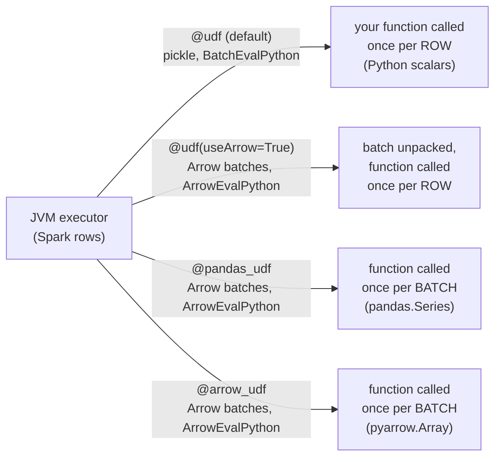
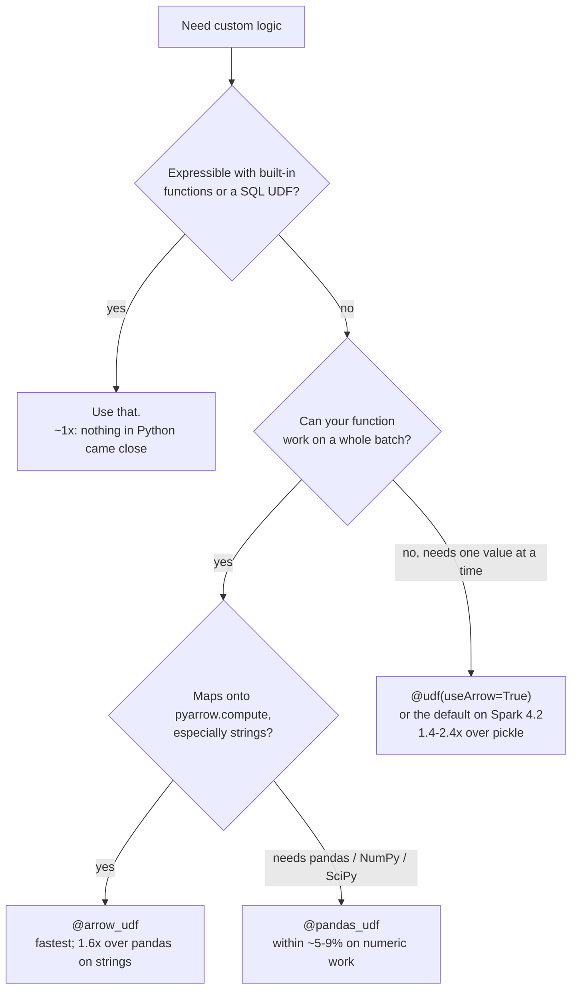

*Originally published on [systems/null](https://systemsnull.net/posts/data-engineering-ai/pyspark-udf-showdown).*

## The benchmark that tested the wrong Arrow

Earlier this year I built a benchmark to answer a question that comes up constantly: if you need custom Python logic in Spark, which kind of UDF should you write, and what does it cost? It compared seven options across three workloads (trivial arithmetic, a string transform, and a normal CDF) at scales from 100K to 100M rows.

The result my write-up leaned on hardest was a pair of rows that came out almost identical: a plain `@udf` ran at 48.5x the cost of the equivalent built-in function at 50M rows, and the same `@udf` "with Arrow turned on" ran at 48.9x (69.2x against 69.0x at 100M). I called it the key insight: switching transport from pickle to Arrow buys nothing when your function still executes one row at a time.

The conclusion about per-row execution is right, but the evidence wasn't what I thought. This is the setting the benchmark toggled:

```python
# What my benchmark flipped for its "@udf + Arrow" case:
spark.conf.set("spark.sql.execution.arrow.pyspark.enabled", "true")
# ...which only governs DataFrame.toPandas() and createDataFrame(pandas_df).
# It never touches Python UDFs.

# What actually moves a regular Python UDF onto Arrow:
spark.conf.set("spark.sql.execution.pythonUDF.arrow.enabled", "true")   # session-wide
@udf(DoubleType(), useArrow=True)                                        # or per UDF
def f(x): ...
```

[The PySpark documentation](https://spark.apache.org/docs/latest/api/python/tutorial/sql/arrow_pandas.html) is explicit that `arrow.pyspark.enabled` controls pandas conversions. So my two nearly identical rows were the same pickled UDF measured twice, and the gap between them (under 1%) is just how much two runs of the same thing vary.

I had built an A/A test by accident, in a benchmark that existed precisely because Spark's "Arrow" naming is easy to confuse.

That mistake is the best evidence I have for the actual thesis: **the cost of a Python UDF is decided far more by what your function receives (a single value, a pandas Series, or an Arrow array) than by whether Arrow carries the bytes, and because "Arrow" names several different mechanisms, it's easy to flip the switch that sounds right and optimize nothing.** Here is what each of them actually does:

| What you set | What it controls | Affects your UDF? |
|---|---|---|
| `spark.sql.execution.arrow.pyspark.enabled` | `toPandas()` and `createDataFrame(pandas_df)` conversions | No |
| `@udf(useArrow=True)` or `spark.sql.execution.pythonUDF.arrow.enabled` | Moves a regular UDF to Arrow batches (`ArrowEvalPython`); your function still gets one scalar per call. On by default since Spark 4.2 | Yes, 1.4x to 2.4x |
| `@pandas_udf` | Arrow batches; your function gets a `pandas.Series` per call | Yes, vectorized |
| `@arrow_udf` (Spark 4.1+, SPARK-53014) | Arrow batches; your function gets a `pyarrow.Array` per call | Yes, vectorized, no pandas |

## Three choices hiding behind every decorator

Every Python UDF call makes three independent choices: how data crosses from the JVM to the Python worker (transport), which physical operator Spark plans (`BatchEvalPython` or `ArrowEvalPython`), and what your function receives once the data arrives (the execution model). **The last one determines how many times Python has to be entered.**



| UDF type | Operator | Transport | Calls into your Python | Receives |
|---|---|---|---|---|
| `@udf` (default, pre-4.2) | `BatchEvalPython` | pickle | once per row | scalar |
| `@udf(useArrow=True)` | `ArrowEvalPython` | Arrow | once per row | scalar |
| `@pandas_udf` | `ArrowEvalPython` | Arrow | once per batch | `pandas.Series` |
| `@arrow_udf` | `ArrowEvalPython` | Arrow | once per batch | `pyarrow.Array` |

This is the exact code the benchmark ran for the arithmetic workload (`x * 2 + 1`):

```python
@udf(DoubleType())                    # once per row, pickle
def py_arith(x):
    return float(x) * 2 + 1 if x is not None else None

@udf(DoubleType(), useArrow=True)     # once per row, Arrow batches
def use_arrow_arith(x):
    return float(x) * 2 + 1 if x is not None else None

@pandas_udf(DoubleType())             # once per batch, pandas.Series
def pandas_arith(x):
    return x * 2 + 1

@arrow_udf(DoubleType())              # once per batch, pyarrow.Array
def arrow_arith(x: pa.Array) -> pa.Array:
    return pc.add(pc.multiply(x, 2), 1)
```

And for the string workload (`upper(x) + '_SUFFIX'`), where the two vectorized options separate:

```python
@pandas_udf(StringType())
def pandas_string(x):
    return x.str.upper() + "_SUFFIX"

@arrow_udf(StringType())
def arrow_string(x: pa.Array) -> pa.Array:
    upper = pc.utf8_upper(x)
    suffix = pa.array(["_SUFFIX"] * len(upper), type=pa.string())   # see note below
    return pc.binary_join_element_wise(upper, suffix, "")
```

## What the measurements show

Median wall-clock seconds at 50M rows, with the multiple of the built-in time in parentheses (the mislabeled "Arrow config" row is omitted, since it was a second run of the default `@udf`):

| | arithmetic | string | normal CDF |
|---|---|---|---|
| built-in functions | 0.107 | 0.486 | 0.176 |
| SQL UDF | 0.095 (0.9x) | 0.477 (1.0x) | n/a |
| `@arrow_udf` | 0.725 (6.8x) | 1.545 (3.2x) | 0.762 (4.3x) |
| `@pandas_udf` | 0.789 (7.4x) | 2.512 (5.2x) | 0.819 (4.7x) |
| `@udf(useArrow=True)` | 2.228 (20.8x) | 4.430 (9.1x) | 2.942 (16.7x) |
| `@udf` (default, pickle) | 5.199 (48.5x) | 6.216 (12.8x) | 6.183 (35.1x) |

And at 100M rows:

| | arithmetic | string | normal CDF |
|---|---|---|---|
| built-in functions | 0.147 | 0.910 | 0.267 |
| `@arrow_udf` | 1.332 | 2.904 | 1.333 |
| `@pandas_udf` | 1.400 | 4.743 | 1.449 |
| `@udf(useArrow=True)` | 4.188 | 8.735 | 5.658 |
| `@udf` (default, pickle) | 10.139 | 12.212 | 12.060 |

Three things stand out, and each one follows from the execution model rather than the transport.

**Arrow batching helps a row-at-a-time UDF, but only about 2x.** `useArrow=True` took arithmetic from 5.20s to 2.23s and the CDF from 6.18s to 2.94s, because `ArrowEvalPython` moves data in efficient batches instead of pickling rows. It still calls your function once per value, though, and that per-call cost is a hard ceiling: across every workload and scale, the row-at-a-time UDFs topped out at roughly 8 to 10 million rows per second (50M rows in 5.2s; 100M in 10.1s), which is about the rate at which CPython can be entered and exited no matter what's computed inside.

The vectorized UDFs cross into Python once per batch instead, and they were about 3x faster again than `useArrow=True` on arithmetic.

**Between the vectorized options, the gap is almost entirely strings.**

| `@arrow_udf` speedup over `@pandas_udf` | arithmetic | string | CDF |
|---|---|---|---|
| 50M rows | 1.09x | 1.63x | 1.07x |
| 100M rows | 1.05x | 1.63x | 1.09x |

That split is what you'd expect from how the two libraries lay out data. A numeric pandas Series is a NumPy array underneath, so converting from Arrow is cheap and the arithmetic is the same vectorized arithmetic either way. Strings are different; pandas has traditionally stored them as an array of Python objects, each its own heap allocation, while Arrow keeps them in one contiguous buffer plus an array of offsets. Converting to pandas means building millions of Python objects, and every operation afterwards walks memory scattered across the heap.

If anything the benchmark understates the gap, because my `@arrow_udf` string function builds a Python list of suffixes the length of every batch before joining them, which is exactly the per-element Python work `pyarrow.compute` exists to avoid. The CDF case is close for the opposite reason: `pyarrow.compute` has no `erf`, so my "Arrow" CDF converts to NumPy and calls SciPy, just like the pandas version does.

**Scale changes which choice matters.** Arithmetic workload, median seconds (the `@arrow_udf` column is blank below 50M because it wasn't a separate case in those earlier runs):

| rows | built-in | `@arrow_udf` | `@pandas_udf` | `useArrow=True` | `@udf` (pickle) |
|---|---|---|---|---|---|
| 100K | 0.073 | | 0.181 | 0.212 | 0.161 |
| 1M | 0.077 | | 0.200 | 0.248 | 0.258 |
| 10M | 0.074 | | 0.299 | 0.568 | 1.092 |
| 50M | 0.107 | 0.725 | 0.789 | 2.228 | 5.199 |
| 100M | 0.147 | 1.332 | 1.400 | 4.188 | 10.139 |

At 100K rows every Python UDF was within 2x to 6x of the built-ins, and the plain pickled `@udf` was actually the fastest Python option on arithmetic, because fixed costs (starting Python workers, setting up batches) dominate everything at that size. The tiers only separate cleanly somewhere around 10M rows.

If your job processes a few hundred thousand rows, UDF type is unlikely to be what's making it slow.

## Why I'd trust the seconds over the multipliers

There's a second correction to my own write-up, and it applies to almost any benchmark reported as "Nx slower." My report said row-at-a-time UDFs showed superlinear growth, from 48.5x at 50M to 69.2x at 100M. **That's true of the ratio and false of the thing you care about:**

| default `@udf`, arithmetic | 50M | 100M | growth for 2x rows |
|---|---|---|---|
| `@udf` absolute time | 5.199s | 10.139s | 1.95x (linear) |
| built-in absolute time | 0.107s | 0.147s | 1.37x |
| ratio | 48.5x | 69.2x | "superlinear" |

The ratio grew because its denominator grew slowly; the built-in at this scale is mostly fixed overhead.

The baseline has another problem I can't fully explain away. SQL UDFs, which compile to the same plan as built-ins, came out slightly faster than them at every scale (0.64x to 0.98x). The likeliest cause is ordering: the built-in case always ran first in each workload and may have absorbed start-up cost despite the warmup. If so, every multiplier here is somewhat inflated. An earlier set of my own 50M runs, before I raised driver memory, had the built-in at 0.25s and the pickled `@udf` at about 22x, while the `@udf`'s own time moved only about 10%.

The headline multiplier more than doubled on the strength of the baseline alone.

## What has changed, and what I didn't measure

Spark 4.2 [turns Arrow optimization on by default](https://spark.apache.org/docs/latest/api/python/tutorial/sql/arrow_pandas.html) for regular Python UDFs, after an attempt to do the same for 4.0 was reverted ([SPARK-48516](https://issues.apache.org/jira/browse/SPARK-48516)). On 4.2 a plain `@udf` should therefore behave like my `useArrow=True` rows, a free 2x for anyone who never touches the setting; I haven't rerun the benchmark on 4.2, so **that's an expectation, not a measurement**.

I also only benchmarked scalar UDFs. The partition-level APIs `mapInPandas` and `mapInArrow`, and the grouped `applyInPandas` and `applyInArrow`, follow the same logic about what your function receives (the Arrow variants skip pandas conversion entirely), and they're the right tools when you need to change the number of rows or see a whole partition or group at once. I have no measurements for them, and I'd rather say so than borrow numbers.

The benchmark's own limits:

- One machine, `local[*]`, via Spark Connect; hardware not recorded.
- Synthetic, low-cardinality data (`spark.range` plus two derived columns, short strings), cached in memory before timing.
- Each case materialized with a count, not written anywhere.
- One warmup, median of three timed runs, no variance recorded.
- The 100K to 10M runs predate the 32GB driver setting and the separate `@arrow_udf` case, so there's no genuine `@arrow_udf` data below 50M.

None of this changes the ordering, which held everywhere, but the exact multipliers are specific to this setup.

## Choosing, based on what was measured



**Whichever you choose, check which "Arrow" your setting actually refers to.** Mine didn't, and I wrote a benchmark about exactly this.

## Further reading

- [SPARK-53014](https://issues.apache.org/jira/browse/SPARK-53014): Arrow UDF public API (`@arrow_udf`).
- [SPARK-40307](https://issues.apache.org/jira/browse/SPARK-40307): Arrow-optimized Python UDFs (`useArrow`), Spark 3.5.0.
- Benchmark code and raw results: `spark-udf-benchmark` (Spark 4.1.0, Spark Connect, `local[*]`).
