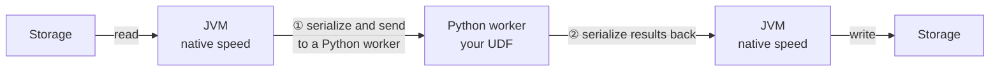
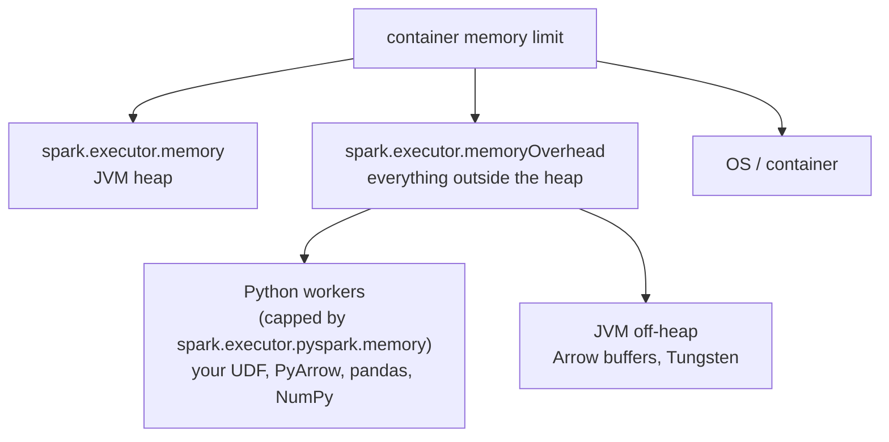

*Originally published on [systems/null](https://systemsnull.net/posts/data-engineering-ai/python-performance-in-spark).*

When I benchmarked PySpark's UDF types earlier this year, I ran the same three workloads (trivial arithmetic, a string transform, a normal CDF) at five scales, from 100 thousand rows to 100 million. At 100 million rows, the default row-at-a-time Python UDF took about 10 seconds for arithmetic that a built-in function finished in under a fifth of a second. At 100 thousand rows, the same UDF was the fastest Python option I tested.

Both results are true, and between them they're most of what you need to know about PySpark performance: **the cost is almost never in your function.** It's in how many times, and in what shape, your data crosses from the JVM into Python, and whether that crossing is large enough to matter at all.

**My argument is that there is really one PySpark performance technique, applied at different places: cross the JVM/Python boundary less often, move less across it, or stop paying for a JVM where you don't need one. The changes worth making are ordered by how much of that crossing they remove, and the biggest one, not crossing at all, is also the most often skipped.**

The history of how Arrow came to carry that crossing is in Arrow in PySpark, 2016 to 2026, and the full benchmark is in Stop Blaming Serialization for Slow Python UDFs. This post is the practical version: what to change, in what order, and what each change actually removes.

---

## Where the time goes

PySpark is a Python client for a JVM engine. DataFrame operations build a plan in Python (through Py4J, which only ever carries control messages, never bulk data) and the JVM executes it; `df.filter(col("x") > 5).groupBy("y").count()` never puts a row into Python, which is why it runs at the same speed as Scala. The data only leaves the JVM when your own code needs it:



Everything outside arrows ① and ② happens at native speed. Every change below makes those two arrows smaller, rarer, or unnecessary, and I've ordered them by how much they took off the arrows in what I measured, or, where I haven't measured, by what they remove.

## Don't cross at all: built-ins and SQL UDFs

**The largest win isn't a better UDF; it's no UDF.** Built-in functions run inside the JVM as Catalyst expressions, fused by whole-stage code generation into tight loops, and never serialize anything.

What surprised me more is that SQL UDFs get the same treatment. Spark 4.0 added [SQL user-defined functions](https://spark.apache.org/docs/4.1.0/sql-ref-syntax-ddl-create-sql-function.html) ([SPARK-46057](https://issues.apache.org/jira/browse/SPARK-46057)), and their bodies are inlined into the logical plan, so the optimizer can see straight through them:

```sql
CREATE FUNCTION classify(score INT) RETURNS STRING
RETURN CASE
    WHEN score > 90 THEN 'excellent'
    WHEN score > 70 THEN 'good'
    ELSE 'needs_improvement'
END;
```

In my benchmark (median wall-clock time, 50M rows, Spark 4.1.0 through Spark Connect on one machine), the SQL UDF was indistinguishable from the built-ins, and every Python option cost several times more:

| | arithmetic | string | normal CDF |
|---|---|---|---|
| built-in functions | 0.107 s | 0.486 s | 0.176 s |
| SQL UDF | 0.095 s | 0.477 s | n/a |
| fastest Python UDF (`@arrow_udf`) | 0.725 s | 1.545 s | 0.762 s |
| default Python UDF (`@udf`, pickle) | 5.199 s | 6.216 s | 6.183 s |

**So the first question for any UDF is whether it needs to be Python.** Plenty of "we need a UDF" logic is a `CASE` expression, a string function, or a date calculation that already exists in `pyspark.sql.functions`. Python earns its place when you need a library (scikit-learn, a parser, a C extension) or logic that genuinely can't be expressed in SQL. Everything after this point is about paying less for that choice.

## Cross once per batch, not once per row

If it has to be Python, the next biggest lever is how often Spark calls your function. A regular `@udf` is called once per row; `@pandas_udf` and `@arrow_udf` are called once per batch of rows. That difference showed up as a hard ceiling in my runs: every row-at-a-time UDF, whatever it computed, topped out at roughly 8 to 10 million rows per second, which is roughly the rate at which CPython can be entered and exited. The batched UDFs weren't bound by it.

| 50M rows | arithmetic | string | normal CDF |
|---|---|---|---|
| `@udf` (pickle, per row) | 5.199 s | 6.216 s | 6.183 s |
| `@udf(useArrow=True)` (Arrow transport, still per row) | 2.228 s | 4.430 s | 2.942 s |
| `@pandas_udf` (per batch, `pandas.Series`) | 0.789 s | 2.512 s | 0.819 s |
| `@arrow_udf` (per batch, `pyarrow.Array`) | 0.725 s | 1.545 s | 0.762 s |

Two things in that table decide what to change. Moving a per-row UDF onto Arrow transport helps, 1.4x to 2.4x here, and [on Spark 4.2 you get it for free](https://spark.apache.org/docs/latest/api/python/tutorial/sql/arrow_pandas.html): 4.2 finally flipped `spark.sql.execution.pythonUDF.arrow.enabled` (and its UDTF counterpart) to true by default, after the same change was merged for 4.0 and reverted before release ([SPARK-48516](https://issues.apache.org/jira/browse/SPARK-48516)).

But **rewriting to a batched UDF is worth several times more again**, because it removes the per-row call rather than making the trip to it cheaper.

Between the two batched options, the choice mostly comes down to strings: `@arrow_udf` was only 5 to 9% faster than `@pandas_udf` on numeric work, but about 1.6x faster on the string transform, because pandas has traditionally stored strings as individual Python objects while Arrow keeps them in one contiguous buffer.

```python
import pyarrow as pa
import pyarrow.compute as pc
from pyspark.sql.functions import arrow_udf

@arrow_udf("string")
def add_suffix(x: pa.Array) -> pa.Array:
    return pc.binary_join_element_wise(pc.utf8_upper(x), pa.scalar("_SUFFIX"), "")
```

One warning, because I learned it the expensive way: `spark.sql.execution.arrow.pyspark.enabled` is not the UDF setting. It governs `toPandas()` and `createDataFrame()`, and it's the one my benchmark originally toggled for its "Arrow" case, which is why I once reported that Arrow transport changes nothing for UDFs. It was the same pickled UDF, measured twice. (On 4.2 that setting is also on by default, so the confusion matters less for new code than for anyone reading old tuning advice.)

And the scale caveat from the opening is real. At small sizes, fixed costs dominate, and the ordering can flip:

| arithmetic, median seconds | built-in | `@pandas_udf` | `@udf(useArrow=True)` | `@udf` (pickle) |
|---|---|---|---|---|
| 100K rows | 0.073 | 0.181 | 0.212 | 0.161 |
| 10M rows | 0.074 | 0.299 | 0.568 | 1.092 |
| 100M rows | 0.147 | 1.400 | 4.188 | 10.139 |

If your job touches a few hundred thousand rows, rewriting its UDFs is unlikely to be what makes it faster.

## Don't produce the data: Python data sources with pushdown

After calling Python less, the next thing to remove is data that never needed to exist. Built-in sources like Parquet already push filters down and skip row groups that can't match; for most of Spark's history, custom sources that could do the same had to be written in Java or Scala. Spark 4.0 added the [Python Data Source API](https://spark.apache.org/docs/latest/api/python/tutorial/sql/python_data_source.html) ([SPARK-44076](https://issues.apache.org/jira/browse/SPARK-44076)), and Spark 4.1 added filter pushdown for it ([SPARK-51271](https://issues.apache.org/jira/browse/SPARK-51271)), so a source written in Python can now turn `WHERE status = 'active'` into a query parameter, a database predicate, or a skipped file block, and never send the rest.

When I went back over my own notes on this feature to write this post, the example I'd written was wrong, and checking it against Spark's source turned up something I hadn't known: pushdown for Python sources is **off by default**. It's governed by `spark.sql.python.filterPushdown.enabled`, [an internal setting added in 4.1](https://github.com/apache/spark/blob/v4.2.0/sql/catalyst/src/main/scala/org/apache/spark/sql/internal/SQLConf.scala) whose description says enabling it costs "running Python worker one additional time during planning"; without it, your `pushFilters()` is never called.

[The method](https://github.com/apache/spark/blob/v4.2.0/python/pyspark/sql/datasource.py) also has a less obvious contract than I'd assumed. It returns the filters Spark must *still* apply after the scan, not the ones you accepted, and each filter's `attribute` is a column-path tuple:

```python
from pyspark.sql.datasource import DataSourceReader, EqualTo

spark.conf.set("spark.sql.python.filterPushdown.enabled", "true")  # off by default

class ApiReader(DataSourceReader):
    def __init__(self, options):
        self.url = options.get("url")
        self.pushed = []

    def pushFilters(self, filters):
        # Filters arrive ANDed together; yield the ones Spark must still apply.
        for f in filters:
            if isinstance(f, EqualTo) and f.attribute == ("status",):
                self.pushed.append(f)          # handled at the source
            else:
                yield f

    def read(self, partition):
        import requests
        params = {f.attribute[0]: f.value for f in self.pushed}
        for row in requests.get(self.url, params=params).json():
            yield (row["id"], row["name"], row["status"])
```

Only conjunctions are pushed (a filter like `a = 1 or b = 2` arrives as an empty list), and a reader can also yield `pyarrow.RecordBatch` objects instead of tuples, which [the Spark docs](https://spark.apache.org/docs/latest/api/python/tutorial/sql/python_data_source.html) say can improve performance by "up to one order of magnitude."

I haven't measured either path, so this is the one change on the list I'm ranking by what it removes rather than by what I saw: for a source backed by an API or a database, **rows that are never fetched are the cheapest rows there are.**

## Skip pandas for grouped work

Per-group logic (normalize within each location, fit a model per customer) has long meant `applyInPandas`, which converts every group from Arrow into a pandas DataFrame and back. Spark 4.0 added `applyInArrow` ([SPARK-40559](https://issues.apache.org/jira/browse/SPARK-40559)), and [each group now reaches your function](https://spark.apache.org/docs/latest/api/python/reference/pyspark.sql/api/pyspark.sql.GroupedData.applyInArrow.html) as a `pyarrow.Table`, in the format it crossed the boundary in:

```python
def normalize(table: pa.Table) -> pa.Table:
    totals = table.column("total")
    mean, std = pc.mean(totals).as_py(), pc.stddev(totals).as_py()
    normalized = (pa.array([0.0] * len(totals)) if not std
                  else pc.divide(pc.subtract(totals, mean), std))
    return pa.Table.from_arrays([table.column("order_id"), totals, normalized],
                                names=["order_id", "total", "normalized"])

result = orders.groupBy("location_id").applyInArrow(
    normalize, schema="order_id long, total double, normalized double")
```

This is the same trade as step 2, one level up: **it removes a conversion, not a crossing**, so the payoff should track what that conversion cost in my UDF numbers (little for numeric groups, more for string-heavy ones, more for larger groups). I haven't benchmarked the grouped APIs, so I won't put a number on it.

## Take the JVM out of the client

Spark Connect is on this list for a different reason than the others. **It doesn't make a query faster; it removes the JVM from every client process.** Classic PySpark embeds a full Spark driver in each notebook, scheduled job, and CI container. [With Connect](https://spark.apache.org/docs/latest/spark-connect-overview.html), the client sends unresolved plans over gRPC and gets Arrow batches back, and the thin `pyspark-client` package has no JVM and needs no JDK. When I measured it for my own Connect demos on 4.2, the numbers were less dramatic than the pitch:

| | `pyspark` (full) | `pyspark-client` |
|---|---|---|
| PyPI artifact | 429.28 MB | 1.60 MB |
| installed `pyspark/` | 481 MB | 19 MB |
| Spark JARs on the client | 456 MB, 276 files | none |
| virtual env with Connect dependencies | 820 MB | 359 MB |

The last row is the honest one: `pyarrow`, `pandas`, and `numpy` are required dependencies, so the environment shrinks by less than half.

What you actually get is a client with no JVM to start, no JDK to install, and no way for a crashed notebook to take the driver down with it. What you give up is anything that needs the JVM on your side: RDDs, `SparkContext`, custom accumulators. ML on Connect has been supported since 4.0 and generally available since 4.1, so that's no longer on the list of reasons to stay classic.

## Give Python the memory it actually uses

The last change is the one that turns slow jobs into failed ones when it's wrong. Python workers live outside the JVM heap, so the settings most Spark tuning advice is about don't cover them:



**The rule is that the container has to fit the heap, the overhead, and the OS, and that Python's share has to come out of the overhead.** If you use `toPandas()` or pandas UDFs, `spark.sql.execution.arrow.pyspark.selfDestruct.enabled` [frees Arrow buffers as they're converted](https://spark.apache.org/docs/latest/configuration.html), so the same data doesn't sit in memory twice.

Beyond that, the usual advice still holds: let Adaptive Query Execution size shuffle partitions at runtime (it's been on by default since 3.2, and 4.1 extended it to stateless streaming, [SPARK-53941](https://issues.apache.org/jira/browse/SPARK-53941), which [can change a streaming query's behaviour after an upgrade](https://spark.apache.org/docs/latest/streaming/ss-migration-guide.html)), and broadcast small dimension tables instead of shuffling them. None of that is specific to Python, which is why it's last on a list about Python.

---

## What's coming in 4.3

The 4.3 branch hasn't been released (its first release candidate [failed its vote on September 6](https://lists.apache.org/thread/6bhgq2w84zrv3sl4wr2zl8p23fvbsfrg), and there's no new date), but it shows where the boundary is heading, and it confirms the order above.

The most interesting change goes around the boundary instead of through it: experimental transpilation of Python UDFs into Spark expressions (SPIP [SPARK-54783](https://issues.apache.org/jira/browse/SPARK-54783), `spark.sql.experimental.optimizer.transpilePyUDFs`). **A simple enough Python function would never cross into Python at all**, which is change number 1 done for you. It's off by default, requires ANSI mode, and only works in classic mode, not Connect, but it's the only approach on the branch that could get under the per-row ceiling rather than lowering the cost of hitting it.

Alongside it are smaller changes to the crossing itself: pipelined, asynchronous transfer of UDF batches (`spark.python.udf.pipelined.enabled`, [SPARK-56642](https://issues.apache.org/jira/browse/SPARK-56642), off by default) and a cap on bytes per UDF batch ([SPARK-57593](https://issues.apache.org/jira/browse/SPARK-57593)). A proposal to make Spark better on a single machine also adds an Arrow format for Spark's in-memory cache ([SPARK-57268](https://issues.apache.org/jira/browse/SPARK-57268)).

Two things haven't moved. PySpark still doesn't support pandas 3, even on the 4.3 branch; it pins pandas below 3.0, and the ticket to support it ([SPARK-55139](https://issues.apache.org/jira/browse/SPARK-55139)) is open, so the PyArrow-backed string type pandas 3 made the default in January won't help pandas UDFs yet. And Real-Time Mode in 4.3 gains stateful operators, but still can't run Python UDFs ([SPARK-57237](https://issues.apache.org/jira/browse/SPARK-57237) is open).

Housekeeping to plan for: [4.2 raised the minimum PyArrow to 18.0.0 and dropped PyPy](https://github.com/apache/spark/blob/branch-4.3/python/docs/source/migration_guide/pyspark_upgrade.rst), and 4.3 drops Python 3.10 ([SPARK-56889](https://issues.apache.org/jira/browse/SPARK-56889)).

---

I opened with a UDF that took 10 seconds at 100 million rows and was the fastest Python option at 100 thousand. The reason is the same one behind every change on this list: your function was never the expensive part.

The crossing was, and the best PySpark optimization is still the one that decides the data doesn't need to cross.
