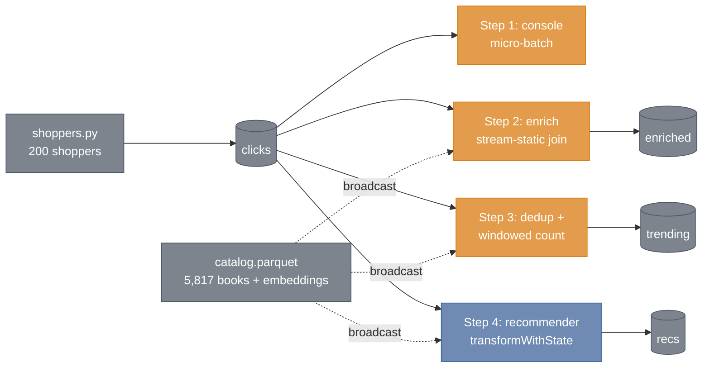
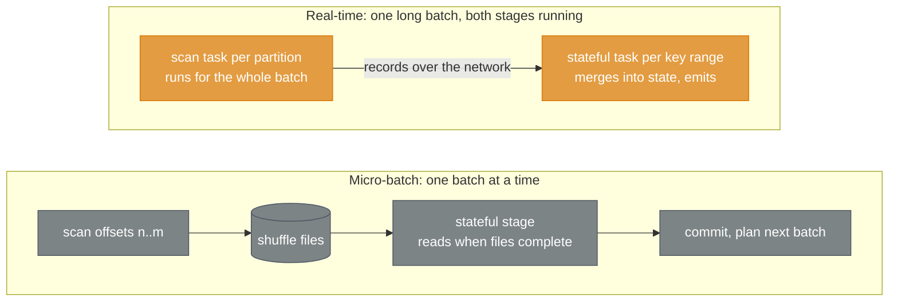

import img0 from "./real-time-mode-spark-43-basics.gif";
import img1 from "./real-time-mode-spark-43-trigger.gif";
import img2 from "./real-time-mode-spark-43-stateful.gif";
import img3 from "./real-time-mode-spark-43-processor.gif";
import img4 from "./real-time-mode-spark-43-grade.gif";
import img5 from "./real-time-mode-spark-43-live.gif";

*Originally published on [systems/null](https://systemsnull.net/posts/data-engineering-ai/real-time-mode-spark-43).*

## Spark 4.3 is out, and Real-time Mode does state now (!!)

Spark 4.3.0 landed on PyPI and Maven Central at the end of October, and for anyone who works on streaming the headline is pretty easy to pick out of the release: Real-time Mode, which arrived in 4.1 as millisecond Structured Streaming for stateless queries only, can now run stateful queries too (deduplication, aggregations, and the JVM `transformWithState` API). This is what makes it applicable to workloads such as fraud scores, sessions, alerts and recommendations, all of which need to retain state between records.

A Real-time query uses the same DataFrame or Dataset transformations, state store and checkpointing model as a micro-batch query, but it keeps its tasks running and processes records as they arrive instead of scheduling a fresh set of tasks for every small batch. Spark 4.3 extends that model across a shuffle, which is what lets a record reach the task that owns its key and update state without waiting for the batch to finish.

**Real-time Mode changes what sets the latency of a Structured Streaming query: a record no longer waits for Spark to schedule its batch, so its latency is determined by the work it touches on its way through the pipeline.** That is why a per-shopper recommender that scores a few thousand books on every click can answer in milliseconds, but it is also why the remaining waits, including network buffering, state access and checkpoint boundaries, are worth understanding before you put it in front of anything.

So this post starts from Structured Streaming basics in the default micro-batch mode, then moves the same kinds of queries to Real-time Mode, then makes them stateful, and ends with a recommender written with `transformWithState` that keeps a taste vector per shopper. Each step is a runnable file in [spark-demos](https://github.com/lisancao/spark-demos/tree/main/demos/14_real_time_mode), and every latency here comes out of one script (`bin/bench.sh`) run against Spark 4.3.0 on one Linux machine, recorded in the demo's `NOTES.md`.

## Example: a bookshop that re-ranks while you browse

The shop sells 5,817 books from [Project Gutenberg's catalog](https://www.gutenberg.org/ebooks/offline_catalogs.html), sorted into twelve aisles (Poetry, Romance, Science-Fiction & Fantasy, Cooking & Drinking and so on, from Gutenberg's own "Category" bookshelves). A generator plays 200 shoppers, each with one or two favourite aisles that Spark never gets to see; most of a shopper's clicks land in a favourite aisle and the rest land anywhere, every click is a view, a cart add or a purchase, and a small share of events get sent twice with the same `event_id`, the way a retrying mobile client would. Clicks go to a Kafka topic, and each step reads them from there.



Before any streaming happens there's a batch step, `00_build_catalog.py`, that reads the catalog CSV, keeps English texts that sit in exactly one of the twelve aisles (up to 500 per aisle, picked by a hash so reruns get the same books), and embeds each book's title, author and subject headings with [`BAAI/bge-small-en-v1.5`](https://huggingface.co/BAAI/bge-small-en-v1.5) (384 dimensions) inside Spark, using `mapInPandas` and [fastembed](https://github.com/qdrant/fastembed) so each task loads the model once and embeds its rows in batches. The aisle label is deliberately left out of the embedded text, so when the recommender later puts a shopper's picks in their favourite aisles it's because the subjects and titles are similar, not because it read the answer key.

```python
def embed(batches: Iterator[pd.DataFrame]) -> Iterator[pd.DataFrame]:
    from fastembed import TextEmbedding
    model = TextEmbedding(MODEL, cache_dir=str(DATA / "models"), threads=1)   # one core per Spark task
    for pdf in batches:
        vectors = list(model.embed(pdf["text"].tolist(), batch_size=64))
        yield pdf.drop(columns=["text"]).assign(vector=[v.astype("float32").tolist() for v in vectors])

shop.mapInPandas(embed, "book_id long, title string, author string, aisle string, vector array<float>")
```

The embedding is the expensive, model-shaped part of the personalisation, and it happens once, offline, in batch; what the streaming side does per click is arithmetic against those vectors. That split isn't only a design preference, it's forced by Real-time Mode, which I'll come back to.

## Step 1: Structured Streaming basics

Structured Streaming treats a stream as a table that keeps growing: `readStream` gives you a DataFrame over it, you write ordinary DataFrame code against that DataFrame, and `writeStream` keeps running that code on each new slice of input. In the default execution mode each slice is a micro-batch, a small batch job that Spark plans, schedules as a fresh set of tasks, runs over the offsets that arrived since the last one, and commits to the checkpoint before planning the next.

```python
raw = (s.readStream.format("kafka")
       .option("kafka.bootstrap.servers", BOOTSTRAP)
       .option("subscribe", "clicks")
       .option("startingOffsets", "latest")
       .load())

clicks = (raw.select(F.from_json(F.col("value").cast("string"), CLICK_SCHEMA).alias("c"))
          .select("c.*")
          .where(F.col("action").isin("cart", "purchase"))
          .select("user_id", "book_id", "action", F.timestamp_millis("ts").alias("clicked_at")))

q = (clicks.writeStream.format("console")
     .option("checkpointLocation", str(CHECKPOINTS / "01-basics"))
     .outputMode("append")
     .trigger(processingTime="5 seconds")
     .start())
```

The source hands records over with their Kafka partition and offset, which lets Spark track what it has and has not processed, while the transformation remains ordinary DataFrame code; neither `from_json` nor `where` knows that its input is streaming. The trigger decides when the next micro-batch starts (every 5 seconds here; `processingTime="0 seconds"` means back to back, as fast as they go), and the checkpoint records the query's progress and, for a stateful query, its state so it can resume after a restart. The output mode (`append`, `update` or `complete`) determines which rows of the result table each batch writes; it does not make much difference for this filter, but it will once the query begins updating state.

```text
-------------------------------------------
Batch: 1
-------------------------------------------
+-------+-------+------+-----------------------+
|user_id|book_id|action|clicked_at             |
+-------+-------+------+-----------------------+
|u0178  |4745   |cart  |2026-11-04 21:22:40.141|
|u0099  |32495  |cart  |2026-11-04 21:22:40.041|
|u0136  |47805  |cart  |2026-11-04 21:22:40.166|
|u0196  |13184  |cart  |2026-11-04 21:22:39.616|
```


The cost of the micro-batch model is in how it works: every batch pays for planning, task scheduling and a commit, and every record waits for the batch it lands in. That fixed work puts a practical floor under latency, which [the Spark 4.3 Real-time Mode docs](https://spark.apache.org/docs/4.3.0/streaming/real-time-mode.html) put at roughly 100 ms.

## Step 2: The same query in Real-time Mode

Real-time Mode keeps the API and changes the execution: instead of launching short tasks for every slice, it launches one long-running task per Kafka partition, and those tasks stay up for the length of a (long) batch and process records as they arrive. Records flow source to transformation to sink without waiting for a batch boundary, so the batch duration stops being a latency setting and becomes, mostly, a checkpoint interval; the default is 5 minutes, and records still come out in milliseconds.

Step 2 enriches every click with the book's title and aisle through a stream-static join, and writes the result to another Kafka topic. Turning it into a Real-time query is a trigger change, plus the `update` output mode Real-time Mode requires:

```python
books = s.read.parquet(CATALOG).select("book_id", "title", "author", "aisle")

enriched = (clicks.join(F.broadcast(books), "book_id")
            .select(F.col("user_id").alias("key"),
                    F.to_json(F.struct("event_id", "user_id", "action", "ts", "book_id",
                                       "title", "aisle")).alias("value")))

w = (enriched.writeStream.format("kafka")
     .option("kafka.bootstrap.servers", BOOTSTRAP)
     .option("topic", "enriched")
     .option("checkpointLocation", str(CHECKPOINTS / f"02-enrich-{a.mode}"))
     .outputMode("update"))
if a.mode == "rtm":
    w = w.trigger(realTime="30 seconds")       # a checkpoint every 30 s; records don't wait for it
else:
    w = w.trigger(processingTime="0 seconds")  # micro-batches back to back, as fast as they go
```

The `broadcast` hint isn't optional here: a stream-static join in Real-time Mode must not introduce a shuffle, so the static side has to be broadcast to every task. In Scala and Java the trigger is `Trigger.RealTime("30 seconds")`; in Python the duration is required, and anything under 5 seconds is rejected at start.

I measured end-to-end latency the strict way: the output topics are created with `message.timestamp.type=LogAppendTime`, so every output record carries the time the broker appended it, and `bin/latency.py` subtracts the click's own timestamp (set by the generator when it produced the click) from that. The number covers the input hop, Spark, Spark's Kafka producer and the output hop; both clocks are the same machine's. The generator ran at 200 clicks a second for 45 seconds per run, against a 4-partition topic.

| Step 2, stateless enrich | p50 | p90 | p99 |
|---|---|---|---|
| micro-batch, back-to-back trigger | 115 ms | 161 ms | 204 ms |
| Real-time Mode | 0 ms | 1 ms | 1 ms |

The micro-batch numbers are the floor the docs talk about: even with no trigger interval at all, a record waits for the batch it lands in to be planned, scheduled, run and committed. The Real-time numbers are a single machine on localhost at a modest rate, and both timestamps have millisecond resolution, so a median of 0 ms means only that at least half the records arrived within the same measured millisecond; it does not establish zero or sub-millisecond latency. The point is the shape: a record's latency is now dominated by its own path through the query rather than the scheduling and completion of its batch.


The execution model comes with a fairly strict set of requirements:

| Real-time Mode requires | What happens otherwise |
|---|---|
| `outputMode("update")` | `STREAMING_REAL_TIME_MODE.OUTPUT_MODE_NOT_SUPPORTED` at start |
| a batch duration of at least 5 s | `INVALID_STREAMING_REAL_TIME_MODE_TRIGGER_INTERVAL` |
| a Kafka source | `STREAMING_REAL_TIME_MODE.INPUT_STREAM_NOT_SUPPORTED` (the `rate` source isn't supported either) |
| a Kafka, `foreach`, console or memory sink | `STREAMING_REAL_TIME_MODE.SINK_NOT_SUPPORTED`; `foreachBatch` is out because it works on whole batches |
| every operator on the allowlist | `STREAMING_REAL_TIME_MODE.OPERATOR_OR_SINK_NOT_IN_ALLOWLIST`, which names the operator |
| enough cores for every long-running task at once | the query doesn't make progress |

The cores line is the one that bites on a laptop. A Real-time task holds its core for the whole batch, so a 4-partition topic needs 4 free cores before the query can move at all, and a stateful query needs more (next section). The docs also recommend one Real-time query per cluster, for the same reason; anything else on the cluster competes for slots the Real-time query is sitting on.

## Step 3: Stateful queries, and the shuffle that doesn't wait

Stateless operators work record by record inside one task, so long-running tasks are all they need. A stateful operator is different: a `dropDuplicates` on `event_id` or a `groupBy` on an aisle needs every record for a key to reach the same task, regardless of which Kafka partition it arrived on, which means a shuffle. In the micro-batch engine a shuffle is a hard boundary (the producer stage writes shuffle files, and only once they're complete does the consumer stage read them back grouped by key), and a long-running Real-time task never completes, so an ordinary shuffle would simply deadlock.

4.3 gets around that with two pieces that work together. A **pipelined shuffle** changes the scheduling: the source stage and the stateful stage are marked as one pipelined group and scheduled at the same time, both as long-running tasks. A **streaming shuffle** changes the transport: since both stages are running at once, the producer sends output incrementally over the network to the consumer tasks rather than materialising the whole shuffle as files first. Records may still spend a short time in network buffers, as the benchmark below makes rather obvious, but they do not wait for the producer stage or batch to finish before being regrouped by key and merged into state. The state itself still lives in the state store and is checkpointed each batch, preserving the same exactly-once processing semantics as micro-batch; delivery to an external sink remains a separate guarantee. None of this needs configuring because it is what a Real-time trigger does to a supported shuffle on the streaming path.



Step 3 drops retried events by `event_id`, then counts clicks and purchases per aisle per minute. It's the code you'd write for micro-batch, with the Real-time trigger:

```python
trending = (clicks
            .dropDuplicates(["event_id"])                       # stateful: every event_id seen so far
            .join(F.broadcast(books), "book_id")
            .withWatermark("event_time", "30 seconds")
            .groupBy(F.window("event_time", "1 minute"), "aisle")   # stateful: a running count per window and aisle
            .agg(F.count("*").alias("clicks"),
                 F.sum(F.when(F.col("action") == "purchase", 1).otherwise(0)).alias("purchases"),
                 F.max("ts").alias("last_ts")))
```

There is an important production caveat hiding in the first line: `dropDuplicates(["event_id"])` retains every event ID it has seen, and the watermark applied later to `event_time` belongs to the windowed aggregation rather than the deduplication. `dropDuplicatesWithinWatermark`, the bounded version of this operation, is not supported in Real-time Mode in 4.3, so this demo's deduplication state grows for as long as the query runs.

Because the output mode is `update`, each window's row is emitted every time it changes, and in Real-time Mode it changes on every record; the watermark doesn't hold results back here, it only governs when a closed window's state can be evicted. The latency is measured from the newest click counted into each emitted row (`last_ts`):

| Step 3, dedup + windowed aggregation | rows out | p50 | p90 | p99 |
|---|---|---|---|---|
| micro-batch, back-to-back trigger | 1,943 | 237 ms | 408 ms | 645 ms |
| Real-time Mode | 7,979 | 50 ms | 77 ms | 99 ms |
| Real-time Mode, shuffle flush wait 1 ms | 7,979 | 2 ms | 3 ms | 41 ms |


The row counts are the update semantics made visible: micro-batch emits one row per window and aisle per batch, with everything that arrived during the batch folded in, while Real-time Mode emits an updated count per click, which is roughly the input rate. If you're feeding a dashboard that's a lot of rows; if you're feeding something that acts on each change, it's the point.

The first time I made the query stateful, its median jumped from below the measurement's 1 ms resolution to 43 ms; in the benchmark run above it landed at 50 ms. That looked like the stateful operator being slow until I went through the 4.3 source and found the same number in the new streaming shuffle. It batches records into network buffers (32 KB by default), and a part-filled buffer is held for up to `spark.shuffle.streaming.networkBufferMaxWaitTimeMs` (50 ms by default) before it is flushed to the next task. At 200 clicks a second spread over four partitions, the buffers rarely fill, so most records wait for the timer. Setting it to 1 ms takes the median to 2 ms and the p99 from 99 ms to 41 ms.

The config's own docstring describes the trade directly: "Lower values reduce latency at the cost of smaller, less efficient messages." It is marked internal in 4.3, so this is not a documented tuning recommendation and the setting may change; the result instead shows why a lightly loaded stateful query can sit near 50 ms even when the state operation itself is cheap, and why latency and network efficiency cannot both be inferred from the name Real-time Mode.

The core budget follows the number of stages that must remain alive together, not merely the input rate. A query with one stateful operator needs a core for each Kafka partition plus one for each post-shuffle partition. Step 3 has two differently keyed stateful operators, deduplication by `event_id` followed by aggregation by window and aisle, so its pipelined group contains the source stage and two shuffle stages; with four partitions at each stage it needs twelve task slots. Leaving `spark.sql.shuffle.partitions` at its default of 200 would make that requirement wildly larger. Inspect the physical plan, count every concurrent stage and set the partition count deliberately.

## Step 4: A recommender in `transformWithState`

Dedup and aggregation cover a lot, but personalisation needs arbitrary per-key logic, which in Spark means [`transformWithState`](https://spark.apache.org/docs/4.3.0/streaming/structured-streaming-transform-with-state.html): you write a `StatefulProcessor` class, Spark calls it with each key's rows, and you get typed state variables (value, list and map state), timers, and TTL on the state. In 4.3 it runs under a Real-time trigger, with one big caveat stated plainly in the docs: only the Scala and Java API. PySpark's `transformWithState` and `transformWithStateInPandas` are rejected, so step 4 is Scala, built with sbt and run through `spark-submit` on the 4.3.0 binary.

The processor keeps four things per shopper, all with a 30-minute TTL so shoppers who leave stop costing memory:

| State | Type | What it holds |
|---|---|---|
| `taste` | `ValueState[Array[Float]]` | a decayed, action-weighted sum of the clicked books' embeddings |
| `clicks` | `ValueState[Long]` | how many distinct clicks fed it |
| `seen` | `MapState[Long, Long]` | books already clicked, so they're never recommended back |
| `events` | `MapState[String, Long]` | event ids already applied, so a retried event is ignored |

On every click the processor decays the taste vector, adds the clicked book's embedding weighted by the action (a view counts 1, a cart add 3, a purchase 5), scores every book in the catalog against it by cosine similarity, and emits the top five it hasn't seen. The catalog is collected on the driver once and broadcast, so every task has all 5,817 vectors in memory; scoring all of them is a couple of million multiply-adds per click, which fits comfortably inside the 3 ms end-to-end median measured below.

```scala
override def handleInputRows(user: String, rows: Iterator[Click], timers: TimerValues): Iterator[Recs] = {
  val cat = catalog.value
  val vec = if (taste.exists()) taste.get() else new Array[Float](cat.dim)
  var n = if (clicks.exists()) clicks.get() else 0L
  var last: Click = null
  rows.foreach { c =>
    if (!events.containsKey(c.event_id)) {          // a retried event is ignored
      events.updateValue(c.event_id, c.ts)
      cat.row(c.book_id).foreach { r =>
        val w = weight(c.action)
        var i = 0
        while (i < cat.dim) { vec(i) = vec(i) * decay + w * cat.vecs(r * cat.dim + i); i += 1 }
        seen.updateValue(c.book_id, c.ts)
        n += 1
        last = c
      }
    }
  }
  if (last == null) return Iterator.empty
  taste.update(vec)
  clicks.update(n)

  // One idle timer per shopper, pushed back on every click.
  getHandle.listTimers().foreach(t => getHandle.deleteTimer(t))
  getHandle.registerTimer(timers.getCurrentProcessingTimeInMs() + idleMs)

  Iterator.single(Recs(user, "picks", last.event_id, last.ts, n, topK(cat, vec)))
}
```


The loop over `rows` matters more than it looks. In micro-batch, `handleInputRows` gets all of a key's rows for the batch in one call; in Real-time Mode it's called once per row, with a one-row iterator. A processor that only looks at the first row, or that emits once per call assuming it has seen the whole batch, will behave differently in the two modes, so the docs' advice (write it to be correct either way) is the thing to follow. The job itself is the usual Dataset pipeline, ending in the Real-time trigger:

```scala
val recs = clicks                       // Dataset[Click], parsed from the clicks topic
  .groupByKey(_.user_id)
  .transformWithState(
    new Recommender(catalog, Duration.ofMinutes(30), idleMs),
    TimeMode.ProcessingTime(),
    OutputMode.Update())

recs.select($"user_id".as("key"), to_json(struct($"*")).as("value"))
  .writeStream.format("kafka")
  .option("topic", "recs")
  .option("checkpointLocation", s"$demo/data/checkpoints/04-recs-$mode")
  .outputMode("update")
  .trigger(Trigger.RealTime("30 seconds"))
  .start()
```

`TimeMode.ProcessingTime()` is there because TTL needs it; event-time mode works in Real-time too, with a watermark that's fixed for the whole batch and only moves between batches. And the first time I ran the micro-batch version for comparison, it refused to start:

```text
[UNSUPPORTED_FEATURE.STORE_BACKEND_NOT_SUPPORTED_FOR_TWS] The feature is not supported: Store backend
org.apache.spark.sql.execution.streaming.state.HDFSBackedStateStoreProvider is not supported by
TransformWithState operator. Please use RocksDBStateStoreProvider.
```

`transformWithState` needs the RocksDB state store. A Real-time query sets RocksDB, changelog checkpointing and checkpoint format v2 for you as soft defaults (only if you haven't set them yourself), and a micro-batch query doesn't, so a processor that works under `Trigger.RealTime` fails the moment you switch the trigger back. Every step in the demo now sets those three configs explicitly, which also means both modes in the tables run on the same state store. Watch out for the reverse trip too: Real-time Mode rejects a checkpoint written with format v1, so an existing micro-batch query that's been running on v1 needs a fresh checkpoint location before it can move to a Real-time trigger.

### Grading the recommendations

The generator writes each shopper's hidden favourite aisles to a file Spark never reads, so the recommendations can be graded: what share of the recommended books sit in one of the shopper's favourite aisles, grouped by how many clicks the shopper had made when the picks came out, against what picking books at random would score for the same shoppers. This run had the shoppers browse at 100 clicks a second for 60 seconds.

| Clicks so far | Picks | In a favourite aisle | Random picks would be |
|---|---|---|---|
| 1 | 1,000 | 64% | 12% |
| 2 to 4 | 3,000 | 73% | 12% |
| 5 to 9 | 5,000 | 79% | 12% |
| 10 to 19 | 9,905 | 82% | 12% |
| 20+ | 11,095 | 84% | 12% |


One click is already most of the way there, which says a single book's nearest neighbours in embedding space mostly share its aisle (its subject headings do a lot of the work); the gain after that is the taste vector averaging out the 20% of clicks that land anywhere. Watching one shopper live (`bin/watch.py`) shows the less flattering side of a decayed sum: a shopper whose favourites were Philosophy and Travel Writing added one detective novel to their cart, and because a cart add weighs three views, their next rounds of picks were almost all detective stories, even after two more Philosophy views. That's a weighting decision, not an engine one, but it's the kind of thing you only see when the picks update on every click.


| Step 4, recommender | p50 | p90 | p99 |
|---|---|---|---|
| micro-batch, back-to-back trigger | 190 ms | 275 ms | 396 ms |
| Real-time Mode | 29 ms | 49 ms | 158 ms |
| Real-time Mode, shuffle flush wait 1 ms | 3 ms | 3 ms | 216 ms |

The recommender has the same shape as step 3, which makes sense; `groupByKey` is a shuffle, so the streaming shuffle's flush timer sets most of the Real-time median, and the full-catalog scoring barely registers next to it (3 ms end to end once the timer is at 1 ms). The p99 didn't improve with the shorter wait, and I haven't isolated why; the docs note that a Real-time query stops processing while it commits and starts the next batch, which is the obvious suspect for a tail in a 45-second run with 30-second batches. Micro-batch also emitted fewer rows (7,274 against 7,931 in Real-time), because a shopper's clicks that land in the same batch come in through one `handleInputRows` call and get one set of picks.

### Timers on a quiet shopper

The idle timer is the one place the per-record story doesn't hold, and it's documented. Each click pushes the shopper's timer 20 seconds out; when it fires, the processor emits a "nudge" (the picks you'd email to someone who wandered off). In Real-time Mode, Spark checks for expired timers after each input row reaches a state partition and once more when the batch ends; there's no background thread polling idle partitions. When I stopped the shoppers, all 200 nudges did fire, but with a median of 4.3 seconds and a maximum of 12.5 seconds after they were due, because with no input arriving the only thing left to trigger the check was the end of the 30-second batch. A second run (the one in the film) came out at a median of 18.9 seconds and a maximum of 28.8, which is the same mechanism with the batch boundary landing later relative to when the shoppers stopped; anywhere inside the batch duration is fair game.

In a busy shop, other shoppers' clicks landing on the same partition trigger the check almost immediately; on a quiet partition, a timer's precision is bounded by the batch duration. Event-time watermarks have the same bound, since they advance only between batches. If a timer needs to be punctual on idle keys, the batch duration is the knob, with the checkpointing overhead that comes with a shorter one.

## What about running the model in the stream?

Precomputing the catalog embeddings leaves an obvious question: why not call the model per record, using a Python UDF or a `pandas_udf` to embed a search query as it arrives? Under a Real-time trigger, neither version I tested in Spark 4.3 starts; both planned to `ArrowEvalPythonExec` and failed with the same error:

```text
[STREAMING_REAL_TIME_MODE.OPERATOR_OR_SINK_NOT_IN_ALLOWLIST] Streaming real-time mode has the following
limitation: The operator(s): org.apache.spark.sql.execution.python.ArrowEvalPythonExec is not in the
operator allowlist for Real-Time Mode.
```

Scalar UDFs are on the supported list in the docs, but that means JVM UDFs; anything that sends rows to a Python worker is a separate physical operator, and none of the Python ones are allowlisted in 4.3 (there's a `spark.sql.streaming.realTimeMode.allowlistCheck` config that turns the check off, at your own risk, which I didn't try).

That's why the demo embeds offline and scores in the JVM. It's not a bad split for personalisation in general (the catalog changes slowly, the shopper changes constantly, and dot products are cheap), but it does mean that in 4.3 the model-shaped work in a Real-time pipeline is either precomputed, written in Scala or Java, or called from a `foreach` sink or a JVM UDF talking to a model server.

## What I did not test

Everything ran on one machine (16 cores, Spark in local mode, a single Kafka broker in Docker), so there is no network between executors, and the stateless result below the measurement's 1 ms resolution will not survive a real cluster unchanged. The load was modest (200 clicks a second for the latency runs) and each run was 45 seconds after a warm-up, so I haven't looked at sustained throughput, at what happens to the streaming shuffle when buffers actually fill, or at long-running state growth. The unbounded event-ID deduplication in step 3 makes that last omission especially important rather than hypothetical.

I didn't kill and restart anything, so the recovery behaviour (exactly-once processing, at-least-once delivery through the Kafka sink, which can re-write records emitted before a failure) is not something I tested. Stopping a stateful Real-time query logs `ERROR ErrorNotifier: A fatal error has occurred` with `Connection to streaming shuffle writer N closed before termination`; in every run that was the job being cancelled by `stop()`, not a failure, but it's alarming the first time.

## In a Nutshell

- **Real-time Mode is a trigger.** `Trigger.RealTime("30 seconds")` in Scala, `.trigger(realTime="30 seconds")` in Python, with `outputMode("update")`, a Kafka source and a Kafka, `foreach`, console or memory sink.
- **The batch duration is a checkpoint interval**, not a latency setting; records come out per record, and the duration bounds recovery work, timers on idle partitions and watermark progress.
- **Count your cores**: every stage in a pipelined group runs at once, so count the source partitions and the partitions in each shuffle stage; set `spark.sql.shuffle.partitions` deliberately.
- **Stateful queries are new in 4.3**: `dropDuplicates`, `groupBy(...).agg(...)` including windows, and JVM `transformWithState`, through a pipelined, streaming shuffle; stream-stream joins, `flatMapGroupsWithState`, session windows and `dropDuplicatesWithinWatermark` aren't supported yet. Plain `dropDuplicates` is unbounded, so its state grows with every new key.
- **The streaming shuffle holds part-filled buffers for up to 50 ms** (`spark.shuffle.streaming.networkBufferMaxWaitTimeMs`, internal), which sets the median of a lightly loaded stateful query.
- **`transformWithState` in Real-time Mode is Scala or Java only**, gets one row per `handleInputRows` call, and needs RocksDB, which Real-time Mode sets for you and micro-batch doesn't.
- **Timers and watermarks are bounded by input or the batch end**, so a quiet key's timer can be up to a batch duration late.

## Further reading

- [Real-time Mode](https://spark.apache.org/docs/4.3.0/streaming/real-time-mode.html), the Spark 4.3 docs page: requirements, the supported-operator list, state store defaults, and every example used here.
- [`transformWithState` programming guide](https://spark.apache.org/docs/4.3.0/streaming/structured-streaming-transform-with-state.html), for the processor API, state variables, timers, TTL and initial state.
- [Structured Streaming programming guide](https://spark.apache.org/docs/4.3.0/streaming/index.html), for sources, sinks, output modes and checkpointing in the micro-batch engine.
- [spark-demos/14_real_time_mode](https://github.com/lisancao/spark-demos/tree/main/demos/14_real_time_mode), the code for every step, the benchmark script and `NOTES.md` with every measured number.
