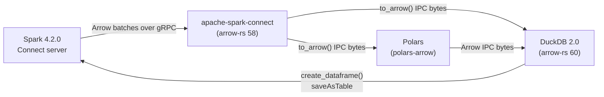

import img0 from "./spark-connect-rust-duckdb-polars-deps.gif";
import img1 from "./spark-connect-rust-duckdb-polars-data.gif";
import img2 from "./spark-connect-rust-duckdb-polars-arrow.gif";
import img3 from "./spark-connect-rust-duckdb-polars-duckdb.gif";
import img4 from "./spark-connect-rust-duckdb-polars-polars.gif";
import img5 from "./spark-connect-rust-duckdb-polars-back.gif";

*Originally published on [systems/null](https://systemsnull.net/posts/data-engineering-ai/spark-connect-rust-duckdb-polars).*

## Setting the Rust-Native Scene

In the OCaml post we walked through the process of building a Connect client from scratch, but in truth the Rust client is probably the only one you really need if you're working right now in the data engineering field. It gives you in-process interoperability with engines like Polars (written in Rust) and DuckDB (C++, with official Rust bindings), meaning you no longer have to choose between Spark and &lt;INSERT COOL, TRENDY, HIP NEW ENGINE HERE>. In my connect idiot's guide I only hinted at the Rust client as part of a way to gauge supported operations. In this follow-up, I want to deep dive into the Rust Client. It'll be helpful to know what Spark connect is ahead of time, but you'll probably figure it out pretty easily if you're a smart cookie. TLDR on the previous posts: Connect is Spark's attempt to decouple the JVM from the user's environment by implementing a client-server architecture where a very lightweight client sends unresolved logical plans to a remote cluster. 

Spark Connect sends query results to the client as Arrow record batches (thank god). The client builds a plan, the server runs it, and results are returned as Arrow. If you want to know why this is important, I'd suggest reading my previous blog on Arrow batches replacing pickle serialization between the JVM and Python process in Spark. Every Connect client gets those same Arrow batches, so this isn't unique to Rust: in Python, PySpark's `toArrow()` (4.0 and later) hands you a pyarrow table that DuckDB and Polars can read directly. What Rust adds is doing it in one compiled program with no Python in the process, where DuckDB and Polars read the batches as Rust libraries. This separation allows Spark to do the work that needs a cluster (the scan, the join across a billion rows, the group-by), and when the result comes down as Arrow,  DuckDB or Polars can be used in the same process without writing intermediary data files. 

The demo and code in this blog can be found in [spark-demos/demos/09_spark_connect_rust](https://github.com/lisancao/spark-demos/tree/main/demos/09_spark_connect_rust) with its full run log.

**With the official Rust client, one Spark result comes out as Arrow IPC bytes that DuckDB and Polars both read cheaply, DuckDB registers it without a further copy, and the answer goes back to Spark.**


## What the Rust client actually is

[apache/spark-connect-rust](https://github.com/apache/spark-connect-rust) is the Apache Spark project's own Rust client, listed on the [Spark Connect page](https://spark.apache.org/spark-connect/) next to the Go and Swift ones, with its documentation at [apache.github.io/spark-connect-rust](https://apache.github.io/spark-connect-rust/). The crate is `apache-spark-connect`, used in code as `spark_connect`, and the version number is the Spark version it speaks: `4.2.0` means Spark 4.2.0 and later, which is a nice convention more clients should steal.

The [architecture page](https://apache.github.io/spark-connect-rust/architecture/) describes one Rust core (plan building, gRPC via tonic, Arrow decoding) with two faces on it: a synchronous Rust API shaped like PySpark, and a `pyspark-client-rust` wheel on PyPI that installs as `pyspark` and is meant as a drop-in for the reference Python client. This blog uses the Rust API. If you've used other Rust gRPC clients, "synchronous" is the part to notice: no `async`, no runtime to set up, and no `.await` anywhere in your code. The hello world from the docs is the entire API in miniature:

```rust
use spark_connect::{SparkSession, functions as f, lit};

fn main() -> Result<(), Box<dyn std::error::Error>> {
    let spark = SparkSession::builder()
        .remote("sc://localhost:15002")
        .get_or_create()?;

    let df = spark
        .range(1_000_000)?
        .select([(f::col("id") * lit(2)).alias("x")])
        .filter((f::col("x") % lit(3)).eq(lit(0)));

    println!("count = {}", df.count()?);
    Ok(())
}
```

The [compatibility page](https://apache.github.io/spark-connect-rust/compatibility/) says the goal is full API parity with the reference PySpark Connect client, that the protobuf plans it builds are checked byte-for-byte against the reference Python client in CI, and that the official PySpark Connect test suite is run against it. In practice, if you know PySpark you can mostly guess the Rust method name (`spark.sql()`, `df.filter()`, `df.group_by()`, `df.write().save_as_table()`), and when you guess wrong the compiler tells you, which is more than Python does.

## Setting up the environment

**The server.** Any Spark 4.2 or later Connect server will do. The demo's `compose.yaml` starts the official image's Connect server (it listens on all interfaces by default) and gives it a health check, so `docker compose up --wait` returns when the port actually answers rather than when the container starts:

```yaml
services:
  spark-connect:
    image: apache/spark:4.2.0-scala2.13-java21-python3-ubuntu
    entrypoint:
      - /opt/spark/sbin/start-connect-server.sh
      - --wait
      - --conf
      - spark.driver.memory=4g
    ports:
      - "127.0.0.1:${CONNECT_PORT:-15002}:15002"
    healthcheck:
      test: ["CMD", "bash", "-c", "</dev/tcp/127.0.0.1/15002"]
      interval: 5s
      retries: 40
```

```sh
docker compose up -d --wait
```

The published port is the one thing you may need to change. My machine already had a Spark Connect server on 15002 from another demo the first time I ran this (this keeps happening to me; it's the first item in the idiot's guide's debugging section), so that run used `CONNECT_PORT=15902`. It's also why the first thing the program prints is the server's version.

**The crate.** Three things have to be installed before `cargo build` works, and each fails at build time if you skip it. You need `protoc`, because the client compiles the Spark Connect `.proto` files when it builds; a C++ compiler plus CMake, because DuckDB is built from source; and Rust 1.98, because polars 0.55 uses standard library APIs stabilised after 1.92 (`std::hint::cold_path` among them) and won't compile on anything older. The demo pins 1.98 in `rust-toolchain.toml`, so `rustup` fetches the right compiler on its own, and the other two are one package each:

```sh
sudo apt-get install protobuf-compiler build-essential cmake   # Debian/Ubuntu
brew install protobuf cmake                                    # macOS
```

Then this `Cargo.toml`, which is the part worth copying exactly. The `polars` feature list is the demo's own needs (lazy frames, IPC, rolling windows) plus four I found the slow way on 0.54 so you don't have to: `parquet`, `strings` and `temporal`, without which `lazy` doesn't compile, and `timezones`, without which a timestamp column from Spark won't print:

```toml
[dependencies]
# The official client. Its `polars` feature (to_polars()) is left off: it pins polars 0.54.
spark-connect = { package = "apache-spark-connect", version = "4.2" }

# arrow-rs (the Rust Arrow library), at DuckDB 2.0's major. The client uses 58 internally.
arrow = { version = "60", features = ["prettyprint"] }

# duckdb-rs for DuckDB 2.0, statically linked. `vtab-arrow` lets DuckDB query arrow-rs batches.
duckdb = { version = "1.20000.1", features = ["bundled", "vtab-arrow", "appender-arrow"] }

# The newest polars crate. It reads Arrow IPC with its own Arrow implementation.
polars = { version = "0.55.2", features = [
    "lazy", "ipc", "ipc_streaming", "dtype-full", "fmt", "timezones",
    "rolling_window", "pct_change", "round_series", "parquet", "strings", "temporal",
] }
```


Two version facts are worth knowing before you touch that file. DuckDB 2.0 came out on 2026-10-21, and its Rust crate (`duckdb` 1.20000.1; the crate encodes DuckDB 2.0.0 in the minor version) is built on arrow-rs 60, while the client is still on 58. Different arrow-rs majors are different Rust types, so a `RecordBatch` from the client won't type-check where DuckDB wants one; the hand-off is the Arrow IPC bytes from `to_arrow()`, which any arrow-rs major can read. Polars doesn't use arrow-rs at all; it ships its own Arrow implementation (`polars-arrow`) and reads the same IPC bytes. The client's `to_polars()` does exactly that internally, but against polars 0.54, so the demo leaves that feature off and calls Polars' IPC reader itself, which works with whatever polars you have. As for Polars 2.0, it's a Python release (2.0.0 on 2026-10-06, 2.1 since). There's no 2.x `polars` crate yet, and the 2.x source only builds with Polars' own patched `hashbrown` and a nightly toolchain, so the newest crate, 0.55.2, is what a Rust program gets. (The client's own [installation page](https://apache.github.io/spark-connect-rust/installation/) says Rust 1.70 or later, which is true of the client alone; Polars is what raises the floor.) The first build took 4m23s in a clean container, since DuckDB compiles from source, and a rebuild after a code change takes seconds.

## Step 1: Some data to play with

Nothing is downloaded. Spark builds a 20-million-row orders table from `range()` and hash functions, so the whole demo runs anywhere a Spark 4.2 server is reachable and nobody has to find a dataset:

```rust
let spark = SparkSession::builder().remote("sc://localhost:15002").get_or_create()?;
println!("Spark {}", spark.version()?);

spark.sql(
    "CREATE TABLE IF NOT EXISTS orders USING parquet AS
     SELECT id AS order_id,
            element_at(array('sfo','lax','sea','nyc','chi','aus','den','pdx','phx','mia','bos','atl'),
                       CAST(pmod(xxhash64(id, 7), 12) AS INT) + 1)            AS city,
            timestamp_seconds(1756684800 + pmod(xxhash64(id, 1), 2592000))     AS ts,
            CAST(round(5 + pmod(xxhash64(id, 2), 9500) / 100.0, 2) AS DOUBLE)  AS amount,
            CAST(1 + pmod(xxhash64(id, 3), 6) AS INT)                         AS items,
            element_at(array('delivered','delivered','delivered','cancelled','refunded'),
                       CAST(pmod(xxhash64(id, 4), 5) AS INT) + 1)             AS status
     FROM range(20000000)",
)?
.collect()?;
```

The `.collect()` on the end is not a typo. Everything in this client is lazy, the same as PySpark: `spark.sql()` builds a plan, and nothing runs on the server until an action asks for a result, which for a `CREATE TABLE` means you have to ask for its (empty) result on purpose.

```
Spark 4.2.0 at sc://localhost:15002
  orders: 20000000 rows
```


## Step 2: Getting a result out as Arrow (four ways, and one of them is wrong)

The client has four ways worth knowing to turn a DataFrame into something you hold in Rust (there are others, such as `to_local_iterator()` for streaming rows and `to_datafusion()` behind a feature flag), and picking the right one is most of the performance story in this blog:

| Method | You get | Use it when |
|---|---|---|
| `collect()` | `Vec<Row>`, each value boxed as a `Value` enum | You want to look at a few rows |
| `collect_record_batches()` | `Vec<arrow::RecordBatch>`, the server's batches as decoded | The result is going to DataFusion or your own arrow-rs 58 code |
| `to_arrow()` | `Vec<u8>`, one Arrow IPC file | The result is going to a file, a socket, or another Arrow library |
| `to_polars()` | `polars::DataFrame` (polars 0.54) | The result is going to Polars and you're on 0.54; otherwise read `to_arrow()` with Polars' `IpcReader` |

One city's orders, as batches and as one IPC file (the form DuckDB and Polars get below):

```rust
let sfo = spark.sql("SELECT order_id, city, ts, amount, items, status FROM orders WHERE city = 'sfo'")?;
let batches = sfo.collect_record_batches()?;
let ipc = sfo.to_arrow()?;
```

```
176 RecordBatches, 1667285 rows
arrow-rs schema: order_id: Int64, city: Utf8, ts: Timestamp(µs, "Etc/UTC"),
                 amount: Float64, items: Int32, status: Utf8
as Arrow IPC: 77.3 MiB
```


The batch count is the server's choice, not yours. Connect caps each batch at `spark.sql.execution.arrow.maxRecordsPerBatch` rows (default 10,000) and at a byte size, `spark.connect.grpc.arrow.maxBatchSize` (default 128 MiB in Spark 4.x, of which it uses 70%), and the client hands you the batches exactly as they arrived. Here the row cap is the one that bites (176 batches rather than the 167 the cap alone would give, since a batch never spans two partitions), and `arrow::compute::concat_batches` joins the pieces into one when a consumer wants that.

The same 1.67 million rows, each way, on one machine with the server in a container on the same host. Each path re-runs the query on the server, and each number includes that scan (an earlier count and sum on the same table had already put the files in the OS page cache and warmed up the JVM):

| Path | ms |
|---|---|
| `collect_record_batches()` | 683 |
| `to_arrow()` | 477 |
| `collect()` | 1475 |

**Rows cost about twice what batches cost for the same data.** Most of the difference is client-side work. (These are single runs: `to_arrow()` calls `collect_record_batches()` internally and still came in faster, so the noise is a couple of hundred milliseconds; the doubling for rows is well outside it.) In the client's source, `collect()` decodes the same Arrow batches and then builds a `Row` for every row and a `Value` for every cell, which is a perfectly reasonable thing to do for twenty rows you intend to print and a silly thing to do for 1.67 million you intend to hand to DuckDB. If the result is going to another engine, it should never pass through `collect()`.

## Step 3: DuckDB 2.0 gets the batch

First the result crosses from the client's arrow-rs to DuckDB's: the `to_arrow()` bytes from step 2, read with arrow 60's IPC reader and joined into one batch. For the 1.67 million rows that takes 70 ms:

```rust
use arrow::ipc::reader::FileReader;   // arrow 60, DuckDB's major

fn ipc_to_batch(ipc: &[u8]) -> Result<RecordBatch, Box<dyn Error>> {
    let reader = FileReader::try_new(Cursor::new(ipc), None)?;
    let schema = reader.schema();
    let batches: Vec<RecordBatch> = reader.collect::<Result<_, _>>()?;
    Ok(concat_batches(&schema, &batches)?)
}
```

duckdb-rs has an Arrow table function behind the `vtab-arrow` feature. In DuckDB 2.0's crate you register a `RecordBatch` by wrapping it in an `ArrowBatchRegistration`, which you pass to `arrow(?)` as a query parameter. The batch isn't copied; it stays registered until the registration is dropped. A view can't take a prepared parameter, so to get a view the registration goes into a DuckDB variable first:

```rust
use duckdb::vtab::arrow::{ArrowBatchRegistration, ArrowVTab};

fn arrow_view(db: &Connection, name: &str, rb: RecordBatch) -> duckdb::Result<ArrowBatchRegistration> {
    let reg = ArrowBatchRegistration::new(rb);
    db.execute(&format!("SET VARIABLE {name}_batch = ?"), [&reg])?;
    db.execute_batch(&format!(
        "CREATE VIEW {name} AS SELECT * FROM arrow(getvariable('{name}_batch'))"
    ))?;
    Ok(reg)
}

let db = Connection::open_in_memory()?;
db.register_table_function::<ArrowVTab>("arrow")?;
let _orders = arrow_view(&db, "orders", ipc_to_batch(&ipc)?)?;
let _surge = arrow_view(&db, "surge", surge_schedule(&ts_type)?)?;   // built in Rust; its timestamps use Spark's ts type
```

Keep the registrations in variables for as long as you query the views. Dropping one unregisters the batch, and the view then fails with `is not registered` rather than reading freed memory, which is the right failure but a confusing one if you discarded the return value with a `?;`. (DuckDB 1.5's crate took two integers and a pair of `::UBIGINT` casts instead, and kept every batch alive for the life of the process; the new API is an improvement on both counts.)

Now the reason I brought DuckDB in at all. The `surge` table is a per-six-hour price multiplier that exists only in the client process, and each order needs the latest multiplier at or before its timestamp. (It's built in Rust, with its `starts_at` column given the same Arrow timestamp type and zone as Spark's `ts`, so DuckDB sees two `TIMESTAMP WITH TIME ZONE` columns rather than one with a zone and one without.) That is an ASOF join (match each row to the nearest earlier key instead of an equal one), which DuckDB has as a first-class SQL operator. Spark has an as-of join inside it (pandas-on-Spark's `merge_asof`, and an `AsOfJoin` relation in the Connect protocol), but 4.2 has no SQL syntax for it (4.3 adds `ASOF JOIN`, off by default) and the Rust client doesn't expose it, so from Rust today this part is DuckDB's job:

```sql
WITH surged AS (
    SELECT o.ts, o.amount, s.multiplier, o.amount * s.multiplier AS surged
    FROM orders o
    ASOF JOIN surge s ON o.city = s.city AND o.ts >= s.starts_at
)
SELECT CAST(CAST(ts AS TIMESTAMP) AS DATE) AS day,
       count(*) AS orders, round(sum(amount), 2) AS revenue,
       round(sum(surged), 2) AS surged_revenue, round(avg(multiplier), 4) AS avg_multiplier
FROM surged GROUP BY 1 ORDER BY 1
```

```
+------------+--------+------------+----------------+----------------+
| day        | orders | revenue    | surged_revenue | avg_multiplier |
+------------+--------+------------+----------------+----------------+
| 2025-09-01 | 55829  | 2933784.48 | 3482949.81     | 1.1868         |
| 2025-09-02 | 55924  | 2927311.35 | 3476037.04     | 1.1881         |
| 2025-09-03 | 55491  | 2913342.93 | 3459069.6      | 1.1877         |
...
  PASS  DuckDB count == Spark count: 1667285
  PASS  DuckDB sum(amount) == Spark sum(amount): 87512653.61 vs 87512653.61
  PASS  ASOF JOIN kept every order: 1667285
```


The double cast on `ts` is the one seam in this step. Spark's `timestamp` arrives tagged with the session time zone (`Timestamp(µs, "Etc/UTC")`), DuckDB maps that to `TIMESTAMP WITH TIME ZONE`, and a direct cast to `DATE` fails with `Conversion Error: Unimplemented type for cast (TIMESTAMP WITH TIME ZONE -> DATE)`. Zone-aware casts are what DuckDB's ICU extension provides, and the `bundled` build doesn't include it (duckdb-rs has an `icu` feature that does). Casting through plain `TIMESTAMP` sidesteps it for a UTC session; for any other zone, add the feature or do the date arithmetic in Spark before collecting.

**One practical rule for this step, and it's the one that surprised me.** Registering the batch is free, and a count and sum through the view take 65 ms. But the identical ASOF rollup took 1901 ms through the view and 139 ms on a native table that cost 146 ms to create from the same view:

```sql
CREATE TABLE orders_native AS SELECT * FROM orders;   -- 146 ms for 1.67M rows
```

So if you're going to run more than one query over the rows, or any join, copy them into a table first; the copy pays for itself on the first join. I had assumed the zero-copy view was the fast path because zero-copy sounds like the fast path, and it isn't. I haven't profiled why. Part of it is in the duckdb-rs source: every scan through the table function converts the Arrow vectors into DuckDB's own format again, so each query pays the copy that the native table paid once. My guess for the rest is that the view is a single sequential source with no statistics. The gap was the same on DuckDB 1.5.6 (2226 ms against 177), so 2.0 didn't change this rule.

## Step 4: Polars gets Spark's aggregate

Spark is the right place for the 20-million-row group-by. Polars is the nicer place for what comes after, which here is a per-city rolling window and a day-over-day change, both of which are one expression in Polars and a window specification you'd have to think about in Spark SQL. `to_arrow()` runs the query and gives you the result as an in-memory Arrow IPC file, and Polars' `IpcReader` turns that into a `polars::DataFrame`. That's all `to_polars()` does inside the client; doing it yourself means it works with polars 0.55. It costs a copy into IPC bytes and a decode into Polars' own buffers, because Polars has its own Arrow implementation.

```rust
let daily = spark.sql(
    "SELECT city, CAST(ts AS DATE) AS day, count(*) AS orders, round(sum(amount), 2) AS revenue
     FROM orders GROUP BY 1, 2",
)?;
let pl_daily = IpcReader::new(Cursor::new(daily.to_arrow()?)).finish()?;   // Spark runs the group-by; 360 rows cross as IPC

let rolling = pl_daily.lazy()
    .sort(["city", "day"], SortMultipleOptions::default())
    .with_columns([
        col("revenue")
            .rolling_mean(RollingOptionsFixedWindow { window_size: 7, min_periods: 1, ..Default::default() })
            .over([col("city")])?
            .alias("revenue_7d"),
        col("revenue").pct_change(lit(1)).over([col("city")])?.alias("revenue_pct"),
    ])
    .collect()?;
```

```
polars schema: {"city": String, "day": Date, "orders": Int64, "revenue": Float64}
┌──────┬────────────┬────────┬───────────┬────────────┬─────────────┐
│ city ┆ day        ┆ orders ┆ revenue   ┆ revenue_7d ┆ revenue_pct │
│ str  ┆ date       ┆ i64    ┆ f64       ┆ f64        ┆ f64         │
╞══════╪════════════╪════════╪═══════════╪════════════╪═════════════╡
│ atl  ┆ 2025-09-01 ┆ 55524  ┆ 2.9116e6  ┆ 2.9116e6   ┆ null        │
│ atl  ┆ 2025-09-02 ┆ 55327  ┆ 2.9054e6  ┆ 2.9085e6   ┆ -0.002129   │
│ atl  ┆ 2025-09-03 ┆ 55638  ┆ 2.9335e6  ┆ 2.9168e6   ┆ 0.009665    │
...
  PASS  Polars sum(orders) == Spark count(orders): 20000000
```


Getting the aggregate into Polars took 695 ms here (nearly all of it Spark running the group-by) and the rolling computation after it 5 ms, which is the ratio you'd hope for when Spark is doing the heavy part. (Since polars 0.54, `over()` returns a `Result`, hence the `?` inside the expression list; nothing I read warned me about that.) The IPC copy is cheap: once `to_arrow()` has produced the 77.3 MiB IPC file for the whole 1.67-million-row slice, reading it into Polars takes 72 ms.

A Polars frame can keep going into DuckDB too, by the same route the Spark result took. Polars writes the Arrow IPC stream format with `IpcStreamWriter`, arrow-rs reads it with `StreamReader`, and the result is a `RecordBatch` for the same table function; for the 360 rolling rows that is 17.5 KiB and 1 ms:

```rust
let mut buf = Vec::new();
IpcStreamWriter::new(&mut buf).finish(&mut rolling.clone())?;
let back: Vec<RecordBatch> = StreamReader::try_new(Cursor::new(buf), None)?.collect::<Result<_, _>>()?;
let _rolling = arrow_view(&db, "rolling", concat_batches(&back[0].schema(), &back)?)?;
```

After that `rolling` is a DuckDB view like `orders` was, and `QUALIFY row_number() OVER (PARTITION BY city ORDER BY revenue_7d DESC) = 1` (a clause that filters on a window function's result, which Spark SQL also picked up in 4.2) picks each city's best week out of it.

## Step 5: Sending the answer back to Spark

Spark Connect already takes Arrow inbound: `createDataFrame` is sent as a `LocalRelation`, the protocol's message for client-side data, whose payload is Arrow IPC bytes (step 6 of the OCaml post was writing exactly that by hand). The Rust client's public entry point for it is `create_dataframe(rows, schema)`, which takes `Row` values. So a `RecordBatch` that came out of DuckDB gets unpacked into rows first (a loop over columns and a `match` on the Arrow type; the demo's `record_batch_to_rows` is about forty lines) and then written like any other DataFrame:

```rust
let (rows, schema) = record_batch_to_rows(&surge_daily)?;
spark.create_dataframe(rows, schema)?
    .write().mode("overwrite").save_as_table("sfo_surge_daily")?;
```

```
struct<day:date,orders:bigint,revenue:double,surged_revenue:double,avg_multiplier:double>
  PASS  Spark table rows == DuckDB rows: 30
  PASS  Spark sum(surged_revenue) == DuckDB sum: 103926081.03 vs 103926081.02
```


That is 157 ms for 30 rows, timed as one step from Arrow to the saved table. (The cent between the sums is floating point, not lost data: Spark and DuckDB add the same thirty doubles in a different order, so the check allows five cents rather than demanding an exact match.) The row conversion grows with row count the same way `collect()` does in the other direction, so for big data going back, write it somewhere both sides can read and `spark.read()` it instead. A `create_dataframe` that took batches directly would be a very welcome addition to the client, since the IPC writer it needs is already in there.

## Spark Type Mapping to DuckDB and Polars
  
The full table with the values is in the demo README; this is the part to keep nearby:

| Spark type | arrow-rs | DuckDB | Polars |
|---|---|---|---|
| `tinyint` to `bigint` | `Int8` to `Int64` | `TINYINT` to `BIGINT` | `i8` to `i64` |
| `float`, `double` | `Float32`, `Float64` | `FLOAT`, `DOUBLE` | `f32`, `f64` |
| `decimal(p,s)` | `Decimal128(p, s)` | `DECIMAL(p,s)`, digits intact | `decimal[p,s]`, digits intact |
| `string` (a `char(n)` literal also arrives as `string`) | `Utf8` | `VARCHAR` | `str` |
| `binary` | `Binary` | `BLOB` | `binary` |
| `boolean` | `Boolean` | `BOOLEAN` | `bool` |
| `date` | `Date32` | `DATE` | `date` |
| `timestamp` | `Timestamp(µs, "<session zone>")` | `TIMESTAMP WITH TIME ZONE` | `datetime[μs, <zone>]` |
| `timestamp_ntz` | `Timestamp(µs)` | `TIMESTAMP` | `datetime[μs]` |
| `array<T>` | `List` | `T[]` | `list[T]` |
| `map<K,V>` | `Map` | `MAP(K, V)` | `list[struct[2]]` (Polars has no map type) |
| `struct<...>` | `Struct` | `STRUCT(...)` | `struct[n]` |
| `interval day to second` | `Duration(µs)` | `INTERVAL` | `duration[μs]` |
| `interval year to month`, calendar `interval` | `Interval` | `INTERVAL` | polars 0.55 panics building the frame (calendar intervals can be imported as a struct with `POLARS_IMPORT_INTERVAL_AS_STRUCT=1`, marked unstable); cast to a number in Spark first |
| `time` | fails on the server with `UNSUPPORTED_TIME_TYPE`: Spark's Arrow serialiser doesn't handle TIME, so it never leaves | | |
| `variant` | `Struct(value Binary, metadata Binary)` | `STRUCT(value BLOB, metadata BLOB)` | `struct[2]`; opaque bytes in both |
| `void` (a bare `NULL` literal) | `Null` | duckdb-rs can't bind it (`Unsupported data type: Null`) | `null` |

For example, `timestamp` carries the server's session zone into DuckDB's and Polars' type systems (which is correct, and is why the `DATE` cast in step 3 needed care); `timestamp_ntz` doesn't. And Polars has no year-month interval type, so turn any such column into a number in Spark before it heads that way. Everything else, decimals included, keeps its precision and lands as a native column type in both engines (in pandas a decimal column becomes a column of Python `Decimal` objects, exact but slow, which is a thing I'd rather not think about).

## Limitations

All of it ran on one machine with the server in a container on the same host, so the Spark-to-client times contain no real network; across a network the transfer would dominate and the gap between `collect()` and batches would matter less in proportion. Every timing is a single run in a warm process, not a benchmark harness, and the DuckDB view-versus-table gap is an order of magnitude, not a precise ratio. The server ran with default Arrow batch settings. The type sweep didn't include GEOMETRY or GEOGRAPHY, which are new in Spark 4.2. Neither `to_datafusion()` nor the client's WebAssembly UDF path (Rust functions compiled to wasm and run on the executors) was exercised; the latter is its own blog and probably a fun one. The Polars findings are for the 0.55.2 crate, not Polars 2.0, which Rust can't use yet.

## Summarizing the Stack

- **Server:** any Spark 4.2+ Connect server; `docker compose up -d --wait` with the official image and a health check on the port.
- **Build:** `protoc`, a C++ toolchain and CMake installed; the Cargo.toml above, copied exactly; `rust-toolchain.toml` pinned to 1.98.
- **Connect:** `SparkSession::builder().remote("sc://host:15002").get_or_create()?`, then print `spark.version()` before anything else.
- **Get results out as Arrow:** `to_arrow()` for DuckDB 2.0 and Polars (the IPC bytes cross any arrow-rs major), `collect_record_batches()` for your own arrow-rs 58 code, `collect()` only for rows you intend to read.
- **DuckDB:** register `ArrowVTab`, wrap the batch in an `ArrowBatchRegistration` and keep it alive, put a view over it, and copy it into a table if you'll query it more than once or join it at all.
- **Polars:** `IpcReader` over the `to_arrow()` bytes and go; turn on the `timezones` feature before the first timestamp.
- **Back to Spark:** `create_dataframe(rows, schema)` for small results; shared storage for large ones.
- **Types:** decide between `timestamp` and `timestamp_ntz` before data crosses a boundary, and keep intervals out of Polars.

The idiot's guide said to check that the client you pick supports what you need before you build on it. For the Rust client that check comes out well, and what it's best at is the thing the protocol was designed around in the first place: the result is already Arrow, so the only question left is where you want to send it.

## Further reading

- [apache/spark-connect-rust](https://github.com/apache/spark-connect-rust) and its [docs](https://apache.github.io/spark-connect-rust/): [installation](https://apache.github.io/spark-connect-rust/installation/), [quickstart](https://apache.github.io/spark-connect-rust/quickstart/), [DataFrames](https://apache.github.io/spark-connect-rust/dataframes/), [architecture](https://apache.github.io/spark-connect-rust/architecture/), [compatibility](https://apache.github.io/spark-connect-rust/compatibility/), and [Rust UDFs via WebAssembly](https://apache.github.io/spark-connect-rust/udfs/), the part this blog skipped
- [`apache-spark-connect` on docs.rs](https://docs.rs/apache-spark-connect), for `collect_record_batches`, `to_arrow`, `to_polars` and `to_datafusion`
- [DuckDB 2.0.0's release notes](https://github.com/duckdb/duckdb/releases/tag/v2.0.0) and [duckdb-rs 1.20000.1's](https://github.com/duckdb/duckdb-rs/releases/tag/v1.20000.1)
- [Spark Connect overview](https://spark.apache.org/spark-connect/), which lists the Go, Rust and Swift clients, and the [Connect server docs](https://spark.apache.org/docs/latest/spark-connect-overview.html) for starting one without Docker
- [duckdb-rs](https://github.com/duckdb/duckdb-rs) and its `vtab-arrow` feature; [DuckDB's ASOF join](https://duckdb.org/docs/stable/guides/sql_features/asof_join), which Spark 4.2 has no SQL for
- [Polars](https://pola.rs/) and [`polars-arrow`](https://crates.io/crates/polars-arrow), its own Arrow implementation and the reason for the IPC hop
- [The demo](https://github.com/lisancao/spark-demos/tree/main/demos/09_spark_connect_rust), with the full run log and the complete type table in its README
