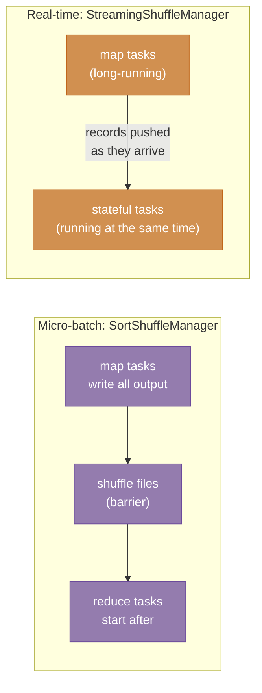

import img0 from "./ultimate-guide-spark-43-header.jpg";
import img1 from "./spark-4-3-guide-rtm-stateful.gif";
import img2 from "./spark-4-3-guide-rtm-live.gif";
import img3 from "./spark-4-3-guide-scd2-flow.gif";
import img4 from "./spark-4-3-guide-scd2-v1.gif";
import img5 from "./spark-4-3-guide-scd2-v2.gif";
import img6 from "./spark-4-3-guide-scd2-v3.gif";
import img7 from "./spark-4-3-guide-feather.gif";
import img8 from "./spark-4-3-guide-connect-client.gif";
import img9 from "./spark-4-3-guide-connect-rest.gif";
import img10 from "./spark-4-3-guide-zip.gif";
import img11 from "./spark-4-3-guide-transpile.gif";
import img12 from "./spark-4-3-guide-asof.gif";
import img13 from "./spark-4-3-guide-json-table.gif";
import img14 from "./spark-4-3-guide-variant.gif";
import img15 from "./spark-4-3-guide-nanos.gif";
import img16 from "./spark-4-3-guide-sql-extras.gif";
import img17 from "./spark-4-3-guide-archives.gif";

*Originally published on [systems/null](https://systemsnull.net/posts/data-engineering-ai/ultimate-guide-spark-43).*


## A release about time (mostly)

Spark 4.3.0 came out on October 30, including the more in depth [Databricks release blog](https://www.databricks.com/blog/introducing-apache-spark-43-now-available-databricks-runtime-19), which means my feeds are about to fill with listicles that paste the release notes into a numbered list and call it a day. I wanted to do something a little more in depth by reviewing each of the major features in this release as closely as possible, so that people can get a better idea of the expected behaviours and what it's like to actually run the changes. Funnily, I expect a blog like this to have a shorter shelf life than usual as these releases are currently en track for a quarterly cadence, meaning Spark is about to get much more fully featured in the next year as it moves towards 5.0.

Reading the [release notes](https://spark.apache.org/releases/spark-release-4-3-0.html) end to end, I kept noticing that the big items all circle the same thing from different angles. Real-time Mode is about how quickly one record gets through a stateful query; SCD Type 2 is about how long a row's history survives; ASOF JOIN is about which version of a fact was true at a given moment; and nanosecond timestamps are about how finely Spark can tell two moments apart in the first place. The remaining features (Project Feather, the Spark Connect observability work, `DataFrame.zip`, Python UDF transpilation) are about a different clock, which is yours: how long you wait between writing a query and seeing it run.

**Most of Spark 4.3 is about time, both the data's and yours: the scheduler learned to pipeline shuffles, so stateful streaming queries now run at millisecond latency; Auto CDC learned to keep history; SQL learned point-in-time joins and nanosecond precision; and the rest of the release shortens the loop between writing Spark code and finding out whether it works.**

Every example here is a runnable script in [spark-demos/demos/16_spark_43_guide](https://github.com/lisancao/spark-demos/tree/main/demos/16_spark_43_guide), and every clip below is that script running against Spark 4.3.0 (`pip install pyspark==4.3.0`) on my machine. The Real-time Mode clips come from the [Real-time Mode demo](https://github.com/lisancao/spark-demos/tree/main/demos/14_real_time_mode), which is a teaser for one of my upcoming Spark Streaming blog posts ;) 

Below is a rundown of the new features and how to enable or take advantage of them.

| Feature                                             | Area                  | On by default?                   | How to turn it on                                                                       |
| --------------------------------------------------- | --------------------- | -------------------------------- | --------------------------------------------------------------------------------------- |
| Stateful Real-time Mode                             | Structured Streaming  | Yes (with the Real-time trigger) | `.trigger(realTime="...")`, update mode                                                 |
| SCD Type 2 in Auto CDC                              | Declarative Pipelines | Yes                              | `STORED AS SCD TYPE 2` / `stored_as_scd_type=2`; target must support DSv2 row-level ops |
| Shuffle-free single-task execution                  | Project Feather       | No                               | `spark.sql.optimizer.singleTaskExecution.enabled=true`                                  |
| Arrow-native Dataset cache                          | Project Feather       | No                               | `spark.sql.cache.serializer=...ArrowCachedBatchSerializer` (static)                     |
| Operation IDs, REST endpoints, `with` sessions      | Spark Connect         | Yes                              | nothing                                                                                 |
| Persistent local Connect server                     | Spark Connect         | No                               | `SPARK_LOCAL_CONNECT_REUSE=1`                                                           |
| `DataFrame.zip`                                     | PySpark, Connect      | Yes                              | nothing                                                                                 |
| Python UDF transpilation                            | PySpark               | No (experimental)                | `spark.sql.experimental.optimizer.transpilePyUDFs=true` plus ANSI mode                  |
| `ASOF JOIN`                                         | SQL                   | No (preview)                     | `spark.sql.join.asofJoin.enabled=true`                                                  |
| `JSON_TABLE`, VARIANT edit functions                | SQL                   | Yes                              | nothing                                                                                 |
| Nanosecond timestamps                               | SQL                   | No (preview)                     | `spark.sql.timestampNanosTypes.enabled=true`                                            |
| `UNNEST`, `counter_diff`, `jaro_winkler_similarity` | SQL                   | Yes                              | nothing                                                                                 |
| Reading inside tar, zip and 7z archives             | File sources          | No                               | `spark.sql.files.archive.reader.enabled=true`                                           |

## Stateful Real-time Mode

Real-time Mode landed in 4.1 as a new trigger for Structured Streaming: instead of slicing a stream into micro-batches and waiting for each one to be planned, scheduled and committed, the query runs long-lived tasks that process records as they arrive and checkpoint on a much longer interval. The catch in 4.1 and 4.2 was that it only ran stateless queries (filters, projections, stream-static joins), because anything stateful needs a shuffle, and a classic shuffle is a blocking barrier where every map task has to finish writing before a single reduce task can read.

A new `PipelinedShuffleDependency` ([SPARK-58185](https://issues.apache.org/jira/browse/SPARK-58185)) routes data through a new `StreamingShuffleManager` ([SPARK-57141](https://issues.apache.org/jira/browse/SPARK-57141)), which pushes records to downstream tasks over Netty while the upstream tasks are still running. The `DAGScheduler` now schedules a pipelined group of stages together, fails them together, and refuses to start a group without enough task slots ([SPARK-58263](https://issues.apache.org/jira/browse/SPARK-58263), [SPARK-58398](https://issues.apache.org/jira/browse/SPARK-58398)). This admission check prevents deadlock on a busy cluster: a consumer stage started without its producer would sit idle while holding cores. With that machinery in place, Real-time Mode supports streaming aggregation ([SPARK-58635](https://issues.apache.org/jira/browse/SPARK-58635)), `dropDuplicates` ([SPARK-58508](https://issues.apache.org/jira/browse/SPARK-58508)) and Scala/Java `transformWithState` ([SPARK-57228](https://issues.apache.org/jira/browse/SPARK-57228)), and is no longer marked `@Experimental`.



The query itself doesn't change shape. In this deduplication and windowed-count step from the bookshop demo, only the trigger and output mode are specific to Real-time Mode:

```python
trending = (clicks
    .withWatermark("ts", "10 seconds")
    .dropDuplicates(["event_id"])                       # resent clicks counted once
    .groupBy(F.window("ts", "10 seconds"), "aisle")
    .count())

(trending.writeStream.format("kafka")
    .outputMode("update")
    .trigger(realTime="30 seconds")                     # the whole change
    .start())
```


Measured end to end on my machine (from the click's own timestamp to the broker's append time on the output topic, 200 clicks a second for 45 seconds), the same query looks like this in each mode:

| Step | Mode | p50 ms | p99 ms |
|---|---|---|---|
| Dedup + windowed count | micro-batch | 237 | 645 |
| Dedup + windowed count | Real-time | 50 | 99 |
| Dedup + windowed count | Real-time, flush wait 1 ms | 2 | 41 |
| `transformWithState` recommender | micro-batch | 190 | 396 |
| `transformWithState` recommender | Real-time | 29 | 158 |

The 50 ms median comes from a timer. The streaming shuffle flushes when its buffer fills or `spark.shuffle.streaming.networkBufferMaxWaitTimeMs` expires; the default is 50 ms, and a lightly loaded query does not fill the buffer first. Reducing the wait to 1 ms brought the median down to 2 ms at the cost of more small network writes, a tradeoff to tune per workload rather than a useful global default. (The shorter run in the clip measured a 67 ms median and 96 ms p99 at the default, then 2 ms and 3 ms at 1 ms; the table contains the longer benchmark, and this amount of variation is normal for a single-machine test.) Databricks reports p99 latencies of 136 ms for `dropDuplicates`, 139 ms for a window aggregation and 141 ms for `transformWithState` on its benchmark workloads ([SPARK-58884](https://issues.apache.org/jira/browse/SPARK-58884)). Those results are not guarantees, and neither are mine, which come from one desktop with Kafka running in Docker.

For a stateful example, the recommender keeps a taste vector per shopper, built from book embeddings, in `transformWithState` and rescores the catalog on every click. The recommendations therefore change a few milliseconds after each click:


Real-time Mode still has several limits. `transformWithState` supports only Scala and Java, requires the RocksDB state store, and fires a processing-time timer on an idle key only when another row reaches its partition or the Real-time batch ends. `ASOF JOIN` is not supported. Pipelined stages also require cores concurrently, so the cluster must be sized for the whole pipeline rather than its widest stage.

## SCD Type 2 in Auto CDC

Auto CDC arrived in 4.2 as the Declarative Pipelines way to turn a change feed into current state: give it keys, a sequencing column and a delete rule, and it keeps a target table in sync with MERGE, handling out-of-order and replayed events for you. In 4.2 that meant SCD Type 1, where the target only ever holds the latest version of each row. 4.3 adds SCD Type 2 ([SPARK-58321](https://issues.apache.org/jira/browse/SPARK-58321)), in Python (`stored_as_scd_type=2`, `track_history_column_list`), in SQL (`STORED AS SCD TYPE 2`, `TRACK HISTORY ON`) and through Spark Connect, so the target keeps every version, each bounded by `__START_AT` and `__END_AT`.

I reused the ghost kitchen from that post, this time tracking its menu. Each dish change arrives on a Kafka topic as a JSON event, as it would from a CDC tool. The pipeline has a Python source that reads the topic,

```python
@dp.table
def menu_changes():
    return (spark.readStream.format("kafka")
        .option("kafka.bootstrap.servers", "localhost:29292")
        .option("subscribe", "menu-changes")
        .option("startingOffsets", "earliest")
        .load()
        .select(from_json(col("value").cast("string"), CHANGE).alias("e"))
        .select("e.*"))
```

and this one SQL statement:

```sql
-- Keep every version of every dish, not just the latest one.
CREATE STREAMING TABLE menu
FLOW AUTO CDC
FROM STREAM(menu_changes)
KEYS (dish_id)
SEQUENCE BY seq
APPLY AS DELETE WHEN op = 'DELETE'
COLUMNS * EXCEPT (op)
STORED AS SCD TYPE 2
TRACK HISTORY ON (price, station);
```


`TRACK HISTORY ON` controls which changes open a new version. Changes to unlisted columns update the current version in place, which prevents corrections such as typo fixes from creating history entries. Publishing change events in batches and running the pipeline after each batch shows both cases:


After the third run, the table contains the full history of each dish:

| dish_id | dish | price | station | `__START_AT` | `__END_AT` |
|---|---|---|---|---|---|
| 1 | Birra tacos | 14.00 | grill | 1 | 2 |
| 1 | Birria tacos | 14.00 | plancha | 2 | NULL |
| 2 | Smash burger | 13.50 | grill | 1 | 2 |
| 2 | Smash burger | 15.00 | grill | 2 | NULL |
| 3 | Khao soi | 16.00 | wok | 1 | 2 |

The typo fix at sequence 3 did not open a third row for the tacos because `dish` is not tracked; it updated the current version instead. Removing khao soi closed its window at sequence 2 rather than deleting it, preserving the previous menu state. `__START_AT` and `__END_AT` contain the sequencing value, which is an integer here but could instead be a commit timestamp.

As with Type 1, the target must support DSv2 row-level operations because Auto CDC applies each micro-batch with `MERGE`. Spark's built-in file formats, including Parquet, fail at startup with `AUTOCDC_TARGET_DOES_NOT_SUPPORT_MERGE`; Apache Iceberg is the usual choice. Iceberg has not published a Spark 4.3 runtime yet (Maven Central currently stops at `iceberg-spark-runtime-4.1`), so I used an Iceberg runtime built from a branch with Spark 4.3 support. The Iceberg runtime, Kafka connector jars and `spark.sql.extensions` are static configurations and must be passed to `spark-pipelines run`, which accepts `spark-submit` arguments. Putting them in `spark-pipeline.yml` makes the CLI apply them to a live session and fail with `CANNOT_MODIFY_CONFIG`.

## Project Feather: faster on small data

Spark has always been a slightly absurd tool for a 500-row file because its planning assumes the data is large: a `groupBy` gets a partial aggregate, a hash shuffle and a final aggregate, while an `orderBy` adds a range shuffle. Each exchange creates a stage boundary and another scheduling round trip. That overhead disappears into the work on a cluster; on a laptop, in a test suite, or in an agent running hundreds of small queries, it becomes the work. Project Feather ([SPARK-56978](https://issues.apache.org/jira/browse/SPARK-56978)) addresses that overhead, and 4.3 includes its first two pieces, both opt-in.

Shuffle-free single-task execution ([SPARK-57851](https://issues.apache.org/jira/browse/SPARK-57851), `spark.sql.optimizer.singleTaskExecution.enabled`) notices when a query fragment reads something that fits in one partition (by default a single non-empty small file, or a local relation of up to 1,000 rows) and plans the scans, aggregations, distincts, windows, sorts and limits above it as one task with no exchanges at all. The same aggregation, with the flag off and then on:

```python
def run(single_task, runs=20):
    spark.conf.set("spark.sql.optimizer.singleTaskExecution.enabled",
                   single_task)
    t = time.perf_counter()
    for _ in range(runs):
        # a fresh DataFrame each time, like a notebook cell or a test
        df = (spark.read.parquet(small)
              .groupBy("store").count().orderBy("store"))
        df.collect()
    return df, (time.perf_counter() - t) / runs * 1000
```


| singleTaskExecution | Operators in the executed plan | Time per query |
|---|---|---|
| false | Sort, Exchange (range), HashAggregate, Exchange (hash), HashAggregate, FileScan | 82.9 ms |
| true | Sort, HashAggregate, FileScan | 51.2 ms |

Both exchanges (and the shuffle query stages AQE wraps around them) are gone, and the query takes about 60% of the time, warm, on a session that's already paid for JVM startup. The loop builds a new DataFrame every time on purpose, because that's what a notebook cell, a test or an agent does. My first version collected the same DataFrame twenty times, and from the second collect on AQE reuses the shuffle output it already has, skipping the very stages Feather removes, so the two settings came out within a few milliseconds of each other. I wrote up the full benchmark (more queries, cold starts, and a test suite that went from 12.6 s to 5.2 s) in Benchmark Project Feather on a Fresh DataFrame.

The second piece is Arrow-native Dataset caching ([SPARK-57268](https://issues.apache.org/jira/browse/SPARK-57268)): set `spark.sql.cache.serializer=org.apache.spark.sql.execution.columnar.ArrowCachedBatchSerializer` when the application starts (it's static) and `df.cache()` stores Arrow batches instead of Spark's own columnar format, which pairs nicely with everything Arrow already does between the JVM and Python. Compression is available through `spark.sql.execution.arrow.compression.codec`, but it defaults to `none`, so out of the box the Arrow cache is bigger than the default one. Broader in-process local repartitioning was deferred to the next release ([SPARK-57399](https://issues.apache.org/jira/browse/SPARK-57399)).

## Spark Connect: operation IDs and REST endpoints

In my idiot's guide to Connect I complained that debugging a Connect app means correlating a client-side error with a server you can't see, and 4.3 fixes the two halves of that. First, the Python and Scala clients now generate an operation ID before every `ExecutePlan` request ([SPARK-58547](https://issues.apache.org/jira/browse/SPARK-58547)) and hand it back on success (`df.executionInfo.operation_id`) and, more usefully, on failure (`e.operation_id` on the exception), because a request that fails before its first response never learned a server-generated ID. The server publishes the same ID as a Spark local property, so listeners and executor tasks can see it too.

```python
remote = SparkSession.builder.remote("sc://localhost:15043")
with remote.getOrCreate() as spark:      # new in 4.3: sessions are context managers
    ok = spark.sql("SELECT count(*) AS n FROM range(1000000)")
    ok.collect()
    print("succeeded, operation", ok.executionInfo.operation_id)

    try:
        spark.sql("SELECT revenue FROM range(10)").collect()
    except Exception as e:   # the client knows the ID even on failure
        print("failed,    operation", e.operation_id)
```


Second, the server's sessions and operations are now in the monitoring REST API ([SPARK-57941](https://issues.apache.org/jira/browse/SPARK-57941)), next to the SQL and streaming endpoints, where before they only lived in the Connect tab of the UI:

```bash
curl -s $API/connect/sessions | jq
curl -s $API/connect/operations | jq '.[] | select(.operationId == env.OP)'
```

Take the ID the client printed for the failure, and the server's record of that same operation has its state, timings, the SQL execution it ran and the full error:


Because the Connect listener writes these events to the event log, the same endpoints work in the History Server after the application exits. Other Connect changes include the session context manager above ([SPARK-58159](https://issues.apache.org/jira/browse/SPARK-58159)), a `SQLContext` wrapper for existing code ([SPARK-57021](https://issues.apache.org/jira/browse/SPARK-57021)), an experimental `SPARK_LOCAL_CONNECT_REUSE=1` setting that keeps a local Connect server alive between runs ([SPARK-57787](https://issues.apache.org/jira/browse/SPARK-57787)), and broader support in the Connect JDBC driver for complex types, `DatabaseMetaData` keys and SQLSTATE class `08` connection errors. The `INVALID_HANDLE.SESSION_*` errors changed SQLSTATE from `HY000` to `08003`, so retry logic that matches SQLSTATE may need updating. Connect Gateway and the Rust-backed Python client are concurrent projects, not Spark 4.3 features.

## PySpark: DataFrame.zip and UDF transpilation

`DataFrame.zip` ([SPARK-55886](https://issues.apache.org/jira/browse/SPARK-55886), with Connect support in [SPARK-57247](https://issues.apache.org/jira/browse/SPARK-57247)) places two column projections of the same DataFrame side by side, row for row, without a join key. It replaces joins built on `monotonically_increasing_id()`, whose rows are not guaranteed to align. Both sides must originate from the same plan, with matching filters, sorts, joins and aggregations beneath the projections.


The experimental Python UDF transpiler ([SPARK-55206](https://issues.apache.org/jira/browse/SPARK-55206)) is the one I've been waiting for since the UDF showdown, where the conclusion was that the fastest Python UDF is the one that never runs Python. With `spark.sql.experimental.optimizer.transpilePyUDFs=true` and ANSI mode on, PySpark reads simple UDF bodies when you define them and lowers them to Catalyst expressions, so `len(dish)` becomes Spark's own `length` and the `BatchEvalPython` step (and the Python worker, and the serialization) drops out of the plan:

```python
spark = (SparkSession.builder
         .config("spark.sql.ansi.enabled", "true")  # transpiling needs ANSI
         .getOrCreate())

@udf("int", useArrow=False)
def name_length(dish: str) -> int:
    return len(dish)
```


The restrictions are not all documented together, so I read `pyspark/sql/udf.py` to collect them. Transpilation applies only to non-Arrow batched UDFs (hence `useArrow=False`), classic PySpark, ANSI mode, and function bodies that PySpark can recover from source, excluding an inline lambda passed directly to `udf()`. With ANSI mode disabled, PySpark warns and falls back because the generated expressions use ANSI semantics. The transpiler also preserves Python behavior where Spark differs: a transpiled `len` raises on NULL as CPython would, represented in the full plan by a `raise_error` branch. Parameter type hints keep the generated plan small. Other PySpark changes bound UDF input batches by bytes, implement more pandas API on Spark functions natively, remove Python 3.10 support, and raise the minimum NumPy version to 1.23.2.

## Spark SQL: ASOF JOIN, JSON_TABLE, VARIANT edits and nanoseconds

`ASOF JOIN` ([SPARK-58092](https://issues.apache.org/jira/browse/SPARK-58092)) is the point-in-time join: for each row on the left, the single closest row on the right that satisfies a `MATCH_CONDITION` comparison, optionally within an equality `ON` or `USING` key. In my Rust client post I had to pull a Spark result into DuckDB to do exactly this, so it's nice to have it native, with a dedicated sort-merge operator. The canonical ML case is matching each prediction to the feature version that had actually been published when the prediction was made:

```sql
SELECT p.made_at, p.score, f.version AS features_used, f.published_at
FROM predictions p
ASOF JOIN feature_versions f
MATCH_CONDITION (p.made_at >= f.published_at)  -- latest one out by then
```


The 10:03 prediction gets `v1` from 10:00 and never `v2` from 10:05, which didn't exist yet (using it would be leakage), and the 10:07 prediction gets `v2` alone, where a plain `>=` join would return both versions and leave you to pick the latest yourself, which is exactly where the leakage bugs usually creep in. It's a preview: `spark.sql.join.asofJoin.enabled` is off by default (and internal, so it won't show up in `SET -v`), only `INNER` and `LEFT OUTER` are supported, and in streaming only stream-static works, with the stream on the left.

`JSON_TABLE` ([SPARK-58366](https://issues.apache.org/jira/browse/SPARK-58366)) is the SQL-standard table function for expanding a JSON array into typed rows. It also supports `FOR ORDINALITY` and `EXISTS` columns:


And VARIANT values can finally be edited in place with `variant_set`, `variant_insert`, `variant_delete`, `variant_array_append` and `variant_strip_nulls` (plus `try_` versions), instead of being parsed into a struct and serialized back:


Nanosecond timestamps ([SPARK-56876](https://issues.apache.org/jira/browse/SPARK-56876)) add `TIMESTAMP_NTZ(p)` and `TIMESTAMP_LTZ(p)` for precisions 7 to 9, with `unix_nanos`, `timestamp_nanos`, `current_timestamp(p)`, datetime functions, interval arithmetic, and Parquet, ORC, JSON, CSV, Avro, JDBC, Arrow and Connect support. Spark's `TIMESTAMP` has been microseconds since forever, which means two market events a nanosecond apart (or two rows from a Parquet file written by something that does use nanoseconds) silently became the same instant:


Nanosecond timestamps remain a preview behind `spark.sql.timestampNanosTypes.enabled`, and the Databricks release post warns that they may change incompatibly. Typed literals such as `TIMESTAMP_NTZ(9) '...'` do not parse yet, so values must be cast from strings. I would not use the type for production work yet: while building this demo, I found a query that returns an incorrect count when a nanosecond column appears beside other `DISTINCT` aggregates in the same `SELECT`; I am reducing the reproduction before filing it. The `TIME` type also gained nanosecond precision and broader connector support, but remains disabled behind an internal flag.

Other SQL additions include ANSI `UNNEST` in `FROM`, with `WITH ORDINALITY`; `counter_diff`, a window function that converts a running counter such as requests served or bytes sent into per-interval deltas and returns NULL after a reset; and `jaro_winkler_similarity` for fuzzy name matching:


Also new and not filmed: `@`-syntax time travel on table names (`t@v3`, or `t@20261105093000000` in the fixed 17-digit `yyyyMMddHHmmssSSS` form), `COMMENT ON COLUMN`, dynamic table options on `UPDATE`, `MERGE` and `DELETE`, `AS JSON` output for `SHOW TABLES` and `SHOW PARTITIONS`, `collect_union`, `to_base32`/`from_base32`, and a `BIN BY` relation operator behind a flag.

## Reading files inside archives

The archive reader may be the feature I use most. With `spark.sql.files.archive.reader.enabled=true`, file sources read entries inside tar, zip and 7z archives as separate files, including during schema inference; `archivePathFilter` selects the entries to read. This removes the usual step of unpacking a vendor's nightly archive into a temporary directory:


## Other changes in Spark 4.3

A lot of 4.3 is engine work you get for free. `ReplaceHashWithSortAgg` and combining adjacent partial and final aggregates are now on by default, whole-stage codegen covers `UNION`, AQE can convert a sort-merge join to a shuffled hash join in the physical plan, nested column pruning reaches into `transform` over arrays of structs, and the vectorized Parquet reader got faster decoding paths and a `BYTE_STREAM_SPLIT` reader. There's an opt-in to spread NULL outer join keys across partitions (a classic skew source), fractional `spark.task.cpus`, `spark.rdd.compress` on by default, and the Spark UI's Content Security Policy on by default. On Kubernetes the official images move to Ubuntu 26.04 with Python 3.14, and containers drop `allowPrivilegeEscalation` by default.

A few changes can change results or break things on upgrade, all in the [migration guide](https://spark.apache.org/docs/4.3.0/sql-migration-guide.html): exact `percentile`/`median` may differ in the last ULP; `Dataset.observe` metrics now count only the last successful task attempt; `HAVING` is applied before window functions when the `SELECT` also has a generator (fixing wrong results); non-deterministic filters are no longer pushed to DSv2 sources; Thrift Server sessions can no longer set JVM system properties; and the AQE rule `DynamicJoinSelection` was renamed `DemoteBroadcastHashJoin`, so an exclusion by the old name now silently does nothing.

## In Summary

- **Stateful Real-time Mode**: pipelined shuffles let dedup, aggregation and `transformWithState` (Scala/Java) run at millisecond latency with only a trigger change, and the default median is a 50 ms flush timer you can tune.
- **SCD Type 2 in Auto CDC** keeps every version with `__START_AT`/`__END_AT`; `TRACK HISTORY ON` decides what opens a new version, and the target needs a row-level-capable catalog like Iceberg (whose 4.3 runtime isn't published yet).
- **Project Feather** is opt-in: single-task execution removes the exchanges from small queries (about 1.6x faster here, warm), and the Arrow cache serializer is a static config.
- **Spark Connect** gives you an operation ID on success and failure, and the same operation in the server's REST API.
- **`DataFrame.zip`** replaces the `monotonically_increasing_id` join hack; **UDF transpilation** removes Python from simple UDFs if you're on classic PySpark with ANSI on.
- **ASOF JOIN, nanosecond timestamps and archive reading** are all behind flags; **JSON_TABLE, VARIANT edits, UNNEST and `counter_diff`** just work.

Most of it comes back to time: a record's few milliseconds through a stateful query, a dish's price history that never gets overwritten, the feature version that was true at 10:03, the nanosecond between two trades, and the milliseconds a small query no longer spends on shuffles. On a quarterly cadence, expect all of it to keep moving faster than it used to.

## Further reading

- [Introducing Apache Spark 4.3](https://www.databricks.com/blog/introducing-apache-spark-43-now-available-databricks-runtime-19), the Databricks launch post, with the Real-time Mode benchmarks.
- [Spark 4.3.0 release notes](https://spark.apache.org/releases/spark-release-4-3-0.html), every change with its JIRA.
- [SQL migration guide, 4.2 to 4.3](https://spark.apache.org/docs/4.3.0/sql-migration-guide.html), for the behaviour changes above.
- [spark-demos/demos/16_spark_43_guide](https://github.com/lisancao/spark-demos/tree/main/demos/16_spark_43_guide), every script in this post, plus the film scripts.
- AUTO CDC: Turning an event log into current state, the SCD Type 1 post this builds on.
