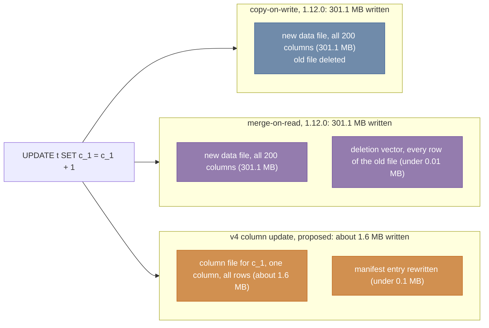
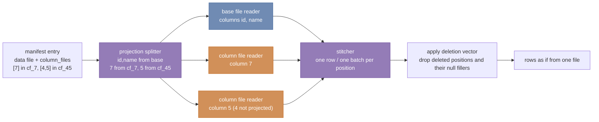
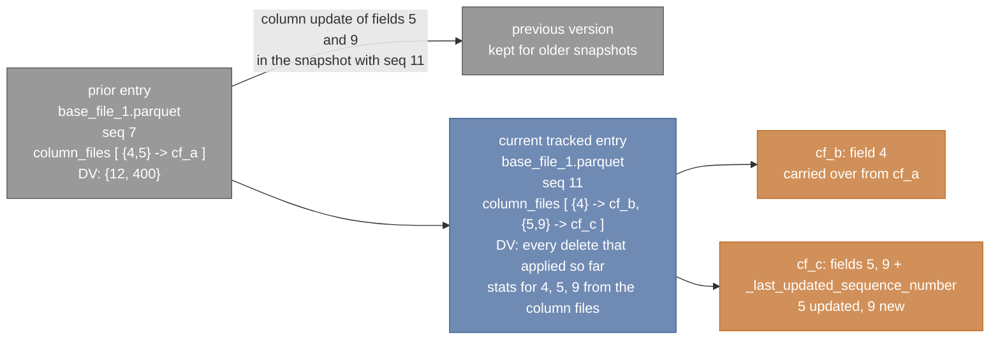

import img0 from "./iceberg-column-updates-setup-flow.svg";
import img1 from "./iceberg-column-updates-table-and-updates.svg";

*Originally published on [systems/null](https://systemsnull.net/posts/data-engineering-ai/iceberg-column-updates).*

## Efficient Column Updates in a Nutshell

Apache Iceberg has two common ways to change a row in a table, and both of them work at file or row granularity. Under ***copy-on-write***, the engine finds the data file that holds the row, rewrites the entire file with the new value, and swaps the old file out of the table's metadata. Under ***merge-on-read***, it leaves the old file alone, records the old row as deleted, and writes the new row into a new data file; readers apply the deletes while scanning. In the v2 version of my experiment, that delete was a *position delete file* (a list of file paths and row numbers). In the v3 version, it was a *deletion vector*, or DV (a compressed bitmap of positions for one data file). Either way, Iceberg is still changing rows, not individual columns.

Row-level updates are good enough for many workloads. They get expensive on very wide tables: feature stores, embedding tables, and model-scoring tables with hundreds or thousands of columns. A nightly job might recompute one feature, refresh one model's scores, or backfill one new column for every existing row. That is one column changing across the table, but today it can still mean rewriting every byte in the touched data files.

[Efficient column updates in Iceberg](https://github.com/apache/iceberg/issues/15146) is the v4 work aimed at that case. It builds on an earlier column-family proposal, where related columns would have been declared up front and written separately from the start. Column updates keep that idea in view, but the focus is narrower: make the cost of a write closer to the columns that changed instead of the current all-or-nothing shape.

At the heart of the design is a new ***column file***: a file that holds one or more whole columns for every row of an existing data file. That lets the data payload for a column update be the updated column, not the whole row. Iceberg finds column files the same way it finds everything else, through its ***manifests***: metadata files that list every data file in the table along with row counts, partition values and column statistics. A column file is recorded on the manifest entry for the data file it belongs to. The reader then uses that metadata to turn the base file plus its column files back into rows.

## Current Column Updates in Iceberg Are Expensive

Take a table shaped like a feature store: an `id` column plus two hundred `double` columns of random numbers, with 200,000 rows. I wrote it with Spark 4.0.1 and Iceberg 1.12.0 as a single 300.9 MB Parquet file, so every update has one base file to deal with and the snapshot history stays easy to read. Then I made two copies: one with `write.update.mode` set to copy-on-write, and one set to merge-on-read. I also ran the same experiment on v2 tables. The only difference was that v2 wrote a position delete file where v3 wrote a deletion vector, so I'm only showing v3 here.

Against each copy, I ran two `UPDATE` statements. The first is the backfill case: change one column, `c_1`, for every row. The second is the partial case: change one column, `c_2`, for one row in ten. After each statement, the newest snapshot summary and the `.files` metadata table show what the commit added and how large it was.


```sql
-- the backfill case: every row, one column of two hundred
UPDATE local.db.wide_v3_merge_on_read SET c_1 = c_1 + 1;

-- the partial case: one row in ten, one column
UPDATE local.db.wide_v3_merge_on_read SET c_2 = c_2 + 1 WHERE id % 10 = 0;

-- what I read after each one
SELECT summary FROM local.db.wide_v3_merge_on_read.snapshots ORDER BY committed_at DESC LIMIT 1;
SELECT content, record_count, file_size_in_bytes FROM local.db.wide_v3_merge_on_read.files;
```

| Update mode                     | Statement                 | What the commit added                                                                                       | MB written          |
| ------------------------------- | ------------------------- | ----------------------------------------------------------------------------------------------------------- | ------------------- |
| copy-on-write                   | all rows, `c_1`           | one new data file, all 200 columns (the old file deleted)                                                   | 301.1         |
| merge-on-read                   | all rows, `c_1`           | one new data file, all 200 columns, plus one deletion vector                                                | 301.1 + under 0.01 (DV)   |
| copy-on-write                   | one row in ten, `c_2`     | one new data file, all 200 columns (the old file deleted)                                                   | 301.1         |
| merge-on-read                   | one row in ten, `c_2`     | one new data file of 20,000 rows, all 200 columns, plus one deletion vector                                 | 30.1 + 0.03 (DV) |
| **column file (v4, estimated)** | **all rows, `c_1`**       | **one column file holding `c_1` for every row, plus a rewritten manifest entry**                            | **about 1.6** |
| **column file (v4, estimated)** | **one row in ten, `c_2`** | **one column file holding `c_2` for every row (nine tenths carried over), plus a rewritten manifest entry** | **about 1.6** |

The bold rows are estimates. No released Iceberg can run a v4 column update.

For the backfill, both modes wrote a new 301.1 MB file, slightly larger than the 300.9 MB base file because the updated values compress a little differently. That is all 200 columns rewritten to change one. Copy-on-write does this by definition. Merge-on-read does it because Iceberg treats an `UPDATE` as a delete of the old row plus an insert of the new one. When every row changes, the insert half is a complete new data file. The deletion vector marks every row of the old file as gone, and until compaction the table holds both files.

The partial update is where the two modes differ. Merge-on-read wrote a 30.1 MB file holding every column of the 20,000 touched rows, about a tenth of the table. Copy-on-write rewrote the full 301.1 MB file again. Merge-on-read scales with the number of rows touched, but it still writes every column for each touched row.

A v4 column update changes the scale of the write. The column `c_1` on its own, with the same values in the same order, is 1.6 MB as a Parquet file: about half a percent of the base file.

In the current modes, write size is driven by rows touched times columns carried. Changing one column or 200 columns has the same shape.



## Byte by Byte

For the data payload, a v4 column update writes one new file holding the updated column for every row. The dominant write is that one column. On this table every column is random doubles, so each column is roughly 1/200th of the file:

|                                                      |              |
| ---------------------------------------------------- | ------------ |
| base file (200 columns, 200,000 rows)                | 300.9 MB     |
| one column, by proportion (300.9 MB ÷ 200)           | about 1.5 MB |
| `c_1` written on its own as a Parquet file, measured | 1.6 MB       |

The partial update lands at the same estimate. A column file must hold every row of the column, so changing one row in ten still writes the column in full. The untouched nine tenths are copied from the base file. The size depends on the column, not on how many rows changed.

Two small costs are left out of that estimate: the rewritten manifest entry, which is a fraction of a megabyte here, and a null at each deleted position if the base file has deletes. At typical deletion ratios, neither changes the rough size of the write.

The expected write drops from 301.1 MB to about 1.6 MB: nearly 200x on this table because the table has 200 similarly sized columns. For any table, the factor is the base file size divided by the updated column's size. `column_sizes` in the `.files` metadata table gives that size per column. A real writer will add overhead on top of the column file; this demo does not measure that yet.

## Anatomy of a Column File

The public v4 draft defines a column file as "a file that stores the values of one or more fields for each row of another file." That last part matters. A column file is not a list of changed cells. It has the same row count as the data file and holds the complete current value of one or more fields for every row. The data file's manifest entry lists which fields live in which column file:

```json
{
  "location": "s3://bucket/data/base_file_1.parquet",
  "record_count": 1000,
  "column_files": [
    {
      "location": "s3://bucket/data/column_update_7.parquet",
      "field_ids": [7],
      "file_format": "parquet",
      "file_size_in_bytes": 12345
    }
  ]
}
```

The sketch omits most tracked-file fields. The important part is the `column_files` list. Each entry names the column file's location, the live top-level field IDs it stores, the file format (`avro`, `orc` or `parquet`) and the file size in bytes. It may also carry encryption key metadata.

A reader that understands column files resolves each projected field from the column file that lists it and every other field from the data file. The remaining requirements:

| Requirement | Consequence |
|---|---|
| It is stored in a normal data-file format | The bytes are ordinary Parquet, ORC or Avro; stitching them into the base file still requires Iceberg v4 column-file support. |
| Whole top-level fields only | A struct is updated as a unit; one leaf cannot be updated alone. |
| One column file per field | Updating a field again replaces its column file instead of stacking another. |
| Every row, in the base file's order | The read is a column swap by position; the write has to line up exactly. |
| Unchanged rows are carried over | A partial update still writes the whole column. |
| Deleted rows are written as null | A heavily deleted file carries a few percent of filler. |
| The deletion vector decides what is deleted | A null is a filler, never a tombstone. |

The fifth requirement sets the size of a partial update. A column file for one row in ten is not 20,000 values keyed by position. It is 200,000 values: 20,000 new values and the rest copied from wherever the field lived before, or null where the row is deleted.

That is the 1.6 MB file from the demo, not a 0.03 MB delta.

**A column file is the whole column, not a delta. It mirrors its base file row for row and is swapped in by position at read time. Wide backfills get cheaper; row-level refreshes are not the sweet spot.**

> **"Column families" is a different thing**
> The earlier proposal was about *column families*: declaring which columns belong together so they are written as separate files from the start. The design doc keeps that as future work and the current column-file text does not define families. "Column file" in this post is the v4 spec term.

## Stitching It Back Together on Read

A read of a data file with column files has four steps:

1. Use the manifest entry to split the requested fields between the base file and column files.
2. Open the base file and only the column files needed for the projection.
3. Read those files in position order and combine each position's pieces into one row or batch.
4. Apply the deletion vector to the combined result.

Because the files are row-aligned, step 3 is what the design doc calls "reference substitution": the column file's array replaces the base file's array for the updated field. The intended read shape is a column-level substitution, not a join or keyed merge.



In the Java implementation work, step 3 is a *stitcher*. There is one stitcher per engine row type, such as Spark `InternalRow`, Flink `RowData`, and the generic `Record`. Steps 1, 2 and 4 are shared across engines.

- A column file is opened only when a query projects one of its fields. A query on `c_200` reads the base file alone.
- Column files do not need to share the base file's row groups, the chunks of rows a Parquet file is written and read in. When row groups do not line up, the reader slices batches to the overlapping window.
- Deletion vectors are applied after stitching, so a column file can hold nulls at deleted rows and is never consulted about deletion.

## Explaining every row

The every-row requirement is what makes partial updates less dramatic.

The alternative was a *sparse* column file: only the changed rows, each tagged with its position. A one-in-ten update would then weigh a tenth of the column. The design rejects that tradeoff because it moves cost to readers outside the JVM:

> The two representations have asymmetric read-side cost across language ecosystems. Spark's `ColumnVector` is an abstract class with virtual dispatch, so a custom stitching subclass can redirect per-row reads (`getInt(rowId)` → choose base vs column file) with no memory copy. Concrete Arrow array types in arrow-rs, PyArrow, and arrow-go do not support this yet.

In Spark, a sparse file can stay lazy on read. A `ColumnVector` subclass can answer `getDouble(i)` from the column file when position `i` was updated and from the base file otherwise, without materializing a replacement array.

An Arrow array in Rust, Python or Go is a contiguous buffer with no per-row redirect. Those readers would have to materialize a new array per batch by scattering the updated values over the base column. That read cost gives back much of what the sparse file saved on write.

With every row present, the stitch can be expressed as an array-level substitution instead of a sparse overlay.

v4 tables need a layout that works across those engines, so the draft standardizes the every-row representation instead of letting writers choose between dense and sparse column files. Once a layout is allowed, every reader has to handle it.

| | Every row (the spec) | Updated rows only (the alternative) |
|---|---|---|
| Partial update writes | the whole column | only the changed rows |
| Read in Spark | swap one array | cheap either way |
| Read in Rust, Python, Go | substitute an array | copy the column |

## How a column update effects manifest

A column update changes the manifest as well as the data. Conceptually, the new snapshot stops pointing at the old version of the tracked file and points at a successor entry for the same base file with a new `column_files` list. Earlier snapshots still see the old metadata for time travel. A field may appear in only one column file for a tracked file, so updating one field of an existing column file means rewriting that column file with its other fields carried over.



The current tracked entry also gets a new *sequence number*: the file's age in commit order, which decides which delete files apply to it. With the new number, older deletes should not be replayed against the new column values.

That sequence-number change would otherwise make older deletes tricky. The v4 work handles this by folding deletes that already applied to the file, including equality deletes, into the entry's own deletion vector. The DV becomes the complete delete record for the current version of the tracked file, and the reader does not need to replay old delete files against the updated columns.

Stats for the updated fields are recomputed from the column file, so file pruning based on those fields can still work.

Row lineage is part of this too. Since v3, every row carries `_last_updated_sequence_number`, the sequence number of the commit that last changed it. One of the new column files has to hold that field: null for every row the update changed, so those rows inherit the new sequence number on read, and the previous value for every row it did not change. Row IDs do not change.

If the updated field is used for partitioning or sorting, metadata has to become conservative for that file because the rows may no longer match the old placement information. Plan for weaker pruning and ordering metadata on that file until compaction rewrites it.

| Step | Cost |
|---|---|
| Read the column's current values and the file's deletes | a read before the write, even for a partial update |
| Write one column file per base file | the column file |
| Rewrite the manifest entry, stats and partition info | small, but every touched file gets it |
| Compact later (`rewrite_data_files` folds column files back in) | stitching is a cost between compactions, not forever |

## But why not directly in Parquet?

The design doc evaluated a Parquet-level alternative and discarded it. Parquet's footer has a `ColumnChunk.file_path` field, so in theory a Parquet file could say that its `score` chunk lives in one file while its other chunks live in `users.parquet`. A column update could then be a narrow Parquet file whose footer describes the whole row. Iceberg would record it as an ordinary data file, with no spec change.

The catch is in the comment on that field in today's `parquet.thrift`: "there are no known reference implementations that will read externally stored column data if this field is populated within a standard parquet file. Making use of the field for this purpose is not considered part of the Parquet specification." The field exists, but readers do not honor it. "No Parquet change" would have become a parquet-format change after all, followed by changes in every Parquet reader Iceberg depends on.

| | In the manifest (chosen) | In the Parquet footer (discarded) |
|---|---|---|
| Who must change | Iceberg's spec and readers | parquet-format and every Parquet reader |
| Can the planner skip files? | yes, from the manifest | only after opening footers |
| Can cleanup jobs see every file? | yes | no, the link is inside a footer |
| Formats | Parquet, ORC, Avro | Parquet only |

The [File Format API](https://systemsnull.net/posts/data-engineering-ai/iceberg-file-format-api) makes the same kind of choice: keep the bytes in plain data-file formats and put the table-level structure in Iceberg metadata, where every engine already has to look.

A column file is tracked by Iceberg, not by Parquet. v4-aware `expire_snapshots`, `remove_orphan_files` and `rewrite_data_files` implementations can account for column files from the manifest. A Parquet tool that opens a column file directly sees an ordinary narrow Parquet file with no link to its base file.

## State of the Implementation

Everything above is based on the public v4 draft, the proposal issue and open implementation work as of 2026-10-27. The public spec includes v4 column-file text, but v4 itself is still under active development and has not been formally adopted. The row-count requirement has changed once already; implementation details can still move.

| Piece | State | Where |
|---|---|---|
| Proposal | open, milestone "Iceberg V4 Spec" | [issue 15146](https://github.com/apache/iceberg/issues/15146) |
| Design doc | current | [doc](https://docs.google.com/document/d/1Bd7JVzgajA8-DozzeEE24mID_GLuz6iwj0g4TlcVJcs) |
| Spec text | present in the public v4 draft, still part of active v4 work | Iceberg spec and linked PRs |
| Readers and writers | implementation work in progress | linked under Further reading |
| Format version 4 | not formally adopted; nothing here is in Iceberg 1.12.0 | |

The demo ran once on one machine, measured file sizes only, and used random doubles that make every column about the same width. The reference column is a Spark Parquet file, not an Iceberg column file, so a real column file may be slightly larger. The filler-overhead figures come from the design doc and were not reproduced here. I did not build the reader PR. The research, demo script and draft used AI assistance; the reading of the spec and the opinions are mine, and so are any mistakes.

## What you should know and how to proceed

- **You have a wide table with a regular column refresh.** Budget for the full rewrite until v4 ships in your engine, or keep the fast-moving columns in a narrower table on the same key and join at read time. That is column families by hand. Migrating to v4 later becomes a consolidation, not a full redesign.
- **Your refresh touches a few rows, not all of them.** Stay on merge-on-read unless the math says otherwise. A column file writes every row of the column, so compare the fraction of rows you touch against the column's share of bytes (`column_sizes` in the `.files` table) before expecting v4 to help.
- **You run compaction and orphan cleanup on a schedule.** Every query on an updated column reads the base file and the column file until `rewrite_data_files` folds them back together. Compaction is part of the column-update workflow, not an optional cleanup later.
- **You partition or sort on a column you might update.** Treat this as a conservative-metadata case. Pruning and ordering information can get weaker for the affected file until compaction rewrites it.
- **You write an engine.** The stitcher is the interface to watch. Every-row column files make the stitch an array-level substitution; Arrow arrays are the reason the layout is every-row.

## Further Reading

- [Efficient column updates in Iceberg](https://github.com/apache/iceberg/issues/15146), the proposal, and its [design doc](https://docs.google.com/document/d/1Bd7JVzgajA8-DozzeEE24mID_GLuz6iwj0g4TlcVJcs)
- The code trail: the [spec text](https://github.com/apache/iceberg/pull/16425) and [reader work](https://github.com/apache/iceberg/pull/18324)
- `ColumnChunk.file_path` in [parquet.thrift](https://github.com/apache/parquet-format/blob/master/src/main/thrift/parquet.thrift); the [Parquet board minutes](https://whimsy-vm9.apache.org/board/minutes/Parquet.html)
- Lance [table format](https://lancedb.github.io/lance/format/) and [data overlay files](https://github.com/lancedb/lance/blob/main/docs/src/format/table/data_overlay_file.md); Paimon [data evolution](https://paimon.apache.org/docs/1.3/append-table/data-evolution/); Hudi [RFC-80](https://github.com/apache/hudi/blob/master/rfc/rfc-80/rfc-80.md)
