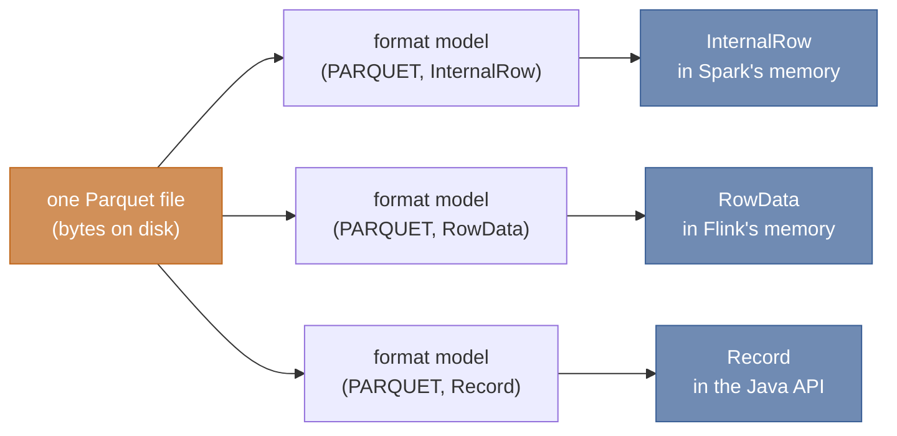
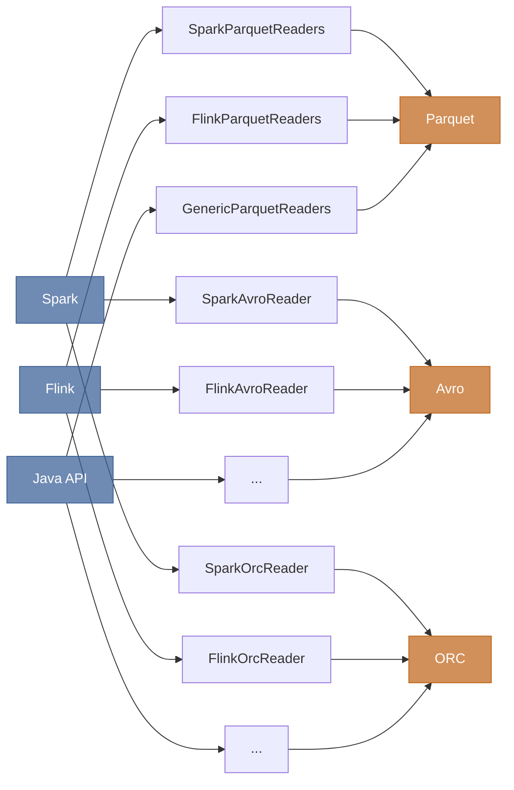
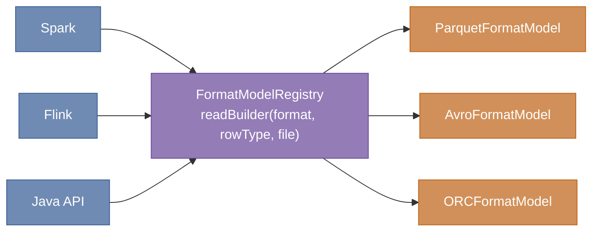
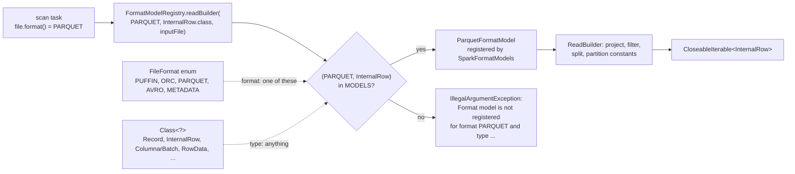

*Originally published on [systems/null](https://systemsnull.net/posts/data-engineering-ai/iceberg-file-format-api).*

## What is the file format API?

Apache Iceberg traditionally exposed its data files through three libraries, one each for Parquet, Avro and ORC, and until this year every engine that spoke Iceberg had its own way of calling them. Spark had `SparkParquetReaders`, Flink had `FlinkParquetReaders`, the generic Java API had `GenericParquetReaders`, and each engine chose its own path through the format's read options, filter pushdown, split handling, encryption and metrics. The practical effect was that a feature added to one format for one engine (a new v3 type, a default value, a shredded variant column) tended to arrive for the other engines later or not at all, because the work had to be redone per engine. 

The File Format API, which shipped in 1.11.0 and was [announced](https://iceberg.apache.org/blog/apache-iceberg-file-format-api/) in February, is the project's attempt to streamline all this: a single registry of "format models," each one the pairing of a file format with an engine's in-memory row type, and a single set of builders (`ReadBuilder`, `FileWriterBuilder` and its delete-file siblings) that every engine now goes through. It was also originally framed as the way to try out newer formats such as Vortex and Lance, which are fundamentally designed very differently than Parquet and meant specifically for vector work and multimodal data storage. 

Note for Rust/Python users: this is a Java API. The registry lives in `iceberg-core`, so it reaches exactly the engines that link that jar and reuse its readers (Spark, Flink, Hive, the plain Java `Record` path). DuckDB, DataFusion via iceberg-rust, PyIceberg and Polars each implement the Iceberg spec with their own readers and leverage Arrow readers instead. For Trino, which is Java, it instead uses Iceberg's core for metadata and its own Parquet and ORC readers for data. DuckDB, DataFusion, Polars and PyIceberg all read into Arrow or something Arrow can hand over without copying, so the row-type axis collapses to one and a new format just needs an Arrow reader (Lance and Vortex both ship one). Java implementations have three row types and no shared memory format, which is why it needed a registry to play the role Arrow plays everywhere else.

| Engine                             | Language | Reads Iceberg data files with                                    | Goes through the registry? |
| ---------------------------------- | -------- | ---------------------------------------------------------------- | -------------------------- |
| Spark, Flink, Hive, plain Java API | Java     | Iceberg's own readers from `iceberg-core` and the format modules | yes                        |
| Trino                              | Java     | its own Parquet and ORC readers; Iceberg core for metadata only  | no                         |
| PyIceberg                          | Python   | its own readers on PyArrow                                       | no                         |
| DataFusion (via iceberg-rust)      | Rust     | its own Arrow-based Parquet reader                               | no                         |
| DuckDB                             | C++      | its own Parquet reader                                           | no                         |
| Polars                             | Rust     | Arrow                                                            | no                         |

*Table 1. Which engines the File Format API actually reaches.*

## Reducing Format Model x Reader Complexity

A **file format** is how bytes are laid out on disk: Parquet, Avro and ORC each have their own encoding, compression, statistics and footer, and Iceberg doesn't care which one a given data file uses as long as it can read it. An **engine in-memory row type**, which the project calls the *object model*, is how one row looks in memory once it's been read, and that depends on the engine, not the file: Spark wants an `InternalRow`, Flink a `RowData`, the plain Java API an Iceberg `Record`. The same Parquet file can be read into any of them, and the same `InternalRow` can be written out as Parquet or ORC. A format model is one cell in that grid: one format, one row type.

Here is the grid as it stands at 1.12.0, with a mark wherever a format model exists:

| Row type (object model) | Parquet | Avro | ORC |
|---|---|---|---|
| `Record` (plain Java API) | yes | yes | yes |
| `InternalRow` (Spark, row at a time) | yes | yes | yes |
| `ColumnarBatch` (Spark, vectorized) | read only | no | read only |
| `ColumnarBatch` (Arrow) | read only | no | no |
| `RowData` (Flink) | yes | yes | yes |

*Table 2. The format-by-row-type grid. Each "yes" is one registered format model.*



Scale this complexity further, per engine and per format:



After, through the File Format API's registry:



**The API makes the engine's row type pluggable over a fixed list of file formats, such that any engine can register its own representation and read every Iceberg table through the shared builders, while a new format remains a change inside the Iceberg project; and because the formats are fixed, multimodal support is arriving as new column types defined on the Parquet side (see FILE type that was shipped in parquet-format 2.14.0, VECTOR type currently in proposal stage) and mirrored into the next table spec.

## Into the weeds 

Everything in the API is built on one map, which makes it the ideal place to start digging into in the codebase to gain a better understanding. If you only want to read and write files through the registry, skip ahead to "Usage." Read this section to understand *why* the API behaves the way it does, and come back to it when something in a later section needs the detail.

### The registry key

A *map* here is the ordinary programming kind: a lookup table from a key to a value. In `FormatModelRegistry`, the key is a pair (which file format, which row type) and the value is a *format model*, the object that knows how to read and write that one combination. Here is the method that puts entries into the map:

```java
// core/src/main/java/org/apache/iceberg/formats/FormatModelRegistry.java (1.12.0)
public static synchronized void register(FormatModel<?, ?> formatModel) {
  Pair<FileFormat, Class<?>> key = Pair.of(formatModel.format(), formatModel.type());
  ...
  MODELS.put(key, formatModel);
}
```

The second half of the key, `Class<?>`, is the Java class of the row the engine wants back. For the plain Java API it is Iceberg's own `Record`; for Spark it is `InternalRow` (one row at a time) or `ColumnarBatch` (a block of rows); for Flink it is `RowData`. The Iceberg project calls this the *object model*.

> **Object model versus schema**
> The object model is the engine's in-memory shape for a row. It says nothing about the file and nothing about the table's schema. The *schema* says which columns a table has; the *object model* says what Java class a row of that table becomes once it is read.

The first half of the key, `FileFormat`, is an *enum*: a type whose allowed values are a fixed list written into the source code. You cannot add a value at runtime. This enum lives in `iceberg-api`, the module that holds Iceberg's public interfaces:

```java
// api/src/main/java/org/apache/iceberg/FileFormat.java (1.12.0)
public enum FileFormat {
  PUFFIN("puffin", false),
  ORC("orc", true),
  PARQUET("parquet", true),
  AVRO("avro", true),
  METADATA("metadata.json", false);
  ...
}
```

Puffin and metadata appear because the enum names every kind of file Iceberg writes, not only data files. Puffin files hold statistics and deletion vectors; `metadata.json` is the table's root file. The three data formats are the ones in the middle: ORC, Parquet and Avro.

The two halves of the key are not the same kind of thing, and that difference organizes the rest of this post:

| Half of the key | Type | Allowed values | Who can add one |
|---|---|---|---|
| Format | `FileFormat` enum in `iceberg-api` | the five names above | the Iceberg project, by changing the enum |
| Row type | any `Class<?>` | anything | any engine, by calling `register()` |

*Table 3. The two halves of the registry key.*

The announcement says the registry "decouples engines from specific formats and allows new formats to be added without modifying engine code." That is true as far as engine code goes. What a new format has to modify is `iceberg-api`, the enum itself.

### What happens on a read

A *scan task* is Iceberg's description of one file to read, including which format it is in. From the task to the rows, a read goes like this:

1. The engine asks the registry for a read builder, passing the task's format, its own row type, and the file.
2. The registry looks up the (format, row type) pair.
3. If the pair is registered, the model returns a builder. The engine sets the columns it wants, a filter, and the byte range of the file it was assigned, then calls `build()`.
4. If the pair is not registered, the registry throws an error that names the pair it could not find.



The dotted lines draw the open-versus-closed distinction: one input to the lookup comes from a fixed list, the other is whatever the engine says it is.

### How models get registered

When the registry class is first loaded, it tries to call a `register()` method on four classes by name: the generic models, and the Arrow, Flink and Spark ones. If one of those classes, or something it depends on, is not on the *classpath* (the set of jars the program was started with), the registry logs a line and moves on. The practical consequence is that the contents of the map depend on which Iceberg jars you ship. You will see this directly in the "Usage" section. Everything the project registers at 1.12.0 is an engine's row type against a format Iceberg already had (Table 2); none of it is a new format.

## Usage

It would be a terrible user experience to construct format models yourself; so instead you'll ask the registry for a builder and configure it. A *builder* is an object you set options on one at a time and then finish with `build()`. The registry exposes two of them, and together they are the whole surface an engine touches:

| Call | You pass | You set | You get back |
|---|---|---|---|
| `readBuilder(format, rowType, inputFile)` | the file's format, your row type, the file | columns to project, a filter, a byte range (split) | something you can iterate over, yielding rows of your type |
| `dataWriteBuilder(format, rowType, outputFile)` | the format to write, your row type, the output | the schema and partition spec | a writer; closing it yields a `DataFile`, the record Iceberg stores in its manifests, with column statistics already filled in |

*Table 4. The two registry calls an engine uses.*

### Where this code lives

If your experience of Iceberg so far is `spark.sql("SELECT * FROM demo.orders")` or a REST catalog behind a `/v1/namespaces` endpoint, the first question is where code like this even goes. It goes nowhere near either of those. There are three different places you can stand when you use Iceberg, and the File Format API only exists at the lowest one:

| Where you stand | What you type | What Iceberg does for you | Sees the Format API? |
|---|---|---|---|
| An engine (Spark SQL, Flink SQL, Trino) | `SELECT`, `INSERT`, `MERGE` | catalog lookup, planning, file reads and writes, commits | No. The engine calls it for you. |
| A catalog client (the REST catalog, PyIceberg, a Spark catalog config) | load a table, list snapshots, commit metadata | metadata only; no data files are opened | No. Files are not touched at this level. |
| The Java library directly (`iceberg-core`, `iceberg-data`, `iceberg-parquet` on a classpath) | Java against `Table`, `Schema`, `FormatModelRegistry` | only what you call | Yes. This is where the registry is a public class you can call. |

*Table 5. Three levels of using Iceberg. The Format API is reachable only from the bottom one.*

The program below is a plain Java `main` method with the Iceberg jars as dependencies. It is not a Spark job, it is not submitted to anything, and it does not need a catalog or even a table. It writes one Parquet file with Iceberg's own writer and reads it back with Iceberg's own reader, which is the single step every engine performs thousands of times per query and the only step the Format API is responsible for.

You would never run something like this in production. You run it when you want to see what the registry contains on a given classpath, or when you are writing a new format model and want the shortest possible loop between a change and a result. Here is the whole setup:

1. Make an empty directory with two files in it: `pom.xml` and `src/main/java/demo/Main.java`.
2. In `pom.xml` (Maven is Java's package manager, and this is its dependency list), declare the Iceberg modules you want on the classpath. The set is deliberately minimal: `iceberg-api`, `iceberg-core`, `iceberg-data` and `iceberg-parquet`, plus the Hadoop client jars Parquet needs and a logger. There is no `iceberg-orc`, and no Spark.
3. Run `mvn -q compile exec:java`. Maven downloads the jars from Maven Central, compiles `Main.java`, and runs it on the JVM in your terminal. The output below is what it prints.

### The program

I ran this against Iceberg 1.12.0 from Maven Central on Java 17, with nothing timed. The program does four things:

1. Prints the `FileFormat` enum.
2. Reaches into the registry and prints what is in the map.
3. Writes three records through the write builder, then reads them back through the read builder.
4. Asks for a (format, row type) pair that cannot be there.

```java
package demo;

import java.io.File;
import java.lang.reflect.Method;
import java.util.Map;
import org.apache.iceberg.DataFile;
import org.apache.iceberg.FileFormat;
import org.apache.iceberg.Files;
import org.apache.iceberg.PartitionSpec;
import org.apache.iceberg.Schema;
import org.apache.iceberg.data.GenericRecord;
import org.apache.iceberg.data.Record;
import org.apache.iceberg.encryption.EncryptionUtil;
import org.apache.iceberg.formats.FormatModelRegistry;
import org.apache.iceberg.io.CloseableIterable;
import org.apache.iceberg.io.DataWriter;
import org.apache.iceberg.types.Types;

public class Main {
  public static void main(String[] args) throws Exception {

    // 1. The format half of the key: a fixed list, nothing is added at runtime.
    System.out.println("== FileFormat enum values");
    for (FileFormat f : FileFormat.values()) {
      System.out.println("  " + f + " splittable=" + f.isSplittable());
    }

    // 2. Peek inside the registry (reflection, since the map is private).
    //    Shows what the jars on the classpath registered before main() ran.
    System.out.println("== registered format models on this classpath (core + data + parquet)");
    Method models = FormatModelRegistry.class.getDeclaredMethod("models");
    models.setAccessible(true);
    Map<?, ?> m = (Map<?, ?>) models.invoke(null);
    m.keySet().stream().map(Object::toString).sorted().forEach(k -> System.out.println("  " + k));

    // An Iceberg schema. Columns are matched by the numeric field id, not by name.
    Schema schema = new Schema(
        Types.NestedField.required(1, "id", Types.LongType.get()),
        Types.NestedField.optional(2, "name", Types.StringType.get()));

    // A local file to write to; an engine would get an object store path from FileIO.
    File out = new File(args.length > 0 ? args[0] : "/tmp/ffa-demo.parquet");
    out.delete();

    // 3a. Write. (PARQUET, Record.class) is the registry key; build() does the lookup
    //     and hands back the Parquet model's writer, or throws if the pair is missing.
    System.out.println("== write via FormatModelRegistry.dataWriteBuilder(PARQUET, Record.class, ...)");
    DataWriter<Record> writer =
        FormatModelRegistry.<Record, Object>dataWriteBuilder(
                FileFormat.PARQUET, Record.class,
                EncryptionUtil.plainAsEncryptedOutput(Files.localOutput(out)))
            .schema(schema)
            .spec(PartitionSpec.unpartitioned())  // required even without partitioning
            .overwrite()
            .build();

    // Record is Iceberg's generic row type; copy(name, value, ...) makes a row.
    GenericRecord rec = GenericRecord.create(schema);
    for (long i = 1; i <= 3; i++) {
      writer.write(rec.copy("id", i, "name", "row-" + i));
    }
    writer.close();

    // toDataFile() returns the manifest entry an engine would commit, statistics included.
    DataFile df = writer.toDataFile();
    System.out.println("  wrote " + df.path() + " format=" + df.format() + " records=" + df.recordCount()
        + " bytes=" + df.fileSizeInBytes() + " valueCounts=" + df.valueCounts());

    // 3b. Read. Same key, other direction. An engine would also set a filter and a split.
    System.out.println("== read via FormatModelRegistry.readBuilder(PARQUET, Record.class, ...)");
    try (CloseableIterable<Record> rows =
        FormatModelRegistry.<Record, Object>readBuilder(
                FileFormat.PARQUET, Record.class, Files.localInput(out))
            .project(schema)
            .build()) {
      for (Record r : rows) {
        System.out.println("  " + r);
      }
    }

    // 4. A valid format and a valid row type, but iceberg-orc is not on the
    //    classpath, so nobody registered the pair. The error names it.
    System.out.println("== ask for a model that is not registered (ORC with generic Record, no iceberg-orc on classpath)");
    try {
      FormatModelRegistry.readBuilder(FileFormat.ORC, Record.class, Files.localInput(out));
    } catch (IllegalArgumentException e) {
      System.out.println("  " + e.getMessage());
    }
  }
}
```

And its output:

```text
== FileFormat enum values
  PUFFIN splittable=false
  ORC splittable=true
  PARQUET splittable=true
  AVRO splittable=true
  METADATA splittable=false
== registered format models on this classpath (core + data + parquet)
  (AVRO, class org.apache.iceberg.deletes.PositionDelete)
  (AVRO, interface org.apache.iceberg.data.Record)
  (PARQUET, class org.apache.iceberg.deletes.PositionDelete)
  (PARQUET, interface org.apache.iceberg.data.Record)
== write via FormatModelRegistry.dataWriteBuilder(PARQUET, Record.class, ...)
  wrote .../out.parquet format=PARQUET records=3 bytes=684 valueCounts={1=3, 2=3}
== read via FormatModelRegistry.readBuilder(PARQUET, Record.class, ...)
  Record(1, row-1)
  Record(2, row-2)
  Record(3, row-3)
== ask for a model that is not registered (ORC with generic Record, no iceberg-orc on classpath)
  Format model is not registered for format ORC and type interface org.apache.iceberg.data.Record
```

Reading the output top to bottom:

- **The map holds Parquet and Avro**, each paired with the generic `Record` and with the position-delete row type, and nothing else.
- **Avro is present without being asked for**, because its model ships inside `iceberg-core`.
- **ORC is absent** because the `iceberg-orc` jar is not on the classpath, and the error names the exact pair the registry could not find.
- **The write returned `valueCounts`**: the writer filled in the `DataFile` statistics without the program doing anything.
- **One thing the program cannot express at all** is a request for a format outside the five names. There is no `FileFormat.LANCE` to pass, and converting the string `"lance"` to a `FileFormat` throws "Invalid file format: lance" before the registry is ever reached.

The row-type side is open. The format side is closed.

### The same call, from Spark

To connect this back to the level you already know: when you run `spark.read.table("demo.orders").show()` with the Iceberg connector, Spark loads the table through the catalog, plans which data files each task should scan, and then, for every file, makes exactly the call the program made by hand. Here is the Spark connector's version at 1.12.0, from `BaseRowReader` in the `iceberg-spark` module:

```java
// Same call as the program above, with Spark's row type and all the options set.
ReadBuilder<InternalRow, ?> reader =
    FormatModelRegistry.readBuilder(format, InternalRow.class, file);
return reader
    .project(projection)          // columns the query asked for
    .idToConstant(idToConstant)   // partition values, not stored in the file
    .reuseContainers()
    .split(start, length)         // this task's byte range
    .caseSensitive(caseSensitive())
    .filter(residual)             // what is left of the WHERE clause
    .withNameMapping(nameMapping())
    .build();
```

The `format` variable is the `FileFormat` recorded in the manifest entry for that file, and `InternalRow.class` is the row type Spark registered for itself in `SparkFormatModels` at startup. The query you type at the top level becomes, at the bottom level, one registry lookup per file. Everything between the two is planning.

## Exploring pluggability

The extension point is relatively easy to grokk and doesn't take a ton of code. This section covers what an engine supplies, what the format model owns, and what "pluggable" therefore means in practice.

Here is how the generic Parquet model is registered, with each argument labeled:

```java
// data/src/main/java/org/apache/iceberg/data/GenericFormatModels.java (1.12.0)
FormatModelRegistry.register(
    ParquetFormatModel.create(
        Record.class,          // the row type
        Schema.class,          // the engine schema type
        (icebergSchema, fileSchema, engineSchema) ->              // how to write a Record
            GenericParquetWriter.create(icebergSchema, fileSchema),
        (icebergSchema, fileSchema, engineSchema, idToConstant) ->  // how to read one
            GenericParquetReaders.buildReader(icebergSchema, fileSchema, idToConstant),
        new RecordVariantShreddingAnalyzer(),                      // see below
        (Function<Schema, UnaryOperator<Record>>) ignored -> Record::copy));  // how to copy a row
```

The engine supplies two functions. The **writer function**, given a schema, builds something that writes a row's values into Parquet. The **reader function** builds something that reads values out of Parquet into a row; its `idToConstant` argument is a map from column ids to values that come from metadata rather than from the file, mostly partition columns. `ParquetFormatModel` wraps those two functions in the builders every caller uses, and everything else lives in the model, once, for every engine:

| The engine supplies | The format model owns |
|---|---|
| the row class and the engine schema type | *schema conversion* between Iceberg's schema and the file's |
| a writer function (row values into the file) | *filter pushdown*: skipping chunks of the file that cannot match |
| a reader function (file values into a row) | *splits*: reading one byte range of a large file |
| a shredding analyzer (which variant fields to shred) | encryption |
| a row-copy function | the statistics that end up in the `DataFile` |
| | the shredded write path itself |

*Table 6. Division of labour between an engine and a format model.*

The engine never touches anything in the right-hand column.

> **The analyzer argument**
> *Variant* is Iceberg's type for semi-structured data such as JSON. *Shredding* is Parquet's technique of storing some of a variant's fields as ordinary columns so they can be filtered and read quickly. The Parquet model owns the shredded write path; each engine supplies an analyzer that says which fields to shred for its row type. There is one for `Record` here, and a Spark one and a Flink one in their modules. It is a small example of how the labour divides: the format owns the mechanism, the engine owns the choice.

So if you maintain an engine, or anything with its own idea of a row, this is your plugin point, and it is a good one. Register your row type against Parquet, Avro and ORC, and your engine reads any Iceberg table through the same builders Spark uses, without changing anything in the Iceberg project.

And the engines really do all go through it now, which is the part of the announcement that is simply true. Every reader in the 1.12.0 source that opens a data file (in Spark, Flink, the generic Java path, the MapReduce input format and the Arrow reader) gets its reader from the registry; none of them calls the old per-format `Parquet.read`, `ORC.read` or `Avro.read` directly any more. One implementation per format, shared by every engine, chosen by (format, row type).

Put that next to the dotted lines in the read diagram and "pluggable" comes into focus. What was scattered and is now unified is the engine side. What was fixed and is still fixed is the format side. That is not a flaw so much as a boundary, and the next section is about what sits on the other side of it.

## Where formats come into play and the compatibility kit

This section answers two questions: how does a new file format get into Iceberg today, and what does it have to pass once it is there?

### Adding a format: the Vortex example

A new format enters Iceberg the way the project's own showcase does. *Vortex* is a newer columnar file format, and its integration ([issue 15416](https://github.com/apache/iceberg/issues/15416)) has a pull request ([#15915](https://github.com/apache/iceberg/pull/15915)) that shows every step. The PR has been open since April, and the table shows where it lands:

| Layer | What a new format needs there | Does the Vortex PR touch it? |
|---|---|---|
| `iceberg-api` | a new `FileFormat` value | yes, first file in the change list |
| a format module | the format model, readers and writers | yes, new `iceberg-vortex` module |
| each engine | a registration of its row type against the new format | yes, Spark readers and tests |
| the compatibility kit | an entry so the whole test matrix runs against it | not yet |
| the table spec | a fifth name in the `file_format` sentence | no |

*Table 7. Where a new file format has to land, and how far the Vortex PR gets.*

The first file in the PR's change list is `FileFormat.java`, adding `VORTEX` to `iceberg-api`, the module with the strongest compatibility promises in the project; every change there is checked by a tool called Revapi and has to be acknowledged on purpose. What the PR does *not* touch is as telling as what it does. Iceberg's *table spec* is the document every implementation follows, in Java or any other language. It lists each data file in a manifest with a `file_format` field, and the [spec](https://github.com/apache/iceberg/blob/apache-iceberg-1.12.0/format/spec.md) at 1.12.0 defines that field as "String file format name, `avro`, `orc`, `parquet`, or `puffin`." The Vortex PR changes nothing in the spec. The Java enum is moving ahead of the spec text, which is a normal order of events in this project, but it means adding a format has two halves: the constant in `iceberg-api`, and the spec sentence that would need a fifth name before PyIceberg or iceberg-rust were obliged to know about it.

### What a format has to pass

Behind the implementation sits the [Technology Compatibility Kit](https://github.com/apache/iceberg/issues/15415) (TCK). A *compatibility kit* is a test suite that a new component must pass to count as equivalent to the existing ones. Here, it is the set of tests a new format has to pass to be held to the same standard as Parquet. The announcement lists the TCK as in progress; the issue's author said in August that it is "more-or-less finished" apart from some v3 types and vectorized paths, which I'll take at face value and no further, since it's one comment.

The path for a format today is therefore:

1. Get into the enum.
2. Implement a format model.
3. Get every engine to register its row type against it.
4. Pass the TCK.

That is a project roadmap item, not a plugin. A closed enum is also how the `DataFile` metadata, the manifest field above, and every reader that switches on format stay consistent with one another, so I'd be surprised if it opened casually.

### Inside the kit

Since the kit is what a format or an engine actually has to pass, it is worth looking at what it is, because it is smaller and more concrete than the name suggests.

The kit is two *abstract* test classes in the test folder of the `iceberg-data` module. Abstract means they are templates: they contain every test but leave a few blanks for an engine to fill in. `ReadFormatModelTests` covers reading, and `BaseFormatModelTests` extends it with writing. An engine joins by writing a small subclass that fills in the blanks:

1. What its row class is.
2. How to turn an Iceberg schema into its own kind of schema.
3. How to turn a generic `Record` into one of its rows.
4. How to compare two of its rows.
5. How to convert a single constant value.

Spark's subclass is about a page, Flink's about the same. Everything else is inherited from the template.

What gets inherited is every test, run for every file format the kit knows about, times every *data generator* (a small class that produces a schema and some random rows for it). The generators cover primitives, UUID, fixed, binary, decimals, a struct, a list and a map of primitives, nanosecond timestamps and variant. The tests cover round trips in both directions (including delete files), every read builder option, default values at every nesting, statistics in each collection mode, the metadata columns, schema evolution and name mapping.

The part I find most useful is that the kit is also where the exceptions get written down. Each engine's subclass declares the Iceberg types it cannot hold, and each format declares the features it is missing. Tests for those are skipped rather than failed, so the kit doubles as the honest table of who supports what:

| | Cannot hold / is missing |
|---|---|
| Spark | `time`, `timestamp_ns` |
| Flink | `time` |
| Avro | filter pushdown, splits, column statistics, native encryption |
| ORC | reader-side defaults, variant, container reuse |
| Parquet | AES stream encryption |

*Table 8. Exclusions declared in the compatibility kit at 1.12.0.*

The nanosecond timestamp I mentioned above is a one-line entry in Spark's exclusion set, which is the clearest statement anywhere in the repository that the gap is in the engine and not in the format or the API.

The kit was not in 1.11.0. It arrived as a series of separate PRs through the year, several from contributors outside the original design group, and the last open piece is vectorized reads.

That is what sits behind the "more-or-less finished" comment, and it also tells you how a new format gets in: add an entry for it to the kit's list of formats, run the whole matrix, and write down what it cannot do in the missing-features map. That list is the contract.

## Implications for native multimodal in Iceberg

*Multimodal* data means images, audio, video and documents, plus the embedding vectors a model produces from them. If formats are fixed, then multimodal data has to come into Iceberg through the formats it already has, and that is exactly what is happening, one level down and one project over. Two new column types are being defined in the Parquet format spec first, and then mirrored into Iceberg's table spec as part of the *v4* revision. (The table spec is versioned; v3 is current, and v4 is being drafted in the open PRs below.)

Both new types are Parquet *logical types*. A logical type is a label on top of a physical storage type that says how to interpret the bytes: a string is bytes labeled as UTF-8, a date is an integer labeled as days since the epoch.

### FILE

`FILE` is a column type for "bytes that live somewhere." Parquet got a `FILE` logical type in [parquet-format PR 585](https://github.com/apache/parquet-format/pull/585), merged in July and released in [2.14.0](https://github.com/apache/parquet-format/releases/tag/apache-parquet-format-2.14.0) in September. Iceberg's [FILE type proposal](https://github.com/apache/iceberg/issues/17919) (Talat Uyarer, Alex Stephen, Sung Yun and Gaurav Soni; spec in [PR 17918](https://github.com/apache/iceberg/pull/17918)) defines the Iceberg `file` type by reference to it. A value is a reference with optional fields:

| Field | Meaning |
|---|---|
| `uri` | where the bytes live |
| `offset`, `size` | a byte range inside that object |
| `content_type` | what the bytes are |
| `checksum` | integrity check |
| `inline` | the bytes themselves, for small payloads |

*Table 9. Sub-fields of the proposed Iceberg `file` type.*

So a small image can sit inline inside the data file, and a large one can be a byte range inside an external object. The table carries the reference, statistics on the sub-fields, and mappings for Parquet, Avro and ORC.

Whether an engine can actually go and fetch those bytes without holding cloud credentials is a separate question, handled on the catalog side with *pre-signed URLs*: links that carry their own temporary permission. [PR 18080](https://github.com/apache/iceberg/pull/18080) adds that to the REST catalog spec, and [PR 18079](https://github.com/apache/iceberg/pull/18079) teaches the readers to use the links the catalog hands back (both by Sung Yun, both open). That is where the design is still moving.

### VECTOR

`VECTOR` follows the same pattern, a few months behind. [parquet-format PR 624](https://github.com/apache/parquet-format/pull/624) proposes a `VECTOR(D)` logical type, meaning a list of exactly D numbers, on top of Parquet's existing list storage. Iceberg's [vector type proposal](https://github.com/apache/iceberg/issues/18297) with its [spec PR 18416](https://github.com/apache/iceberg/pull/18416) defines `vector(E, D)`, a fixed-length list of D numbers of element type E, and maps it onto the three formats Iceberg has:

| Iceberg v4 type | Parquet | Avro | ORC | Rules |
|---|---|---|---|---|
| `vector(E, D)` | Parquet's standard nested list encoding, annotated `VECTOR(D)` (per parquet-format #624); element required, Parquet mapping for `E` | `array`, elements non-null | `array`, elements non-null | `E` in `int`, `long`, `float`, `double`; exactly `D` non-null elements; no NaN or infinities; no type promotion to or from `vector`; no lower/upper bounds |

*Table 10. The proposed `vector` type and its format mappings.*

### What the two proposals have in common

Read those two proposals next to the registry and the shape is clear. Neither one routes embeddings or media around Parquet. Both extend Parquet to carry them, and then teach Iceberg's schema, statistics and three existing format mappings about the new type. Neither needs a new `FileFormat`. That was the part I didn't expect going in: the announcement talks about new formats, and the multimodal column types are being written into Parquet, the format the new formats were meant to sit beside.

The File Format API helps here, but less than you might hope, and it is worth being exact about how much. What the Parquet model shares across engines is the schema conversion, splits, filters, encryption and statistics. Turning a `vector` column into a Spark row field or a Flink row field is still the job of each engine's own reader and writer function, the two functions from the registration code in "Exploring pluggability." So a new type is one change in the Parquet module plus one in each engine's value readers, not one change total. (Both spec PRs are open; if either is withdrawn, or Iceberg defines the type without reference to Parquet, this section is dated.)

A useful way to hold all of this: a column type has to clear three layers before you can use it from a given engine, and the File Format API only touches the middle one. The table spec has to define it; each file format has to store it; each engine has to have somewhere to put the value. Table 11 shows four types at 1.12.0, two shipped and two proposed:

| Type | Table spec | Parquet | Avro | ORC | Spark | Flink |
|---|---|---|---|---|---|---|
| `timestamp_ns` | v3 | yes | yes | yes | no | yes |
| `geometry`, `geography` | v3 | yes | yes | no | 4.1 and later | no |
| `file` | v4, proposed | released in parquet-format 2.14.0 | mapping in the proposal | mapping in the proposal | no | no |
| `vector` | v4, proposed | proposed | mapping in the proposal | mapping in the proposal | no | no |

*Table 11. Where four column types stand across the three layers. A "no" in the engine columns means the engine has no in-memory type to hold the value, whatever the file can store.*

The nanosecond timestamp row is a keen example. The spec has it, every format stores it, and Spark's own timestamp is microseconds, so Iceberg's converter has no case for it. No change to the registry could fix that, meaning unsupported types in an engine don't suddenly become supported by this new API. Spark is in the middle of fixing it from its own side: an open proposal, [SPIP: Timestamps with nanosecond precision](https://issues.apache.org/jira/browse/SPARK-56822), adds nanosecond timestamp types to Spark SQL, the types are already on Spark's main branch, and a steady stream of PRs is teaching each function about them. Once a Spark release ships them, the Iceberg side is a converter case and a one-line removal from that exclusion set, so do expect this row to change.

## State of the work and future

Everything above is a reading of the Java implementation at 1.12.0 and of spec PRs that are open on the day I'm writing. It says nothing about PyIceberg or iceberg-rust, which I didn't read, and it benchmarks nothing; the run exists to show what the registry contains and what it says when a model is missing, not how fast anything is. The Vortex PR could merge in any form, and the Java enum could grow a value before the spec sentence does, as that PR already shows. If the enum is opened in some more general way, the "formats are a project change" half of this is dated. The types half stands on its own, because the FILE and vector types are defined in Parquet regardless of what the Java registry does.

| Piece | Status | Where to look |
|---|---|---|
| File Format API | shipped in 1.11.0; every engine in 1.12.0 reads through it | [announcement](https://iceberg.apache.org/blog/apache-iceberg-file-format-api/), [proposal](https://github.com/apache/iceberg/issues/12225) |
| Compatibility kit | "more-or-less finished" per its author; vectorized reads open | [issue 15415](https://github.com/apache/iceberg/issues/15415) |
| Vortex as a new format | open PR, adds `VORTEX` to the enum | [PR 15915](https://github.com/apache/iceberg/pull/15915) |
| Parquet `FILE` type | released in parquet-format 2.14.0 | [PR 585](https://github.com/apache/parquet-format/pull/585) |
| Iceberg `file` type (v4) | open spec PR | [issue 17919](https://github.com/apache/iceberg/issues/17919), [PR 17918](https://github.com/apache/iceberg/pull/17918) |
| Pre-signed data access | open spec and reader PRs | [PR 18080](https://github.com/apache/iceberg/pull/18080), [PR 18079](https://github.com/apache/iceberg/pull/18079) |
| Parquet `VECTOR` type | open proposal | [PR 624](https://github.com/apache/parquet-format/pull/624) |
| Iceberg `vector` type (v4) | open spec PR | [issue 18297](https://github.com/apache/iceberg/issues/18297), [PR 18416](https://github.com/apache/iceberg/pull/18416) |

*Table 12. Status of every moving part, as of writing.*

## Keeping up with the Joneses: What your next step is

- **You have images or embeddings in Iceberg today.** Keep the reference as a string and the embedding as a list, which the current readers handle, and plan a schema migration to `file` and `vector` when v4 is adopted rather than a storage migration to another format.
- **You want to follow the decisions.** Watch the two Iceberg spec PRs, the Parquet VECTOR PR, and the two pre-signing PRs, because that is where the capability is being decided.
- **You are an engine author with your own row type.** Register it. The API is for you, it works, and the run above is the whole recipe.
- **You want a new format in Iceberg.** Start from the TCK issue and the Vortex PR, and budget for it as a contribution to the project, because that is what it is.

## Further reading

- [Introducing the Apache Iceberg File Format API](https://iceberg.apache.org/blog/apache-iceberg-file-format-api/), the announcement, and the [proposal issue](https://github.com/apache/iceberg/issues/12225)
- [FILE type proposal](https://github.com/apache/iceberg/issues/17919) and [spec PR](https://github.com/apache/iceberg/pull/17918); [parquet-format FILE](https://github.com/apache/parquet-format/pull/585); pre-signed data access [PR 18080](https://github.com/apache/iceberg/pull/18080) and [PR 18079](https://github.com/apache/iceberg/pull/18079)
- [Vector type proposal](https://github.com/apache/iceberg/issues/18297) and [spec PR](https://github.com/apache/iceberg/pull/18416); [parquet-format VECTOR](https://github.com/apache/parquet-format/pull/624)
- [Vortex integration PR](https://github.com/apache/iceberg/pull/15915) and the [TCK issue](https://github.com/apache/iceberg/issues/15415); the kit itself is [`ReadFormatModelTests`](https://github.com/apache/iceberg/blob/apache-iceberg-1.12.0/data/src/test/java/org/apache/iceberg/data/ReadFormatModelTests.java) and [`BaseFormatModelTests`](https://github.com/apache/iceberg/blob/apache-iceberg-1.12.0/data/src/test/java/org/apache/iceberg/data/BaseFormatModelTests.java), first merged in [PR 15441](https://github.com/apache/iceberg/pull/15441)
- The run: Iceberg 1.12.0, `iceberg-core` + `iceberg-data` + `iceberg-parquet`, Java 17; the full program and its output are in the Usage section above
